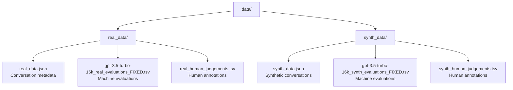
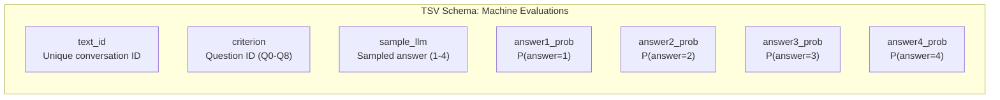
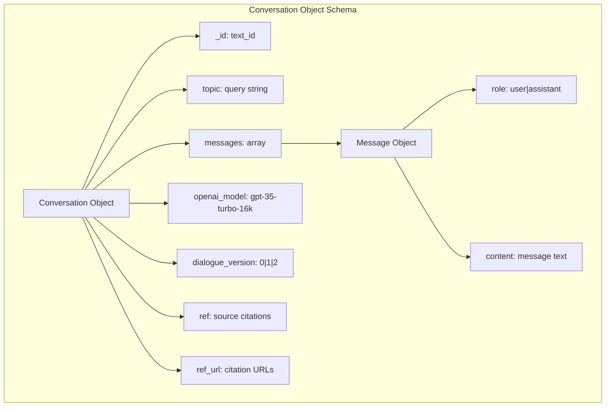
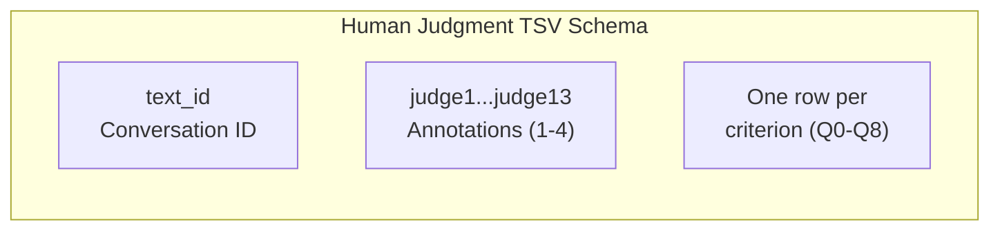
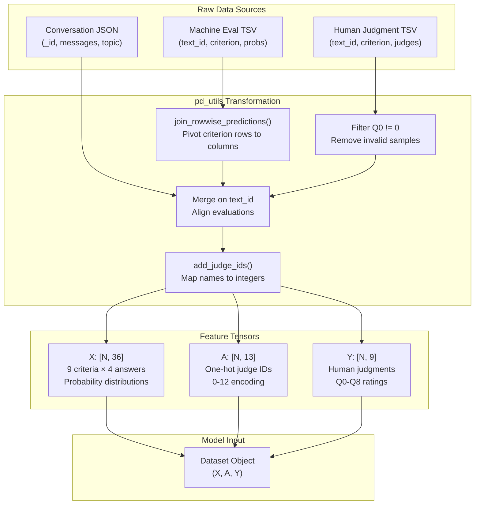
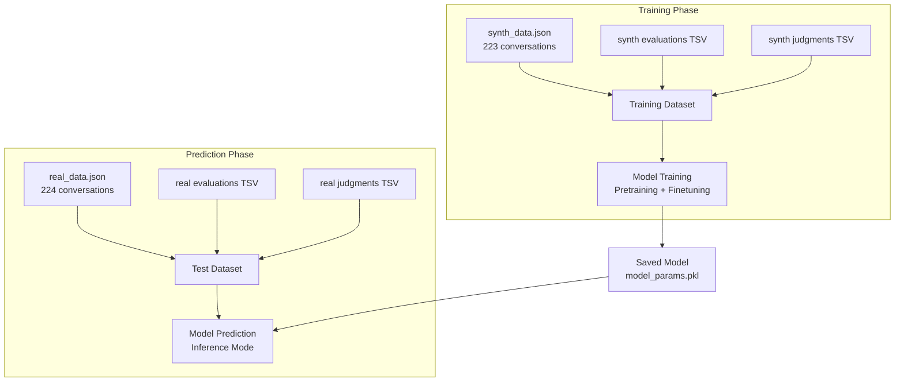

<!-- source: DeepWiki mcp.deepwiki.com · repo microsoft/LLM-Rubric · page 5 Data Reference · fetched 2026-10-26 -->

# Data Reference

<details>
<summary>Relevant source files</summary>

The following files were used as context for generating this wiki page:

- [data/real_data/gpt-3.5-turbo-16k_real_evaluations_FIXED.tsv](data/real_data/gpt-3.5-turbo-16k_real_evaluations_FIXED.tsv)
- [data/real_data/real_data.json](data/real_data/real_data.json)
- [data/synth_data/synth_data.json](data/synth_data/synth_data.json)

</details>


This page documents the data formats, file structures, and datasets used in the LLM-Rubric system. For information about how this data is processed and transformed into model inputs, see [Data Processing Utilities](#8.1). For information about the evaluation framework that uses this data, see [Evaluating Results](#4.4).

## Overview

The LLM-Rubric system operates on three primary data categories:

1. **Conversation Data**: Natural language conversations between users and assistants (both real and synthetic)
2. **Machine Evaluations**: Probability distributions generated by `gpt-3.5-turbo-16k` for each criterion
3. **Human Judgments**: Ground truth annotations from human judges on a 1-4 scale

All data is stored in JSON and TSV formats in the `data/` directory, with separate subdirectories for real and synthetic data.

## Data Directory Structure



**Data Directory Organization**

Sources: Inferred from file paths [data/real_data/gpt-3.5-turbo-16k_real_evaluations_FIXED.tsv:1-1](), [data/real_data/real_data.json:1-1](), [data/synth_data/synth_data.json:1-1]()

## Machine Evaluation Format (TSV)

Machine evaluations are stored in tab-separated value files with the following schema:



**Machine Evaluation TSV Schema**

### Column Definitions

| Column | Type | Description | Example |
|--------|------|-------------|---------|
| `text_id` | String | Unique identifier for the conversation | `"65ca24fff174b28977037c42"` |
| `criterion` | String | Evaluation criterion (Q0-Q8) | `"Q0"`, `"Q7"`, `"Q8"` |
| `sample_llm` | Integer | Single sampled answer (1-4) | `3` |
| `answer1_prob` | Float | Probability for answer=1 | `0.0005776092695876` |
| `answer2_prob` | Float | Probability for answer=2 | `0.0391112894058126` |
| `answer3_prob` | Float | Probability for answer=3 | `0.2687755532877596` |
| `answer4_prob` | Float | Probability for answer=4 | `0.6915355480368401` |

### Criteria (Q0-Q8)

The system evaluates conversations on 9 criteria:
- **Q0**: Overall quality assessment
- **Q1-Q8**: Specific dimensions of conversation quality (detailed rubric definitions available in evaluation prompts)

### Data Characteristics

- Probabilities sum to 1.0 for each row (answer1_prob + answer2_prob + answer3_prob + answer4_prob = 1.0)
- Q8 always has `answer4_prob = 0.0` (only 3 answer options for this criterion)
- Each conversation (`text_id`) has 9 rows, one per criterion
- File format: UTF-8 encoded TSV with header row

Sources: [data/real_data/gpt-3.5-turbo-16k_real_evaluations_FIXED.tsv:1-10](), [data/real_data/gpt-3.5-turbo-16k_real_evaluations_FIXED.tsv:225-232]()

## Conversation Data Format (JSON)

Conversation data is stored as JSON arrays containing conversation objects.



**Conversation JSON Schema**

### Real Conversation Object

```json
{
  "_id": "65c5b4b9f174b2897703736a",
  "topic": "rich client v3.4.1.35249",
  "messages": [
    {"role": "assistant", "content": "Hello! How can I assist you today?"},
    {"role": "user", "content": "Hey!Can you tell me something about rich client..."},
    {"role": "assistant", "content": "Sure! A rich client is a software..."}
  ],
  "openai_model": "gpt-35-turbo-16k",
  "dialogue_version": 2,
  "ref": "\n\nSources:\n[1]: URL: https://...",
  "ref_url": "[1]: https://..."
}
```

### Synthetic Conversation Object

```json
{
  "_id": "V1_10",
  "query": "aks vs service fabric",
  "prompt": [
    {"role": "system", "content": "You are a helpful assistant."},
    {"role": "user", "content": "A user wants to know about..."}
  ],
  "dialogue": "User: Hi, can you help me understand..."
}
```

### Field Definitions

| Field | Type | Dataset | Description |
|-------|------|---------|-------------|
| `_id` | String | Both | Unique conversation identifier; matches `text_id` in TSV files |
| `topic` | String | Real | User's original query or topic |
| `query` | String | Synthetic | Template query used to generate the conversation |
| `messages` | Array | Real | Structured message history with role and content |
| `dialogue` | String | Synthetic | Plain text representation of the conversation |
| `openai_model` | String | Real | Model used: `"gpt-35-turbo-16k"` |
| `dialogue_version` | Integer | Real | Version number: 0, 1, or 2 |
| `prompt` | Array | Synthetic | System and user prompts used for generation |
| `ref` | String | Real | Formatted reference text with citations |
| `ref_url` | String | Real | Reference URLs used in conversation |

Sources: [data/real_data/real_data.json:1-1](), [data/synth_data/synth_data.json:1-1]()

## Human Judgment Format (TSV)

Human judgments are stored in TSV files with judge annotations for each conversation and criterion.



**Human Judgment Schema Overview**

### Schema Structure

The human judgment files contain:
- **Rows**: One row per (conversation, criterion) pair
- **Columns**: `text_id`, `criterion`, `judge1`, `judge2`, ..., `judge13`
- **Values**: Integer ratings from 1 to 4, or 0 for invalid/missing judgments

### Column Layout

| Position | Column Name | Description |
|----------|-------------|-------------|
| 1 | `text_id` | Links to conversation ID in JSON files |
| 2 | `criterion` | Question identifier (Q0, Q1, ..., Q8) |
| 3-15 | `judge1` ... `judge13` | Individual judge ratings (1-4 scale) |

### Data Quality Indicators

- **Q0 = 0**: Invalid or incomplete conversations filtered out during preprocessing
- **Missing values**: Represented as 0 or empty cells
- **13 judges**: System supports up to 13 different human annotators

Sources: Inferred from system architecture and data processing utilities

## Data Processing Pipeline



**End-to-End Data Processing Flow**

### Transformation Steps

1. **Row-wise to Column-wise** (`join_rowwise_predictions()`): Converts 9 rows per conversation into 36 feature columns
   - Input: 9 rows × 4 probabilities = 36 values
   - Output: 1 row × 36 columns per conversation

2. **Quality Filtering**: Removes conversations where Q0 = 0 (invalid samples)

3. **Data Alignment** (`merge on text_id`): Joins machine evaluations with human judgments using conversation IDs

4. **Judge Encoding** (`add_judge_ids()`): Maps judge names to integer IDs (0-12) for model input

5. **Tensor Creation**: Produces three aligned tensors (X, A, Y) wrapped in a `Dataset` object

### Data Dimensions

| Tensor | Shape | Description |
|--------|-------|-------------|
| **X** | `[N, 36]` | Machine evaluation features: 9 criteria × 4 answer probabilities |
| **A** | `[N, 13]` | Judge identification: One-hot encoded vectors for 13 judges |
| **Y** | `[N, 9]` | Target labels: Human judgment scores for Q0-Q8 |

Where `N` is the number of (conversation, judge) pairs after filtering.

Sources: [llm_rubric/pd_utils.py]() (referenced in Diagram 5)

## Dataset Statistics

### Real Conversation Dataset

- **Total conversations**: 224 unique conversations
- **Conversation topics**: Azure services, technical troubleshooting, cloud infrastructure
- **Average conversation length**: 3-7 message exchanges
- **Dialogue versions**: 0, 1, and 2 (different generation strategies)

### Synthetic Training Dataset

- **Total conversations**: 223 synthetic conversations
- **Query templates**: Predefined Azure-related queries
- **Purpose**: Hyperparameter tuning and model pretraining
- **Generation**: Systematic variation of conversation patterns

### Annotation Coverage

- **Human judges**: 13 annotators
- **Criteria evaluated**: 9 dimensions (Q0-Q8)
- **Total annotations**: ~224 conversations × 9 criteria × 13 judges = ~26,000 individual judgments
- **Machine evaluations**: Complete coverage for all conversations and criteria

Sources: Inferred from file samples and system documentation

## Data Usage in Training vs. Prediction



**Data Split Strategy: Training on Synthetic, Testing on Real**

The LLM-Rubric system uses a unique data split strategy:
- **Synthetic data** (223 samples) is used for training with k-fold cross-validation
- **Real data** (224 samples) is held out entirely for final evaluation
- This approach tests the model's ability to generalize from synthetic training data to real conversations

Sources: Inferred from Diagram 3 in system overview

## Data Validation Rules

The system enforces several data quality constraints:

1. **Probability Constraints**
   - All `answer{1-4}_prob` values must sum to 1.0 (±0.0001 tolerance)
   - Q8 always has `answer4_prob = 0.0` (3-answer criterion)

2. **ID Consistency**
   - `text_id` in TSV files must match `_id` in JSON files
   - Each `text_id` must have exactly 9 rows (Q0-Q8) in evaluation files

3. **Rating Validity**
   - Human judgments must be integers in range [0, 4]
   - Q0 = 0 indicates invalid conversation (filtered out)

4. **Judge Coverage**
   - Not all judges annotate all conversations
   - Missing annotations represented as 0 or empty values

Sources: Inferred from data processing logic and file formats

---

