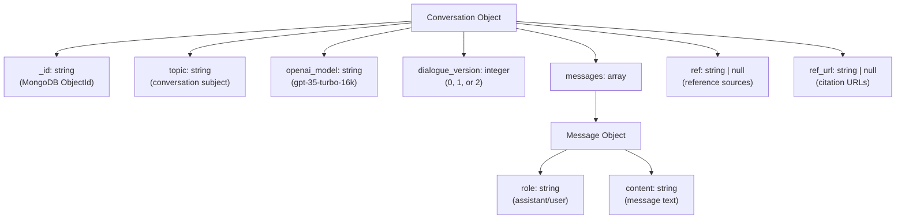
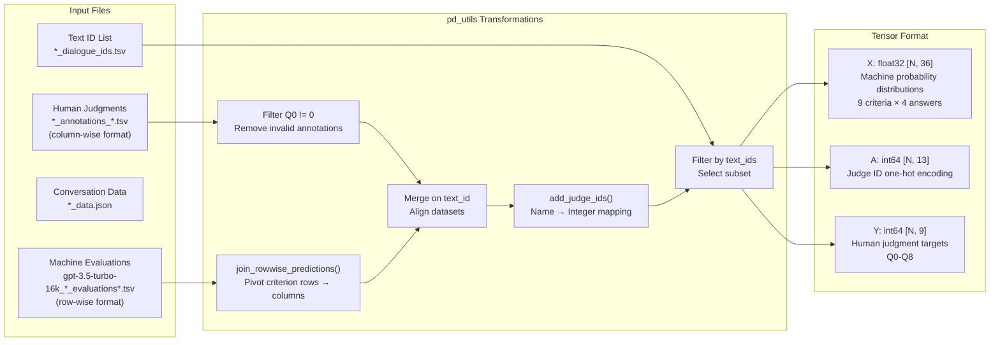
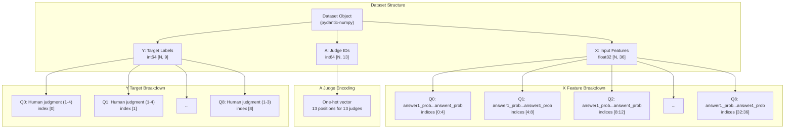

<!-- source: DeepWiki mcp.deepwiki.com · repo microsoft/LLM-Rubric · page 5.1 Data Formats and Schema · fetched 2026-10-26 -->

# Data Formats and Schema

<details>
<summary>Relevant source files</summary>

The following files were used as context for generating this wiki page:

- [data/real_data/gpt-3.5-turbo-16k_real_evaluations_FIXED.tsv](data/real_data/gpt-3.5-turbo-16k_real_evaluations_FIXED.tsv)
- [data/real_data/real_data.json](data/real_data/real_data.json)
- [data/real_data/real_dialogue_ids.tsv](data/real_data/real_dialogue_ids.tsv)
- [data/synth_data/synth_data.json](data/synth_data/synth_data.json)

</details>


## Purpose and Scope

This page documents the data formats and schemas used throughout the LLM-Rubric system. It covers the structure of input data files (TSV and JSON formats), the organization of machine evaluations and human judgments, and how raw data is transformed into model-ready tensors.

For information about the actual datasets provided with this repository, see [Real Conversation Dataset](#5.2). For details on the machine evaluation generation process, see [Machine Evaluations](#5.3).

## Overview

The LLM-Rubric system processes three primary types of data:

1. **Machine Evaluations**: LLM-generated probability distributions over answer choices for each rubric criterion (TSV format)
2. **Human Judgments**: Ground truth annotations from human judges for each rubric criterion (TSV format)
3. **Conversation Data**: Natural language conversations with metadata (JSON format)

All data files are identified by a unique `text_id` that serves as the primary key linking conversations, machine evaluations, and human judgments together.

## Machine Evaluation Format

Machine evaluations are stored in TSV files with a **row-wise format** where each row represents one criterion's evaluation for one conversation.

### Schema

| Column | Type | Description |
|--------|------|-------------|
| `text_id` | string | Unique identifier for the conversation (MongoDB ObjectId format) |
| `criterion` | string | Rubric criterion identifier: `Q0`, `Q1`, `Q2`, ..., `Q8` |
| `sample_llm` | integer | Sampled answer (1-4) drawn from the probability distribution |
| `answer1_prob` | float | Probability assigned to answer choice 1 |
| `answer2_prob` | float | Probability assigned to answer choice 2 |
| `answer3_prob` | float | Probability assigned to answer choice 3 |
| `answer4_prob` | float | Probability assigned to answer choice 4 |

### File Structure

```
text_id	criterion	sample_llm	answer1_prob	answer2_prob	answer3_prob	answer4_prob
65ca24fff174b28977037c42	Q0	4	0.0005776093	0.0391112894	0.2687755533	0.6915355480
65ca24fff174b28977037c42	Q8	3	0.3877684112	0.2447416301	0.3674897339	0.0
65ca24fff174b28977037c42	Q7	4	0.0308410579	0.1814291557	0.5253201840	0.2624096024
...
```

### Key Properties

- **9 rows per conversation**: One row for each criterion (Q0-Q8)
- **4 answer choices**: The probability distribution sums to 1.0 (or close to 1.0 for criteria with fewer valid answers)
- **Zero probabilities**: Some criteria (e.g., Q8) have `answer4_prob = 0.0` because only 3 answer choices are valid
- **Row-wise organization**: Requires pivoting to columnar format for model input (see [Data Processing Utilities](#8.1))

### File Locations

- Real data: [data/real_data/gpt-3.5-turbo-16k_real_evaluations_FIXED.tsv:1-448]()
- Synthetic data: Similar structure in synthetic data directory

Sources: [data/real_data/gpt-3.5-turbo-16k_real_evaluations_FIXED.tsv:1-448]()

## Human Judgment Format

Human judgments are stored in TSV files with a **column-wise format** where each row represents all judgments for one conversation by one judge.

### Schema

| Column | Type | Description |
|--------|------|-------------|
| `text_id` | string | Unique identifier for the conversation |
| `judge` | string | Human annotator identifier (e.g., "Judge1", "Judge2", ..., "Judge13") |
| `Q0` | integer | Human judgment for criterion Q0 (1-4 scale) |
| `Q1` | integer | Human judgment for criterion Q1 (1-4 scale) |
| `Q2` | integer | Human judgment for criterion Q2 (1-4 scale) |
| `Q3` | integer | Human judgment for criterion Q3 (1-4 scale) |
| `Q4` | integer | Human judgment for criterion Q4 (1-4 scale) |
| `Q5` | integer | Human judgment for criterion Q5 (1-4 scale) |
| `Q6` | integer | Human judgment for criterion Q6 (1-4 scale) |
| `Q7` | integer | Human judgment for criterion Q7 (1-4 scale) |
| `Q8` | integer | Human judgment for criterion Q8 (1-3 scale) |

### Key Properties

- **Column-wise organization**: Each rubric criterion is a separate column
- **Q0 special handling**: Q0 serves as a validity filter; rows with `Q0 = 0` are excluded from analysis
- **Multiple judges**: Each conversation may have judgments from multiple judges (typically 13 judges)
- **Rating scale**: Most criteria use 1-4 scale; Q8 uses 1-3 scale

### Data Quality Filters

The system applies the following filters when loading human judgments:

1. **Q0 != 0**: Exclude invalid annotations [data/real_data/gpt-3.5-turbo-16k_real_evaluations_FIXED.tsv:2-224]()
2. **Merge on text_id**: Align with machine evaluations and conversation data
3. **Judge ID mapping**: Convert judge names to integer IDs (0-12) for efficient processing

Sources: [data/real_data/gpt-3.5-turbo-16k_real_evaluations_FIXED.tsv:1-448]()

## Conversation Data Format

Conversation data is stored in JSON format with rich metadata and message history.

### Schema



### Example Structure

```json
{
  "_id": "65c5b4b9f174b2897703736a",
  "topic": "rich client v3.4.1.35249",
  "openai_model": "gpt-35-turbo-16k",
  "dialogue_version": 2,
  "messages": [
    {
      "role": "assistant",
      "content": "Hello! How can I assist you today?"
    },
    {
      "role": "user",
      "content": "Hey!Can you tell me something about rich client v3.4.1.35249"
    },
    {
      "role": "assistant",
      "content": "Sure! A rich client is a software..."
    }
  ],
  "ref": "Sources:\n[1]: URL: https://...",
  "ref_url": "[1]: https://..."
}
```

### Key Fields

- **`_id`**: Primary key matching `text_id` in evaluation files
- **`messages`**: Alternating assistant/user messages forming the conversation
- **`dialogue_version`**: Indicates generation method (0 = no references, 1 = with references, 2 = specific format)
- **`ref` and `ref_url`**: Optional citation information for reference-grounded conversations

### File Locations

- Real conversations: [data/real_data/real_data.json:1]()
- Synthetic conversations: [data/synth_data/synth_data.json:1]()

Sources: [data/real_data/real_data.json:1](), [data/synth_data/synth_data.json:1]()

## Data Transformation Pipeline

The raw data formats are transformed into model-ready tensors through a multi-step process handled by `pd_utils`.



### Transformation Steps

1. **`join_rowwise_predictions()`**: Pivots machine evaluations from 9 rows per conversation to 36 columns (9 criteria × 4 probability values)
2. **Filter Q0 != 0**: Removes invalid human annotations
3. **Merge on text_id**: Combines machine evaluations and human judgments
4. **`add_judge_ids()`**: Maps judge names to integer IDs (0-12) for one-hot encoding
5. **Filter by text_ids**: Selects specific conversations based on train/test splits

Sources: Diagram 5 from system architecture

## Model-Ready Dataset Schema

After transformation, data is packaged into a `Dataset` object with three tensor components.

### Tensor Dimensions



### Tensor Specifications

| Tensor | Shape | dtype | Description |
|--------|-------|-------|-------------|
| **X** | `[N, 36]` | `float32` | LLM probability distributions for all criteria |
| **A** | `[N, 13]` | `int64` | One-hot encoded judge IDs (13 judges) |
| **Y** | `[N, 9]` | `int64` | Human judgment targets (Q0-Q8) |

Where `N` is the number of samples (conversation × judge pairs).

### Feature Index Mapping

The 36 features in `X` are organized as:

```
X[:, 0:4]   → Q0: [answer1_prob, answer2_prob, answer3_prob, answer4_prob]
X[:, 4:8]   → Q1: [answer1_prob, answer2_prob, answer3_prob, answer4_prob]
X[:, 8:12]  → Q2: [answer1_prob, answer2_prob, answer3_prob, answer4_prob]
X[:, 12:16] → Q3: [answer1_prob, answer2_prob, answer3_prob, answer4_prob]
X[:, 16:20] → Q4: [answer1_prob, answer2_prob, answer3_prob, answer4_prob]
X[:, 20:24] → Q5: [answer1_prob, answer2_prob, answer3_prob, answer4_prob]
X[:, 24:28] → Q6: [answer1_prob, answer2_prob, answer3_prob, answer4_prob]
X[:, 28:32] → Q7: [answer1_prob, answer2_prob, answer3_prob, answer4_prob]
X[:, 32:36] → Q8: [answer1_prob, answer2_prob, answer3_prob, answer4_prob]
```

The 9 targets in `Y` are:

```
Y[:, 0] → Q0 human judgment
Y[:, 1] → Q1 human judgment
Y[:, 2] → Q2 human judgment
Y[:, 3] → Q3 human judgment
Y[:, 4] → Q4 human judgment
Y[:, 5] → Q5 human judgment
Y[:, 6] → Q6 human judgment
Y[:, 7] → Q7 human judgment
Y[:, 8] → Q8 human judgment
```

Sources: Diagram 5 from system architecture

## Text ID Reference Files

Text ID files provide lists of conversation identifiers for specific datasets or splits.

### Schema

```
text_id
65c5b4b9f174b2897703736a
65c5b90bf174b28977037378
65c5c73ef174b289770373a2
...
```

### Purpose

- Define train/test splits
- Select subsets of conversations for evaluation
- Ensure consistent data partitioning across experiments

### File Locations

- Real dialogue IDs: [data/real_data/real_dialogue_ids.tsv:1-225]()

Sources: [data/real_data/real_dialogue_ids.tsv:1-225]()

## Data Format Summary

| Data Type | Format | Structure | File Pattern |
|-----------|--------|-----------|--------------|
| Machine Evaluations | TSV | Row-wise (9 rows/conversation) | `*_evaluations*.tsv` |
| Human Judgments | TSV | Column-wise (9 columns Q0-Q8) | `*_annotations*.tsv` |
| Conversations | JSON | Nested objects with messages | `*_data.json` |
| Text IDs | TSV | Single column list | `*_dialogue_ids.tsv` |
| Model Tensors | NumPy | 3D arrays (X, A, Y) | In-memory Dataset object |

All data is linked via the `text_id` field, which serves as the primary key across all file types.

Sources: [data/real_data/gpt-3.5-turbo-16k_real_evaluations_FIXED.tsv:1-448](), [data/real_data/real_data.json:1](), [data/synth_data/synth_data.json:1](), [data/real_data/real_dialogue_ids.tsv:1-225]()

---

