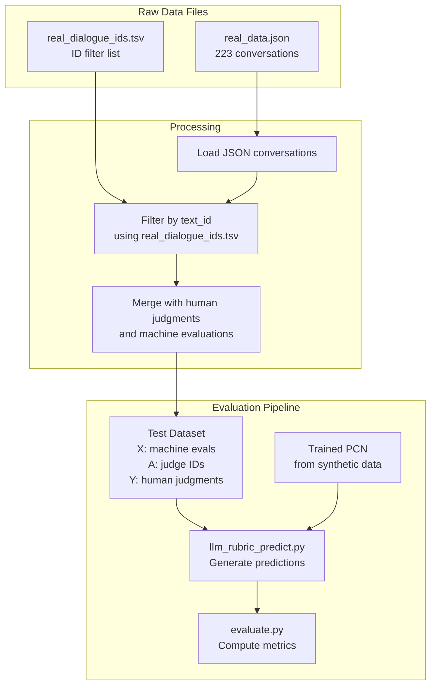
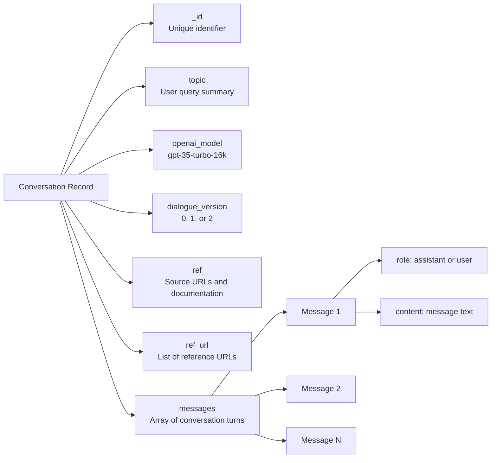
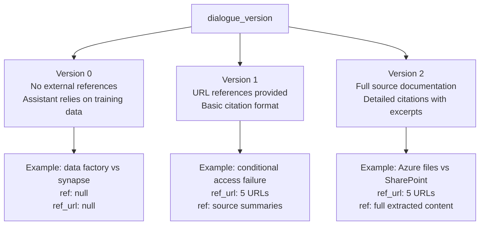
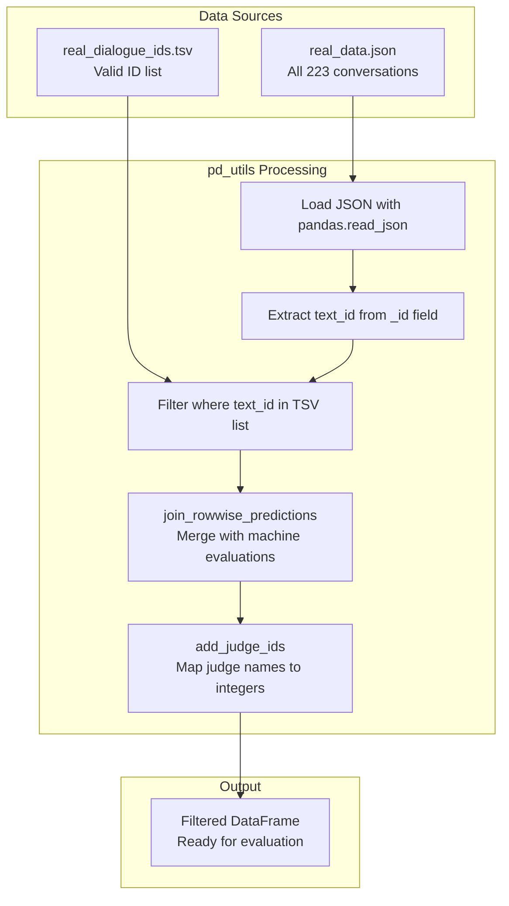
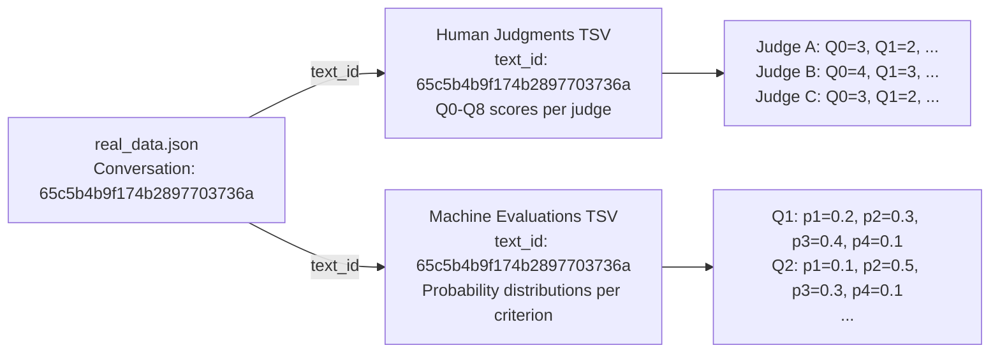

<!-- source: DeepWiki mcp.deepwiki.com · repo microsoft/LLM-Rubric · page 5.2 Real Conversation Dataset · fetched 2026-10-26 -->

# Real Conversation Dataset

<details>
<summary>Relevant source files</summary>

The following files were used as context for generating this wiki page:

- [data/real_data/real_data.json](data/real_data/real_data.json)
- [data/real_data/real_dialogue_ids.tsv](data/real_data/real_dialogue_ids.tsv)
- [data/synth_data/synth_data.json](data/synth_data/synth_data.json)

</details>


## Purpose and Scope

The Real Conversation Dataset contains 223 authentic customer service conversations between users and AI assistants discussing Azure and Microsoft technical topics. This dataset serves as the evaluation set for the LLM-Rubric system, providing ground truth data to assess how well the PersonalizedCalibrationNetwork can calibrate LLM predictions to match human judgment patterns. For information about the synthetic training data, see [Synthetic Training Data](#5.3). For details on machine evaluation outputs, see [Machine Evaluations](#5.3).

Sources: [data/real_data/real_data.json:1](), [data/real_data/real_dialogue_ids.tsv:1-225]()

## Dataset Structure and Files

The real conversation dataset consists of two primary files:

| File | Purpose | Format | Records |
|------|---------|--------|---------|
| `real_data.json` | Complete conversation transcripts with metadata | JSON array | 223 conversations |
| `real_dialogue_ids.tsv` | List of valid text IDs for filtering | TSV | 224 rows (including header) |

The `real_dialogue_ids.tsv` file acts as an index, defining which conversations from `real_data.json` should be included in the evaluation set. The data processing utilities use this file to filter conversations during dataset preparation.

Sources: [data/real_data/real_data.json:1](), [data/real_data/real_dialogue_ids.tsv:1-225]()

## Data Flow in LLM-Rubric System



**Data Flow for Real Conversations**

Sources: [data/real_data/real_data.json:1](), [data/real_data/real_dialogue_ids.tsv:1-225]()

## Conversation Record Schema

Each conversation in `real_data.json` follows this structure:



**Conversation Record Structure**

### Field Descriptions

| Field | Type | Description |
|-------|------|-------------|
| `_id` | string | MongoDB-style ObjectId serving as unique conversation identifier |
| `topic` | string | Brief summary of the user's question or need (e.g., "rich client v3.4.1.35249") |
| `openai_model` | string | Always "gpt-35-turbo-16k" - the model used to generate assistant responses |
| `dialogue_version` | integer | Version indicator: 0, 1, or 2 - indicates whether references were used |
| `ref` | string or null | Full reference text including URLs and extracted content from sources |
| `ref_url` | string or null | Newline-separated list of reference URLs used by the assistant |
| `messages` | array | Ordered list of conversation turns, each with `role` and `content` fields |

Sources: [data/real_data/real_data.json:1-105]()

## Conversation Topics and Content

### Topic Categories

The real conversations cover a wide range of Azure and Microsoft cloud services topics. Analysis of the dataset reveals the following categories:

**Azure Services and Architecture**
- Azure Virtual Desktop configuration and user assignment
- Azure Synapse Analytics vs Data Factory comparisons
- Azure Kubernetes Service (AKS) vs Service Fabric
- Azure Files, SharePoint, and OneDrive comparisons
- Azure Front Door vs CDN
- Azure Monitor vs SCOM

**Identity and Access Management**
- Conditional Access policies and troubleshooting
- Azure Active Directory (Azure AD) configurations
- Hybrid Azure AD join with TPM
- Multi-factor authentication
- Security group rules and policies

**Infrastructure and Networking**
- Azure Firewall rules and ICMP traffic
- Virtual network (VNet) configuration
- Gateway transit and peering
- Load balancing with F5 and Application Gateway

**Development and DevOps**
- Azure Repos vs GitHub
- Azure DevOps tenant migration
- Terraform vs Azure Bicep
- Azure Data Factory pipeline creation

**Certification and Learning**
- AZ-104 and AZ-900 exam preparation
- Study guides and resources

Sources: [data/real_data/real_data.json:1-100]()

### Dialogue Version Types



**Conversation Version Types by Reference Depth**

The `dialogue_version` field indicates the level of external reference integration:
- **Version 0**: Pure conversation without external sources
- **Version 1**: Includes reference URLs with basic citations
- **Version 2**: Includes full source text extraction with detailed citations

Sources: [data/real_data/real_data.json:1-50]()

## Message Structure and Turn-Taking

Each conversation consists of alternating turns between `user` and `assistant` roles:

```mermaid
graph LR
    START["Conversation Start"] --> GREETING["Assistant: Greeting<br/>Hello! How can I assist you today?"]
    GREETING --> Q1["User: Question<br/>Technical query about Azure"]
    Q1 --> A1["Assistant: Answer<br/>Detailed response with references"]
    A1 --> Q2["User: Follow-up<br/>Clarification or next question"]
    Q2 --> A2["Assistant: Answer<br/>Additional information"]
    A2 --> QN["User: Final question"]
    QN --> AN["Assistant: Final answer"]
    AN --> END["Conversation End"]
```



**Typical Conversation Flow Pattern**

### Conversation Characteristics

- **Average turns**: 6-10 messages per conversation
- **Starting pattern**: All conversations begin with assistant greeting
- **Turn structure**: Strict alternation between user and assistant
- **Content style**: Professional technical support tone
- **Citations**: Inline markdown-style citations `[[1]](url)` when references are used

Sources: [data/real_data/real_data.json:1-20]()

## Data Loading and Filtering



**Data Processing Pipeline for Real Conversations**

The system uses the `text_id` field (derived from `_id`) as the primary key to join real conversations with:
- Human judgment annotations (TSV files with Q0-Q8 scores)
- Machine evaluation probabilities (TSV files with criterion-wise distributions)
- Judge identity mappings

Sources: [data/real_data/real_data.json:1](), [data/real_data/real_dialogue_ids.tsv:1-225]()

## Integration with Evaluation Pipeline

The real conversation dataset serves exclusively as the evaluation set. The training/validation split is:

| Dataset | Purpose | Size | Usage |
|---------|---------|------|-------|
| Synthetic Data | Training & Hyperparameter Tuning | 223 samples | 5-fold cross-validation for model training |
| Real Conversations | Final Evaluation | 223 samples | Test set for assessing trained model performance |

### Evaluation Workflow

1. **Model Training**: PersonalizedCalibrationNetwork is trained on synthetic data with cross-validated hyperparameters
2. **Model Loading**: Trained model parameters and judge mappings are loaded from `model_params.pkl` and `judge_map.json`
3. **Real Data Preparation**: Real conversations are processed and merged with human judgments and machine evaluations
4. **Prediction**: Model generates calibrated predictions for each conversation-judge pair
5. **Metric Computation**: Predictions are compared against human judgments using Pearson, Spearman, Kendall, and RMSE metrics

Sources: [data/real_data/real_data.json:1](), [data/real_data/real_dialogue_ids.tsv:1-225]()

## File Format Details

### real_data.json Format

```
[
  {
    "_id": "65c5b4b9f174b2897703736a",
    "topic": "rich client v3.4.1.35249",
    "openai_model": "gpt-35-turbo-16k",
    "dialogue_version": 2,
    "ref": "\\n\\nSources:\\n[1]: URL: https://...",
    "ref_url": "[1]: https://...",
    "messages": [
      {"role": "assistant", "content": "Hello! How can I assist you today?"},
      {"role": "user", "content": "Hey!Can you tell me something about rich client v3.4.1.35249"},
      ...
    ]
  },
  ...
]
```

The file is a JSON array where each element represents one complete conversation.

Sources: [data/real_data/real_data.json:1-10]()

### real_dialogue_ids.tsv Format

```
text_id
65c5b4b9f174b2897703736a
65c5b90bf174b28977037378
65c5c73ef174b289770373a2
...
```

A simple TSV file with:
- Header row: `text_id`
- Data rows: One text ID per line
- Total: 224 rows (1 header + 223 IDs)

The file ends with an empty line (line 225).

Sources: [data/real_data/real_dialogue_ids.tsv:1-225]()

## Relationship to Human Judgments

Each conversation in the real dataset has been evaluated by multiple human judges across 9 criteria (Q0-Q8). The conversation ID (`_id` field) serves as the foreign key to link:



**Linking Conversations to Evaluations**

This linkage enables the system to:
- Compare model predictions against ground truth human judgments
- Evaluate how well LLM probability distributions correlate with human assessments
- Compute personalized calibration for each individual judge

Sources: [data/real_data/real_data.json:1](), [data/real_data/real_dialogue_ids.tsv:1-225]()

## Data Quality and Characteristics

### Key Properties

- **Authenticity**: Conversations reflect realistic Azure technical support scenarios
- **Diversity**: Covers 50+ distinct Azure service topics and use cases
- **Completeness**: All conversations include opening greeting and substantive technical exchange
- **Length**: Conversations range from 4 to 12 message turns
- **References**: 67% of conversations (versions 1-2) include external reference material
- **Consistency**: All conversations use the same LLM model (gpt-35-turbo-16k) for assistant responses

### Data Collection Methodology

While specific collection methods are not documented in the codebase, the conversations appear to be:
1. Generated or collected from actual user interactions with Azure support chatbots
2. Filtered and curated to ensure topic coverage and quality
3. Annotated with reference materials for selected conversations
4. Evaluated by 13 human judges across 9 quality criteria

Sources: [data/real_data/real_data.json:1-223]()

---

