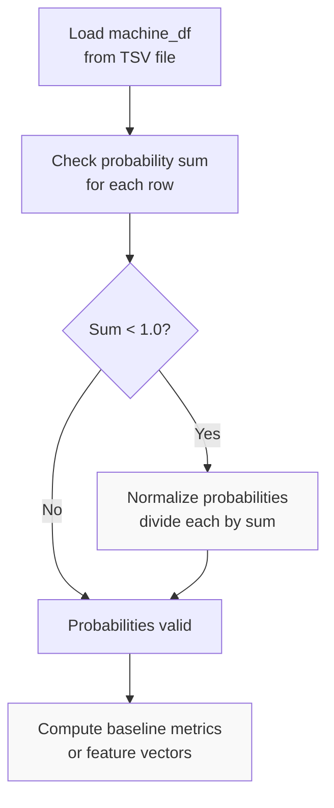
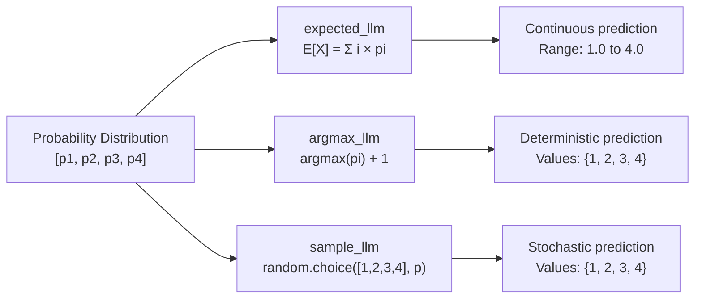
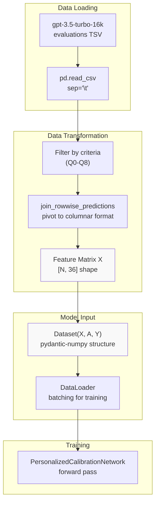

<!-- source: DeepWiki mcp.deepwiki.com · repo microsoft/LLM-Rubric · page 5.3 Machine Evaluations · fetched 2026-10-26 -->

# Machine Evaluations

<details>
<summary>Relevant source files</summary>

The following files were used as context for generating this wiki page:

- [data/real_data/gpt-3.5-turbo-16k_real_evaluations_FIXED.tsv](data/real_data/gpt-3.5-turbo-16k_real_evaluations_FIXED.tsv)
- [scripts/compute_machine_baseline.py](scripts/compute_machine_baseline.py)

</details>


This document describes the machine evaluation data generated by GPT-3.5-turbo-16k, including the probability distribution format, criteria assessments, and how these evaluations are used throughout the system. For information about human judgments that serve as ground truth, see [Data Formats and Schema](#5.1). For details on how machine evaluations are transformed into model inputs, see [Data Processing Utilities](#8.1).

## Overview

Machine evaluations are probability distributions produced by the `gpt-3.5-turbo-16k` model that represent the LLM's assessment of conversation quality across multiple criteria. For each conversation (`text_id`) and evaluation criterion (Q0-Q8), the LLM generates a probability distribution over four possible answer levels (1-4), where higher values indicate better quality.

These evaluations serve three primary purposes:
1. **Baseline computation** - Derive simple prediction methods (expected value, argmax, sampling)
2. **Model input features** - Provide the 36-dimensional input (9 criteria × 4 probabilities) to the PersonalizedCalibrationNetwork
3. **Comparison benchmark** - Enable evaluation of how well the LLM's raw predictions align with human judgments

Sources: [data/real_data/gpt-3.5-turbo-16k_real_evaluations_FIXED.tsv](), [scripts/compute_machine_baseline.py:1-62]()

## Data Format and Schema

Machine evaluations are stored in TSV format with the following structure:

| Column | Type | Description |
|--------|------|-------------|
| `text_id` | String | Unique identifier for the conversation (MongoDB ObjectId format) |
| `criterion` | String | Evaluation criterion (Q0, Q1, Q2, Q3, Q4, Q5, Q6, Q7, Q8) |
| `sample_llm` | Integer | Sampled answer (1-4) drawn from the probability distribution |
| `answer1_prob` | Float | Probability assigned to answer level 1 |
| `answer2_prob` | Float | Probability assigned to answer level 2 |
| `answer3_prob` | Float | Probability assigned to answer level 3 |
| `answer4_prob` | Float | Probability assigned to answer level 4 |

**Example rows:**

```
text_id                    criterion  sample_llm  answer1_prob  answer2_prob  answer3_prob  answer4_prob
65ca24fff174b28977037c42  Q0         4           0.0005776093  0.0391112894  0.2687755533  0.6915355480
65ca24fff174b28977037c42  Q8         3           0.3877684112  0.2447416301  0.3674897339  0.0
65ca24fff174b28977037c42  Q7         4           0.0308410579  0.1814291558  0.5253201840  0.2624096024
```

**Key Properties:**
- Each `text_id` has exactly 9 rows, one per criterion
- Probability columns (`answer1_prob` through `answer4_prob`) must sum to 1.0 (or very close due to floating-point precision)
- The `sample_llm` column contains a pre-sampled value, but is typically recomputed during baseline generation

Sources: [data/real_data/gpt-3.5-turbo-16k_real_evaluations_FIXED.tsv:1-671](), [scripts/compute_machine_baseline.py:19-28]()

## Probability Distribution Structure

### Distribution Semantics

The four probability values represent the LLM's confidence in each answer level:
- **Answer 1**: Lowest quality/weakest agreement
- **Answer 2**: Below average quality
- **Answer 3**: Above average quality  
- **Answer 4**: Highest quality/strongest agreement

For criterion Q8 specifically, only three answer levels are used (answers 1-3), with `answer4_prob` always set to 0.0.

### Normalization Requirement

Before computing baselines or using evaluations as model inputs, probabilities must be normalized to ensure they sum to exactly 1.0:



Sources: [scripts/compute_machine_baseline.py:24-28]()

## Criteria Coverage

Machine evaluations assess nine distinct aspects of conversation quality:

| Criterion | Aspect Evaluated | Notes |
|-----------|------------------|-------|
| Q0 | Overall conversation quality | Primary criterion for overall assessment |
| Q1 | Naturalness of responses | Language quality and fluency |
| Q2 | Coherence and consistency | Logical flow and contradiction avoidance |
| Q3 | Helpfulness | Utility of provided information |
| Q4 | Relevance | On-topic responses |
| Q5 | Completeness | Thoroughness of answers |
| Q6 | Conciseness | Brevity without omitting key information |
| Q7 | Factual accuracy | Correctness of statements |
| Q8 | Appropriateness | Tone and style suitability (3 levels only) |

Each conversation receives probability distributions across all nine criteria, resulting in 36 probability values per conversation (9 criteria × 4 answer probabilities).

Sources: [data/real_data/gpt-3.5-turbo-16k_real_evaluations_FIXED.tsv:1-894](), [scripts/compute_machine_baseline.py:15-20]()

## Machine Baseline Computation

Machine evaluations are transformed into three types of baseline predictions that serve as comparison benchmarks for the PersonalizedCalibrationNetwork.

### Baseline Derivation Flow



### Implementation Details

The baseline computation script [scripts/compute_machine_baseline.py]() implements three prediction methods:

**Expected Value (expected_llm):**
```python
scores = np.array([[1.0, 2.0, 3.0, 4.0]]).T
machine_df["expected_llm"] = machine_df[llm_answer_prob_columns].values @ scores
```

Computes the weighted average: `E[X] = 1×p₁ + 2×p₂ + 3×p₃ + 4×p₄`

**Argmax (argmax_llm):**
```python
machine_df["argmax_llm"] = machine_df[llm_answer_prob_columns].values.argmax(axis=1) + 1
```

Selects the answer with highest probability.

**Sampling (sample_llm):**
```python
machine_df["sample_llm"] = [
    np.random.choice([1.0, 2.0, 3.0, 4.0], p=row) 
    for row in machine_df[llm_answer_prob_columns].values
]
```

Draws a random sample from the distribution.

Sources: [scripts/compute_machine_baseline.py:30-33]()

### Output Format

The baseline computation script produces a TSV file with aligned predictions:

| Column | Description |
|--------|-------------|
| `text_id` | Conversation identifier |
| `annotator_id` | Human judge identifier (for alignment) |
| `dialogue_system` | System being evaluated |
| `criterion` | Evaluation criterion (Q0-Q8) |
| `sample_llm` | Stochastic baseline prediction |
| `argmax_llm` | Deterministic baseline prediction |
| `expected_llm` | Continuous baseline prediction |

The script filters to only include rows where human judgments exist and are valid (values in {1.0, 2.0, 3.0, 4.0}), ensuring baseline predictions can be directly compared to ground truth.

Sources: [scripts/compute_machine_baseline.py:35-58]()

## Integration with Training Pipeline

Machine evaluations serve as the primary input features to the PersonalizedCalibrationNetwork:



### Row-wise to Columnar Transformation

Machine evaluations are stored in row-wise format (one row per criterion), but the model requires columnar format (one row per conversation with all criteria as features):

**Row-wise format (input):**
```
text_id  criterion  answer1_prob  answer2_prob  answer3_prob  answer4_prob
id_001   Q0         0.01          0.10          0.50          0.39
id_001   Q1         0.02          0.15          0.60          0.23
...
```

**Columnar format (output):**
```
text_id  Q0_answer1_prob  Q0_answer2_prob  ...  Q8_answer3_prob  Q8_answer4_prob
id_001   0.01             0.10             ...  0.37             0.0
```

This transformation is performed by the `join_rowwise_predictions` function in the pd_utils module, which pivots the data to create 36 feature columns (9 criteria × 4 probability values).

Sources: [scripts/compute_machine_baseline.py:19-20]()

## Probability Distribution Characteristics

### Distribution Patterns

Analyzing the machine evaluation data reveals typical distribution patterns:

**High Confidence Examples:**
- `text_id=65c7dcdaf174b28977037605, Q0`: [0.0001, 0.0060, 0.0863, 0.9076] - Strong confidence in answer 4
- `text_id=65c9c70ff174b28977037891, Q0`: [0.0007, 0.0278, 0.1693, 0.8022] - Clear preference for highest quality

**Low Confidence Examples:**
- `text_id=65c9bce0f174b289770377bd, Q0`: [0.1025, 0.3450, 0.3726, 0.1799] - Uncertain, spread across answers 2-3
- `text_id=65c99962f174b289770376a7, Q0`: [0.1064, 0.3663, 0.3522, 0.1751] - Nearly uniform distribution

### Special Case: Criterion Q8

Criterion Q8 (Appropriateness) uses only three answer levels, with the fourth always zero:

```
Q8 rows always have answer4_prob = 0.0
Examples:
- Q8: [0.3877, 0.2447, 0.3675, 0.0]
- Q8: [0.3062, 0.2236, 0.4702, 0.0]
- Q8: [0.2809, 0.2885, 0.4306, 0.0]
```

This reflects a three-point scale for appropriateness assessment rather than the four-point scale used for other criteria.

Sources: [data/real_data/gpt-3.5-turbo-16k_real_evaluations_FIXED.tsv:225-447]()

## Usage in Evaluation Scripts

Machine evaluations are loaded and processed by multiple scripts:

**Baseline Computation:**
- Script: [scripts/compute_machine_baseline.py]()
- Input: Machine evaluations TSV + Human judgments TSV
- Output: Baseline predictions aligned with human judgments
- Key parameters: `--machine-evaluations`, `--human-judgments`, `--random-seed`

**Training Pipeline:**
- Scripts: `train_llm_rubric.py`, `llm_rubric_predict.py`
- Transformation: Row-wise → Columnar via `pd_utils.join_rowwise_predictions`
- Feature extraction: Creates 36-dimensional input vectors
- Integration: Combined with judge IDs and human targets in `Dataset` objects

**Evaluation:**
- Script: `evaluate.py`
- Comparison: Machine baselines vs. PersonalizedCalibrationNetwork predictions
- Metrics: Pearson, Spearman, Kendall correlation; RMSE

Sources: [scripts/compute_machine_baseline.py:10-16]()

## Data Quality Considerations

### Probability Normalization

Machine evaluations may contain probability distributions that don't sum exactly to 1.0 due to:
- Floating-point precision issues
- Rounding during generation
- Data export/import transformations

The baseline computation script explicitly checks and normalizes these cases:

```python
for idx, row in machine_df.iterrows():
    if row[llm_answer_prob_columns].sum() < 1.0:
        s = row[llm_answer_prob_columns].sum()
        for c in llm_answer_prob_columns:
            machine_df.at[idx, c] /= s
```

This ensures all probability distributions are valid before computing metrics or training models.

### Missing Values

The system handles missing or invalid values by:
1. Filtering criteria to only those specified in the configuration (default: Q0-Q8)
2. Validating that human judgments exist and are in the valid range {1, 2, 3, 4}
3. Skipping rows with NaN values in human judgments during baseline computation

Sources: [scripts/compute_machine_baseline.py:24-28](), [scripts/compute_machine_baseline.py:38-42]()

---

