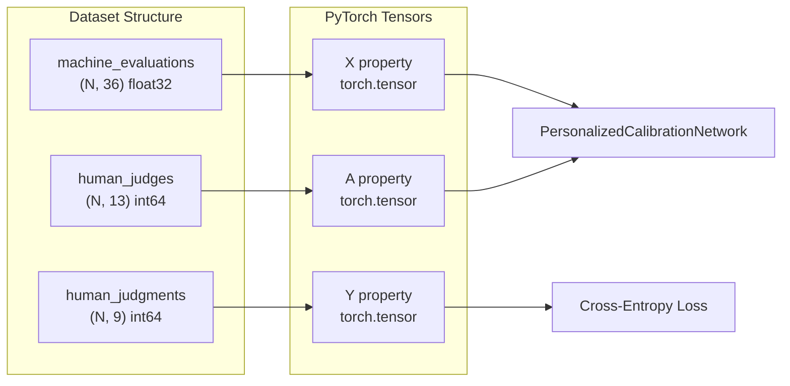
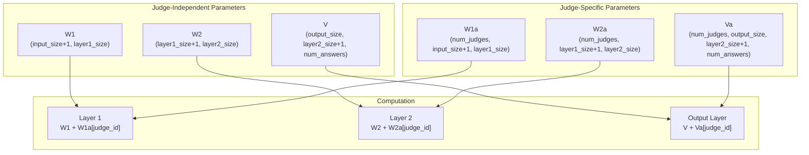
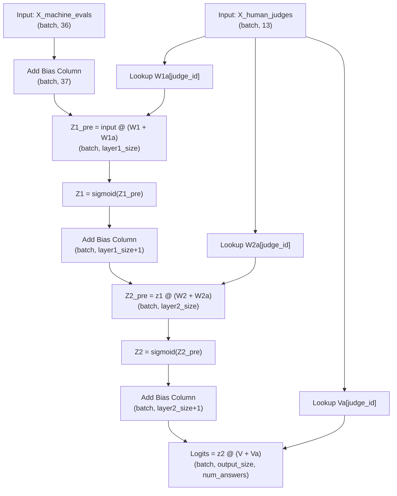
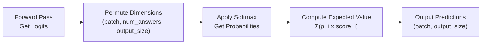
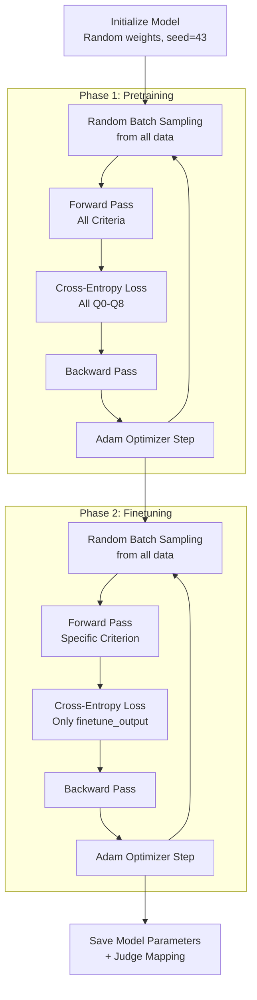
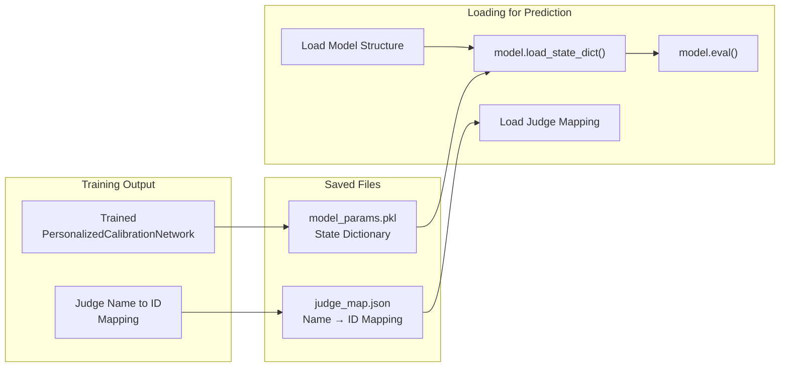

<!-- source: DeepWiki mcp.deepwiki.com · repo microsoft/LLM-Rubric · page 6 Model Reference · fetched 2026-10-26 -->

# Model Reference

Relevant source files

The following files were used as context for generating this wiki page:

- [llm_rubric/model/torch_impl.py](llm_rubric/model/torch_impl.py)

This page provides detailed technical documentation of the `PersonalizedCalibrationNetwork` implementation, including its architecture, training process, hyperparameters, and model artifacts. This is the core neural network component that learns to calibrate LLM probability distributions to match individual human judge preferences.

For high-level concepts about personalized calibration, see [Personalized Calibration Network](#3.2). For practical training instructions, see [Training a Model](#4.2).

---

## Overview

The `PersonalizedCalibrationNetwork` is a PyTorch neural network implemented in [llm_rubric/model/torch_impl.py](). The model architecture combines:

- **Judge-independent parameters**: Shared weights that capture general patterns across all judges
- **Judge-specific parameters**: Personalized weights that adapt the network for each individual judge
- **Two-layer feedforward network**: With sigmoid activations and bias terms
- **Multi-task output layer**: Predicts scores for all 9 criteria (Q0-Q8) simultaneously

The model takes as input LLM probability distributions (36 features: 9 criteria × 4 answer probabilities) and judge IDs, then outputs calibrated predictions on a 1-4 scale for each criterion.

**Sources**: [llm_rubric/model/torch_impl.py:47-163]()

---

## Core Data Structures

### Hyperparameters

The `Hyperparameters` dataclass defines all configuration parameters for the model. It is a frozen, immutable configuration object.

| Parameter | Type | Default | Description |
|-----------|------|---------|-------------|
| `input_size` | int | (required) | Number of input features (typically 36: 9 criteria × 4 answers) |
| `output_size` | int | (required) | Number of output dimensions (typically 9 for Q0-Q8) |
| `num_judges` | int | (required) | Number of unique judges in the dataset |
| `all_data_size` | int | (required) | Total number of training samples |
| `finetune_output` | int | -1 | Which criterion to focus on during finetuning (-1 = all) |
| `num_answers` | int | 4 | Number of possible answer choices (1, 2, 3, 4) |
| `batch_size` | int | 32 | Batch size for training |
| `learning_rate` | float | 0.01 | Adam optimizer learning rate |
| `layer1_size` | int | 100 | Hidden units in first layer |
| `layer2_size` | int | 100 | Hidden units in second layer |
| `pretraining_epochs` | int | 50 | Epochs for pretraining phase |
| `finetuning_epochs` | int | 50 | Epochs for finetuning phase |
| `random_seed` | int | 43 | Random seed for reproducibility |

**Sources**: [llm_rubric/model/torch_impl.py:8-23]()

### Dataset

The `Dataset` dataclass wraps three NumPy arrays into a PyTorch-compatible structure:

**Dataset Properties**:
- `machine_evaluations`: LLM probability distributions, shape `(N, 36)`
- `human_judges`: One-hot encoded judge IDs, shape `(N, 13)`
- `human_judgments`: Ground truth scores 1-4 for each criterion, shape `(N, 9)`
- `X`, `A`, `Y`: Properties that convert NumPy arrays to PyTorch tensors
- `__len__()`: Returns number of samples in the dataset

**Sources**: [llm_rubric/model/torch_impl.py:25-44]()

---

## PersonalizedCalibrationNetwork Architecture

### Weight Parameter Structure

The network has 6 learnable weight tensors that combine judge-independent and judge-specific parameters:

**Parameter Dimensions**:
- **W1**: First layer judge-independent weights `(input_size+1, layer1_size)`
- **W1a**: First layer judge-specific weights `(num_judges, input_size+1, layer1_size)`
- **W2**: Second layer judge-independent weights `(layer1_size+1, layer2_size)`
- **W2a**: Second layer judge-specific weights `(num_judges, layer1_size+1, layer2_size)`
- **V**: Output layer judge-independent weights `(output_size, layer2_size+1, num_answers)`
- **Va**: Output layer judge-specific weights `(num_judges, output_size, layer2_size+1, num_answers)`

All weight parameters are initialized with random values from a standard normal distribution using `torch.randn()` and a fixed random seed for reproducibility.

**Sources**: [llm_rubric/model/torch_impl.py:48-109]()

### Forward Pass

The forward pass implements a two-layer feedforward network with personalized weights at each layer:

**Forward Pass Steps**:
1. **Add bias**: Concatenate a column of ones to input for bias term
2. **Layer 1 computation**: 
   - Lookup judge-specific weights `W1a[judge_id]`
   - Compute `z1_pre = input @ (W1 + W1a_lookup)` using Einstein summation
   - Apply sigmoid activation: `z1 = sigmoid(z1_pre)`
3. **Layer 2 computation**:
   - Add bias to `z1`
   - Lookup `W2a[judge_id]`
   - Compute `z2_pre = z1 @ (W2 + W2a_lookup)`
   - Apply sigmoid activation: `z2 = sigmoid(z2_pre)`
4. **Output layer**:
   - Add bias to `z2`
   - Lookup `Va[judge_id]`
   - Compute logits: `output = z2 @ (V + Va_lookup)`
   - Shape: `(batch_size, output_size, num_answers)` = `(batch, 9, 4)`

The forward pass uses `torch.einsum()` for efficient tensor operations with judge-specific parameters.

**Sources**: [llm_rubric/model/torch_impl.py:112-134]()

---

## Loss and Prediction Functions

### Loss Function

The `loss()` method computes cross-entropy loss between predicted logits and ground truth human judgments:

| Parameter | Type | Description |
|-----------|------|-------------|
| `X` | Tensor | Machine evaluations, shape `(batch, 36)` |
| `A` | Tensor | Judge IDs, shape `(batch, 13)` |
| `Y` | Tensor | Human judgments 1-4, shape `(batch, 9)` |
| `I` | Optional[List] | Criterion indices to compute loss for (None = all) |

**Loss Computation Steps**:
1. Forward pass to get logits `(batch, output_size, num_answers)`
2. Permute to `(batch, num_answers, output_size)` for PyTorch convention
3. If `I` is provided, filter to specific criteria
4. Compute cross-entropy: `F.cross_entropy(logits, Y-1, ignore_index=-1)`
   - Subtracts 1 from Y to convert 1-4 scale to 0-3 indices
   - Ignores index -1 for missing values
5. Return mean loss across batch

**Sources**: [llm_rubric/model/torch_impl.py:137-149]()

### Decode Function

The `decode()` method generates expected value predictions from the model's probability distributions:

**Decode Steps**:
1. Forward pass to get logits
2. Permute dimensions to `(batch, num_answers, output_size)`
3. Apply softmax to get probability distribution over answers
4. Compute expected value: `prediction = Σ(p_i × score_i)` where scores = [1.0, 2.0, 3.0, 4.0]
5. Return predictions on 1-4 scale, shape `(batch, output_size)`

The expected value approach provides a continuous prediction rather than selecting the argmax class.

**Sources**: [llm_rubric/model/torch_impl.py:151-162]()

---

## Training Process

### Two-Phase Training Strategy

The model uses a two-phase training approach:

**Sources**: [llm_rubric/model/torch_impl.py:165-210]()

### Pretraining Loop

The `pretrain_loop()` function trains the model on all criteria simultaneously:

**Parameters**:
- `model`: PersonalizedCalibrationNetwork instance
- `dataset`: Dataset containing X, A, Y tensors
- `optimizer`: PyTorch optimizer (typically Adam)

**Process**:
1. Set model to training mode: `model.train()`
2. Set random seed for reproducibility
3. Calculate total steps: `pretraining_epochs × (all_data_size / batch_size)`
4. For each step:
   - Sample random batch indices using `np.random.choice()`
   - Extract batch data: `X_machine_evals`, `X_human_judges`, `Y_human_judgments`
   - Convert to PyTorch tensors
   - Compute loss on all criteria
   - Backpropagate: `loss.backward()`
   - Update weights: `optimizer.step()`
   - Reset gradients: `optimizer.zero_grad()`

This phase learns general patterns across all criteria and all judges.

**Sources**: [llm_rubric/model/torch_impl.py:165-184]()

### Finetuning Loop

The `finetune_loop()` function focuses training on a specific criterion:

**Parameters**:
- `model`: Pretrained PersonalizedCalibrationNetwork
- `dataset`: Same dataset used in pretraining
- `optimizer`: Same optimizer (maintains state from pretraining)

**Process**:
1. Set model to training mode
2. Set random seed
3. Calculate total steps: `finetuning_epochs × (all_data_size / batch_size)`
4. For each step:
   - Sample random batch indices
   - Extract batch data
   - Compute loss on specific criterion: `loss(X, A, Y, I=[finetune_output])`
   - Backpropagate and update weights

The finetuning phase specializes the model for a particular criterion (typically Q0, the overall assessment) while preserving general knowledge from pretraining.

**Sources**: [llm_rubric/model/torch_impl.py:186-210]()

---

## Training Configuration

### Typical Hyperparameter Values

Based on the implementation defaults and typical usage:

| Hyperparameter | Typical Value | Notes |
|---------------|---------------|-------|
| `input_size` | 36 | 9 criteria × 4 answer probabilities |
| `output_size` | 9 | Q0 through Q8 |
| `num_judges` | 13 | Number of human annotators |
| `layer1_size` | 100 | First hidden layer size |
| `layer2_size` | 100 | Second hidden layer size |
| `batch_size` | 32 | Training batch size |
| `learning_rate` | 0.01 | Adam optimizer learning rate |
| `pretraining_epochs` | 20-50 | Varies by dataset size |
| `finetuning_epochs` | 30-50 | Varies by dataset size |
| `num_answers` | 4 | Fixed to 1-4 scale |
| `random_seed` | 43 | For reproducibility |

### Optimizer Configuration

The model uses PyTorch's Adam optimizer:
- Learning rate specified in `hyperparameters.learning_rate`
- Default Adam parameters (β₁=0.9, β₂=0.999, ε=1e-8)
- Optimizer state is maintained across pretraining and finetuning phases

**Sources**: [llm_rubric/model/torch_impl.py:8-23]()

---

## Model Artifacts

### Saved Model Files

After training, the model produces several artifacts:

**Model Parameters File** (`model_params.pkl`):
- Contains the state dictionary from `model.state_dict()`
- Includes all 6 weight tensors: W1, W1a, W2, W2a, V, Va
- Saved using `torch.save()` or `pickle`
- Required for making predictions

**Judge Mapping File** (`judge_map.json`):
- Maps judge names (strings) to integer IDs (0 to num_judges-1)
- JSON format: `{"judge_name": 0, "another_judge": 1, ...}`
- Ensures consistent judge ID encoding between training and prediction
- Required to properly index judge-specific parameters

### Loading for Inference

To use a trained model for prediction:

1. Create `Hyperparameters` object with same configuration
2. Initialize `PersonalizedCalibrationNetwork(hyperparameters)`
3. Load saved state: `model.load_state_dict(torch.load("model_params.pkl"))`
4. Load judge mapping: `judge_map = json.load(open("judge_map.json"))`
5. Set to evaluation mode: `model.eval()`
6. Use `model.decode(X, A)` to generate predictions

**Sources**: [llm_rubric/model/torch_impl.py:47-163]()

---

## Implementation Details

### Random Seed Management

The model uses a fixed random seed for reproducibility:
- Set during initialization: `torch.manual_seed(hyperparameters.random_seed)`
- Reset before each training loop: `np.random.seed(model.hyperparameters.random_seed)`
- Ensures consistent weight initialization and batch sampling
- Default seed value: 43

### Batch Sampling Strategy

Both training loops use random batch sampling:
- `np.random.choice(len(dataset), size=batch_size)` selects random indices
- Allows for data reuse (sampling with replacement)
- Number of steps = `epochs × (dataset_size / batch_size)`
- Not a traditional epoch-based approach (doesn't guarantee seeing all samples)

### Label Indexing

The model handles the 1-4 label scale internally:
- Human judgments use 1-4 scale
- Cross-entropy loss expects 0-indexed classes
- Loss function subtracts 1: `cross_entropy(logits, Y-1)`
- Decode function uses explicit values: `[1.0, 2.0, 3.0, 4.0]`
- Missing values encoded as -1, ignored via `ignore_index=-1`

### Memory Efficiency

The implementation uses several memory-efficient techniques:
- Einstein summation (`torch.einsum`) for efficient tensor operations
- Single forward pass computes all criteria simultaneously
- Judge-specific parameters only looked up for batch judges
- Gradient computation only for used parameters

**Sources**: [llm_rubric/model/torch_impl.py:1-210]()

---

