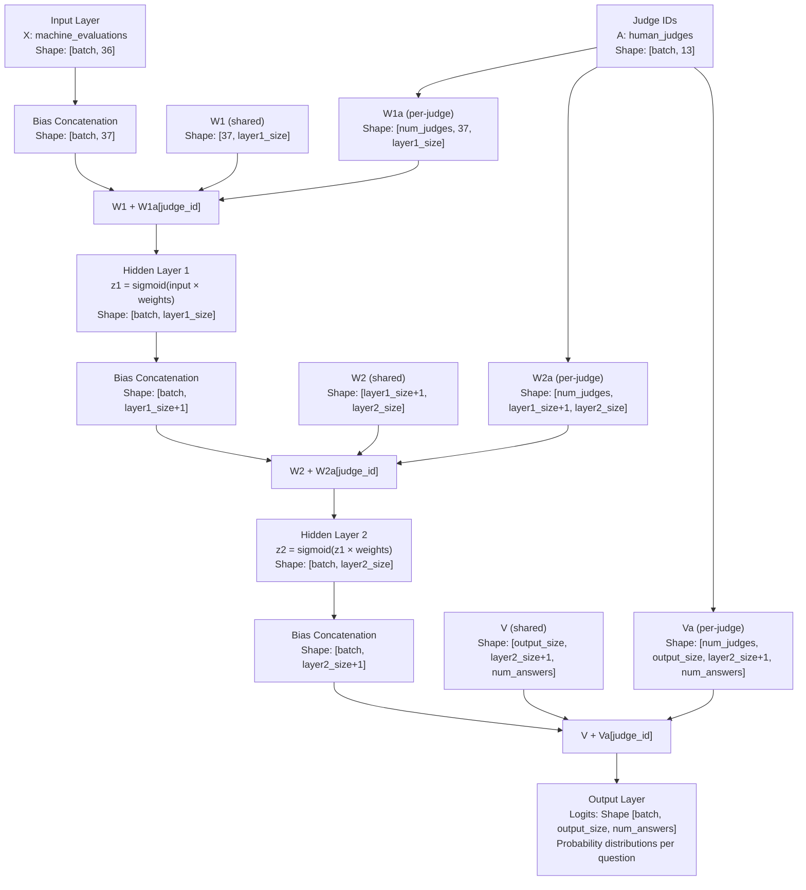
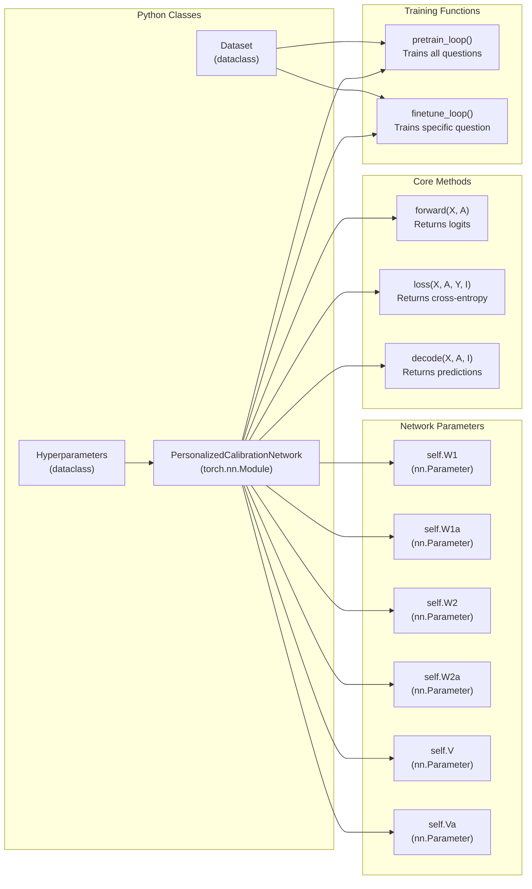
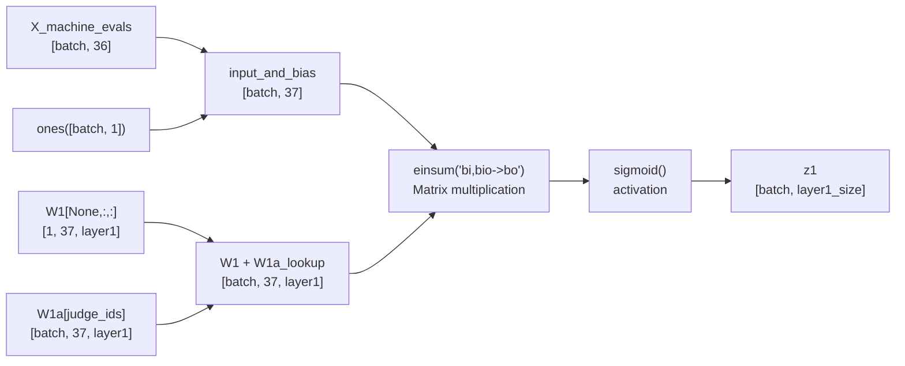
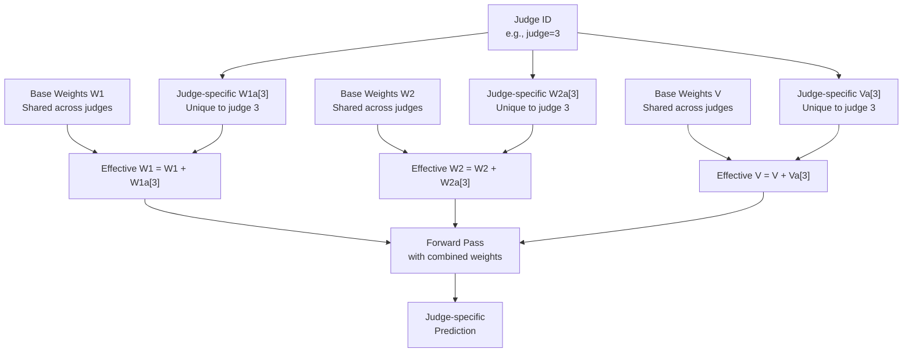

<!-- source: DeepWiki mcp.deepwiki.com · repo microsoft/LLM-Rubric · page 6.1 Network Architecture · fetched 2026-10-26 -->

# Network Architecture

<details>
<summary>Relevant source files</summary>

The following files were used as context for generating this wiki page:

- [README.md](README.md)
- [llm_rubric/model/torch_impl.py](llm_rubric/model/torch_impl.py)

</details>


## Purpose and Scope

This page provides detailed technical documentation of the `PersonalizedCalibrationNetwork` neural network implementation. It covers the layer structure, parameter architecture, activation functions, and forward pass computation. For conceptual explanation of personalized calibration, see [Personalized Calibration Network](#3.2). For training procedures, see [Training Process](#6.2). For hyperparameter configuration details, see [Hyperparameters Configuration](#6.3).

## Network Overview

The `PersonalizedCalibrationNetwork` is a feed-forward neural network with two hidden layers that learns to calibrate LLM probability distributions to match individual human judge preferences. The network combines judge-independent parameters (shared across all judges) with judge-specific parameters (unique to each annotator) to enable personalized predictions.



**Sources:** [llm_rubric/model/torch_impl.py:47-163]()

## Parameter Architecture

The network maintains six trainable parameter tensors, organized into judge-independent and judge-specific pairs for each layer:

| Parameter | Type | Shape | Description |
|-----------|------|-------|-------------|
| `W1` | Shared | `[input_size+1, layer1_size]` | First hidden layer weights (judge-independent) |
| `W1a` | Per-Judge | `[num_judges, input_size+1, layer1_size]` | First hidden layer weights (judge-specific offsets) |
| `W2` | Shared | `[layer1_size+1, layer2_size]` | Second hidden layer weights (judge-independent) |
| `W2a` | Per-Judge | `[num_judges, layer1_size+1, layer2_size]` | Second hidden layer weights (judge-specific offsets) |
| `V` | Shared | `[output_size, layer2_size+1, num_answers]` | Output layer weights (judge-independent) |
| `Va` | Per-Judge | `[num_judges, output_size, layer2_size+1, num_answers]` | Output layer weights (judge-specific offsets) |

**Typical Dimensions:**
- `input_size`: 36 (9 criteria × 4 answer probabilities)
- `output_size`: 9 (Q0-Q8 questions)
- `num_judges`: 13 (number of human annotators)
- `num_answers`: 4 (1-4 rating scale)
- `layer1_size`: 25 (configurable hidden layer size)
- `layer2_size`: 25 (configurable hidden layer size)

All parameters are initialized with random values from a normal distribution using `torch.randn()` with a fixed random seed for reproducibility.

**Sources:** [llm_rubric/model/torch_impl.py:56-109](), [README.md:82-85]()

## Code Entity Mapping



**Sources:** [llm_rubric/model/torch_impl.py:9-23](), [llm_rubric/model/torch_impl.py:26-44](), [llm_rubric/model/torch_impl.py:47-163]()

## Forward Pass Implementation

The forward pass computes logits for each question and answer combination using a three-stage process with personalized parameters at each layer.

### Stage 1: First Hidden Layer



The implementation uses Einstein summation notation for efficient batched matrix multiplication with personalized weights:

```python
input_and_bias = torch.cat([X_machine_evals, bias_column], axis=1)
W1a_lookup = self.W1a[X_human_judges[:,0]]
z1_pre = torch.einsum("bi,bio->bo", input_and_bias, self.W1[None, :, :] + W1a_lookup)
z1 = torch.sigmoid(z1_pre)
```

**Sources:** [llm_rubric/model/torch_impl.py:114-122]()

### Stage 2: Second Hidden Layer

The second hidden layer follows the same pattern as the first, using personalized weights:

```python
z1_and_bias = torch.cat([z1, bias_column], axis=1)
W2a_lookup = self.W2a[X_human_judges[:,0]]
z2_pre = torch.einsum("bi,bio->bo", z1_and_bias, self.W2[None, :, :] + W2a_lookup)
z2 = torch.sigmoid(z2_pre)
```

**Sources:** [llm_rubric/model/torch_impl.py:124-128]()

### Stage 3: Output Layer

The output layer produces logits for each question-answer combination without applying a final activation function:

```python
z2_and_bias = torch.cat([z2, bias_column], axis=1)
Va_lookup = self.Va[X_human_judges[:,0]]
logits = torch.einsum("bi,bqia->bqa", z2_and_bias, self.V[None, :, :, :] + Va_lookup)
```

The output tensor has shape `[batch_size, num_questions, num_answers]`, representing unnormalized log-probabilities for each of the 4 possible answers (1-4 scale) across all 9 questions (Q0-Q8).

**Sources:** [llm_rubric/model/torch_impl.py:130-134]()

## Input Specifications

The `forward()` method accepts two input tensors:

| Input | Variable | Type | Shape | Description |
|-------|----------|------|-------|-------------|
| Machine Evaluations | `X_machine_evals` | `torch.Tensor` (float32) | `[batch_size, 36]` | LLM probability distributions: 9 criteria × 4 answers |
| Human Judge IDs | `X_human_judges` | `torch.Tensor` (int64) | `[batch_size, 13]` | One-hot encoded judge identifiers (typically only first column used) |

The machine evaluations tensor contains flattened probability distributions from the LLM evaluation, where each criterion (Q0-Q8) contributes 4 values representing P(answer=1), P(answer=2), P(answer=3), P(answer=4).

**Sources:** [llm_rubric/model/torch_impl.py:112-114](), [llm_rubric/model/torch_impl.py:26-44]()

## Output and Decoding

### Logits Output

The `forward()` method returns logits with shape `[batch_size, output_size, num_answers]`. These represent unnormalized scores for each answer option across all questions.

### Loss Computation

The `loss()` method converts logits to cross-entropy loss:

```python
def loss(self, X, A, Y, I=None):
    logits = self.forward(X, A)
    permuted_logits = logits.permute(0,2,1)  # [batch, num_answers, num_questions]
    
    if I is not None:
        permuted_logits = permuted_logits[:, :, I]
        Y = Y[:, I]
    
    xent = torch.nn.functional.cross_entropy(
        permuted_logits, (Y-1), ignore_index=-1, reduction='none'
    ).mean()
    return xent
```

The `I` parameter allows selective loss computation on specific questions (used during finetuning to focus on Q0).

**Sources:** [llm_rubric/model/torch_impl.py:137-149]()

### Prediction Decoding

The `decode()` method converts logits to expected value predictions on the 1-4 scale:

```python
def decode(self, X, A, I=None):
    logits = self.forward(X, A)
    permuted_logits = logits.permute(0,2,1)
    
    if I is not None:
        permuted_logits = permuted_logits[:, :, I]
    
    probs = torch.nn.functional.softmax(permuted_logits, dim=1)
    values = torch.tensor([1.0, 2.0, 3.0, 4.0])
    pred = torch.einsum("i,biq->bq", values, probs)  # Expected value
    return pred
```

This computes the expected value as: `E[score] = Σ(probability_i × score_i)` for scores in {1, 2, 3, 4}.

**Sources:** [llm_rubric/model/torch_impl.py:151-162]()

## Activation Functions

The network uses sigmoid activation exclusively:

- **Hidden Layer 1:** `z1 = sigmoid(input × (W1 + W1a))`
- **Hidden Layer 2:** `z2 = sigmoid(z1 × (W2 + W2a))`
- **Output Layer:** No activation (logits only)

The sigmoid function (`torch.sigmoid()`) is applied element-wise to the pre-activation values, providing smooth nonlinear transformations while constraining activations to the (0, 1) range.

**Sources:** [llm_rubric/model/torch_impl.py:122](), [llm_rubric/model/torch_impl.py:128]()

## Personalization Mechanism



The personalization works by indexing into the judge-specific parameter tensors using the judge ID, then adding these offsets to the shared base parameters. This allows the network to learn both common patterns (via shared parameters) and individual preferences (via judge-specific offsets).

**Sources:** [llm_rubric/model/torch_impl.py:119-133]()

---

