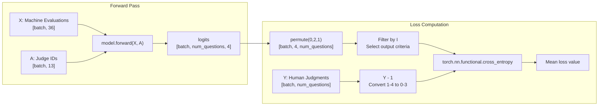
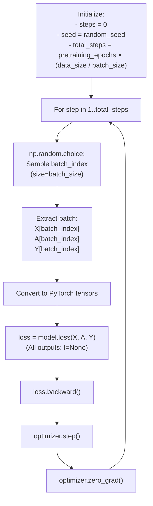
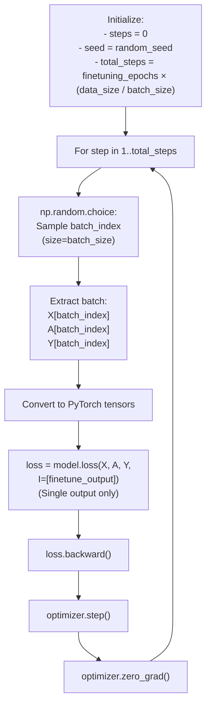
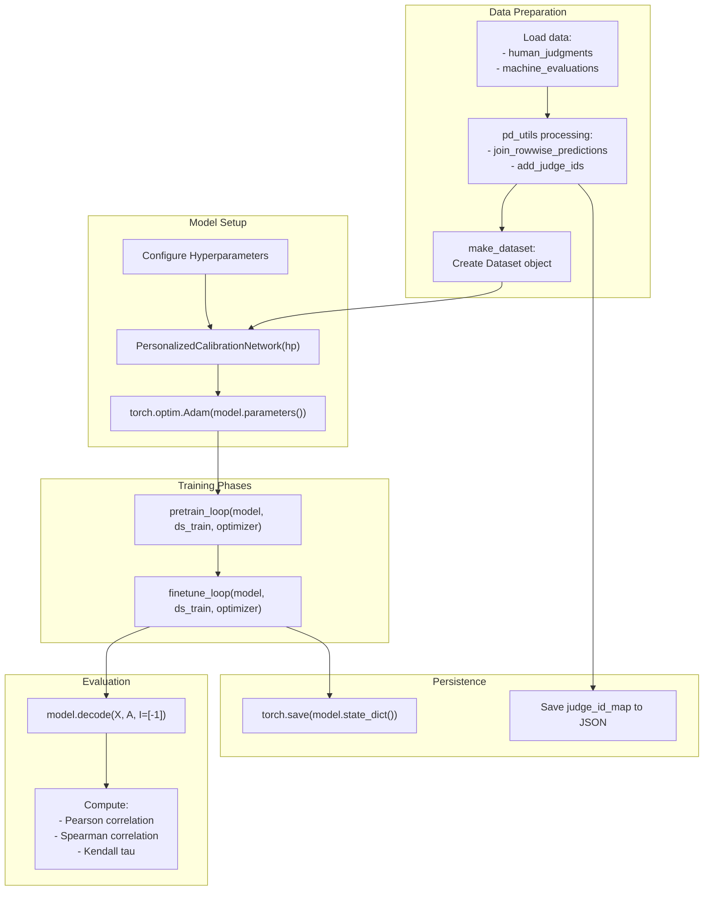
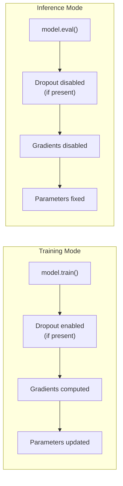

<!-- source: DeepWiki mcp.deepwiki.com · repo microsoft/LLM-Rubric · page 6.2 Training Process · fetched 2026-10-26 -->

# Training Process

<details>
<summary>Relevant source files</summary>

The following files were used as context for generating this wiki page:

- [llm_rubric/model/torch_impl.py](llm_rubric/model/torch_impl.py)
- [scripts/llm_rubric_predict.py](scripts/llm_rubric_predict.py)
- [scripts/train_llm_rubric.py](scripts/train_llm_rubric.py)

</details>


## Purpose and Scope

This page documents the training procedure for the PersonalizedCalibrationNetwork, including the two-phase training strategy (pretraining and finetuning), loss function computation, optimization configuration, and batch sampling methods. For information about the network architecture itself, see [Network Architecture](#6.1). For the complete hyperparameter reference, see [Hyperparameters Configuration](#6.3).

---

## Two-Phase Training Strategy

The PersonalizedCalibrationNetwork uses a two-phase training strategy to optimize performance on the target evaluation criterion while maintaining reasonable predictions across all criteria.

### Phase 1: Pretraining

The pretraining phase trains the model to predict **all output criteria** (Q0-Q8) simultaneously. This establishes general calibration patterns across the full rubric.

| Characteristic | Value |
|---|---|
| Loss computation | All output dimensions (I=None) |
| Typical epochs | 20-50 |
| Purpose | Learn general judge-specific calibration patterns |

### Phase 2: Finetuning

The finetuning phase focuses exclusively on **a single target criterion** (typically Q0, the overall quality score). This specializes the model for the primary evaluation objective.

| Characteristic | Value |
|---|---|
| Loss computation | Single output dimension (I=[-1]) |
| Typical epochs | 30-50 |
| Purpose | Optimize for primary evaluation criterion |

**Rationale**: Training on all criteria first prevents overfitting to a single output and helps the model learn meaningful intermediate representations that capture the evaluation rubric's structure. Finetuning then specializes these representations for the target criterion.

**Sources**: [llm_rubric/model/torch_impl.py:165-210](), [scripts/train_llm_rubric.py:151-154]()

---

## Loss Function

### Cross-Entropy Loss Computation

The model uses categorical cross-entropy loss to train the classification of human judgments on a 4-point scale (1-4).


**Diagram: Loss Function Computation Flow**

The `loss` method in [llm_rubric/model/torch_impl.py:137-149]() implements:

1. **Forward pass**: Generate logits for all criteria
2. **Permutation**: Reshape from `[batch, questions, answers]` to `[batch, answers, questions]` to match PyTorch's cross-entropy expectations
3. **Output filtering**: Select specific criteria via the `I` parameter (all criteria during pretraining, single criterion during finetuning)
4. **Label adjustment**: Subtract 1 from human judgments to convert from 1-4 scale to 0-3 indices
5. **Cross-entropy**: Compute loss with `ignore_index=-1` to mask invalid values
6. **Reduction**: Mean over all samples

### Key Implementation Details

| Aspect | Implementation |
|---|---|
| Label encoding | Human judgments (1-4) converted to indices (0-3) |
| Invalid value handling | `ignore_index=-1` masks entries with Y=-1 |
| Reduction | Mean over batch (average loss per sample) |
| Output selection | `I` parameter filters which criteria contribute to loss |

**Sources**: [llm_rubric/model/torch_impl.py:137-149]()

---

## Optimization Configuration

### Adam Optimizer

The training process uses the Adam optimizer with configurable learning rate.

```python
optimizer = torch.optim.Adam(model.parameters(), lr=hp.learning_rate)
```

| Parameter | Typical Value | Purpose |
|---|---|---|
| `learning_rate` | 0.01 | Step size for gradient descent |
| `parameters()` | All model parameters | Includes W1, W1a, W2, W2a, V, Va |

The same optimizer instance is reused across both training phases without resetting, allowing momentum to carry over from pretraining to finetuning.

**Sources**: [scripts/train_llm_rubric.py:149]()

---

## Pretraining Loop

### Algorithm Overview


**Diagram: Pretraining Loop Implementation**

### Implementation Details

The `pretrain_loop` function in [llm_rubric/model/torch_impl.py:165-184]() implements:

1. **Step calculation**: `pretraining_epochs × (all_data_size / batch_size)` determines total training steps
2. **Random sampling**: Each step samples `batch_size` indices with replacement using `np.random.choice`
3. **Batch extraction**: Selects corresponding rows from dataset arrays
4. **Tensor conversion**: Converts numpy arrays to PyTorch tensors
5. **Loss computation**: Calls `model.loss(X, A, Y)` without output filtering (trains all criteria)
6. **Gradient computation**: `loss.backward()` computes gradients for all parameters
7. **Parameter update**: `optimizer.step()` applies gradient descent
8. **Gradient reset**: `optimizer.zero_grad()` clears gradients for next iteration

### Random Seed Consistency

The loop sets `np.random.seed(model.hyperparameters.random_seed)` to ensure reproducible batch sampling across runs.

**Sources**: [llm_rubric/model/torch_impl.py:165-184]()

---

## Finetuning Loop

### Algorithm Overview

The finetuning loop follows the same structure as pretraining but with a critical difference: it computes loss only for a single target output criterion.


**Diagram: Finetuning Loop Implementation**

### Key Differences from Pretraining

| Aspect | Pretraining | Finetuning |
|---|---|---|
| Loss argument `I` | `None` (all outputs) | `[finetune_output]` (single output) |
| Typical value of `finetune_output` | N/A | `-1` (last criterion, Q0) |
| Number of steps | `pretraining_epochs × (data_size / batch_size)` | `finetuning_epochs × (data_size / batch_size)` |
| Purpose | General calibration | Specialized optimization |

The `I=[model.hyperparameters.finetune_output]` parameter filters the loss computation to focus on a single criterion, typically Q0 (overall quality).

**Sources**: [llm_rubric/model/torch_impl.py:186-210]()

---

## Training Execution Flow

### Complete Training Pipeline


**Diagram: End-to-End Training Execution in train_llm_rubric.py**

### Script Execution Steps

The [scripts/train_llm_rubric.py]() script orchestrates the complete training process:

1. **Data loading** [scripts/train_llm_rubric.py:42-52]():
   - Read human judgments TSV
   - Read machine evaluations TSV
   - Filter invalid judgments (Q0 != 0)
   - Join rowwise predictions into columnar format

2. **Judge ID mapping** [scripts/train_llm_rubric.py:70]():
   - Create integer mapping for judge names
   - Add judge_id column to dataframe

3. **Hyperparameter configuration** [scripts/train_llm_rubric.py:83-105]():
   - Parse command-line overrides
   - Initialize Hyperparameters dataclass
   - Set input_size, output_size, num_judges

4. **Model initialization** [scripts/train_llm_rubric.py:106]():
   - Create PersonalizedCalibrationNetwork
   - Random seed determines initial weights

5. **Dataset creation** [scripts/train_llm_rubric.py:147]():
   - Convert dataframe to Dataset object
   - Extract X (machine evaluations), A (judge IDs), Y (human judgments)

6. **Optimizer setup** [scripts/train_llm_rubric.py:149]():
   - Configure Adam optimizer with learning rate

7. **Pretraining phase** [scripts/train_llm_rubric.py:152]():
   - Train on all criteria
   - Print "Pretraining" message

8. **Finetuning phase** [scripts/train_llm_rubric.py:154]():
   - Train on target criterion
   - Print "Finetuning" message

9. **Post-training evaluation** [scripts/train_llm_rubric.py:156-166]():
   - Compute loss on training set
   - Generate predictions using decode
   - Calculate correlation metrics

10. **Model persistence** [scripts/train_llm_rubric.py:169-172]():
    - Save model parameters to pickle
    - Save judge mapping to JSON

**Sources**: [scripts/train_llm_rubric.py:1-177](), [llm_rubric/model/torch_impl.py:165-210]()

---

## Batch Sampling Strategy

### Random Sampling with Replacement

Both training loops use the same batch sampling approach:

```python
batch_index = np.random.choice(len(dataset), size=model.hyperparameters.batch_size)
```

| Characteristic | Details |
|---|---|
| Method | `np.random.choice` with replacement |
| Sample size | `batch_size` (typically 32) |
| Population | All dataset indices [0, len(dataset)) |
| Seed control | Set once at loop start for reproducibility |

### Implications

- **With replacement**: Same sample can appear multiple times in a batch
- **Stochastic**: Different batches each step (except when reproduced with same seed)
- **Epoch approximation**: Total steps ≈ epochs × (dataset_size / batch_size), but not guaranteed to visit every sample exactly once per epoch

This approach balances computational efficiency with exploration of the training data space.

**Sources**: [llm_rubric/model/torch_impl.py:173-179](), [llm_rubric/model/torch_impl.py:195-201]()

---

## Training vs. Inference Mode

### Model State Transitions


**Diagram: Training vs. Inference Mode State**

The model's training state affects its behavior:

| State | Set by | Used in | Effect |
|---|---|---|---|
| Training | `model.train()` | pretrain_loop, finetune_loop | Enables gradient computation, updates parameters |
| Evaluation | `model.eval()` | llm_rubric_predict.py | Disables gradients, freezes parameters |

During training, [llm_rubric/model/torch_impl.py:166]() and [llm_rubric/model/torch_impl.py:187]() explicitly call `model.train()` at the start of each loop. For inference, [scripts/llm_rubric_predict.py:103]() calls `model.eval()` after loading saved weights.

**Sources**: [llm_rubric/model/torch_impl.py:166](), [llm_rubric/model/torch_impl.py:187](), [scripts/llm_rubric_predict.py:103]()

---

## Training Output and Monitoring

### Console Output

The training script prints progress information:

```
Loaded 2899 human judgments from <path>
Loaded 2007 machine evaluations from <path>
Number of judges
13
Total rows: 2899
9 4
Pretraining
Finetuning
Train Loss (FT) 0.5234
Train pearsonr 0.8156
Train spearmanr 0.7892
Train kendallt 0.6543
```

### Monitored Metrics

After training completes, the script evaluates on the training set:

| Metric | Computation | Purpose |
|---|---|---|
| Loss (FT) | `model.loss(ds_train.X, ds_train.A, ds_train.Y, I=[-1])` | Cross-entropy on target criterion |
| Pearson correlation | `scipy.stats.pearsonr(y, yhat)` | Linear correlation |
| Spearman correlation | `scipy.stats.spearmanr(y, yhat)` | Rank correlation |
| Kendall tau | `scipy.stats.kendalltau(y, yhat)` | Ordinal association |

These metrics indicate training performance but do **not** represent generalization to held-out data. For proper evaluation, see [Evaluating Results](#4.4).

**Sources**: [scripts/train_llm_rubric.py:151-166]()

---

