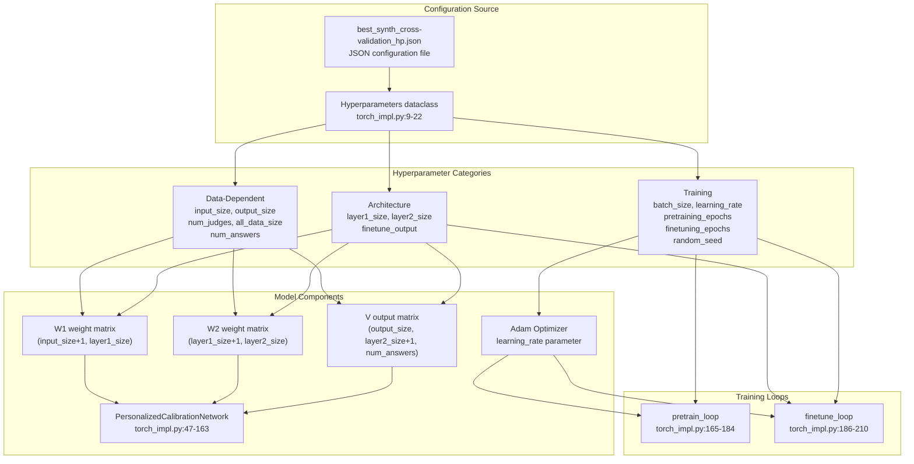
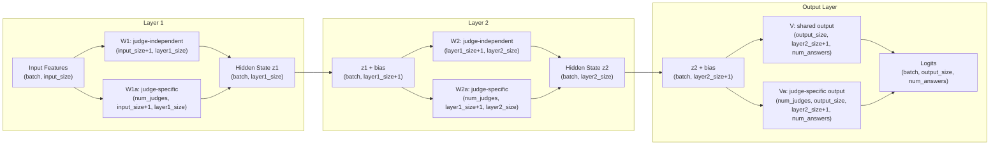
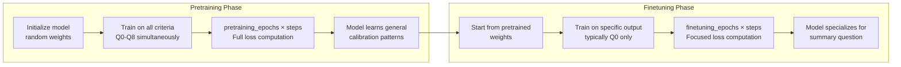
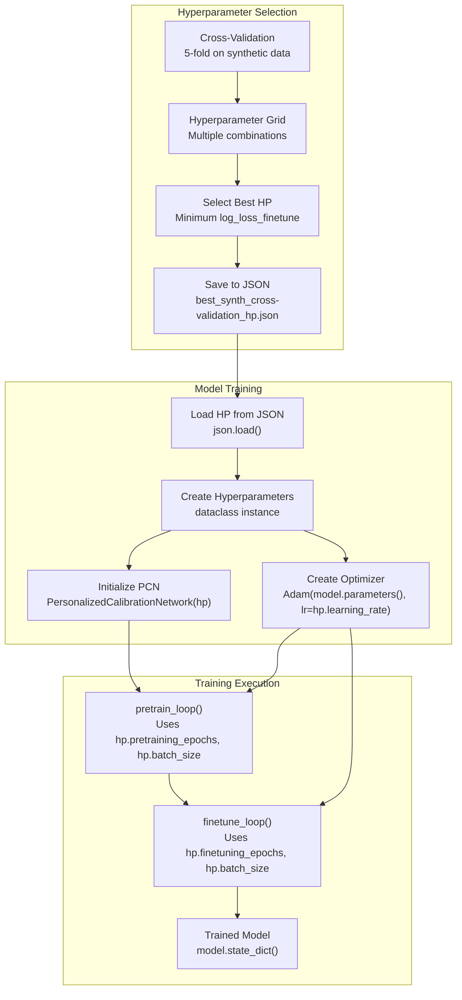

<!-- source: DeepWiki mcp.deepwiki.com · repo microsoft/LLM-Rubric · page 6.3 Hyperparameters Configuration · fetched 2026-10-26 -->

# Hyperparameters Configuration

<details>
<summary>Relevant source files</summary>

The following files were used as context for generating this wiki page:

- [README.md](README.md)
- [experiments/real_data/best_synth_cross-validation_hp.json](experiments/real_data/best_synth_cross-validation_hp.json)
- [llm_rubric/model/torch_impl.py](llm_rubric/model/torch_impl.py)

</details>


## Purpose and Scope

This page provides a complete reference for all hyperparameters used in the PersonalizedCalibrationNetwork model. It documents their meanings, valid ranges, default values, and how they affect model training and behavior. For information about the network architecture itself, see [Network Architecture](#6.1). For details on how hyperparameters are selected through cross-validation, see [Hyperparameter Tuning](#4.5).

## Hyperparameters Overview

The LLM-Rubric system uses a configuration object that encapsulates all hyperparameters needed to construct, train, and evaluate the PersonalizedCalibrationNetwork. These hyperparameters fall into three categories: data-dependent parameters that must match the dataset dimensions, architecture parameters that define the neural network structure, and training parameters that control the optimization process.

### Hyperparameter Structure in Code



**Sources:** [llm_rubric/model/torch_impl.py:9-22](), [experiments/real_data/best_synth_cross-validation_hp.json:1]()

## Data-Dependent Hyperparameters

These parameters must match the dimensions of your dataset and evaluation framework. They are determined by the structure of your rubric, number of judges, and answer scale.

| Parameter | Type | Description | Typical Value | Determined By |
|-----------|------|-------------|---------------|---------------|
| `input_size` | `int` | Dimensionality of machine evaluation input features | 36 | `num_criteria × num_answers` (e.g., 9 criteria × 4 answers) |
| `output_size` | `int` | Number of rubric questions to predict | 9 | Number of criteria in rubric (Q0-Q8) |
| `num_judges` | `int` | Total number of unique human judges | 13 | Count of distinct annotators in dataset |
| `all_data_size` | `int` | Total number of training samples | 223 | Number of conversation-judge pairs |
| `num_answers` | `int` | Number of discrete answer choices | 4 | Rating scale (typically 1-4) |

### Input Size Calculation

The `input_size` parameter represents the flattened LLM probability distributions across all criteria. For each criterion in the rubric, the LLM produces a probability distribution over `num_answers` possible ratings. These distributions are concatenated into a single feature vector.

**Formula:** `input_size = output_size × num_answers`

For the included dataset with 9 criteria (Q0-Q8) and a 4-point rating scale:
- `input_size = 9 × 4 = 36`

This matches the structure of machine evaluations where each row contains columns like `Q0_answer1_prob`, `Q0_answer2_prob`, ..., `Q8_answer4_prob`.

**Sources:** [llm_rubric/model/torch_impl.py:10](), [experiments/real_data/best_synth_cross-validation_hp.json:1]()

## Architecture Hyperparameters

These parameters define the structure and capacity of the PersonalizedCalibrationNetwork's hidden layers.

| Parameter | Type | Description | Default | Best Value (Cross-Validation) |
|-----------|------|-------------|---------|-------------------------------|
| `layer1_size` | `int` | Number of units in first hidden layer | 100 | 25 |
| `layer2_size` | `int` | Number of units in second hidden layer | 100 | 25 |
| `finetune_output` | `int` | Index of output criterion for finetuning | -1 | -1 |

### Hidden Layer Dimensions

The network uses a two-layer feedforward architecture with sigmoid activations. Each layer has both judge-independent and judge-specific weight matrices.

**Weight Matrix Shapes:**



The `layer1_size` and `layer2_size` parameters control the representational capacity of the network. Smaller values (e.g., 25) reduce overfitting risk and work well when training data is limited. Larger values (e.g., 100) provide more capacity but may require more training data to generalize effectively.

**Sources:** [llm_rubric/model/torch_impl.py:56-109](), [experiments/real_data/best_synth_cross-validation_hp.json:1]()

### Finetuning Output Selection

The `finetune_output` parameter specifies which output criterion to focus on during the finetuning phase. Setting this to `-1` (default) means finetuning operates on all output criteria simultaneously. Setting it to a specific index (e.g., `0` for Q0) restricts finetuning to optimize only that criterion.

In the typical workflow, `finetune_output = -1` is used, but during finetuning, the loss is computed only for the first output (Q0, the summary question about overall satisfaction), as implemented in [llm_rubric/model/torch_impl.py:202-205]():

```python
loss = model.loss(
    X_machine_evals_th, X_human_judges_th, Y_human_judgments_th,
    I=[model.hyperparameters.finetune_output],
)
```

When `finetune_output = -1`, the `I` parameter becomes `[-1]`, which causes the finetuning to focus on the last criterion in the output.

**Sources:** [llm_rubric/model/torch_impl.py:14](), [llm_rubric/model/torch_impl.py:186-210]()

## Training Hyperparameters

These parameters control the optimization process, convergence behavior, and computational efficiency.

| Parameter | Type | Description | Default | Best Value (Cross-Validation) | Valid Range |
|-----------|------|-------------|---------|-------------------------------|-------------|
| `batch_size` | `int` | Number of samples per gradient update | 32 | 64 | 1-512 |
| `learning_rate` | `float` | Adam optimizer step size | 0.01 | 0.001 | 10⁻⁵ to 10⁻¹ |
| `pretraining_epochs` | `int` | Number of pretraining passes through data | 50 | 20 | 1-1000 |
| `finetuning_epochs` | `int` | Number of finetuning passes through data | 50 | 30 | 1-1000 |
| `random_seed` | `int` | Seed for reproducibility | 43 | 43 | Any integer |

### Batch Size

The `batch_size` determines how many samples are used to compute each gradient update. Training loops compute the number of steps as:

**Pretraining steps:** `pretraining_epochs × (all_data_size / batch_size)`

**Finetuning steps:** `finetuning_epochs × (all_data_size / batch_size)`

For the best configuration with 223 samples, batch size 64, and 20 pretraining epochs:
- Pretraining steps: `20 × (223 / 64) ≈ 20 × 3 = 60 steps`

Larger batch sizes provide more stable gradients but require more memory and may converge more slowly. Smaller batch sizes introduce more noise but can help escape local minima.

**Sources:** [llm_rubric/model/torch_impl.py:168-170](), [llm_rubric/model/torch_impl.py:189-191]()

### Learning Rate

The `learning_rate` parameter controls the step size for the Adam optimizer. The cross-validation process found that `0.001` (smaller than the default `0.01`) works best for this dataset, suggesting that slower, more careful optimization prevents overshooting.

**Sources:** [llm_rubric/model/torch_impl.py:17](), [experiments/real_data/best_synth_cross-validation_hp.json:1]()

### Training Phase Epochs

The LLM-Rubric training process has two phases:



**Pretraining** (`pretraining_epochs = 20`): The model learns to predict all rubric criteria (Q0-Q8) from LLM probability distributions. This phase captures general patterns across all evaluation dimensions.

**Finetuning** (`finetuning_epochs = 30`): The model focuses on predicting a specific criterion (typically Q0, the overall satisfaction question). This phase specializes the calibration for the most important output.

The cross-validation found that fewer pretraining epochs (20 vs. 50 default) and moderate finetuning epochs (30 vs. 50 default) work best, likely because the synthetic dataset has limited samples and early stopping prevents overfitting.

**Sources:** [llm_rubric/model/torch_impl.py:165-184](), [llm_rubric/model/torch_impl.py:186-210](), [experiments/real_data/best_synth_cross-validation_hp.json:1]()

### Random Seed

The `random_seed` ensures reproducibility by fixing:
- PyTorch weight initialization: [llm_rubric/model/torch_impl.py:55]()
- NumPy random sampling in training loops: [llm_rubric/model/torch_impl.py:167](), [llm_rubric/model/torch_impl.py:188]()
- Batch selection during training

Using `random_seed = 43` consistently allows experiments to be exactly reproduced.

**Sources:** [llm_rubric/model/torch_impl.py:22](), [llm_rubric/model/torch_impl.py:55](), [llm_rubric/model/torch_impl.py:167]()

## Hyperparameter Dataclass Definition

The `Hyperparameters` dataclass is defined as a frozen, hashable Pydantic dataclass that can be easily serialized to/from JSON:

```python
@dataclass(eq=True, frozen=True)
class Hyperparameters:
    input_size: int
    output_size: int
    num_judges: int
    all_data_size: int
    finetune_output: int = -1
    num_answers: int = 4
    batch_size: int = 32
    learning_rate: float = 0.01
    layer1_size: int = 100
    layer2_size: int = 100
    pretraining_epochs: int = 50
    finetuning_epochs: int = 50
    random_seed: int = 43
```

The `frozen=True` attribute makes instances immutable after creation, preventing accidental modifications during training. The `eq=True` enables comparison of hyperparameter configurations for equality.

**Sources:** [llm_rubric/model/torch_impl.py:8-22]()

## Configuration Workflow



**Sources:** [experiments/real_data/best_synth_cross-validation_hp.json:1](), [llm_rubric/model/torch_impl.py:47-52](), [llm_rubric/model/torch_impl.py:165-210]()

## Default vs. Recommended Values

The following table compares the default hyperparameter values in the code with the best values found through cross-validation:

| Hyperparameter | Code Default | Cross-Validation Best | Change Rationale |
|----------------|--------------|----------------------|------------------|
| `batch_size` | 32 | 64 | Larger batches provide more stable gradients |
| `learning_rate` | 0.01 | 0.001 | Smaller rate prevents overshooting, better convergence |
| `layer1_size` | 100 | 25 | Smaller network prevents overfitting on limited data |
| `layer2_size` | 100 | 25 | Smaller network prevents overfitting on limited data |
| `pretraining_epochs` | 50 | 20 | Fewer epochs avoid overfitting on 223 samples |
| `finetuning_epochs` | 50 | 30 | Moderate finetuning balances specialization vs. overfitting |
| `random_seed` | 43 | 43 | Same (used for reproducibility) |
| `finetune_output` | -1 | -1 | Same (focus on last/summary criterion) |
| `num_answers` | 4 | 4 | Same (determined by rating scale) |

The cross-validated hyperparameters reflect optimization for a dataset with 223 training samples. If you have significantly more or less data, you may need to re-tune these values using the hyperparameter search scripts.

**Sources:** [llm_rubric/model/torch_impl.py:9-22](), [experiments/real_data/best_synth_cross-validation_hp.json:1](), [README.md:82-85]()

## Usage Examples

### Creating a Hyperparameters Object

```python
from llm_rubric.model.torch_impl import Hyperparameters

# Using defaults
hp = Hyperparameters(
    input_size=36,
    output_size=9,
    num_judges=13,
    all_data_size=223
)

# Using custom values
hp = Hyperparameters(
    input_size=36,
    output_size=9,
    num_judges=13,
    all_data_size=223,
    batch_size=64,
    learning_rate=0.001,
    layer1_size=25,
    layer2_size=25,
    pretraining_epochs=20,
    finetuning_epochs=30,
    random_seed=43
)
```

### Loading from JSON Configuration

```python
import json
from llm_rubric.model.torch_impl import Hyperparameters

with open('experiments/real_data/best_synth_cross-validation_hp.json', 'r') as f:
    hp_dict = json.load(f)

hp = Hyperparameters(**hp_dict)
```

### Initializing Model with Hyperparameters

```python
from llm_rubric.model.torch_impl import PersonalizedCalibrationNetwork, Hyperparameters

hp = Hyperparameters(
    input_size=36, output_size=9, num_judges=13, all_data_size=223,
    batch_size=64, learning_rate=0.001, layer1_size=25, layer2_size=25,
    pretraining_epochs=20, finetuning_epochs=30
)

model = PersonalizedCalibrationNetwork(hyperparameters=hp)
optimizer = torch.optim.Adam(model.parameters(), lr=hp.learning_rate)
```

**Sources:** [llm_rubric/model/torch_impl.py:9-22](), [llm_rubric/model/torch_impl.py:47-53]()

## Related Configuration Files

The repository includes pre-computed optimal hyperparameters:

| File Path | Description | Usage |
|-----------|-------------|-------|
| `experiments/real_data/best_synth_cross-validation_hp.json` | Best hyperparameters from 5-fold cross-validation on synthetic data | Used for training final model on real conversation data |

These files are generated by the hyperparameter search process documented in [Hyperparameter Tuning](#4.5) and consumed by the training scripts.

**Sources:** [experiments/real_data/best_synth_cross-validation_hp.json:1](), [README.md:82-86]()

---

