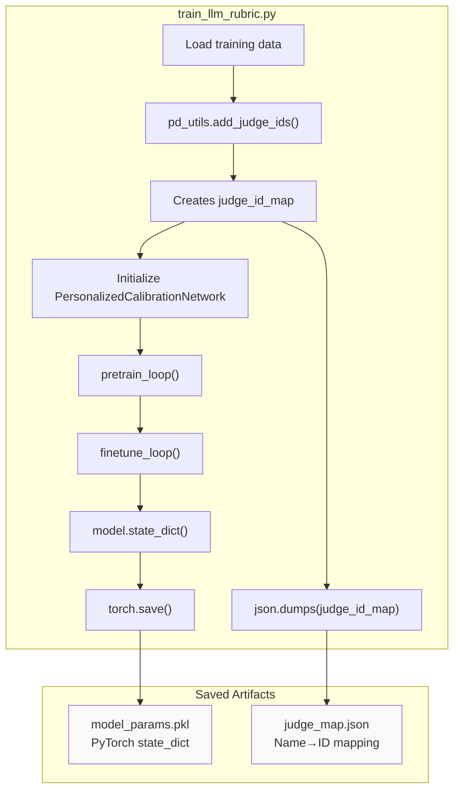
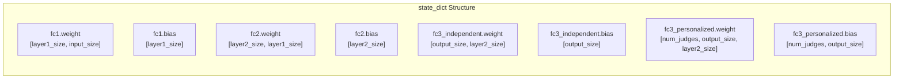
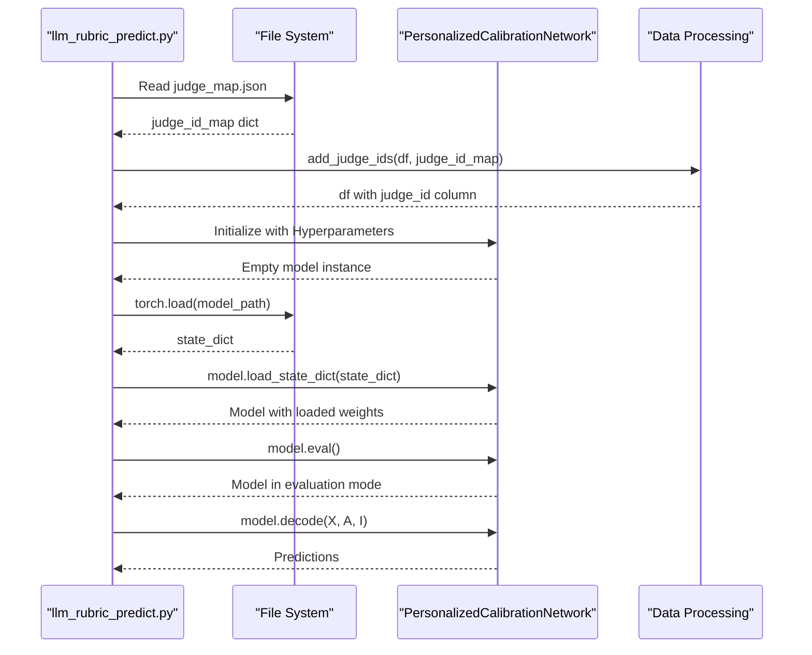
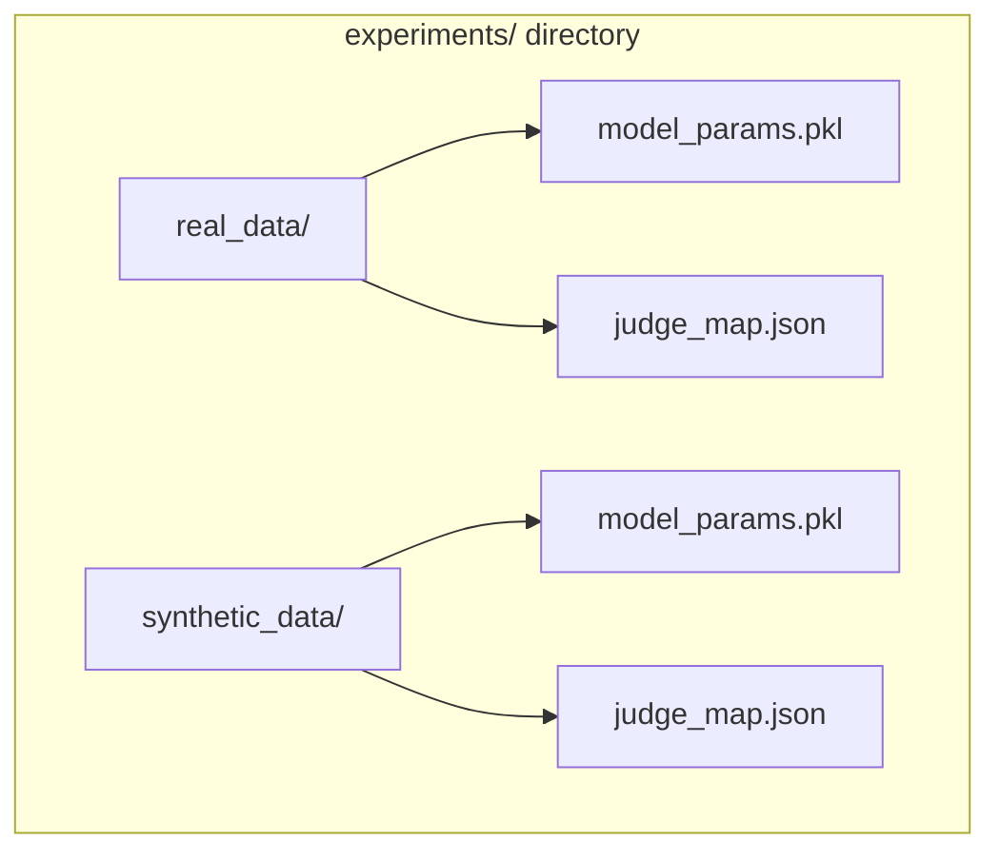

<!-- source: DeepWiki mcp.deepwiki.com · repo microsoft/LLM-Rubric · page 6.4 Model Artifacts · fetched 2026-10-26 -->

# Model Artifacts

<details>
<summary>Relevant source files</summary>

The following files were used as context for generating this wiki page:

- [experiments/real_data/judge_map.json](experiments/real_data/judge_map.json)
- [experiments/real_data/llm_rubric_full_q0_model_params.pkl](experiments/real_data/llm_rubric_full_q0_model_params.pkl)
- [scripts/llm_rubric_predict.py](scripts/llm_rubric_predict.py)
- [scripts/train_llm_rubric.py](scripts/train_llm_rubric.py)

</details>


## Purpose and Scope

This document describes the model artifacts generated during training and loaded during prediction. Model artifacts are the persistent files that capture the trained model's state, enabling reuse without retraining. The LLM-Rubric system produces two types of artifacts: model parameters and judge mappings.

For information about the training process that generates these artifacts, see [Training Process](#6.2). For guidance on using these artifacts to make predictions, see [Making Predictions](#4.3).

---

## Overview

The `PersonalizedCalibrationNetwork` requires two artifacts to function:

| Artifact | File Format | Purpose | Size |
|----------|-------------|---------|------|
| Model Parameters | PyTorch state_dict (`.pkl` or `.pt`) | Learned neural network weights | ~KB-MB depending on architecture |
| Judge Map | JSON (`.json`) | Mapping from judge names to integer IDs | ~1 KB |

Both artifacts must be saved together during training and loaded together during prediction to ensure consistency in judge identification.

---

## Artifact Generation Flow



**Sources:** [scripts/train_llm_rubric.py:66-73](), [scripts/train_llm_rubric.py:168-172]()

---

## Model Parameters File

### Structure

The model parameters file contains a PyTorch `state_dict`, which is a Python dictionary mapping parameter names to tensor values. The structure reflects the `PersonalizedCalibrationNetwork` architecture:



### Saving During Training

The training script saves model parameters after both training phases complete:

[scripts/train_llm_rubric.py:168-169]()
```python
model_path.parent.mkdir(exist_ok=True, parents=True)
torch.save(model.state_dict(), model_path)
```

Key characteristics:
- Uses PyTorch's native serialization format
- Contains only parameter tensors, not the model architecture definition
- File extension typically `.pkl` or `.pt`
- Requires PyTorch to deserialize

### Loading During Prediction

The prediction script loads parameters into a freshly initialized model:

[scripts/llm_rubric_predict.py:101-103]()
```python
model = PersonalizedCalibrationNetwork(hp)
model.load_state_dict(torch.load(model_path))
model.eval()
```

Important considerations:
- The `Hyperparameters` object must match the saved model's architecture
- `model.eval()` sets the model to evaluation mode (disables dropout, etc.)
- The model must be initialized before loading state

**Sources:** [scripts/train_llm_rubric.py:168-169](), [scripts/llm_rubric_predict.py:101-103]()

---

## Judge Map File

### Purpose

The judge map establishes a consistent mapping between judge names (strings) and integer IDs used internally by the model. This mapping is critical because:

1. The `PersonalizedCalibrationNetwork` uses integer judge IDs to index personalized parameters
2. Judge names may vary across datasets or not follow a predictable pattern
3. The same mapping must be used during training and prediction

### Structure

The judge map is a JSON object with judge names as keys and integer IDs as values:

[experiments/real_data/judge_map.json:1-26]()
```json
{
  "21": 0,
  "1": 1,
  "19": 2,
  "9": 3,
  ...
}
```

Characteristics:
- Keys: Judge names as strings (from the `annotator_name` column)
- Values: Sequential integer IDs starting from 0
- Number of entries equals `num_judges` in the model
- Order typically reflects the first occurrence in training data

### Generation During Training

The training script generates the judge map during data preprocessing:

[scripts/train_llm_rubric.py:70]()
```python
judge_id_map = pd_utils.add_judge_ids(data_df, judge_column, judge_id_column)
```

The `add_judge_ids` function creates a new column in the dataframe with integer judge IDs and returns the mapping dictionary.

The map is saved to JSON after training completes:

[scripts/train_llm_rubric.py:170-172]()
```python
judge_map_path.parent.mkdir(exist_ok=True, parents=True)
with judge_map_path.open("w") as fh:
    print(json.dumps(judge_id_map, indent="  "), file=fh)
```

### Loading During Prediction

The prediction script loads the judge map before processing data:

[scripts/llm_rubric_predict.py:61-62]()
```python
with judge_map_path.open("r") as fh:
    judge_id_map = json.load(fh)
```

This loaded map is then passed to `add_judge_ids` to ensure consistent judge ID assignment:

[scripts/llm_rubric_predict.py:64]()
```python
pd_utils.add_judge_ids(data_df, judge_column, judge_id_column, judge_id_map=judge_id_map)
```

**Sources:** [scripts/train_llm_rubric.py:70-73](), [scripts/train_llm_rubric.py:170-172](), [scripts/llm_rubric_predict.py:61-64](), [experiments/real_data/judge_map.json:1-26]()

---

## Artifact Loading Workflow



**Sources:** [scripts/llm_rubric_predict.py:61-108]()

---

## File Locations and Naming

### Default Paths

The training and prediction scripts accept paths via command-line options:

| Option | Purpose | Typical Path |
|--------|---------|-------------|
| `--model-path` | Model parameters file | `experiments/*/model_params.pkl` |
| `--judge-map` | Judge mapping file | `experiments/*/judge_map.json` |

Example from real data training:
```bash
python scripts/train_llm_rubric.py \
  --model-path experiments/real_data/model_params.pkl \
  --judge-map experiments/real_data/judge_map.json
```

### Directory Structure



Both artifacts should be stored in the same directory for organizational clarity.

**Sources:** [scripts/train_llm_rubric.py:24-25](), [scripts/llm_rubric_predict.py:24-25]()

---

## Compatibility and Portability

### Hyperparameter Consistency

The model parameters file does not store hyperparameters. When loading a saved model, you must provide matching hyperparameters:

[scripts/llm_rubric_predict.py:94-100]()
```python
hp = Hyperparameters(
    input_size=input_size,
    output_size=output_size,
    num_judges=num_judges,
    all_data_size=len(data_df),
    **hp_args,
)
```

Critical hyperparameters that must match:
- `input_size`: Number of input features (typically 36 = 9 criteria × 4 answers)
- `output_size`: Number of output dimensions (typically 9 for Q0-Q8)
- `num_judges`: Number of judges in training data
- `layer1_size`: First hidden layer size
- `layer2_size`: Second hidden layer size

Mismatch in these parameters will cause loading errors or incorrect behavior.

### Judge Set Consistency

The judge map defines which judges the model can handle. During prediction:

1. New judges not in the map **cannot** be used for personalized predictions
2. Missing judges from the training set result in unused personalized parameters
3. The number of judges must match between training and prediction

### PyTorch Version Compatibility

Model parameters are serialized using PyTorch's native format:
- Generally compatible across minor PyTorch versions
- May have issues across major version changes
- Best practice: Use the same PyTorch version for training and prediction

**Sources:** [scripts/llm_rubric_predict.py:94-103]()

---

## Inspecting Saved Artifacts

### Model Parameters

To inspect the structure and content of saved model parameters:

```python
import torch

# Load the state dict
state_dict = torch.load("experiments/real_data/model_params.pkl")

# Print parameter names and shapes
for name, param in state_dict.items():
    print(f"{name}: {param.shape}")

# Example output:
# fc1.weight: torch.Size([64, 36])
# fc1.bias: torch.Size([64])
# fc3_personalized.weight: torch.Size([13, 9, 32])
# fc3_personalized.bias: torch.Size([13, 9])
```

### Judge Map

To inspect the judge mapping:

```python
import json

with open("experiments/real_data/judge_map.json", "r") as fh:
    judge_map = json.load(fh)

print(f"Number of judges: {len(judge_map)}")
print(f"Judge names: {list(judge_map.keys())}")
print(f"ID range: {min(judge_map.values())} to {max(judge_map.values())}")
```

**Sources:** [experiments/real_data/judge_map.json:1-26]()

---

## Artifact Size Estimation

### Model Parameters

The size of the model parameters file depends on the network architecture:

| Component | Formula | Example (64, 32 layers, 13 judges) |
|-----------|---------|-------------------------------------|
| `fc1` | `(input_size × layer1_size) + layer1_size` | (36 × 64) + 64 = 2,368 params |
| `fc2` | `(layer1_size × layer2_size) + layer2_size` | (64 × 32) + 32 = 2,080 params |
| `fc3_independent` | `(layer2_size × output_size) + output_size` | (32 × 9) + 9 = 297 params |
| `fc3_personalized` | `num_judges × [(layer2_size × output_size) + output_size]` | 13 × 297 = 3,861 params |
| **Total** | | **8,606 parameters** |

At 4 bytes per float32 parameter: ~34 KB

### Judge Map

The judge map file size is minimal:
- Approximately 20-50 bytes per judge (JSON formatting)
- For 13 judges: ~500 bytes to 1 KB

---

## Best Practices

### During Training

1. **Save artifacts together**: Always save both model parameters and judge map after training
2. **Create parent directories**: Use `mkdir(exist_ok=True, parents=True)` before saving
3. **Document hyperparameters**: Store hyperparameters separately or in artifact filenames
4. **Version artifacts**: Include experiment names or dates in artifact paths

### During Prediction

1. **Load judge map first**: Load and apply judge mapping before initializing the model
2. **Validate compatibility**: Check that `num_judges` matches between map and model
3. **Set evaluation mode**: Always call `model.eval()` after loading state_dict
4. **Handle missing judges**: Plan for scenarios where prediction data contains unknown judges

### Organization

```
experiments/
├── real_data/
│   ├── model_params.pkl
│   ├── judge_map.json
│   └── hyperparameters.json  # Optional but recommended
└── synthetic_data/
    ├── fold_0/
    │   ├── model_params.pkl
    │   └── judge_map.json
    └── fold_1/
        ├── model_params.pkl
        └── judge_map.json
```

**Sources:** [scripts/train_llm_rubric.py:168-172](), [scripts/llm_rubric_predict.py:101-103]()

---

## Summary

Model artifacts enable the trained `PersonalizedCalibrationNetwork` to be reused without retraining. The two required artifacts are:

1. **Model Parameters** (`.pkl`): PyTorch state_dict containing all learned weights
2. **Judge Map** (`.json`): Mapping from judge names to integer IDs

Both artifacts must be saved during training and loaded together during prediction. Proper artifact management ensures reproducible results and enables model deployment across different environments.

**Sources:** [scripts/train_llm_rubric.py:1-177](), [scripts/llm_rubric_predict.py:1-122](), [experiments/real_data/judge_map.json:1-26]()

---

