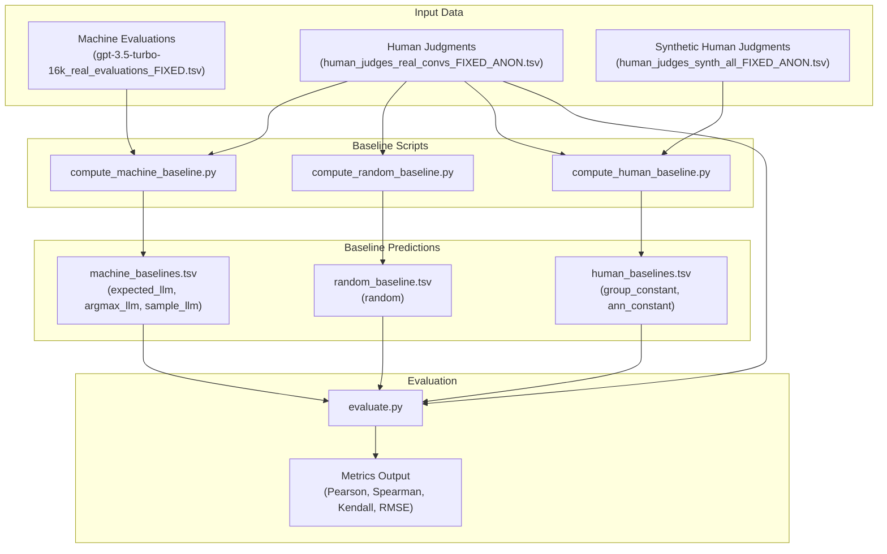
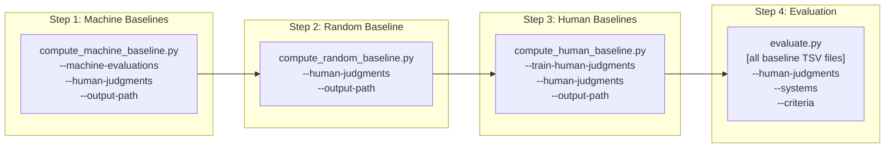
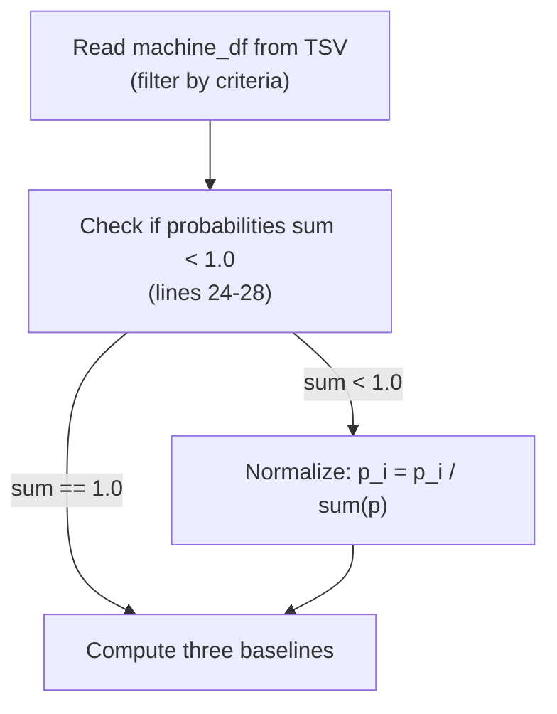
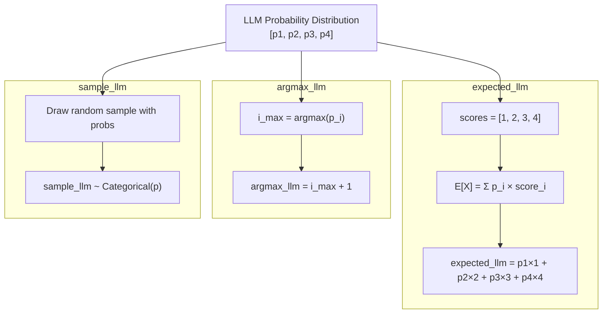
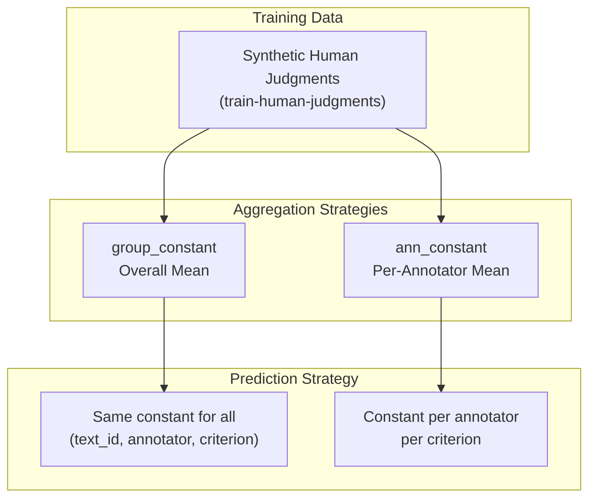
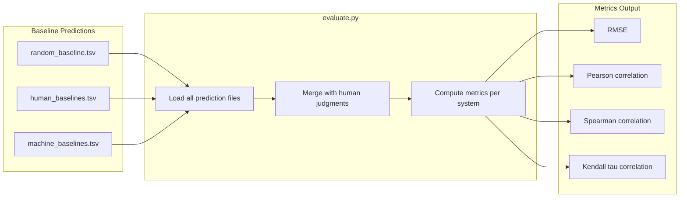
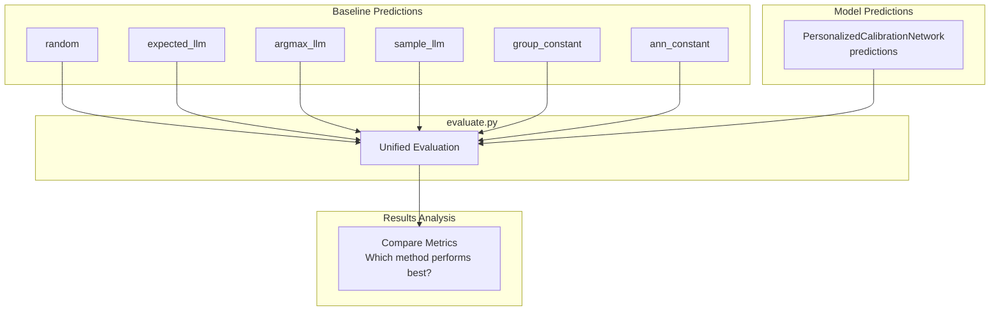

<!-- source: DeepWiki mcp.deepwiki.com · repo microsoft/LLM-Rubric · page 7 Baseline Systems · fetched 2026-10-26 -->

# Baseline Systems

<details>
<summary>Relevant source files</summary>

The following files were used as context for generating this wiki page:

- [scripts/compute_machine_baseline.py](scripts/compute_machine_baseline.py)
- [scripts/run_real_data_baselines.sh](scripts/run_real_data_baselines.sh)

</details>


## Purpose and Scope

This page documents the baseline systems used to benchmark the PersonalizedCalibrationNetwork model's performance. Baseline systems provide comparison points that demonstrate whether the learned calibration approach offers advantages over simpler methods. The LLM-Rubric framework implements six baseline methods divided into three categories: machine baselines (derived from LLM probability distributions), human baselines (derived from human judgment statistics), and a random baseline (performance lower bound).

For detailed information on how to compute these baselines, see [Computing Baselines](#4.1). For evaluation metrics and comparison methodology, see [Evaluating Results](#4.4). For the PersonalizedCalibrationNetwork architecture that these baselines are compared against, see [Personalized Calibration Network](#3.2).

---

## Overview

Baseline systems serve as reference points for evaluating the PersonalizedCalibrationNetwork's learned calibration approach. Each baseline represents a different strategy for predicting human judgments:

| Baseline Type | Baseline Name | Description | Complexity |
|--------------|---------------|-------------|------------|
| Machine | `expected_llm` | Expected value of LLM probability distribution | Statistical aggregation |
| Machine | `argmax_llm` | Most probable answer from LLM distribution | Deterministic selection |
| Machine | `sample_llm` | Random sample from LLM probability distribution | Stochastic selection |
| Human | `group_constant` | Overall mean across all judges and criteria | Global constant |
| Human | `ann_constant` | Per-annotator mean for each criterion | Annotator-specific constant |
| Random | `random` | Uniform random selection from [1, 2, 3, 4] | Performance floor |

The baselines range from simple stochastic methods (`random`) to statistical aggregations (`expected_llm`, `group_constant`) to personalized constants (`ann_constant`). None of these baselines learn from data in the way the PersonalizedCalibrationNetwork does, making them appropriate comparison benchmarks.

---

## Baseline Computation Pipeline

The baseline computation workflow processes machine evaluations and human judgments to produce predictions that can be evaluated against ground truth annotations.

### Pipeline Architecture



**Sources:** [scripts/run_real_data_baselines.sh:1-38]()

### Script Execution Flow

The shell script [scripts/run_real_data_baselines.sh:1-38]() orchestrates the complete baseline computation and evaluation workflow:



**Sources:** [scripts/run_real_data_baselines.sh:1-38]()

---

## Machine Baseline Computation

Machine baselines transform LLM probability distributions into scalar predictions using different aggregation strategies. The implementation is in [scripts/compute_machine_baseline.py:1-62]().

### Probability Distribution Processing

The script first loads machine evaluations and normalizes probability distributions to ensure they sum to 1.0:



The normalization step [scripts/compute_machine_baseline.py:24-28]() ensures that malformed probability distributions don't cause computation errors:

| Column | Description | Range |
|--------|-------------|-------|
| `answer1_prob` | Probability of score 1 | [0.0, 1.0] |
| `answer2_prob` | Probability of score 2 | [0.0, 1.0] |
| `answer3_prob` | Probability of score 3 | [0.0, 1.0] |
| `answer4_prob` | Probability of score 4 | [0.0, 1.0] |

**Sources:** [scripts/compute_machine_baseline.py:19-28]()

### Baseline Formulas

Three distinct baselines are computed from the probability distributions:



**Implementation details:**

1. **`expected_llm`** [scripts/compute_machine_baseline.py:30-31]()
   - Computes expected value using matrix multiplication
   - Formula: `expected_llm = [p1, p2, p3, p4] @ [1, 2, 3, 4]^T`
   - Produces continuous values in range [1.0, 4.0]

2. **`argmax_llm`** [scripts/compute_machine_baseline.py:32]()
   - Selects most probable answer deterministically
   - Formula: `argmax_llm = argmax(probs) + 1`
   - Produces discrete values in {1, 2, 3, 4}

3. **`sample_llm`** [scripts/compute_machine_baseline.py:33]()
   - Samples stochastically from distribution
   - Formula: `sample_llm ~ Categorical([1, 2, 3, 4], p=[p1, p2, p3, p4])`
   - Produces discrete values in {1, 2, 3, 4}

**Sources:** [scripts/compute_machine_baseline.py:30-33]()

### Output Format

The script aligns machine baseline predictions with human judgments by iterating through each (text_id, annotator_id, criterion) tuple [scripts/compute_machine_baseline.py:35-54](). The output TSV file contains:

| Column | Description |
|--------|-------------|
| `text_id` | Conversation identifier |
| `annotator_id` | Judge identifier |
| `dialogue_system` | System being evaluated |
| `criterion` | Rubric criterion (Q0-Q8) |
| `sample_llm` | Sampled baseline prediction |
| `argmax_llm` | Argmax baseline prediction |
| `expected_llm` | Expected value baseline prediction |

**Sources:** [scripts/compute_machine_baseline.py:44-54]()

---

## Random Baseline

The random baseline provides a performance lower bound by generating uniform random predictions. It is computed by the script referenced in [scripts/run_real_data_baselines.sh:13-17]().

The random baseline:
- Generates predictions uniformly from {1, 2, 3, 4}
- Provides no signal from LLM outputs or human judgments
- Serves as a sanity check (all methods should significantly outperform it)
- Has expected correlation with ground truth near 0

For implementation details, see [Random Baseline](#7.3).

**Sources:** [scripts/run_real_data_baselines.sh:13-17]()

---

## Human Baseline Computation

Human baselines aggregate statistics from human judgments to create constant predictions. The implementation is referenced in [scripts/run_real_data_baselines.sh:20-26]().

### Baseline Types



**Human baseline characteristics:**

1. **`group_constant`**
   - Computes mean across all annotators and criteria in training data
   - Predicts same value regardless of annotator identity
   - Captures overall judgment tendency

2. **`ann_constant`**
   - Computes mean per (annotator_id, criterion) pair in training data
   - Predicts annotator-specific values
   - Captures individual annotator biases and scales

Both baselines use synthetic training data [scripts/run_real_data_baselines.sh:24]() to compute statistics, then apply those statistics to real conversation data [scripts/run_real_data_baselines.sh:25]().

**Sources:** [scripts/run_real_data_baselines.sh:20-26]()

---

## Evaluation Framework

After computing all baselines, the evaluation script compares them against ground truth human judgments.

### Evaluation Workflow



The evaluation command [scripts/run_real_data_baselines.sh:29-36]() specifies:
- Input: All baseline TSV files
- `--human-judgments`: Ground truth annotations
- `--systems`: Comma-separated list of baseline names to evaluate
- `--criteria`: Which rubric criteria to evaluate (e.g., "Q0")

**Sources:** [scripts/run_real_data_baselines.sh:29-36]()

---

## Baseline Comparison Matrix

The following table summarizes the key characteristics that differentiate baseline approaches:

| Characteristic | Machine Baselines | Human Baselines | Random Baseline |
|---------------|-------------------|-----------------|-----------------|
| **Input Signal** | LLM probability distributions | Human judgment statistics | None |
| **Personalization** | None | `ann_constant` is annotator-specific | None |
| **Training Required** | No | Yes (computes means from training set) | No |
| **Stochasticity** | `sample_llm` only | None | Yes |
| **Output Type** | Continuous (`expected_llm`) or discrete | Continuous | Discrete |
| **Computation** | Per-instance calculation | Lookup from precomputed constants | Per-instance random draw |

**Sources:** [scripts/compute_machine_baseline.py:1-62](), [scripts/run_real_data_baselines.sh:1-38]()

---

## Integration with Model Training

Baselines serve two purposes in the LLM-Rubric workflow:

1. **Comparison Benchmarks**: Demonstrate whether PersonalizedCalibrationNetwork's learned approach outperforms simpler methods
2. **Sanity Checks**: Ensure evaluation metrics and data processing are correct (e.g., all methods should outperform random baseline)

The comparison workflow:



The PersonalizedCalibrationNetwork should outperform all baselines by:
- Learning nonlinear calibration functions (vs. linear aggregation)
- Adapting to individual judge preferences (vs. global or simple per-annotator constants)
- Training on data to discover patterns (vs. fixed rules)

**Sources:** [scripts/run_real_data_baselines.sh:1-38]()

---

## Command Line Usage

### Computing Machine Baselines

```bash
python scripts/compute_machine_baseline.py \
  --machine-evaluations data/real_data/gpt-3.5-turbo-16k_real_evaluations_FIXED.tsv \
  --human-judgments data/real_data/human_judges_real_convs_FIXED_ANON.tsv \
  --output-path experiments/real_data/predictions/real_convs_machine_baselines.tsv
```

**Parameters:**
- `--machine-evaluations`: Path to LLM evaluation TSV file with probability distributions
- `--human-judgments`: Path to human judgment TSV file for alignment
- `--output-path`: Path to write baseline predictions TSV
- `--random-seed`: Random seed for `sample_llm` reproducibility (default: 4076609)
- `--criteria`: Comma-separated list of criteria to evaluate (default: "Q1,Q2,Q3,Q4,Q5,Q6,Q7,Q8,Q0")

**Sources:** [scripts/compute_machine_baseline.py:10-16](), [scripts/run_real_data_baselines.sh:7-10]()

### Running All Baselines

The complete baseline computation and evaluation pipeline can be executed with:

```bash
bash scripts/run_real_data_baselines.sh
```

This script computes all six baselines and evaluates them against human judgments, producing correlation metrics for comparison.

**Sources:** [scripts/run_real_data_baselines.sh:1-38]()

---

## Related Pages

- For machine baseline implementation details, see [Machine Baselines](#7.1)
- For human baseline implementation details, see [Human Baselines](#7.2)
- For random baseline implementation details, see [Random Baseline](#7.3)
- For evaluation metrics computation, see [Evaluating Results](#4.4)
- For data format specifications, see [Data Formats and Schema](#5.1)

---

