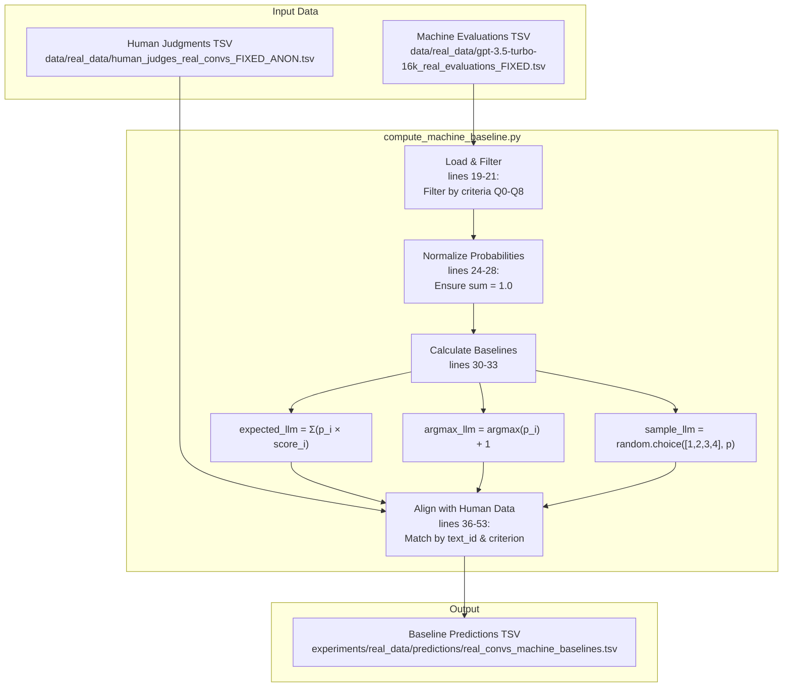
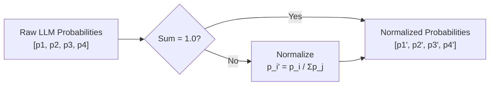
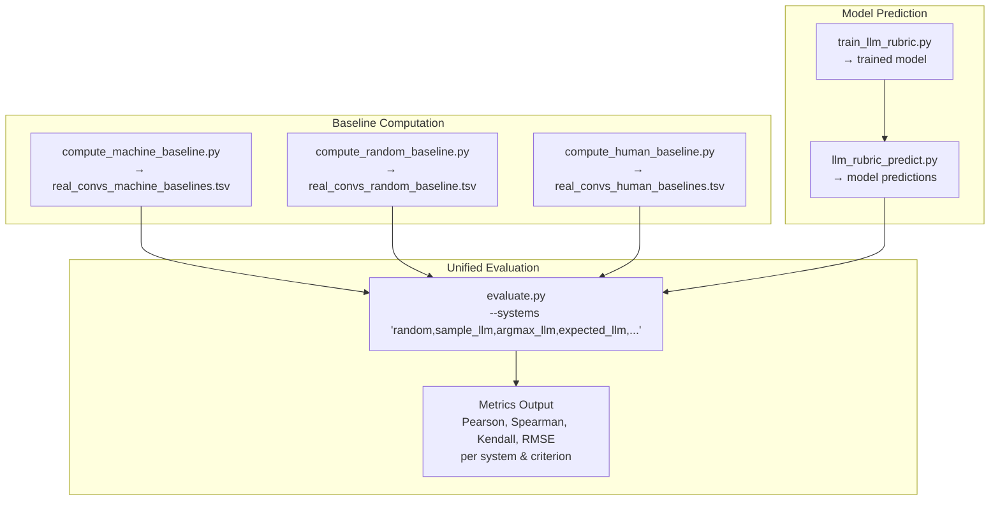
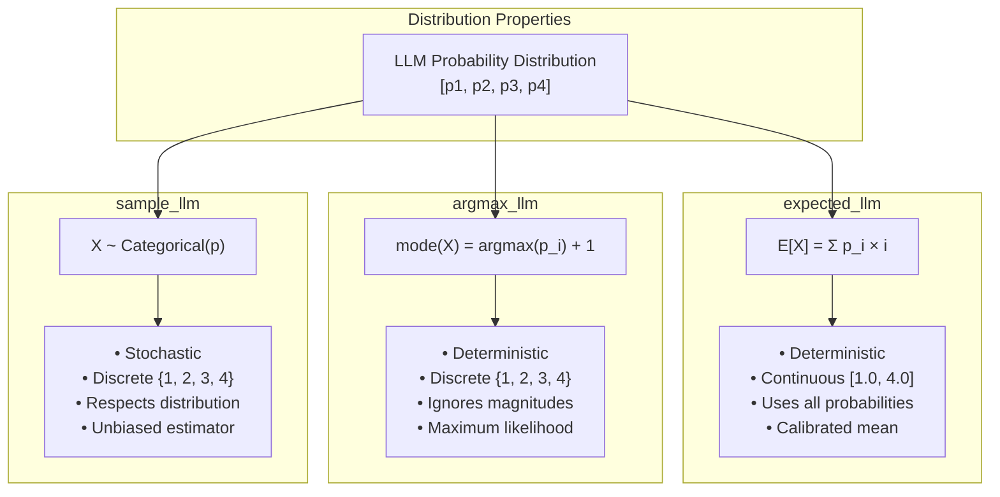

<!-- source: DeepWiki mcp.deepwiki.com · repo microsoft/LLM-Rubric · page 7.1 Machine Baselines · fetched 2026-10-26 -->

# Machine Baselines

<details>
<summary>Relevant source files</summary>

The following files were used as context for generating this wiki page:

- [experiments/real_data/predictions/real_convs_machine_baselines.tsv](experiments/real_data/predictions/real_convs_machine_baselines.tsv)
- [scripts/compute_machine_baseline.py](scripts/compute_machine_baseline.py)
- [scripts/run_real_data_baselines.sh](scripts/run_real_data_baselines.sh)

</details>


This page documents the machine baseline methods that derive predictions directly from LLM probability distributions without learning personalized calibration. These baselines serve as comparison benchmarks for the PersonalizedCalibrationNetwork by using fixed mathematical operations on the raw LLM outputs.

For human-derived baselines, see [Human Baselines](#7.2). For the random baseline, see [Random Baseline](#7.3). For the neural network approach that learns to calibrate these distributions, see [Personalized Calibration Network](#3.2).

---

## Overview

Machine baselines generate predictions by applying deterministic or stochastic operations to the probability distributions produced by `gpt-3.5-turbo-16k` evaluations. Unlike the PersonalizedCalibrationNetwork which learns judge-specific calibration functions, these baselines use fixed rules that apply uniformly to all judges and criteria.

The system implements three machine baseline methods:

| Baseline Method | Type | Description |
|----------------|------|-------------|
| `expected_llm` | Deterministic | Expected value of the probability distribution |
| `argmax_llm` | Deterministic | Most probable answer (mode of distribution) |
| `sample_llm` | Stochastic | Random sample from the distribution |

All three methods operate on the same input: LLM probability distributions over four possible answers (1, 2, 3, 4) for each evaluation criterion (Q0-Q8).

Sources: [scripts/compute_machine_baseline.py:10-61]()

---

## Data Flow Architecture



Sources: [scripts/compute_machine_baseline.py:10-61](), [scripts/run_real_data_baselines.sh:7-10]()

---

## Baseline Methods

### Expected Value (`expected_llm`)

The `expected_llm` baseline computes the expected value of the probability distribution, treating it as the weighted average of possible scores.

**Mathematical Formula:**
```
expected_llm = Σ(i=1 to 4) p_i × i
             = p_1×1 + p_2×2 + p_3×3 + p_4×4
```

Where `p_i` is the probability of answer `i` from the LLM evaluation.

**Implementation:**
```python
scores = np.array([[1.0, 2.0, 3.0, 4.0]]).T
machine_df["expected_llm"] = machine_df[llm_answer_prob_columns].values @ scores
```

**Properties:**
- Deterministic: Same input always produces same output
- Continuous: Output range is [1.0, 4.0]
- Sensitive: Incorporates information from all probability values
- Smooth: Small changes in probabilities produce small changes in output

**Example:**
If LLM probabilities are `[0.1, 0.3, 0.5, 0.1]`:
```
expected_llm = 0.1×1 + 0.3×2 + 0.5×3 + 0.1×4 = 2.6
```

Sources: [scripts/compute_machine_baseline.py:30-31]()

### Argmax (`argmax_llm`)

The `argmax_llm` baseline selects the answer with the highest probability.

**Mathematical Formula:**
```
argmax_llm = argmax(p_1, p_2, p_3, p_4) + 1
```

The `+1` offset converts from 0-indexed array position to 1-4 score scale.

**Implementation:**
```python
machine_df["argmax_llm"] = machine_df[llm_answer_prob_columns].values.argmax(axis=1) + 1
```

**Properties:**
- Deterministic: Same input always produces same output
- Discrete: Output is always an integer in {1, 2, 3, 4}
- Insensitive: Ignores probability magnitudes, only cares about ordering
- Discontinuous: Small probability changes can cause discrete jumps

**Example:**
If LLM probabilities are `[0.1, 0.3, 0.5, 0.1]`:
```
argmax_llm = 3  (index 2 has highest probability 0.5)
```

Sources: [scripts/compute_machine_baseline.py:32]()

### Sampling (`sample_llm`)

The `sample_llm` baseline randomly samples from the probability distribution, treating it as a categorical distribution.

**Mathematical Formula:**
```
sample_llm ~ Categorical(p_1, p_2, p_3, p_4)
```

**Implementation:**
```python
machine_df["sample_llm"] = [
    np.random.choice([1.0, 2.0, 3.0, 4.0], p=row) 
    for row in machine_df[llm_answer_prob_columns].values
]
```

**Properties:**
- Stochastic: Different runs produce different outputs
- Discrete: Output is always an integer in {1, 2, 3, 4}
- Calibrated: Respects probability magnitudes (high prob → more likely sampled)
- Unbiased: Expected value equals `expected_llm` over many samples

**Example:**
If LLM probabilities are `[0.1, 0.3, 0.5, 0.1]`:
```
sample_llm ∈ {1, 2, 3, 4} with probabilities [0.1, 0.3, 0.5, 0.1]
Most likely: 3 (50% chance)
```

Sources: [scripts/compute_machine_baseline.py:33](), [scripts/compute_machine_baseline.py:14]()

---

## Probability Normalization

Before computing baselines, the system ensures all probability distributions sum to 1.0. This handles edge cases where LLM outputs may not be perfectly normalized.



**Implementation:**
```python
for idx, row in machine_df.iterrows():
    if row[llm_answer_prob_columns].sum() < 1.0:
        s = row[llm_answer_prob_columns].sum()
        for c in llm_answer_prob_columns:
            machine_df.at[idx, c] /= s
```

This ensures:
- All baselines receive valid probability distributions
- Expected values are bounded in [1.0, 4.0]
- Sampling is well-defined (probabilities sum to 1.0)

Sources: [scripts/compute_machine_baseline.py:24-28]()

---

## Input Format

### Machine Evaluations

The machine evaluations file contains LLM probability distributions in row-wise format:

| Column | Type | Description |
|--------|------|-------------|
| `text_id` | string | Unique conversation identifier |
| `criterion` | string | Question ID (Q0, Q1, ..., Q8) |
| `answer1_prob` | float | Probability of score 1 |
| `answer2_prob` | float | Probability of score 2 |
| `answer3_prob` | float | Probability of score 3 |
| `answer4_prob` | float | Probability of score 4 |

**Example:**
```
text_id                       criterion  answer1_prob  answer2_prob  answer3_prob  answer4_prob
65c5b4b9f174b2897703736a     Q1         0.1234        0.2345        0.4567        0.1854
65c5b4b9f174b2897703736a     Q2         0.0987        0.3210        0.4321        0.1482
```

### Human Judgments

The human judgments file provides ground truth and alignment information:

| Column | Type | Description |
|--------|------|-------------|
| `text_id` | string | Unique conversation identifier |
| `annotator_id` | int | Judge ID (0-22) |
| `dialogue_system` | int | System ID (0, 1, 2) |
| `Q0`, `Q1`, ..., `Q8` | float | Human scores (1-4) or NaN |

The baseline computation script uses this file to:
1. Filter valid judgments (scores in {1.0, 2.0, 3.0, 4.0}, non-NaN)
2. Align machine predictions with specific judge-criterion pairs
3. Create output rows for each valid human judgment

Sources: [scripts/compute_machine_baseline.py:19-21](), [scripts/compute_machine_baseline.py:36-53]()

---

## Output Format

The baseline computation produces a TSV file with one row per (text, judge, criterion) triple:

| Column | Type | Description |
|--------|------|-------------|
| `text_id` | string | Conversation identifier |
| `annotator_id` | int | Judge ID |
| `dialogue_system` | int | System ID |
| `criterion` | string | Question ID (Q0-Q8) |
| `sample_llm` | float | Sampled prediction |
| `argmax_llm` | float | Argmax prediction |
| `expected_llm` | float | Expected value prediction |

**Example output:**
```
text_id                       annotator_id  dialogue_system  criterion  sample_llm  argmax_llm  expected_llm
65c5b4b9f174b2897703736a     22            2                Q1         3.0         3.0         2.718365
65c5b4b9f174b2897703736a     22            2                Q2         3.0         3.0         2.581871
65c5b4b9f174b2897703736a     22            2                Q3         3.0         2.0         2.397990
```

**File Location:**
- Real data: `experiments/real_data/predictions/real_convs_machine_baselines.tsv`
- Synthetic data: Similar pattern with different path

Sources: [scripts/compute_machine_baseline.py:54-58](), [experiments/real_data/predictions/real_convs_machine_baselines.tsv:1-10]()

---

## Usage

### Command-Line Interface

The baseline computation script is invoked via `typer` CLI:

```bash
python scripts/compute_machine_baseline.py \
  --machine-evaluations <path_to_llm_evals.tsv> \
  --human-judgments <path_to_human_judgments.tsv> \
  --output-path <output_path.tsv> \
  [--random-seed <seed>] \
  [--criteria "Q1,Q2,Q3,Q4,Q5,Q6,Q7,Q8,Q0"]
```

**Parameters:**

| Parameter | Required | Default | Description |
|-----------|----------|---------|-------------|
| `--machine-evaluations` | Yes | - | Path to LLM evaluation TSV |
| `--human-judgments` | Yes | - | Path to human judgment TSV |
| `--output-path` | Yes | - | Path for output TSV |
| `--random-seed` | No | 4076609 | Random seed for `sample_llm` |
| `--criteria` | No | "Q1,Q2,...,Q0" | Comma-separated criteria to process |

**Example:**
```bash
python scripts/compute_machine_baseline.py \
  --machine-evaluations data/real_data/gpt-3.5-turbo-16k_real_evaluations_FIXED.tsv \
  --human-judgments data/real_data/human_judges_real_convs_FIXED_ANON.tsv \
  --output-path experiments/real_data/predictions/real_convs_machine_baselines.tsv
```

Sources: [scripts/compute_machine_baseline.py:10-16](), [scripts/run_real_data_baselines.sh:7-10]()

### Integration with Evaluation Pipeline

Machine baselines are computed as part of the complete baseline evaluation workflow:



The `evaluate.py` script accepts multiple prediction files and computes metrics for each baseline method specified via the `--systems` flag.

Sources: [scripts/run_real_data_baselines.sh:29-36]()

---

## Comparison of Methods

### Theoretical Properties



Sources: [scripts/compute_machine_baseline.py:30-33]()

### When Each Method Works Well

| Baseline | Ideal Scenario | Limitation |
|----------|----------------|------------|
| `expected_llm` | LLM provides well-calibrated probabilities across all answers | Averages away information when distribution is bimodal |
| `argmax_llm` | LLM has high confidence (one probability >> others) | Ignores uncertainty when probabilities are similar |
| `sample_llm` | Want to match distribution shape, multiple evaluations available | High variance in single-shot evaluation |

### Example Comparison

Consider an LLM evaluation with probabilities `[0.05, 0.15, 0.45, 0.35]`:

```
expected_llm = 0.05×1 + 0.15×2 + 0.45×3 + 0.35×4 = 3.1
argmax_llm   = 3  (highest probability at index 2)
sample_llm   = 3 with 45% probability, 4 with 35% probability, etc.
```

If the true human score is 3:
- `argmax_llm` = 3 (exact match)
- `expected_llm` = 3.1 (close, 0.1 error)
- `sample_llm` = 3 or 4 most likely (could match or be off by 1)

If the true human score is 4:
- `argmax_llm` = 3 (error of 1)
- `expected_llm` = 3.1 (error of 0.9)
- `sample_llm` = 4 with 35% probability (reasonable chance of matching)

Sources: [scripts/compute_machine_baseline.py:30-33]()

---

## Implementation Details

### Probability Column Names

The script expects specific column names for LLM probability distributions:

```python
llm_answer_prob_columns = ["answer1_prob", "answer2_prob", "answer3_prob", "answer4_prob"]
```

These columns must be present in the machine evaluations TSV file.

Sources: [scripts/compute_machine_baseline.py:22]()

### Score Mapping

Scores are mapped to the range [1, 4]:

```python
scores = np.array([[1.0, 2.0, 3.0, 4.0]]).T
```

This matches the human judgment scale where:
- 1 = Lowest quality
- 2 = Below average quality
- 3 = Above average quality
- 4 = Highest quality

Sources: [scripts/compute_machine_baseline.py:30]()

### Random Seed

The `sample_llm` baseline uses a configurable random seed for reproducibility:

```python
np.random.seed(random_seed)  # Default: 4076609
```

This ensures that:
1. Results are reproducible across runs with same seed
2. Different seeds can be used for sensitivity analysis
3. Cross-validation folds remain consistent

Sources: [scripts/compute_machine_baseline.py:17]()

### Data Alignment Algorithm

The script aligns machine predictions with human judgments using a nested loop:

```python
for _, row in human_df.iterrows():
    for criterion in criteria:
        if not row[criterion] in set([1.0, 2.0, 3.0, 4.0]):
            continue
        if math.isnan(row[criterion]):
            continue
        mpred_df = machine_df.loc[
            (machine_df["text_id"] == row["text_id"]) & 
            (machine_df["criterion"] == criterion)
        ]
        assert len(mpred_df) == 1
        # Extract baselines and create output row
```

This ensures:
- Only valid human judgments are included (scores 1-4, non-NaN)
- Each (text_id, criterion) pair has exactly one machine evaluation
- All three baselines are computed for each valid judgment

Sources: [scripts/compute_machine_baseline.py:36-53]()

---

## Relationship to Other Systems

### vs. PersonalizedCalibrationNetwork

| Aspect | Machine Baselines | PersonalizedCalibrationNetwork |
|--------|-------------------|--------------------------------|
| **Personalization** | None (same for all judges) | Judge-specific parameters |
| **Learning** | No training required | Requires pretraining + finetuning |
| **Complexity** | Simple mathematical operations | Neural network with hidden layers |
| **Adaptability** | Fixed rules | Learns from data |
| **Calibration** | Assumes LLM is well-calibrated | Learns calibration function |

Machine baselines provide a performance floor. If the PersonalizedCalibrationNetwork cannot outperform these simple methods, it indicates the neural network approach is not adding value.

Sources: [scripts/compute_machine_baseline.py:10-61]()

### vs. Human Baselines

Machine baselines use only LLM outputs, while human baselines use only human judgment statistics. Neither learns from the relationship between LLM outputs and human judgments—that is what the PersonalizedCalibrationNetwork does.

For human baselines, see [Human Baselines](#7.2).

### Evaluation Metrics

All baselines (machine, human, random, and model) are evaluated using the same metrics:

- **Pearson correlation**: Linear relationship with human judgments
- **Spearman correlation**: Monotonic relationship (rank-based)
- **Kendall tau**: Pairwise concordance
- **RMSE**: Root mean squared error

For details on evaluation, see [Evaluating Results](#4.4).

Sources: [scripts/run_real_data_baselines.sh:29-36]()

---

