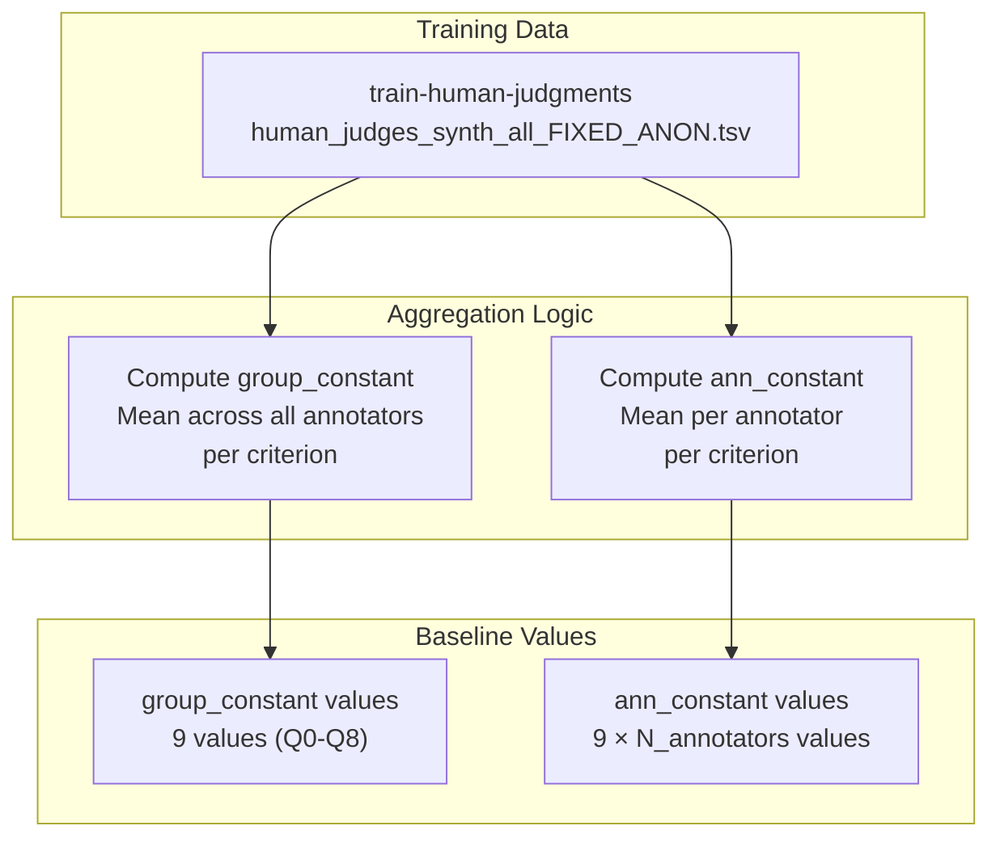
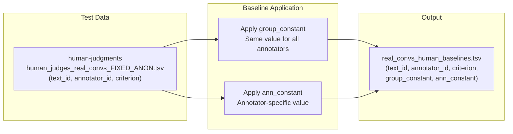
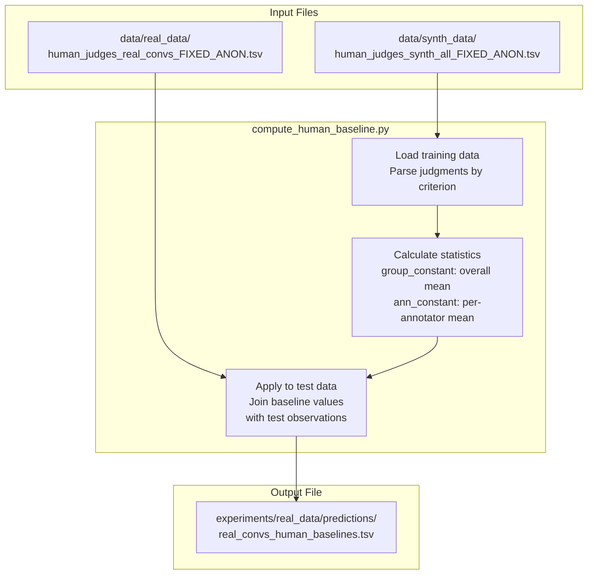
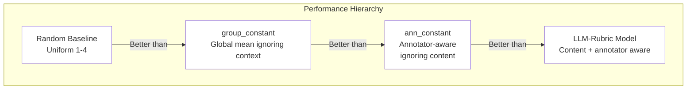
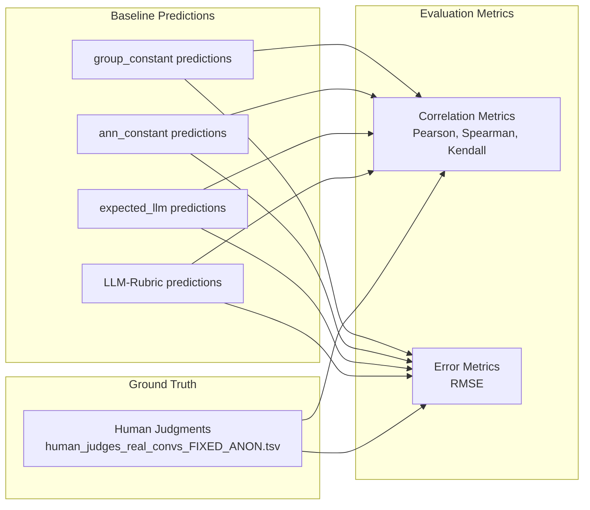
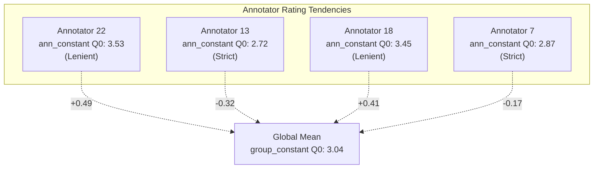

<!-- source: DeepWiki mcp.deepwiki.com · repo microsoft/LLM-Rubric · page 7.2 Human Baselines · fetched 2026-10-26 -->

# Human Baselines

<details>
<summary>Relevant source files</summary>

The following files were used as context for generating this wiki page:

- [experiments/real_data/predictions/real_convs_human_baselines.tsv](experiments/real_data/predictions/real_convs_human_baselines.tsv)
- [scripts/run_real_data_baselines.sh](scripts/run_real_data_baselines.sh)

</details>


This page documents the human-derived baseline systems used for comparison in the LLM-Rubric evaluation framework. These baselines aggregate human judgments using simple statistical methods to provide reference performance metrics.

For machine-derived baselines (expected_llm, argmax_llm, sample_llm), see [Machine Baselines](#7.1). For the random baseline, see [Random Baseline](#7.3).

## Overview

Human baselines leverage actual human judgment data to establish performance benchmarks. Unlike machine baselines that derive predictions from LLM probability distributions, human baselines use aggregated historical human annotations as predictions. The LLM-Rubric system implements two human baseline strategies:

| Baseline System | Description | Granularity |
|----------------|-------------|-------------|
| `group_constant` | Overall mean judgment across all annotators | Global per criterion |
| `ann_constant` | Per-annotator mean judgment | Annotator-specific per criterion |

Both baselines are computed from training data (synthetic conversations) and applied to test data (real conversations) to evaluate how well simple statistical aggregation performs compared to learned calibration models.

**Sources:** [scripts/run_real_data_baselines.sh:20-26]()

## Computation Strategy

### Training Phase

Human baselines are computed from human judgments on synthetic training data. For each evaluation criterion (Q0-Q8), the system calculates:

1. **Group Constant**: Mean of all human judgments across all annotators for each criterion
2. **Annotator Constant**: Mean of each annotator's judgments for each criterion



**Sources:** [scripts/run_real_data_baselines.sh:23-24]()

### Prediction Phase

During prediction, the computed baseline values are used as constant predictions for test data:



**Sources:** [scripts/run_real_data_baselines.sh:25-26]()

## Baseline System Details

### Group Constant Baseline

The `group_constant` baseline represents the population-level central tendency for each criterion. It predicts the overall average judgment regardless of which annotator is evaluating or what specific text is being judged.

**Computation:**
```
group_constant[criterion] = mean(all_judgments[criterion])
```

**Characteristics:**
- Ignores annotator identity
- Ignores text content
- Provides a global performance floor
- Identical prediction for all (text_id, annotator_id) pairs given a criterion

### Annotator Constant Baseline

The `ann_constant` baseline captures annotator-specific tendencies. Each annotator has their own mean judgment for each criterion, reflecting their personal rating patterns.

**Computation:**
```
ann_constant[annotator][criterion] = mean(judgments[annotator][criterion])
```

**Characteristics:**
- Personalized to each annotator
- Still ignores text content
- Tests whether annotator identity alone provides predictive power
- Different predictions for different annotators on the same text

**Sources:** [experiments/real_data/predictions/real_convs_human_baselines.tsv:1-100]()

## Implementation

### Script Invocation

The human baselines are computed using the `compute_human_baseline.py` script:

```bash
python scripts/compute_human_baseline.py \
  --train-human-judgments data/synth_data/human_judges_synth_all_FIXED_ANON.tsv \
  --human-judgments data/real_data/human_judges_real_convs_FIXED_ANON.tsv \
  --output-path experiments/real_data/predictions/real_convs_human_baselines.tsv
```

**Arguments:**
- `--train-human-judgments`: Training data used to compute baseline statistics (synthetic conversations)
- `--human-judgments`: Test data to apply baselines to (real conversations)
- `--output-path`: TSV file path for output predictions

**Sources:** [scripts/run_real_data_baselines.sh:23-26]()

### Data Flow



**Sources:** [scripts/run_real_data_baselines.sh:23-26]()

## Output Format

The output TSV file contains one row per (text_id, annotator_id, dialogue_system, criterion) combination with both baseline predictions:

| Column | Type | Description |
|--------|------|-------------|
| `text_id` | string | Unique identifier for the conversation |
| `annotator_id` | integer | Numeric ID for the human judge |
| `dialogue_system` | integer | System being evaluated (0, 1, or 2) |
| `criterion` | string | Evaluation criterion (Q0-Q8) |
| `group_constant` | float | Global mean prediction for this criterion |
| `ann_constant` | float | Annotator-specific mean prediction for this criterion |

### Example Output Rows

```
text_id                         annotator_id  dialogue_system  criterion  group_constant  ann_constant
65c5b4b9f174b2897703736a       22            2                Q1         3.213605        3.894737
65c5b4b9f174b2897703736a       22            2                Q2         3.397611        3.812500
65c5c73ef174b289770373a2       7             1                Q1         3.213605        3.100000
65c5c73ef174b289770373a2       7             1                Q2         3.397611        2.833333
```

**Sources:** [experiments/real_data/predictions/real_convs_human_baselines.tsv:1-25]()

## Baseline Comparison

### Interpretation

The two human baselines serve different analytical purposes:



**Group Constant Use Cases:**
- Establishes minimum performance above random guessing
- Tests if simple central tendency beats random
- Baseline for systems that ignore annotator identity

**Annotator Constant Use Cases:**
- Tests if annotator identity alone provides signal
- Evaluates benefit of personalization
- Upper bound for content-agnostic personalized systems

**Sources:** [scripts/run_real_data_baselines.sh:20-36]()

## Evaluation Integration

### Metrics Computation

Human baselines are evaluated using the same metrics as other systems (Pearson, Spearman, Kendall correlation, RMSE). The `evaluate.py` script compares both baselines against ground truth human judgments:

```bash
python scripts/evaluate.py \
    experiments/real_data/predictions/real_convs_human_baselines.tsv \
    --human-judgments data/real_data/human_judges_real_convs_FIXED_ANON.tsv \
    --systems "group_constant,ann_constant"
```

The script processes predictions from the human baselines TSV and compares them to actual judgments for each criterion.

**Sources:** [scripts/run_real_data_baselines.sh:30-36]()

### Comparison Framework



**Sources:** [scripts/run_real_data_baselines.sh:30-36]()

## Statistical Properties

### Group Constant Values

The `group_constant` values computed from synthetic training data represent the central tendency for each criterion. From the output data, typical values are:

| Criterion | Typical group_constant Value | Interpretation |
|-----------|------------------------------|----------------|
| Q0 (Overall) | ~3.04 | Slightly above midpoint |
| Q1 | ~3.21 | Moderate positive |
| Q2 | ~3.40 | Moderate positive |
| Q3 | ~3.17 | Moderate positive |
| Q4 | ~3.18 | Moderate positive |
| Q5 | ~3.12 | Moderate positive |
| Q6 | ~3.51 | Strong positive |
| Q7 | ~3.44 | Strong positive |
| Q8 | ~2.17 | Moderate negative |

These values reflect the overall quality distribution in the synthetic training data.

**Sources:** [experiments/real_data/predictions/real_convs_human_baselines.tsv:2-10]()

### Annotator Constant Variability

The `ann_constant` values show substantial inter-annotator variation. For example, for criterion Q0:



This variability demonstrates that annotator identity provides predictive signal beyond the global mean.

**Sources:** [experiments/real_data/predictions/real_convs_human_baselines.tsv:10-34]()

## Limitations

Human baselines have inherent constraints:

1. **Content-Agnostic**: Neither baseline considers the actual text being evaluated, only historical patterns
2. **Static Predictions**: Cannot adapt to novel contexts or edge cases
3. **Training Data Dependency**: Baseline quality depends on representativeness of synthetic training data
4. **Domain Shift**: Synthetic → real data distribution differences may impact accuracy
5. **No Learning**: Cannot improve with more data beyond recomputing means

These limitations make human baselines effective as reference points but unsuitable as primary evaluation systems.

**Sources:** [scripts/run_real_data_baselines.sh:20-26]()

## Usage in Experiments

Human baselines are computed as part of the standard evaluation pipeline for real conversation data. They provide interpretable reference points for:

- **Model Selection**: If a learned model doesn't beat `ann_constant`, it's not learning useful patterns
- **Ablation Studies**: Quantify the value of content-aware vs. content-agnostic predictions
- **Personalization Analysis**: Measure benefit of annotator-specific modeling (`ann_constant` vs. `group_constant` performance gap)

The baselines are always computed before model training to establish performance expectations and guide hyperparameter tuning decisions.

**Sources:** [scripts/run_real_data_baselines.sh:1-38]()

---

