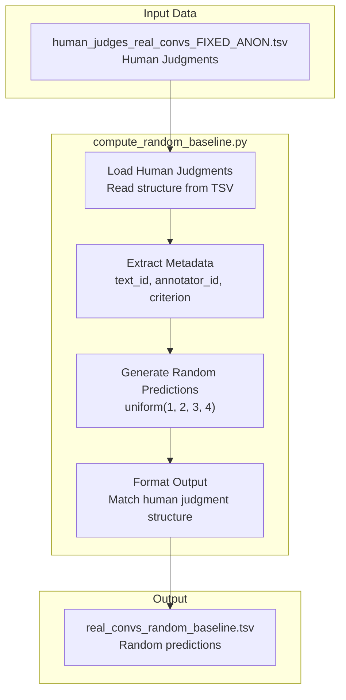
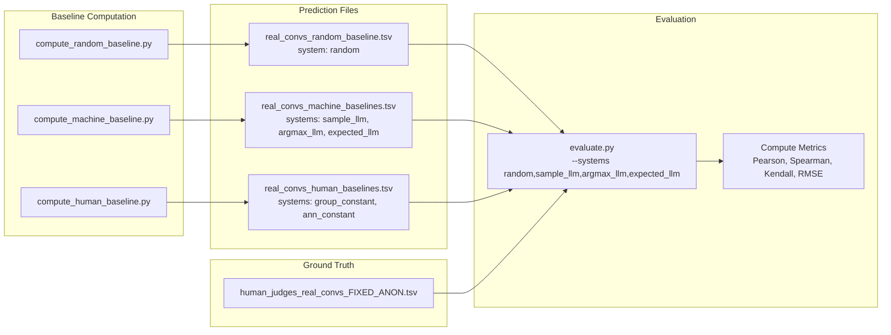
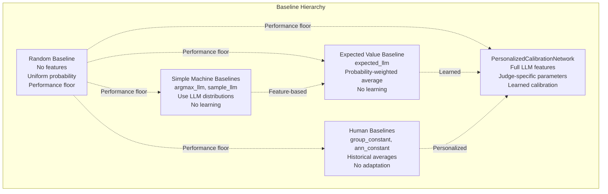

<!-- source: DeepWiki mcp.deepwiki.com · repo microsoft/LLM-Rubric · page 7.3 Random Baseline · fetched 2026-10-26 -->

# Random Baseline

<details>
<summary>Relevant source files</summary>

The following files were used as context for generating this wiki page:

- [experiments/real_data/predictions/real_convs_random_baseline.tsv](experiments/real_data/predictions/real_convs_random_baseline.tsv)
- [scripts/run_real_data_baselines.sh](scripts/run_real_data_baselines.sh)

</details>


## Purpose and Scope

This page documents the **random baseline** system, which generates uniformly random predictions on the 1-4 scale as a performance lower bound for evaluation. The random baseline serves as a reference point to assess whether more sophisticated prediction methods perform better than chance.

For information about other baseline systems, see [Machine Baselines](#7.1) and [Human Baselines](#7.2). For details on the evaluation metrics used to compare baselines, see [Evaluating Results](#4.4).

---

## Overview

The random baseline is the simplest baseline method in the LLM-Rubric evaluation framework. It generates predictions by randomly selecting values from the valid judgment range (1-4) with uniform probability. This approach provides a performance floor that all meaningful prediction systems should exceed.

The random baseline is critical for establishing that other methods demonstrate meaningful predictive power rather than performing at chance level.

**Key Characteristics:**
- **No input features**: Does not use machine evaluations or conversation content
- **Uniform distribution**: Each score (1, 2, 3, 4) has equal probability (0.25)
- **No learning**: Produces purely stochastic outputs
- **Performance floor**: Expected to have the worst correlation with human judgments

---

## Implementation Architecture



**Computation Flow:**

1. **Structure Extraction**: Load human judgment file to determine the required prediction structure (which text_id, annotator_id, criterion combinations exist)
2. **Random Generation**: For each required prediction, generate a random integer from {1, 2, 3, 4} with uniform probability
3. **Output Formatting**: Write predictions in the same format as human judgments for consistent evaluation

Sources: [scripts/run_real_data_baselines.sh:13-17]()

---

## Script Interface

The random baseline is computed using `scripts/compute_random_baseline.py` with the following command-line interface:

```bash
python scripts/compute_random_baseline.py \
  --human-judgments data/real_data/human_judges_real_convs_FIXED_ANON.tsv \
  --output-path experiments/real_data/predictions/real_convs_random_baseline.tsv
```

**Arguments:**
| Argument | Type | Description |
|----------|------|-------------|
| `--human-judgments` | Path | TSV file containing human judgments (used only for structure) |
| `--output-path` | Path | Output TSV file path for random predictions |

**Note**: The human judgments file is used only to determine the structure of required predictions (which combinations of text_id, annotator_id, and criterion need predictions). The actual human judgment values do not influence the random predictions.

Sources: [scripts/run_real_data_baselines.sh:15-17]()

---

## Output Format

The random baseline produces a TSV file with the following schema:

| Column | Type | Description |
|--------|------|-------------|
| `text_id` | String | Unique identifier for the conversation |
| `annotator_id` | Integer | Human judge identifier (0-23) |
| `dialogue_system` | Integer | System variant identifier (0, 1, or 2) |
| `criterion` | String | Evaluation criterion (Q0-Q8) |
| `random` | Float | Random prediction value (1.0, 2.0, 3.0, or 4.0) |

**Example rows:**
```
text_id                     annotator_id  dialogue_system  criterion  random
65c5b4b9f174b2897703736a   22            2                Q1         3.0
65c5b4b9f174b2897703736a   22            2                Q2         3.0
65c5b4b9f174b2897703736a   22            2                Q3         3.0
65c5b4b9f174b2897703736a   22            2                Q4         3.0
```

The `random` column contains the baseline predictions, formatted as floats for consistency with other baseline outputs.

Sources: [experiments/real_data/predictions/real_convs_random_baseline.tsv:1-10]()

---

## Integration with Evaluation Pipeline



The random baseline integrates into the evaluation pipeline as follows:

1. **Computation Phase**: Generated alongside machine and human baselines using the bash script [scripts/run_real_data_baselines.sh:13-17]()

2. **Evaluation Phase**: Passed to `evaluate.py` along with other baseline predictions for unified metric computation [scripts/run_real_data_baselines.sh:30-36]()

3. **Comparison**: Evaluated against the same ground truth human judgments as all other systems

Sources: [scripts/run_real_data_baselines.sh:1-38]()

---

## Statistical Properties

The random baseline exhibits the following statistical properties:

**Expected Behavior:**
- **Mean prediction**: 2.5 (midpoint of 1-4 range)
- **Variance**: ~1.25 (uniform distribution on discrete values)
- **Correlation with human judgments**: ~0 (no systematic relationship)
- **RMSE**: Depends on human judgment distribution, typically 1.0-1.5

**Use as Performance Floor:**

The random baseline establishes the minimum acceptable performance for any evaluation system. A system that performs worse than random indicates fundamental problems:
- Negative correlations suggest the system systematically inverts human preferences
- RMSE similar to random suggests no predictive power
- Failure to exceed random baseline invalidates the approach

---

## Relationship to Other Baselines



**Comparison with Other Baselines:**

| Baseline Type | Uses LLM Features | Learns from Data | Personalized | Expected Performance |
|---------------|-------------------|------------------|--------------|---------------------|
| **Random** | No | No | No | Worst (≈0 correlation) |
| Machine (argmax/sample) | Yes | No | No | Better than random |
| Machine (expected) | Yes | No | No | Better than simple machine |
| Human (group) | No | No | No | Better than random |
| Human (annotator) | No | No | Yes | Better than group |
| **PCN** | Yes | Yes | Yes | Best (learned calibration) |

The random baseline's simplicity makes it a critical reference point: any system that cannot consistently outperform random predictions lacks practical utility.

Sources: [scripts/run_real_data_baselines.sh:1-38]()

---

## Usage Example

**Complete workflow for computing and evaluating the random baseline:**

```bash
# Step 1: Compute random baseline
python scripts/compute_random_baseline.py \
  --human-judgments data/real_data/human_judges_real_convs_FIXED_ANON.tsv \
  --output-path experiments/real_data/predictions/real_convs_random_baseline.tsv

# Step 2: Evaluate against human judgments
python scripts/evaluate.py \
    experiments/real_data/predictions/real_convs_random_baseline.tsv \
    --human-judgments data/real_data/human_judges_real_convs_FIXED_ANON.tsv \
    --systems "random" \
    --criteria "Q0"
```

The evaluation output will show correlation coefficients (Pearson, Spearman, Kendall) and RMSE for the random baseline, which should be near zero for correlations and relatively high for RMSE.

Sources: [scripts/run_real_data_baselines.sh:13-17](), [scripts/run_real_data_baselines.sh:30-36]()

---

## Design Rationale

**Why include a random baseline?**

1. **Sanity Check**: Confirms that evaluation metrics can distinguish meaningful predictions from noise
2. **Statistical Significance**: Provides a null hypothesis for testing whether other systems perform above chance
3. **Debugging Tool**: If a sophisticated system performs at random level, indicates implementation errors
4. **Documentation**: Explicitly documents the performance floor for the evaluation framework

**Implementation Simplicity:**

The random baseline requires no model parameters, training data, or feature engineering. This simplicity is intentional:
- Easy to verify correctness
- No dependencies on model artifacts
- Deterministic from random seed (if seeded)
- Computationally negligible cost

Sources: [scripts/run_real_data_baselines.sh:13-17]()

---

## Key Differences from Machine Baselines

While both random and machine baselines provide reference points, they differ fundamentally:

**Random Baseline:**
- Ignores all input features
- Purely stochastic output
- Establishes absolute performance floor
- No dependency on LLM evaluations

**Machine Baselines ([see Machine Baselines](#7.1)):**
- Use LLM probability distributions as features
- Deterministic (argmax, expected) or semi-deterministic (sample)
- Establish LLM-informed performance floor
- Depend on quality of LLM evaluations

The gap between random and machine baseline performance indicates how much information the LLM evaluations contain about human preferences, before any personalization or learning occurs.

Sources: [scripts/run_real_data_baselines.sh:3-10](), [scripts/run_real_data_baselines.sh:13-17]()

---

