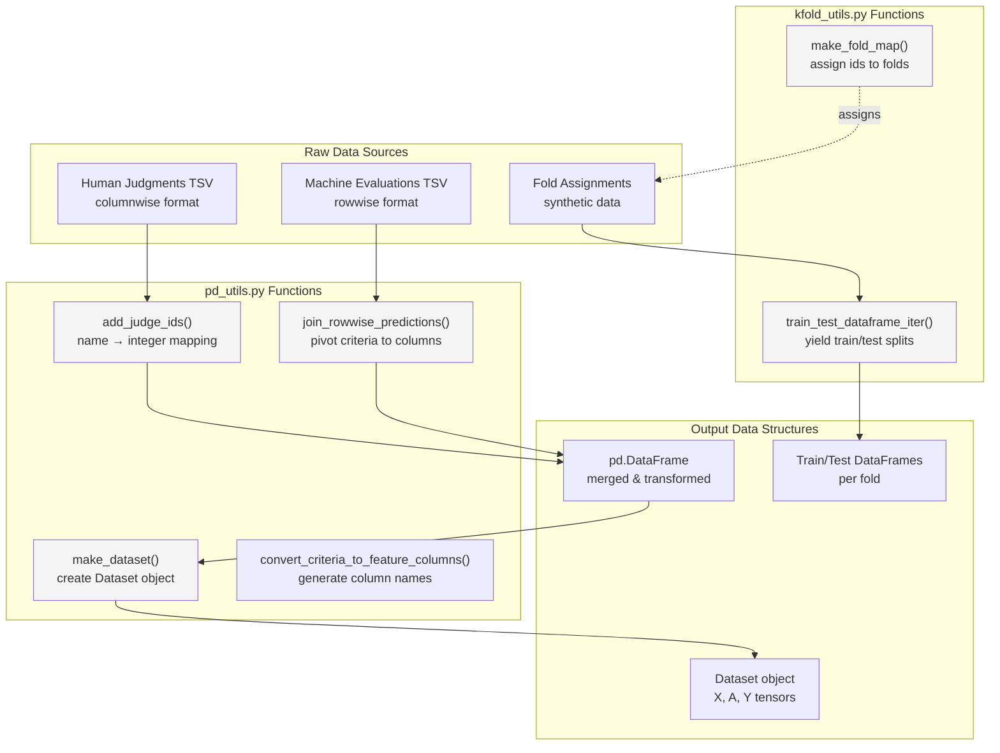
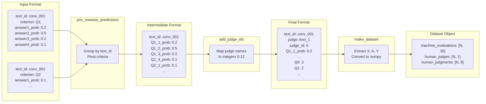
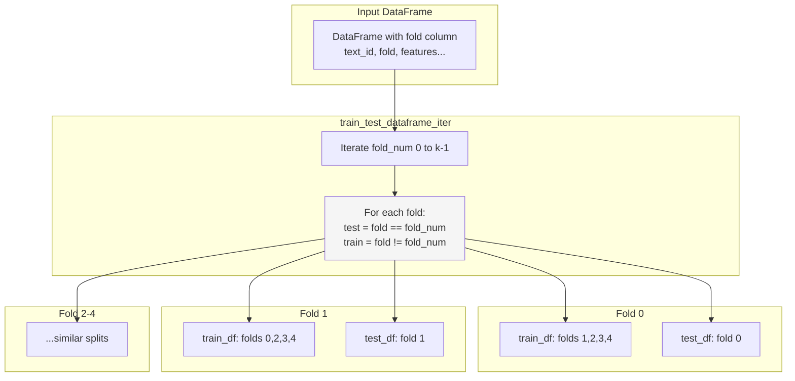
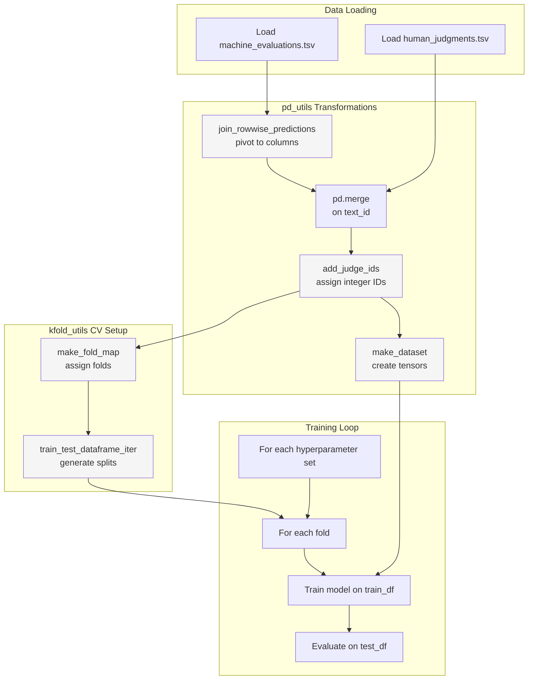

<!-- source: DeepWiki mcp.deepwiki.com · repo microsoft/LLM-Rubric · page 8 Utilities Reference · fetched 2026-10-26 -->

# Utilities Reference

<details>
<summary>Relevant source files</summary>

The following files were used as context for generating this wiki page:

- [llm_rubric/kfold_utils.py](llm_rubric/kfold_utils.py)
- [llm_rubric/pd_utils.py](llm_rubric/pd_utils.py)

</details>


This page documents the utility modules that support data processing and model training in the LLM-Rubric system. These utilities handle data transformation, judge ID assignment, k-fold cross-validation setup, and dataset creation for PyTorch training.

The utilities covered here are:
- **Data Processing Utilities** (`pd_utils.py`): Transform raw data into model-ready formats
- **Cross-Validation Utilities** (`kfold_utils.py`): Support k-fold cross-validation workflows

For information about the LLM evaluation API interface, see the LLM Evaluator section [8.3](#8.3). For details on the Dataset objects these utilities create, see [6](#6). For usage in training workflows, see [4.2](#4.2).

---

## Utility Module Architecture



**Sources:** [llm_rubric/pd_utils.py:1-68](), [llm_rubric/kfold_utils.py:1-34]()

---

## Data Processing Utilities (pd_utils)

The `pd_utils` module provides functions to transform raw data files into PyTorch-compatible tensors. These functions handle data format conversions, judge ID mapping, and dataset construction.

### Function Reference

| Function | Purpose | Input | Output |
|----------|---------|-------|--------|
| `convert_criteria_to_feature_columns()` | Generate feature column names from criteria list | criteria list, num_answers | List of column names |
| `join_rowwise_predictions()` | Pivot row-wise machine evaluations to column-wise format | DataFrame with row per criterion | DataFrame with one row per text_id |
| `add_judge_ids()` | Map judge names to integer IDs | DataFrame with judge column | Updated DataFrame + judge_id_map dict |
| `make_dataset()` | Create PyTorch-ready Dataset object | DataFrame with features, annotator, labels | Dataset(X, A, Y) |

**Sources:** [llm_rubric/pd_utils.py:1-68]()

### Data Transformation Pipeline



**Sources:** [llm_rubric/pd_utils.py:11-67]()

### convert_criteria_to_feature_columns()

Generates standardized feature column names from a list of criteria and number of answers.

**Function Signature:** [llm_rubric/pd_utils.py:7-8]()

**Parameters:**
- `criteria` (list[str]): List of criterion names (e.g., `["Q0", "Q1", "Q2", ...]`)
- `num_answers` (int): Number of possible answers per criterion (typically 4)

**Returns:** list[str] - Column names in format `"{criterion}_{answer_num}_prob"`

**Example Output:**
```
["Q0_1_prob", "Q0_2_prob", "Q0_3_prob", "Q0_4_prob", 
 "Q1_1_prob", "Q1_2_prob", "Q1_3_prob", "Q1_4_prob", ...]
```

**Sources:** [llm_rubric/pd_utils.py:7-8]()

### join_rowwise_predictions()

Transforms machine evaluation data from row-wise format (one row per criterion per text) to column-wise format (one row per text with all criteria as features).

**Function Signature:** [llm_rubric/pd_utils.py:11-33]()

**Parameters:**
- `df` (pd.DataFrame): Input DataFrame with row-wise predictions
- `text_id_column` (str): Column name containing text identifiers
- `criterion_column` (str): Column name containing criterion labels
- `criteria` (list[str]): List of expected criterion values
- `num_answers` (int): Number of answer probabilities per criterion

**Returns:** pd.DataFrame - One row per text_id with probability columns for all criteria

**Input Format:**
```
text_id    criterion    answer1_prob    answer2_prob    answer3_prob    answer4_prob
conv_001   Q0           0.1             0.3             0.4             0.2
conv_001   Q1           0.2             0.5             0.2             0.1
conv_002   Q0           0.3             0.4             0.2             0.1
```

**Output Format:**
```
text_id    Q0_1_prob    Q0_2_prob    Q0_3_prob    Q0_4_prob    Q1_1_prob    Q1_2_prob    ...
conv_001   0.1          0.3          0.4          0.2          0.2          0.5          ...
conv_002   0.3          0.4          0.2          0.1          ...          ...          ...
```

**Implementation Details:**
- Groups input DataFrame by `text_id_column` [llm_rubric/pd_utils.py:20]()
- For each text_id, iterates through criteria and extracts probability columns [llm_rubric/pd_utils.py:22-25]()
- Constructs output DataFrame with flattened probability features [llm_rubric/pd_utils.py:28-31]()

**Sources:** [llm_rubric/pd_utils.py:11-33]()

### add_judge_ids()

Maps human judge names to integer IDs for efficient neural network processing. Creates or uses a judge_id_map dictionary.

**Function Signature:** [llm_rubric/pd_utils.py:36-51]()

**Parameters:**
- `df` (pd.DataFrame): Input DataFrame with judge names
- `judge_column` (str): Column containing judge names
- `judge_id_column` (str): Column name for output integer IDs
- `judge_id_map` (dict, optional): Pre-existing mapping dictionary. If None, creates new mapping.

**Returns:** dict - Judge name to integer ID mapping

**Side Effects:** Modifies input DataFrame by:
1. Converting judge column values to strings [llm_rubric/pd_utils.py:42]()
2. Adding new `judge_id_column` with integer values [llm_rubric/pd_utils.py:48-50]()

**Mapping Strategy:**
- If `judge_id_map` is None, creates mapping from unique judge names [llm_rubric/pd_utils.py:44-46]()
- Assigns sequential integers (0, 1, 2, ...) based on order of appearance
- Ensures consistent judge ID assignment across train/test splits when provided existing map

**Sources:** [llm_rubric/pd_utils.py:36-51]()

### make_dataset()

Creates a `Dataset` object containing PyTorch-ready tensors for model training and evaluation.

**Function Signature:** [llm_rubric/pd_utils.py:54-67]()

**Parameters:**
- `df` (pd.DataFrame): Input DataFrame with all features
- `input_columns` (list[str]): List of criterion names for input features
- `annotator_column` (str): Column containing judge IDs (as integers)
- `output_columns` (list[str]): List of column names for target labels

**Returns:** Dataset object with three fields:
- `machine_evaluations`: np.ndarray[float32] shape [N, 36] - LLM probability distributions
- `human_judges`: np.ndarray[int64] shape [N, 1] - Judge IDs
- `human_judgments`: np.ndarray[float32] shape [N, 9] - Human judgment scores

**Feature Construction:**
- Constructs input feature names by appending `_1_prob`, `_2_prob`, `_3_prob`, `_4_prob` to each criterion [llm_rubric/pd_utils.py:62]()
- For 9 criteria (Q0-Q8), produces 36 input features (9 × 4 = 36)

**Data Type Conversions:**
- Machine evaluations: float32 for efficient GPU computation [llm_rubric/pd_utils.py:64]()
- Human judges: int64 for index operations, reshaped to [N, 1] [llm_rubric/pd_utils.py:65]()
- Human judgments: float32 for loss computation [llm_rubric/pd_utils.py:66]()

**Sources:** [llm_rubric/pd_utils.py:54-67]()

---

## Cross-Validation Utilities (kfold_utils)

The `kfold_utils` module provides functions for k-fold cross-validation workflows. These functions handle fold assignment and train/test split generation.

### Function Reference

| Function | Purpose | Input | Output |
|----------|---------|-------|--------|
| `make_fold_map()` | Assign IDs to fold numbers | List of IDs, k (number of folds) | Dictionary mapping ID → fold number |
| `train_test_dataframe_iter()` | Generate train/test splits | DataFrame with fold column, num_folds | Generator yielding (train_df, test_df) tuples |

**Sources:** [llm_rubric/kfold_utils.py:1-34]()

### K-Fold Split Generation



**Sources:** [llm_rubric/kfold_utils.py:4-23]()

### make_fold_map()

Creates a dictionary mapping text IDs to fold numbers using round-robin assignment.

**Function Signature:** [llm_rubric/kfold_utils.py:26-30]()

**Parameters:**
- `ids` (list[str]): List of text identifiers to assign to folds
- `k` (int): Number of folds (default: 5)

**Returns:** dict - Mapping from text ID to fold number (0 to k-1)

**Assignment Strategy:**
- Uses modulo operation: `fold_num = index % k` [llm_rubric/kfold_utils.py:29]()
- First k items go to folds 0, 1, 2, ..., k-1
- Next k items go to folds 0, 1, 2, ..., k-1 again (round-robin)
- Ensures approximately equal distribution across folds

**Example:**
```python
ids = ["conv_001", "conv_002", "conv_003", "conv_004", "conv_005", "conv_006"]
fold_map = make_fold_map(ids, k=3)
# Result: {"conv_001": 0, "conv_002": 1, "conv_003": 2, 
#          "conv_004": 0, "conv_005": 1, "conv_006": 2}
```

**Sources:** [llm_rubric/kfold_utils.py:26-30]()

### train_test_dataframe_iter()

Generator function that yields train/test DataFrame splits for each fold in k-fold cross-validation.

**Function Signature:** [llm_rubric/kfold_utils.py:4-23]()

**Parameters:**
- `df` (pd.DataFrame): Input DataFrame with fold assignments
- `num_folds` (int): Number of folds (default: 5)
- `fold_column` (str): Column name containing fold numbers (default: "fold")

**Yields:** tuple[pd.DataFrame, pd.DataFrame] - (train_split_df, test_split_df) for each fold

**Validation:**
1. Checks that `fold_column` exists in DataFrame [llm_rubric/kfold_utils.py:9-13]()
2. Verifies fold values are in expected range [0, num_folds) [llm_rubric/kfold_utils.py:15-18]()

**Split Logic:**
- For each fold number from 0 to num_folds-1 [llm_rubric/kfold_utils.py:20]():
  - Test split: rows where `fold_column == fold_num` [llm_rubric/kfold_utils.py:21]()
  - Train split: rows where `fold_column != fold_num` [llm_rubric/kfold_utils.py:22]()
  - Both DataFrames are copied to avoid reference issues [llm_rubric/kfold_utils.py:21-22]()

**Usage Pattern:**
```python
for train_df, test_df in train_test_dataframe_iter(df, num_folds=5):
    # Train model on train_df
    # Evaluate model on test_df
    # Save fold results
```

**Sources:** [llm_rubric/kfold_utils.py:4-23]()

---

## Integration with Training Pipeline



**Sources:** [llm_rubric/pd_utils.py:1-68](), [llm_rubric/kfold_utils.py:1-34]()

---

## Common Usage Patterns

### Pattern 1: Preparing Training Data

This pattern is used in training scripts to prepare data for model training.

**Steps:**
1. Load machine evaluations (row-wise format)
2. Load human judgments (column-wise format)
3. Transform machine evaluations with `join_rowwise_predictions()` [llm_rubric/pd_utils.py:11-33]()
4. Merge DataFrames on text_id
5. Add judge IDs with `add_judge_ids()` [llm_rubric/pd_utils.py:36-51]()
6. Create Dataset with `make_dataset()` [llm_rubric/pd_utils.py:54-67]()

**Key Code Entities:**
- Input columns: `["Q0", "Q1", "Q2", "Q3", "Q4", "Q5", "Q6", "Q7", "Q8"]`
- Output columns: Same as input columns
- Judge column: Typically `"annotator"` or `"judge"`
- Judge ID column: Typically `"annotator_id"` or `"judge_id"`

**Sources:** [llm_rubric/pd_utils.py:1-68]()

### Pattern 2: K-Fold Cross-Validation Setup

This pattern is used for hyperparameter tuning on synthetic data.

**Steps:**
1. Load data and prepare DataFrame
2. Generate fold assignments with `make_fold_map()` [llm_rubric/kfold_utils.py:26-30]()
3. Add fold column to DataFrame
4. Iterate through splits with `train_test_dataframe_iter()` [llm_rubric/kfold_utils.py:4-23]()
5. For each fold:
   - Add judge IDs to train split (creates judge_id_map)
   - Add judge IDs to test split (uses same judge_id_map)
   - Create train Dataset
   - Create test Dataset
   - Train model and evaluate

**Key Considerations:**
- Judge ID map must be consistent across train/test splits within a fold
- Judge ID map may differ across different folds
- Fold column values must be in range [0, num_folds)

**Sources:** [llm_rubric/kfold_utils.py:1-34]()

### Pattern 3: Prediction on New Data

This pattern is used when applying a trained model to new data.

**Steps:**
1. Load pre-trained model and judge_id_map from artifacts
2. Load new machine evaluations and human judgments
3. Transform with `join_rowwise_predictions()` [llm_rubric/pd_utils.py:11-33]()
4. Merge DataFrames
5. Add judge IDs with `add_judge_ids(judge_id_map=saved_map)` [llm_rubric/pd_utils.py:36-51]()
6. Create Dataset with `make_dataset()` [llm_rubric/pd_utils.py:54-67]()
7. Generate predictions

**Critical Requirement:**
- Must use the same judge_id_map that was used during training
- This ensures judge IDs match the model's learned personalized parameters

**Sources:** [llm_rubric/pd_utils.py:36-51]()

---

## Error Handling

### pd_utils Error Cases

The `pd_utils` functions generally assume well-formed input data. Common error scenarios:

**Missing Criteria:**
- If a criterion is missing for a text_id in `join_rowwise_predictions()`, will raise IndexError [llm_rubric/pd_utils.py:24]()
- Ensure all text_ids have complete criterion rows

**Type Mismatches:**
- Functions expect specific column types (strings for IDs, floats for probabilities)
- Type conversion errors will propagate from pandas operations

**Sources:** [llm_rubric/pd_utils.py:1-68]()

### kfold_utils Error Cases

The `kfold_utils` functions include explicit validation:

**Missing Fold Column:**
- Raises Exception if `fold_column` not in DataFrame [llm_rubric/kfold_utils.py:11-13]()
- Error message lists available columns

**Invalid Fold Values:**
- Raises Exception if fold values outside [0, num_folds) range [llm_rubric/kfold_utils.py:15-18]()
- Message indicates unexpected fold IDs in column

**Sources:** [llm_rubric/kfold_utils.py:4-23]()

---

## Performance Considerations

### Memory Efficiency

**join_rowwise_predictions:**
- Creates intermediate list before DataFrame construction [llm_rubric/pd_utils.py:18-26]()
- Memory usage proportional to: `num_texts × num_criteria × num_answers`
- For typical data (200 texts, 9 criteria, 4 answers): ~28KB

**make_dataset:**
- Creates numpy arrays with explicit dtype specifications [llm_rubric/pd_utils.py:64-66]()
- float32 reduces memory by 50% compared to float64
- For 200 samples: X=28.8KB, A=1.6KB, Y=7.2KB

### Computational Efficiency

**add_judge_ids:**
- O(n) operation where n is number of rows [llm_rubric/pd_utils.py:48-50]()
- String conversion applied to all values [llm_rubric/pd_utils.py:42]()

**train_test_dataframe_iter:**
- Generator pattern avoids loading all splits into memory [llm_rubric/kfold_utils.py:23]()
- Each split operation is O(n) for filtering [llm_rubric/kfold_utils.py:21-22]()
- Copy operations ensure data isolation but increase memory usage

**Sources:** [llm_rubric/pd_utils.py:1-68](), [llm_rubric/kfold_utils.py:1-34]()

---

