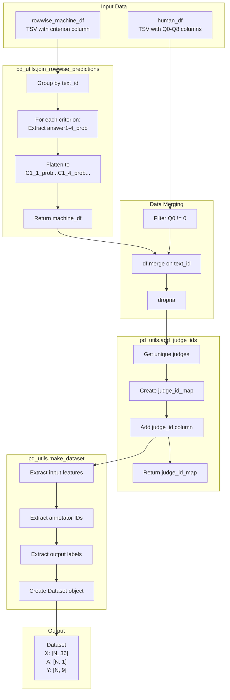
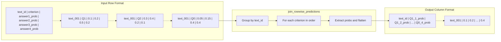
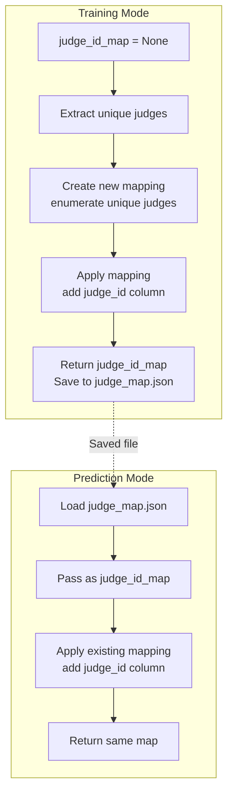
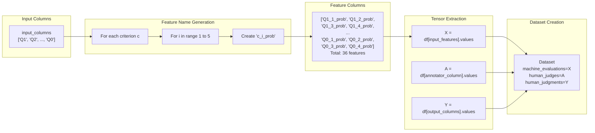
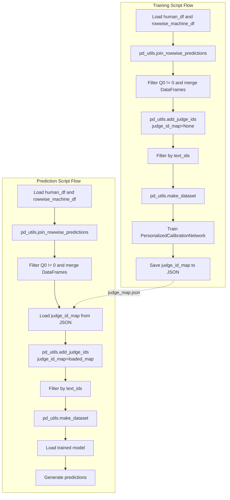

<!-- source: DeepWiki mcp.deepwiki.com · repo microsoft/LLM-Rubric · page 8.1 Data Processing Utilities · fetched 2026-10-26 -->

# Data Processing Utilities

<details>
<summary>Relevant source files</summary>

The following files were used as context for generating this wiki page:

- [llm_rubric/pd_utils.py](llm_rubric/pd_utils.py)
- [scripts/llm_rubric_predict.py](scripts/llm_rubric_predict.py)
- [scripts/train_llm_rubric.py](scripts/train_llm_rubric.py)

</details>


## Purpose and Scope

The `pd_utils` module provides data transformation functions that convert raw human judgments and machine evaluations into model-ready tensors for the PersonalizedCalibrationNetwork. This page documents the transformation pipeline and individual utility functions.

For information about cross-validation utilities, see [Cross-Validation Utilities](#8.2). For details about the Dataset structure used by the model, see [Network Architecture](#6.1).

## Overview

The data processing pipeline transforms two types of input data into a unified format:

| Input Type | Format | Transformation Required |
|------------|--------|------------------------|
| Machine Evaluations | Row-wise (one row per criterion) | Pivot to columnar format |
| Human Judgments | Column-wise (Q0-Q8 as columns) | Filter invalid rows |
| Judge Names | String identifiers | Map to integer IDs |

The output is a `Dataset` object containing three PyTorch-compatible tensors:
- **X**: Machine evaluation features (float32)
- **A**: Judge IDs (int64)
- **Y**: Human judgment targets (float32)

## Data Transformation Pipeline

The following diagram shows the complete transformation flow from raw data to model-ready tensors:



**Sources:** [llm_rubric/pd_utils.py:11-67](), [scripts/train_llm_rubric.py:42-147](), [scripts/llm_rubric_predict.py:42-105]()

## Function Reference

### join_rowwise_predictions

Transforms machine evaluations from row-wise format (one row per criterion per text) to columnar format (one row per text with all criteria as columns).

**Function Signature:**
```python
def join_rowwise_predictions(
    df: pd.DataFrame,
    text_id_column: str,
    criterion_column: str,
    criteria: list[str],
    num_answers: int,
) -> pd.DataFrame
```

**Parameters:**

| Parameter | Type | Description |
|-----------|------|-------------|
| `df` | `pd.DataFrame` | Row-wise machine evaluations |
| `text_id_column` | `str` | Column name for text identifiers (default: "text_id") |
| `criterion_column` | `str` | Column name for criterion identifiers (default: "criterion") |
| `criteria` | `list[str]` | List of criteria to extract (e.g., ["Q1", "Q2", ..., "Q0"]) |
| `num_answers` | `int` | Number of possible answers per criterion (default: 4) |

**Returns:** `pd.DataFrame` with columns `[text_id_column, Q1_1_prob, Q1_2_prob, Q1_3_prob, Q1_4_prob, ..., Q0_4_prob]`

**Transformation Logic:**



**Implementation Details:**

The function iterates through each text_id and builds a flattened feature vector:
1. Groups input DataFrame by `text_id_column` [llm_rubric/pd_utils.py:20]()
2. For each text group, iterates through `criteria` in order [llm_rubric/pd_utils.py:22]()
3. Filters rows matching each criterion [llm_rubric/pd_utils.py:23]()
4. Extracts probability columns and appends to feature vector [llm_rubric/pd_utils.py:24-25]()
5. Creates output DataFrame with feature column names from `convert_criteria_to_feature_columns` [llm_rubric/pd_utils.py:28-31]()

**Usage Example:**

In training and prediction scripts, this function is called immediately after loading machine evaluations:

[scripts/train_llm_rubric.py:45-52]()
[scripts/llm_rubric_predict.py:45-52]()

**Sources:** [llm_rubric/pd_utils.py:11-33]()

### add_judge_ids

Maps human judge names (strings) to integer IDs for efficient neural network processing. This function either creates a new mapping or applies an existing one.

**Function Signature:**
```python
def add_judge_ids(
    df: pd.DataFrame,
    judge_column: str,
    judge_id_column: str,
    judge_id_map = None,
) -> dict
```

**Parameters:**

| Parameter | Type | Description |
|-----------|------|-------------|
| `df` | `pd.DataFrame` | DataFrame containing judge names |
| `judge_column` | `str` | Column name for judge names (default: "annotator_name") |
| `judge_id_column` | `str` | Column name to create for judge IDs (default: "judge_id") |
| `judge_id_map` | `dict` or `None` | Optional existing mapping; if None, creates new mapping |

**Returns:** `dict` mapping judge names (str) to judge IDs (int)

**Side Effects:** Adds a new column `judge_id_column` to the input DataFrame (in-place modification)

**Mapping Behavior:**



**Implementation Details:**

1. Converts all judge names to strings for consistency [llm_rubric/pd_utils.py:42]()
2. If `judge_id_map` is None, creates mapping from unique judges [llm_rubric/pd_utils.py:43-47]()
3. Applies mapping to create `judge_id_column` [llm_rubric/pd_utils.py:48-50]()
4. Returns the mapping dictionary [llm_rubric/pd_utils.py:51]()

**Training vs Prediction:**

| Mode | judge_id_map Parameter | Behavior |
|------|----------------------|----------|
| Training | `None` | Creates new mapping, saves to JSON |
| Prediction | Loaded from JSON | Uses existing mapping for consistency |

Training usage: [scripts/train_llm_rubric.py:70-73]()

Prediction usage: [scripts/llm_rubric_predict.py:61-64]()

**Sources:** [llm_rubric/pd_utils.py:36-51](), [scripts/train_llm_rubric.py:70-73](), [scripts/llm_rubric_predict.py:61-67]()

### make_dataset

Creates a `Dataset` object from a processed DataFrame, extracting the three tensor components required by the PersonalizedCalibrationNetwork.

**Function Signature:**
```python
def make_dataset(
    df: pd.DataFrame,
    input_columns: list[str],
    annotator_column: str,
    output_columns: list[str],
) -> Dataset
```

**Parameters:**

| Parameter | Type | Description |
|-----------|------|-------------|
| `df` | `pd.DataFrame` | Processed DataFrame with machine evaluations, judge IDs, and human judgments |
| `input_columns` | `list[str]` | Criteria for input features (e.g., ["Q1", "Q2", ..., "Q0"]) |
| `annotator_column` | `str` | Column name containing judge IDs (default: "judge_id") |
| `output_columns` | `list[str]` | Criteria for output targets (e.g., ["Q1", "Q2", ..., "Q0"]) |

**Returns:** `Dataset` object with three attributes:
- `X`: Machine evaluations tensor (shape: [N, 36], dtype: float32)
- `A`: Judge ID tensor (shape: [N, 1], dtype: int64)
- `Y`: Human judgments tensor (shape: [N, 9], dtype: float32)

**Feature Construction:**

The function constructs feature column names by appending `_i_prob` suffixes:



**Implementation Details:**

1. Constructs input feature names using list comprehension [llm_rubric/pd_utils.py:62]()
2. Extracts machine evaluations as float32 [llm_rubric/pd_utils.py:64]()
3. Extracts judge IDs as int64 with added dimension [llm_rubric/pd_utils.py:65]()
4. Extracts human judgments as float32 [llm_rubric/pd_utils.py:66]()
5. Returns Dataset object wrapping the three arrays [llm_rubric/pd_utils.py:63-67]()

**Tensor Shapes:**

| Tensor | Shape | Dtype | Description |
|--------|-------|-------|-------------|
| `X` | `[N, 36]` | float32 | 9 criteria × 4 answers = 36 probability features |
| `A` | `[N, 1]` | int64 | Judge ID for each judgment |
| `Y` | `[N, 9]` | float32 | Human ratings for 9 criteria (Q1-Q8, Q0) |

**Usage Example:**

Both training and prediction scripts call this function to create datasets:

Training: [scripts/train_llm_rubric.py:147]()

Prediction: [scripts/llm_rubric_predict.py:105]()

**Sources:** [llm_rubric/pd_utils.py:54-67]()

### convert_criteria_to_feature_columns

Helper function that generates feature column names from criteria names and the number of possible answers.

**Function Signature:**
```python
def convert_criteria_to_feature_columns(criteria: list[str], num_answers: int) -> list[str]
```

**Parameters:**

| Parameter | Type | Description |
|-----------|------|-------------|
| `criteria` | `list[str]` | List of criterion names (e.g., ["Q1", "Q2", ..., "Q0"]) |
| `num_answers` | `int` | Number of possible answers per criterion (typically 4) |

**Returns:** `list[str]` of feature column names in format `"{criterion}_{answer_number}_prob"`

**Example:**

```
Input:  criteria=["Q1", "Q2"], num_answers=4
Output: ["Q1_1_prob", "Q1_2_prob", "Q1_3_prob", "Q1_4_prob", 
         "Q2_1_prob", "Q2_2_prob", "Q2_3_prob", "Q2_4_prob"]
```

This function is used internally by `join_rowwise_predictions` to generate output column names [llm_rubric/pd_utils.py:30]().

**Sources:** [llm_rubric/pd_utils.py:7-8]()

## Data Flow in Training and Prediction

The following diagram shows how pd_utils functions are called in the training and prediction scripts:



**Key Differences:**

| Aspect | Training | Prediction |
|--------|----------|------------|
| Judge ID mapping | Creates new mapping | Loads existing mapping |
| Text IDs | Training set IDs | Test set IDs |
| Model | Trains new model | Loads pre-trained model |
| Output | Saves model + judge_map.json | Generates predictions |

**Sources:** [scripts/train_llm_rubric.py:42-147](), [scripts/llm_rubric_predict.py:42-109]()

## Common Usage Patterns

### Basic Transformation Pipeline

Standard workflow for preparing data for model training or prediction:

```
1. Load data files (human judgments TSV, machine evaluations TSV)
2. Filter invalid human judgments (Q0 != 0)
3. Transform machine evaluations from row-wise to columnar format
4. Merge human and machine DataFrames on text_id
5. Add judge ID column (create new mapping or apply existing)
6. Filter to relevant text IDs
7. Create Dataset object with tensors
8. Pass Dataset to model
```

This pattern is implemented in both [scripts/train_llm_rubric.py:42-147]() and [scripts/llm_rubric_predict.py:42-109]().

### Judge ID Consistency

To ensure consistent judge ID assignments across training and prediction:

1. **Training:** Call `add_judge_ids` with `judge_id_map=None` to create new mapping
2. **Save:** Write returned dictionary to `judge_map.json`
3. **Prediction:** Load `judge_map.json` and pass to `add_judge_ids` as `judge_id_map` parameter

This ensures the same judge always receives the same integer ID, allowing the PersonalizedCalibrationNetwork to apply learned judge-specific parameters correctly.

**Sources:** [scripts/train_llm_rubric.py:70-73, 171-172](), [scripts/llm_rubric_predict.py:61-64]()

---

