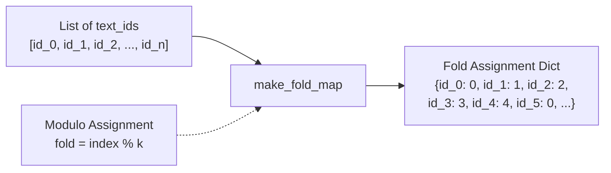
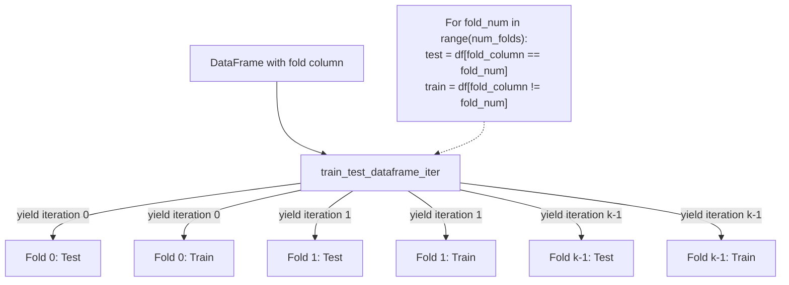
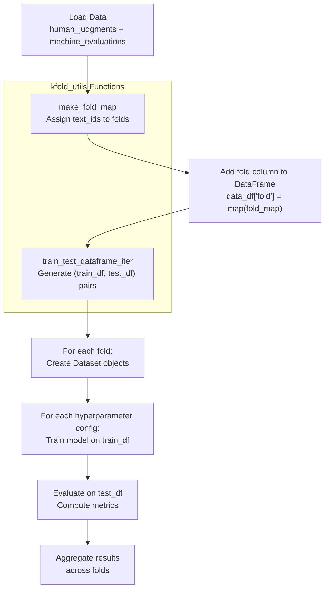
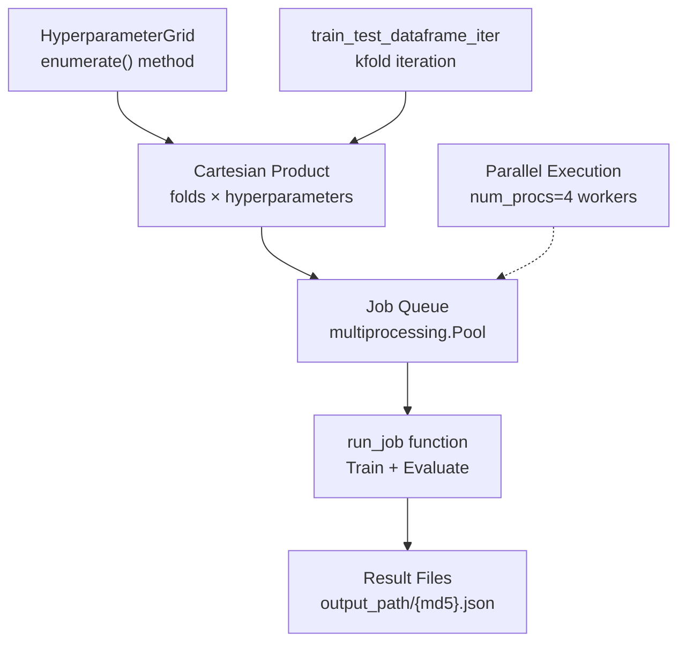
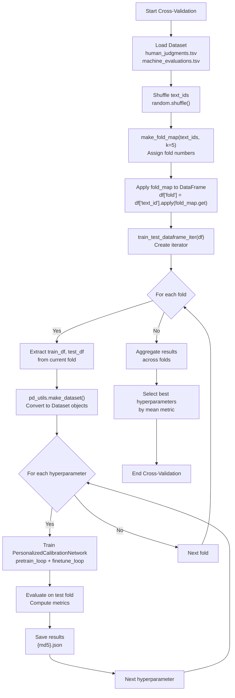

<!-- source: DeepWiki mcp.deepwiki.com · repo microsoft/LLM-Rubric · page 8.2 Cross-Validation Utilities · fetched 2026-10-26 -->

# Cross-Validation Utilities

<details>
<summary>Relevant source files</summary>

The following files were used as context for generating this wiki page:

- [llm_rubric/kfold_utils.py](llm_rubric/kfold_utils.py)
- [scripts/cross_validate_llm_rubric.py](scripts/cross_validate_llm_rubric.py)

</details>


## Purpose and Scope

This document describes the `kfold_utils` module, which provides utilities for k-fold cross-validation in the LLM-Rubric system. These utilities support the hyperparameter optimization workflow by enabling systematic train/test splitting of data.

For information about the hyperparameter tuning workflow that uses these utilities, see [Hyperparameter Tuning](#4.5). For information about the model training process, see [Training a Model](#4.2).

**Sources:** [llm_rubric/kfold_utils.py:1-34]()

---

## Module Overview

The `kfold_utils` module is located at [llm_rubric/kfold_utils.py]() and provides two core functions:

| Function | Purpose | Inputs | Outputs |
|----------|---------|--------|---------|
| `make_fold_map` | Creates a deterministic mapping from IDs to fold numbers | List of IDs, k (number of folds) | Dictionary mapping ID → fold number |
| `train_test_dataframe_iter` | Iterates through train/test splits for each fold | DataFrame with fold assignments, number of folds | Generator yielding (train_df, test_df) tuples |

These functions work together to enable stratified k-fold cross-validation on pandas DataFrames, which is essential for evaluating hyperparameter configurations on the synthetic training data.

**Sources:** [llm_rubric/kfold_utils.py:1-34]()

---

## K-Fold Splitting Strategy

### Fold Assignment with `make_fold_map`

The `make_fold_map` function implements a deterministic fold assignment strategy using modulo arithmetic:

```python
def make_fold_map(ids: list[str], k: int = 5):
    fold_map = {}
    for i, id_ in enumerate(ids):
        fold_map[id_] = i % k
    return fold_map
```

**Function Signature:** [llm_rubric/kfold_utils.py:26-30]()

**Parameters:**
- `ids`: List of identifiers (typically `text_id` values from the dataset)
- `k`: Number of folds (default: 5)

**Returns:** Dictionary mapping each ID to its fold number (0 to k-1)

**Algorithm:** Uses modulo operation `i % k` to cyclically assign sequential IDs to folds. This ensures approximately equal distribution of samples across folds, assuming the input list order is random.



**Diagram: Fold Map Creation**

**Sources:** [llm_rubric/kfold_utils.py:26-30](), [scripts/cross_validate_llm_rubric.py:158-161]()

---

## Train/Test Split Iteration

### Iterating with `train_test_dataframe_iter`

The `train_test_dataframe_iter` function generates train/test splits by iterating through each fold:

**Function Signature:** [llm_rubric/kfold_utils.py:4-23]()

**Parameters:**
- `df`: pandas DataFrame containing the full dataset
- `num_folds`: Number of folds to create (default: 5)
- `fold_column`: Name of the column containing fold assignments (default: "fold")

**Returns:** Generator yielding `(train_df, test_df)` tuples for each fold

**Validation:**
The function performs two validation checks:
1. Verifies that `fold_column` exists in the DataFrame [llm_rubric/kfold_utils.py:9-13]()
2. Ensures all fold values are in the expected range `[0, num_folds)` [llm_rubric/kfold_utils.py:15-18]()

**Splitting Logic:**
For each fold number `fold_num` from 0 to `num_folds-1`:
- **Test set:** Rows where `df[fold_column] == fold_num`
- **Train set:** Rows where `df[fold_column] != fold_num`



**Diagram: Train/Test Split Generation**

**Sources:** [llm_rubric/kfold_utils.py:4-23]()

---

## Integration with Cross-Validation Workflow

The `kfold_utils` functions are used by the hyperparameter tuning script [scripts/cross_validate_llm_rubric.py]() to implement k-fold cross-validation:



**Diagram: Cross-Validation Workflow Integration**

**Sources:** [scripts/cross_validate_llm_rubric.py:140-168]()

### Workflow Steps

**1. Data Loading and Preparation** [scripts/cross_validate_llm_rubric.py:140-154]()
   - Load human judgments and machine evaluations
   - Filter valid samples (`Q0 != 0`)
   - Join predictions using `pd_utils.join_rowwise_predictions`

**2. Fold Assignment** [scripts/cross_validate_llm_rubric.py:155-163]()
   ```python
   fold_map = kfold_utils.make_fold_map(text_ids)
   data_df[fold_column] = data_df[text_id_column].apply(fold_map.get)
   ```

**3. K-Fold Iteration** [scripts/cross_validate_llm_rubric.py:168]()
   ```python
   kfold_iter = kfold_utils.train_test_dataframe_iter(
       data_df, fold_column=fold_column, num_folds=num_folds
   )
   ```

**4. Train/Test Dataset Creation** [scripts/cross_validate_llm_rubric.py:181-183]()
   - For each fold, convert train/test DataFrames to Dataset objects
   - Datasets contain X (machine evaluations), A (judge IDs), Y (human judgments)

**5. Model Training and Evaluation** [scripts/cross_validate_llm_rubric.py:85-120]()
   - Train PersonalizedCalibrationNetwork on training fold
   - Evaluate on test fold
   - Save results for each (fold, hyperparameter) combination

**Sources:** [scripts/cross_validate_llm_rubric.py:140-197]()

---

## Usage Pattern in Hyperparameter Search

The cross-validation utilities enable systematic hyperparameter exploration by creating a nested iteration structure:



**Diagram: Parallel Cross-Validation Execution**

**Job Generation:** [scripts/cross_validate_llm_rubric.py:180-192]()

The `make_job_iter` function creates a generator that yields jobs for each (fold, hyperparameter) combination:

```python
def make_job_iter():
    for fold, (train_df, test_df) in enumerate(kfold_iter):
        ds_train = pd_utils.make_dataset(train_df, ...)
        ds_test = pd_utils.make_dataset(test_df, ...)
        
        for i, hp in hp_grid.enumerate():
            data_md5 = hashlib.md5(...).hexdigest()
            path = output_path / f"{data_md5}.json"
            
            yield fold, ds_train, ds_test, hp, path
```

This creates `num_folds × len(hp_grid)` total jobs that are executed in parallel using `multiprocessing.Pool` [scripts/cross_validate_llm_rubric.py:194-198]().

**Sources:** [scripts/cross_validate_llm_rubric.py:180-198]()

---

## Technical Considerations

### Deterministic Fold Assignment

The `make_fold_map` function uses sequential enumeration with modulo arithmetic, which provides deterministic fold assignments when the input list is pre-shuffled. The cross-validation script ensures reproducibility by:

1. Setting random seed: `random.seed(random_seed)` [scripts/cross_validate_llm_rubric.py:155-156]()
2. Shuffling text_ids: `random.shuffle(text_ids)` [scripts/cross_validate_llm_rubric.py:157]()
3. Creating fold map with shuffled list: `make_fold_map(text_ids)` [scripts/cross_validate_llm_rubric.py:158]()

This ensures that different runs with the same `random_seed` parameter produce identical fold assignments.

**Sources:** [scripts/cross_validate_llm_rubric.py:155-158](), [llm_rubric/kfold_utils.py:26-30]()

### DataFrame Copy Operations

Both train and test DataFrames are created with `.copy()` calls [llm_rubric/kfold_utils.py:21-22]() to prevent unintended modifications to the original DataFrame during model training or evaluation.

**Sources:** [llm_rubric/kfold_utils.py:21-22]()

### Fold Column Validation

The iterator validates that:
- The fold column exists in the DataFrame
- All fold values are integers in range `[0, num_folds)`

If validation fails, an `Exception` is raised with a descriptive error message [llm_rubric/kfold_utils.py:9-18]().

**Sources:** [llm_rubric/kfold_utils.py:9-18]()

---

## Complete Cross-Validation Flow



**Diagram: Complete Cross-Validation Flow with Code Functions**

**Sources:** [llm_rubric/kfold_utils.py:1-34](), [scripts/cross_validate_llm_rubric.py:122-202]()

---

## Configuration Parameters

The cross-validation script accepts the following parameters related to fold management:

| Parameter | Type | Default | Description |
|-----------|------|---------|-------------|
| `num_folds` | int | 5 | Number of cross-validation folds |
| `fold_column` | str | "fold" | Name of the column storing fold assignments |
| `text_id_column` | str | "text_id" | Name of the column containing unique identifiers |
| `random_seed` | int | 43 | Random seed for reproducible fold assignment |

These parameters are passed to `train_test_dataframe_iter` [scripts/cross_validate_llm_rubric.py:168]() to control the cross-validation behavior.

**Sources:** [scripts/cross_validate_llm_rubric.py:122-138](), [scripts/cross_validate_llm_rubric.py:168]()

---

## Error Handling

The `train_test_dataframe_iter` function implements robust error handling:

**Missing Fold Column:** [llm_rubric/kfold_utils.py:9-13]()
```python
if fold_column not in df.columns:
    df_cols = ", ".join([f"'{column}'" for column in df.columns])
    raise Exception(
        f"Fold column '{fold_column}' not in dataframe columns: {df_cols}"
    )
```

**Invalid Fold Values:** [llm_rubric/kfold_utils.py:15-18]()
```python
if not df[fold_column].isin(folds).all():
    raise Exception(
        f"Found uexpected number of fold ids in column: '{fold_column}'"
    )
```

These checks ensure that the DataFrame is properly formatted before attempting train/test splitting.

**Sources:** [llm_rubric/kfold_utils.py:9-18]()

---

