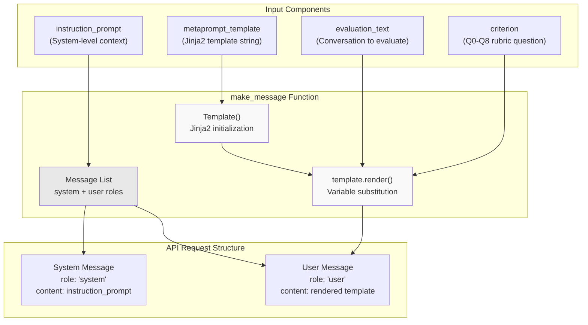
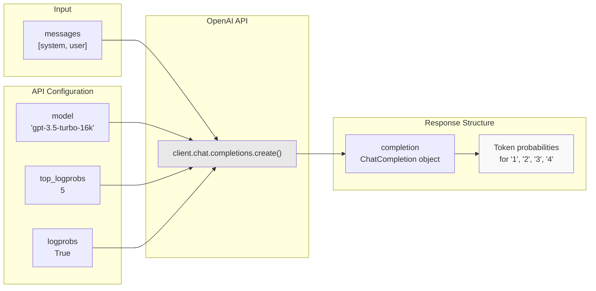
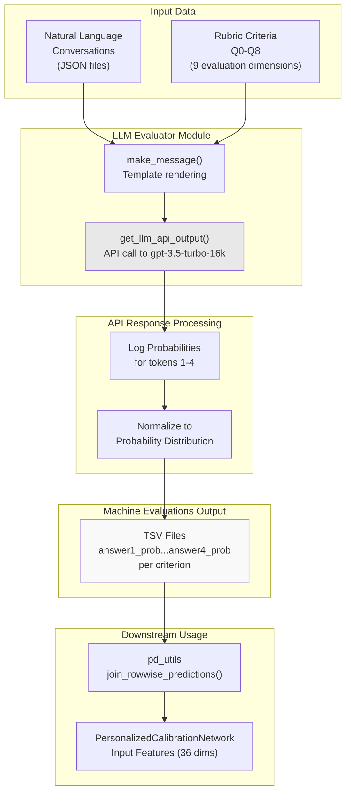
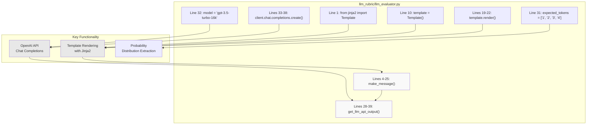

<!-- source: DeepWiki mcp.deepwiki.com · repo microsoft/LLM-Rubric · page 8.3 LLM Evaluator · fetched 2026-10-26 -->

# LLM Evaluator

<details>
<summary>Relevant source files</summary>

The following files were used as context for generating this wiki page:

- [llm_rubric/llm_evaluator.py](llm_rubric/llm_evaluator.py)

</details>


## Purpose and Scope

The LLM Evaluator module provides the interface for generating machine evaluations using OpenAI's GPT-3.5-turbo-16k model. This utility handles prompt construction, API communication, and extraction of probability distributions that serve as input features for the PersonalizedCalibrationNetwork.

The LLM Evaluator is responsible for the "LLM Evaluation Phase" described in the end-to-end workflow. It transforms natural language conversations and rubric criteria into structured probability distributions that can be consumed by downstream model training and prediction pipelines.

For information about how these machine evaluations are used as model input, see [Data Processing Utilities](#8.1). For information about the structure of machine evaluation data files, see [Machine Evaluations](#5.3).

**Sources:** [llm_rubric/llm_evaluator.py:1-39]()

---

## Overview

The LLM Evaluator consists of two primary functions that work together to obtain evaluations from the OpenAI API:

| Function | Purpose | Input | Output |
|----------|---------|-------|--------|
| `make_message` | Constructs API messages from templates | Instruction prompt, metaprompt template, evaluation text, criterion | List of message dictionaries |
| `get_llm_api_output` | Calls OpenAI API with log probabilities | Message list | API completion response with token probabilities |

The module uses Jinja2 templating to enable flexible prompt construction, allowing the same evaluation logic to be applied across different rubric criteria (Q0-Q8).

**Sources:** [llm_rubric/llm_evaluator.py:4-39]()

---

## Architecture and Data Flow

### Message Construction Pipeline



**Diagram: Message Construction Pipeline**

The `make_message` function assembles a two-part message structure required by the OpenAI Chat Completions API. The system message establishes the evaluation context, while the user message contains the specific text and criterion to be evaluated.

**Sources:** [llm_rubric/llm_evaluator.py:4-25]()

---

## Function Reference

### make_message

Constructs a formatted message list for the OpenAI Chat Completions API using Jinja2 templating.

**Function Signature:**
```python
def make_message(
    instruction_prompt: str,
    metaprompt_template: str,
    evaluation_text: str,
    criterion: str,
) -> list[dict[str,str]]:
```

**Parameters:**

| Parameter | Type | Description |
|-----------|------|-------------|
| `instruction_prompt` | `str` | System-level instructions that define the evaluation task and output format |
| `metaprompt_template` | `str` | Jinja2 template string containing placeholders for `evaluation_text` and `criterion` |
| `evaluation_text` | `str` | The natural language conversation or text to be evaluated |
| `criterion` | `str` | The specific rubric criterion (e.g., Q0, Q1, etc.) to assess |

**Return Value:**

A list containing two dictionaries representing the message structure:
- System message: Contains the `instruction_prompt` in the `content` field
- User message: Contains the rendered template with substituted variables

**Implementation Details:**

1. Initializes a Jinja2 `Template` object with the `metaprompt_template` string [llm_rubric/llm_evaluator.py:10]()
2. Renders the template by substituting `evaluation_text` and `criterion` variables [llm_rubric/llm_evaluator.py:19-22]()
3. Constructs a two-element list with "system" and "user" role messages [llm_rubric/llm_evaluator.py:12-24]()

**Example Message Structure:**

```python
[
    {
        "role": "system",
        "content": "You are an expert evaluator. Provide scores between 1-4..."
    },
    {
        "role": "user",
        "content": "Evaluate this conversation:\n[conversation text]\n\nCriterion: Q1"
    }
]
```

**Sources:** [llm_rubric/llm_evaluator.py:4-25]()

---

### get_llm_api_output

Sends a message to the OpenAI API and retrieves completion responses with token-level log probabilities.

**Function Signature:**
```python
def get_llm_api_output(
    messages,
):
```

**Parameters:**

| Parameter | Type | Description |
|-----------|------|-------------|
| `messages` | `list[dict]` | Message list constructed by `make_message` or equivalent |

**Configuration:**

The function is configured with the following fixed parameters:

| Parameter | Value | Purpose |
|-----------|-------|---------|
| `model` | `"gpt-3.5-turbo-16k"` | Large context window model (16,384 tokens) for evaluating conversations |
| `expected_tokens` | `["1", "2", "3", "4"]` | Valid score values matching the 1-4 rubric scale |
| `top_logprobs` | `5` | Number of alternative tokens to return with probabilities |
| `logprobs` | `True` | Enables log probability extraction |

**API Call Structure:**



**Diagram: API Call Structure**

**Return Value:**

A `ChatCompletion` object containing:
- Generated text completion
- Log probabilities for the top 5 alternative tokens at each position
- Model metadata and usage statistics

The log probabilities for tokens "1", "2", "3", "4" are extracted to create probability distributions used as features in the PersonalizedCalibrationNetwork.

**Sources:** [llm_rubric/llm_evaluator.py:28-39]()

---

## Integration with System Pipeline

### From Conversations to Probability Distributions



**Diagram: LLM Evaluator in System Pipeline**

The LLM Evaluator bridges raw conversation data to structured probability distributions:

1. **Input Processing:** For each conversation and each criterion (Q0-Q8), `make_message` constructs a templated prompt
2. **API Invocation:** `get_llm_api_output` sends the message to GPT-3.5-turbo-16k and requests log probabilities
3. **Probability Extraction:** Log probabilities for tokens "1", "2", "3", "4" are extracted from the API response
4. **Output Storage:** Probabilities are saved to TSV files in row-wise format (one row per criterion per conversation)
5. **Feature Engineering:** Data processing utilities transform these probabilities into 36-dimensional feature vectors (9 criteria × 4 answer probabilities)
6. **Model Training:** Feature vectors serve as input `X` to the PersonalizedCalibrationNetwork

**Sources:** [llm_rubric/llm_evaluator.py:1-39]()

---

## Technical Details

### Jinja2 Template Variables

The metaprompt template must include two placeholders:

| Placeholder | Description | Example Usage |
|-------------|-------------|---------------|
| `{{ evaluation_text }}` | The conversation or text to evaluate | Full conversation transcript |
| `{{ criterion }}` | The specific rubric criterion | "Q1: Does the assistant provide accurate information?" |

These placeholders are substituted using Jinja2's `template.render()` method with keyword arguments [llm_rubric/llm_evaluator.py:19-22]().

### Expected Token Format

The function defines `expected_tokens = ["1", "2", "3", "4"]` [llm_rubric/llm_evaluator.py:31](), which corresponds to the 1-4 scoring scale used in the rubric:

| Score | Interpretation |
|-------|----------------|
| 1 | Lowest quality |
| 2 | Below average |
| 3 | Above average |
| 4 | Highest quality |

The API is configured to return log probabilities for these specific tokens, enabling probability distribution extraction even if the model generates a different output token.

### Model Selection Rationale

The choice of `gpt-3.5-turbo-16k` [llm_rubric/llm_evaluator.py:32]() provides:
- **Large Context Window:** 16,384 tokens accommodate lengthy conversations
- **Cost Efficiency:** More economical than GPT-4 for batch evaluation tasks
- **Stable API:** Well-established model with consistent behavior
- **Log Probabilities:** Supports the `logprobs` parameter required for probability distribution extraction

**Sources:** [llm_rubric/llm_evaluator.py:28-39]()

---

## Code Implementation Map



**Diagram: Code Structure and Dependencies**

The module has minimal external dependencies:
- **Jinja2:** Template engine for prompt construction
- **OpenAI Client:** Imported implicitly (client object expected to be available)

**Sources:** [llm_rubric/llm_evaluator.py:1-39]()

---

## Usage Context

The LLM Evaluator is typically used in offline batch processing to generate machine evaluations for all conversations before model training begins. It is not called directly during model training or prediction, as those phases operate on pre-computed probability distributions stored in TSV files.

### Typical Workflow

1. **Data Collection:** Gather natural language conversations requiring evaluation
2. **Rubric Definition:** Define criteria (Q0-Q8) with clear evaluation questions
3. **Prompt Engineering:** Create instruction prompts and metaprompt templates
4. **Batch Evaluation:** For each conversation and criterion, call `make_message` and `get_llm_api_output`
5. **Result Storage:** Save probability distributions to TSV files in the expected format
6. **Training Pipeline:** Use stored evaluations as input to model training (see [Training a Model](#4.2))

### Relationship to Baselines

The probability distributions generated by the LLM Evaluator serve dual purposes:
- **Model Input:** Primary features for the PersonalizedCalibrationNetwork
- **Baseline Computation:** Source data for machine baselines (expected_llm, argmax_llm, sample_llm) - see [Machine Baselines](#7.1)

**Sources:** [llm_rubric/llm_evaluator.py:1-39]()

---

