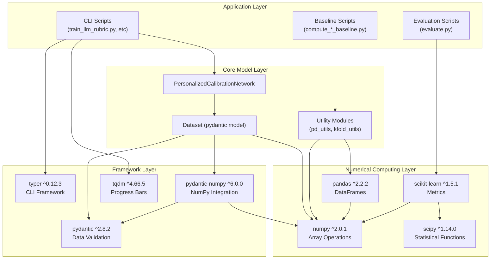
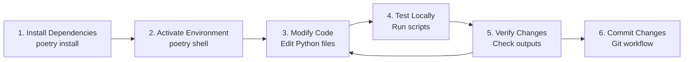
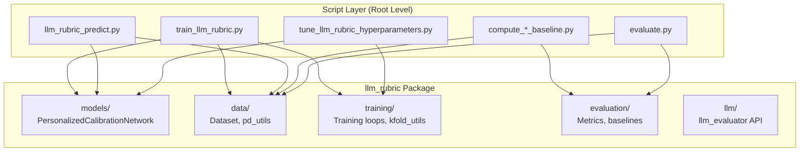
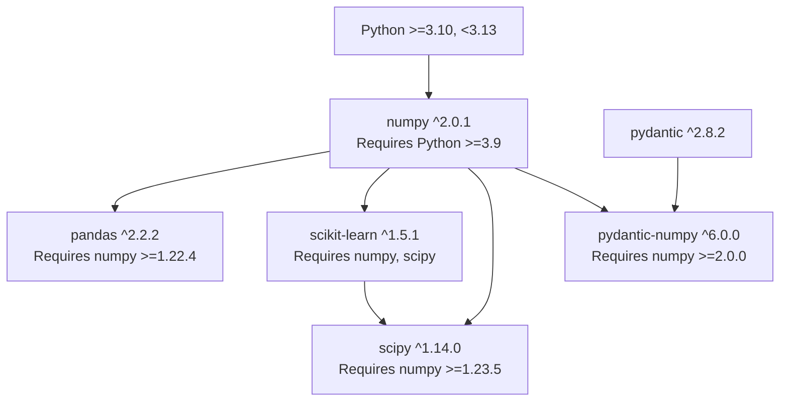

<!-- source: DeepWiki mcp.deepwiki.com · repo microsoft/LLM-Rubric · page 9 Development Guide · fetched 2026-10-26 -->

# Development Guide

<details>
<summary>Relevant source files</summary>

The following files were used as context for generating this wiki page:

- [poetry.lock](poetry.lock)
- [pyproject.toml](pyproject.toml)

</details>


This page provides essential information for developers working on the LLM-Rubric codebase. It covers environment setup, dependency management, project organization, and common development workflows.

For specific topics, refer to:
- **Project Structure**: See [Project Structure](#9.1) for detailed repository organization and module relationships
- **Dependencies**: See [Dependencies and Environment](#9.2) for in-depth dependency information
- **Contributing**: See [Contributing Guidelines](#9.3) for contribution procedures and code of conduct

---

## Development Environment Setup

### Python Version Requirements

The LLM-Rubric project requires Python 3.10 or newer, but does not support Python 3.13 or later. This constraint is specified in [pyproject.toml:10]().

```
Python: >=3.10, <3.13
```

### Poetry-Based Environment

The project uses Poetry for dependency management and packaging. All dependencies are locked in [poetry.lock]() to ensure reproducible builds across development environments.

**Installation Steps:**

1. Install Poetry (if not already installed)
2. Navigate to the project root directory
3. Run `poetry install` to create a virtual environment and install all dependencies
4. Activate the virtual environment with `poetry shell`

Sources: [pyproject.toml:1-23](), [poetry.lock:1-748]()

---

## Dependency Stack Overview

### Core Dependencies

The following table maps each primary dependency to its role in the LLM-Rubric system:

| Dependency | Version | Purpose in System |
|------------|---------|-------------------|
| `numpy` | ^2.0.1 | Array operations for tensor manipulation in `Dataset` and model computations |
| `pandas` | ^2.2.2 | Data loading, transformation in `pd_utils`, and DataFrame operations |
| `scikit-learn` | ^1.5.1 | Correlation metrics (Pearson, Spearman, Kendall) in evaluation pipeline |
| `pydantic` | ^2.8.2 | Data validation for `Dataset` models and configuration schemas |
| `pydantic-numpy` | ^6.0.0 | Integration layer between Pydantic and NumPy arrays for `Dataset` |
| `typer` | ^0.12.3 | CLI framework for command-line scripts (`train_llm_rubric.py`, etc.) |
| `tqdm` | ^4.66.5 | Progress bars during training and batch processing |

Sources: [pyproject.toml:9-18](), [poetry.lock:156-743]()

### Dependency Layer Architecture



Sources: [pyproject.toml:9-18](), [poetry.lock:156-631]()

---

## Development Workflow

### Standard Development Cycle



Sources: [pyproject.toml:1-23]()

### Adding New Dependencies

When adding a new dependency to the project:

1. **Add to pyproject.toml**: Use `poetry add <package-name>` to add the dependency
2. **Lock versions**: Poetry automatically updates `poetry.lock` with exact versions
3. **Test compatibility**: Ensure the new dependency works with Python 3.10-3.12
4. **Document usage**: Update relevant documentation if the dependency is user-facing

**Example:**
```bash
poetry add some-package
poetry lock
poetry install
```

Sources: [pyproject.toml:9-18](), [poetry.lock:744-748]()

---

## Package Organization Overview

### High-Level Module Structure



The repository follows a functional organization where:
- **Core modules** (`llm_rubric/`) contain reusable components
- **Scripts** (root level) provide CLI interfaces for end-to-end workflows
- **Data files** (`data/`) store datasets and results

For detailed module relationships, see [Project Structure](#9.1).

Sources: [pyproject.toml:7]()

---

## Development Tool Integration

### Poetry Commands Reference

| Command | Purpose |
|---------|---------|
| `poetry install` | Install all dependencies from lock file |
| `poetry add <package>` | Add a new dependency |
| `poetry update` | Update dependencies to latest compatible versions |
| `poetry remove <package>` | Remove a dependency |
| `poetry shell` | Activate the virtual environment |
| `poetry run <command>` | Run a command in the virtual environment |
| `poetry lock` | Regenerate the lock file without installing |

### Running Scripts in Development

All executable scripts should be run within the Poetry environment:

```bash
# Method 1: Activate shell first
poetry shell
python train_llm_rubric.py --help

# Method 2: Use poetry run
poetry run python train_llm_rubric.py --help
```

Sources: [pyproject.toml:1-23]()

---

## Common Development Tasks

### Task 1: Adding a New Baseline Method

**Files to Modify:**
1. Create new baseline computation script (e.g., `compute_new_baseline.py`)
2. Implement baseline logic using `pd_utils` for data processing
3. Update `evaluate.py` to include the new baseline in comparisons

**Dependencies Used:**
- `pandas` for data manipulation
- `numpy` for numerical operations
- `typer` for CLI interface

### Task 2: Extending the Model Architecture

**Files to Modify:**
1. Modify `PersonalizedCalibrationNetwork` class definition
2. Update forward pass logic
3. Adjust training loop if new parameters are introduced
4. Update `Hyperparameters` configuration model

**Dependencies Used:**
- `pydantic` for configuration validation
- `numpy` for array operations

### Task 3: Adding New Evaluation Metrics

**Files to Modify:**
1. Extend evaluation functions in `evaluate.py`
2. Import new metric functions from `scikit-learn` or implement custom
3. Update output format to include new metrics

**Dependencies Used:**
- `scikit-learn` for built-in metrics
- `numpy` for custom metric implementations
- `pandas` for results aggregation

Sources: [pyproject.toml:9-18]()

---

## Dependency Version Constraints

### Why Version Ranges Matter

The project uses semantic versioning constraints (e.g., `^2.0.1`) to balance stability and feature access:

- **Caret (`^`) notation**: Allows updates that do not modify the leftmost non-zero digit
  - `^2.0.1` allows `>=2.0.1, <3.0.0`
  - `^0.12.3` allows `>=0.12.3, <0.13.0`
- **Python constraint**: `>=3.10,<3.13` ensures compatibility with typing features and numpy 2.x requirements

### Critical Dependency Relationships



**Key Constraint**: NumPy 2.0+ is required, which necessitates Python 3.10+. This is why the project does not support Python 3.9.

Sources: [pyproject.toml:10-18](), [poetry.lock:156-397]()

---

## Building and Packaging

The project uses Poetry's build system as specified in [pyproject.toml:20-22]():

```toml
[build-system]
requires = ["poetry-core"]
build-backend = "poetry.core.masonry.api"
```

**Build Process:**

1. **Create distribution**: `poetry build`
   - Generates wheel (`.whl`) and source distribution (`.tar.gz`)
2. **Install locally**: `pip install dist/llm_rubric-0.1.0-py3-none-any.whl`
3. **Publish** (if applicable): `poetry publish`

The package is named `llm-rubric` (version 0.1.0) and includes the `llm_rubric` Python package.

Sources: [pyproject.toml:1-8](), [pyproject.toml:20-22]()

---

## Troubleshooting Development Environment

### Common Issues

**Issue 1: Poetry installation fails**
- Ensure Poetry is properly installed: `poetry --version`
- Try clearing Poetry cache: `poetry cache clear . --all`

**Issue 2: Dependency conflicts**
- Delete `poetry.lock` and regenerate: `rm poetry.lock && poetry install`
- Check Python version: `python --version` (must be 3.10-3.12)

**Issue 3: NumPy 2.0 compatibility**
- Some older packages may not support NumPy 2.x
- Poetry will resolve compatible versions automatically
- If issues persist, check `poetry.lock` for version conflicts

**Issue 4: Missing dependencies after pull**
- Run `poetry install` to sync with updated `poetry.lock`
- Ensure you're in the correct virtual environment

Sources: [poetry.lock:744-748](), [pyproject.toml:10-18]()

---

## Next Steps

- **Understand the codebase**: Review [Project Structure](#9.1) for detailed module organization
- **Set up environment**: Follow [Dependencies and Environment](#9.2) for complete setup instructions
- **Start contributing**: Read [Contributing Guidelines](#9.3) for workflow and standards

---

