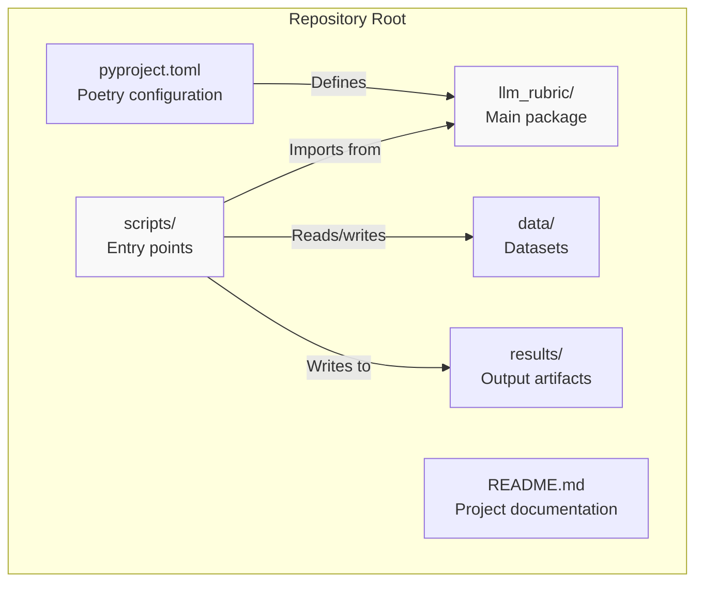
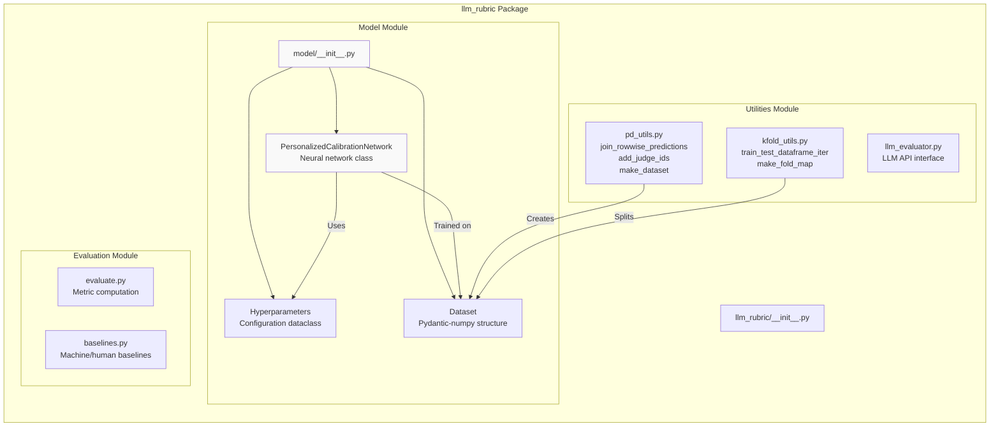
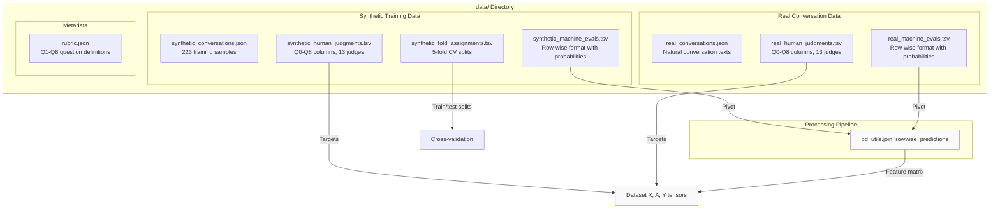
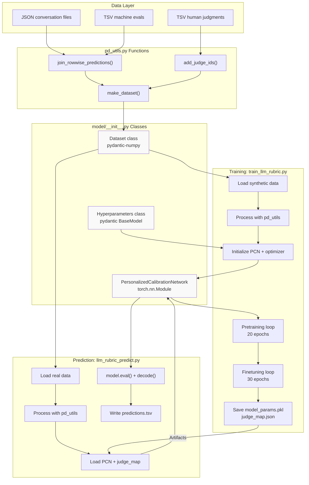
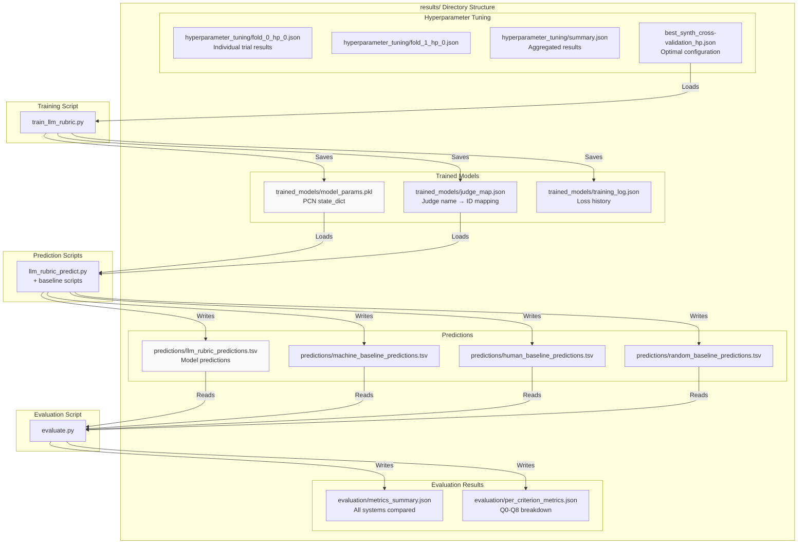

<!-- source: DeepWiki mcp.deepwiki.com · repo microsoft/LLM-Rubric · page 9.1 Project Structure · fetched 2026-10-26 -->

# Project Structure

<details>
<summary>Relevant source files</summary>

The following files were used as context for generating this wiki page:

- [llm_rubric/__init__.py](llm_rubric/__init__.py)
- [llm_rubric/model/__init__.py](llm_rubric/model/__init__.py)
- [pyproject.toml](pyproject.toml)

</details>


This page documents the organization of the LLM-Rubric repository, including the package structure, module relationships, and file organization. It serves as a map for developers navigating the codebase and understanding where different components are located.

For information about setting up the development environment and dependencies, see [Dependencies and Environment](#9.2). For contribution guidelines, see [Contributing Guidelines](#9.3).

## Repository Layout

The LLM-Rubric repository follows a standard Python package structure with Poetry for dependency management. The top-level organization separates the core package, entry point scripts, data files, and documentation.



**Directory Structure Overview**

| Directory/File | Purpose | Key Contents |
|---|---|---|
| `llm_rubric/` | Core Python package | Model implementations, utilities, data processing |
| `data/` | Dataset storage | Real and synthetic conversation data, human judgments, machine evaluations |
| `scripts/` | Entry point executables | Training, prediction, evaluation, baseline computation scripts |
| `results/` | Output directory | Trained models, predictions, evaluation metrics, hyperparameter search results |
| `pyproject.toml` | Package configuration | Dependencies, Python version, package metadata |
| `README.md` | Documentation | Setup instructions, usage examples |

Sources: [pyproject.toml:1-23]()

## Core Package Structure

The `llm_rubric` package is organized into functional modules that separate concerns between model implementation, data processing, evaluation, and utilities.



**Package Module Breakdown**

| Module | File | Primary Classes/Functions | Purpose |
|---|---|---|---|
| `model` | `model/__init__.py` | `PersonalizedCalibrationNetwork`, `Hyperparameters`, `Dataset` | Neural network architecture with judge-specific parameters |
| `data` | `pd_utils.py` | `join_rowwise_predictions()`, `add_judge_ids()`, `make_dataset()` | Data transformation and tensor preparation |
| `validation` | `kfold_utils.py` | `train_test_dataframe_iter()`, `make_fold_map()` | Cross-validation splitting utilities |
| `llm` | `llm_evaluator.py` | LLM API client classes | Interface to gpt-3.5-turbo-16k for evaluation |
| `evaluation` | `evaluate.py` | Metric computation functions | Pearson, Spearman, Kendall, RMSE calculation |
| `baselines` | `baselines.py` | `expected_llm()`, `argmax_llm()`, `sample_llm()` | Baseline prediction methods |

Sources: [llm_rubric/__init__.py:1](), [llm_rubric/model/__init__.py:1]()

## Script Organization

Entry point scripts are located at the repository root and orchestrate the main workflows. Each script is a standalone executable that imports from the `llm_rubric` package.

```mermaid
graph TD
    subgraph "Baseline Scripts"
        CMB["compute_machine_baseline.py<br/>expected_llm, argmax_llm, sample_llm"]
        CRB["compute_random_baseline.py<br/>Uniform random 1-4"]
        CHB["compute_human_baseline.py<br/>group_constant, ann_constant"]
    end
    
    subgraph "Training Scripts"
        THT["tune_hyperparameters.py<br/>Grid search + cross-validation"]
        TLR["train_llm_rubric.py<br/>Pretrain + Finetune PCN"]
    end
    
    subgraph "Prediction Scripts"
        LRP["llm_rubric_predict.py<br/>Load model + generate predictions"]
    end
    
    subgraph "Evaluation Scripts"
        EVAL["evaluate.py<br/>Compute correlation metrics"]
    end
    
    subgraph "llm_rubric Package"
        PKG["Model, utilities, data processing"]
    end
    
    CMB --> PKG
    CRB --> PKG
    CHB --> PKG
    THT --> PKG
    TLR --> PKG
    LRP --> PKG
    EVAL --> PKG
    
    CMB --> |"Writes"| OUT1["results/machine_baselines/"]
    CRB --> |"Writes"| OUT2["results/random_baseline/"]
    CHB --> |"Writes"| OUT3["results/human_baselines/"]
    THT --> |"Writes"| OUT4["results/hyperparameter_tuning/"]
    TLR --> |"Writes"| OUT5["results/trained_models/"]
    LRP --> |"Writes"| OUT6["results/predictions/"]
    EVAL --> |"Writes"| OUT7["results/evaluation_metrics/"]
    
    style PKG fill:#f9f9f9
```



**Script Execution Flow**

| Script | Purpose | Typical Execution Order | Key Outputs |
|---|---|---|---|
| `compute_machine_baseline.py` | Generate machine baseline predictions | 1 | `*_machine_baseline.tsv` files |
| `compute_human_baseline.py` | Generate human baseline predictions | 1 | `*_human_baseline.tsv` files |
| `compute_random_baseline.py` | Generate random baseline predictions | 1 | `*_random_baseline.tsv` files |
| `tune_hyperparameters.py` | Find optimal hyperparameters via cross-validation | 2 | `best_synth_cross-validation_hp.json` |
| `train_llm_rubric.py` | Train PersonalizedCalibrationNetwork | 3 | `model_params.pkl`, `judge_map.json` |
| `llm_rubric_predict.py` | Generate predictions on test data | 4 | `llm_rubric_predictions.tsv` |
| `evaluate.py` | Compute evaluation metrics for all systems | 5 | `evaluation_results.json` |

Sources: Based on workflow described in high-level diagrams

## Data Organization

The data directory contains both real and synthetic conversation datasets along with their associated human judgments and machine evaluations.



**Data File Formats**

| File Type | Format | Key Columns/Fields | Usage |
|---|---|---|---|
| Conversation data | JSON | `text_id`, `conversation_text`, metadata | Input texts for evaluation |
| Human judgments | TSV | `text_id`, `judge`, `Q0`-`Q8` | Ground truth targets (1-4 scale) |
| Machine evaluations | TSV | `text_id`, `criterion`, `answer1_prob`-`answer4_prob` | LLM probability distributions |
| Fold assignments | TSV | `text_id`, `fold` | Cross-validation fold membership (0-4) |
| Rubric definition | JSON | Question texts and descriptions | Evaluation criteria for Q1-Q8 |

**Data Preprocessing Pipeline**

1. Machine evaluations start in **row-wise format**: one row per (text_id, criterion) combination
2. `pd_utils.join_rowwise_predictions()` pivots to **columnar format**: 36 feature columns (9 criteria × 4 answer probabilities)
3. Human judgments filtered for validity: `Q0 != 0`
4. Data merged on `text_id` to align machine and human annotations
5. `pd_utils.add_judge_ids()` converts judge names to integer encodings (0-12)
6. `pd_utils.make_dataset()` creates `Dataset` object with tensors:
   - `X`: float32[N, 36] - LLM probability features
   - `A`: int64[N, 13] - one-hot judge encodings
   - `Y`: int64[N, 9] - human judgment targets

Sources: Based on data processing workflow in Diagram 5

## Module Relationships and Dependencies

This diagram shows how the core modules interact during the training and prediction workflows, mapping natural language components to their code implementations.



**Key Module Dependencies**

| Module | Dependencies | Exports | Used By |
|---|---|---|---|
| `model/__init__.py` | PyTorch, pydantic, numpy | `PersonalizedCalibrationNetwork`, `Hyperparameters`, `Dataset` | Training scripts, prediction scripts |
| `pd_utils.py` | pandas, numpy, pydantic-numpy | `join_rowwise_predictions()`, `add_judge_ids()`, `make_dataset()` | All scripts that process data |
| `kfold_utils.py` | pandas | `train_test_dataframe_iter()`, `make_fold_map()` | Hyperparameter tuning script |
| `llm_evaluator.py` | OpenAI API client | LLM evaluation interface | Machine evaluation scripts |
| `evaluate.py` | scikit-learn | Correlation metric functions | Evaluation script |
| `baselines.py` | numpy, pandas | Baseline computation functions | Baseline computation scripts |

Sources: [llm_rubric/model/__init__.py:1](), based on workflow diagrams

## Model Artifacts and Results Organization

The `results/` directory stores all outputs from training, prediction, and evaluation workflows.



**Model Artifact Specifications**

| Artifact | File Format | Contents | Purpose |
|---|---|---|---|
| `model_params.pkl` | Pickle | PyTorch `state_dict` with all network weights | Model persistence for inference |
| `judge_map.json` | JSON | `{"judge_name": judge_id}` mapping | Consistent judge ID assignment |
| `training_log.json` | JSON | Epoch-level loss values for pretrain/finetune | Training monitoring and debugging |
| `best_synth_cross-validation_hp.json` | JSON | Optimal hyperparameter values | Configuration for final model training |
| Prediction TSV files | TSV | `text_id`, `judge`, `Q0`-`Q8` predictions | Model outputs in standardized format |
| Evaluation JSON files | JSON | Metric dictionaries by system and criterion | Performance comparison data |

Sources: Based on training/prediction/evaluation workflows in Diagrams 2 and 3

## Package Configuration

The `pyproject.toml` file defines the package metadata and dependencies using Poetry.

**Python Package Definition**

```toml
[tool.poetry]
name = "llm-rubric"
version = "0.1.0"
packages = [{include = "llm_rubric"}]
```

This configuration specifies:
- **Package name**: `llm-rubric` (with hyphen for PyPI)
- **Import name**: `llm_rubric` (with underscore for Python)
- **Package location**: `llm_rubric/` directory is the root module

**Dependency Categories**

| Dependency | Version Constraint | Purpose |
|---|---|---|
| `python` | `>=3.10,<3.13` | Runtime version requirement |
| `numpy` | `^2.0.1` | Tensor operations, array handling |
| `pandas` | `^2.2.2` | Data manipulation, TSV/CSV processing |
| `scikit-learn` | `^1.5.1` | Evaluation metrics (correlation coefficients) |
| `pydantic` | `^2.8.2` | Data validation, configuration management |
| `pydantic-numpy` | `^6.0.0` | Numpy array validation in pydantic models |
| `tqdm` | `^4.66.5` | Progress bars for training loops |
| `typer` | `^0.12.3` | CLI argument parsing (if used) |

**Notable Constraints**
- Python version is constrained to 3.10-3.12 for compatibility
- Numpy 2.x is specified, which has breaking changes from 1.x
- All dependencies use caret (`^`) version ranges for minor/patch updates

Sources: [pyproject.toml:1-23]()

---

