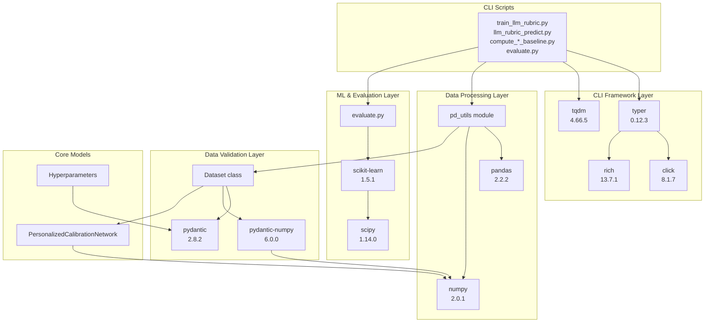
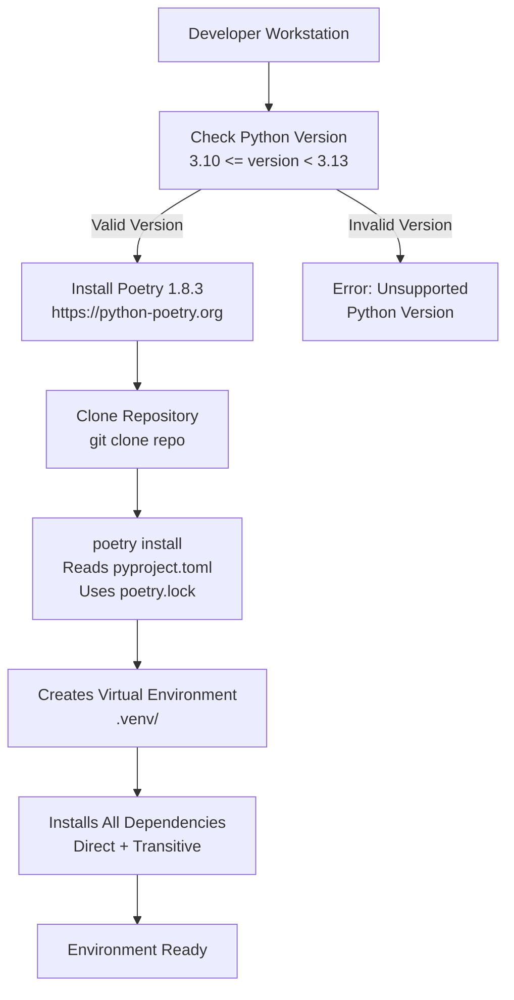
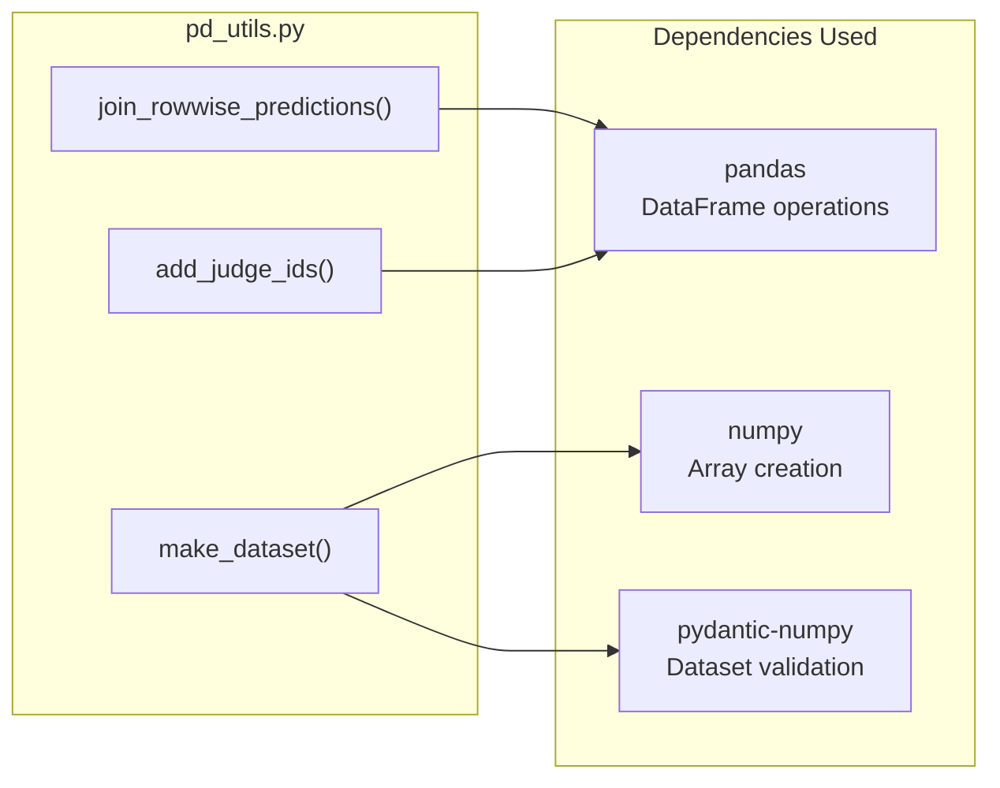
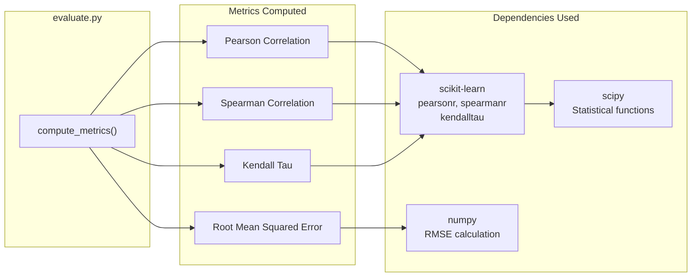
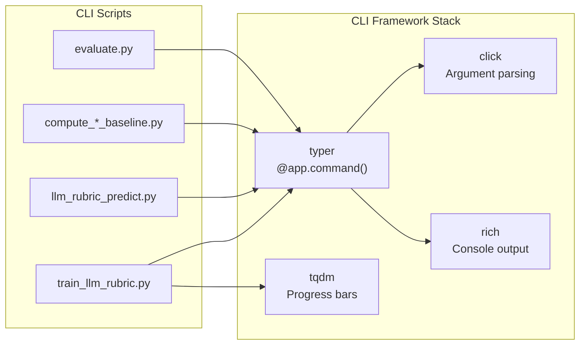

<!-- source: DeepWiki mcp.deepwiki.com · repo microsoft/LLM-Rubric · page 9.2 Dependencies and Environment · fetched 2026-10-26 -->

# Dependencies and Environment

<details>
<summary>Relevant source files</summary>

The following files were used as context for generating this wiki page:

- [.gitignore](.gitignore)
- [poetry.lock](poetry.lock)
- [pyproject.toml](pyproject.toml)

</details>


## Purpose and Scope

This document provides detailed information about the Python dependencies, version requirements, and development environment for the LLM-Rubric codebase. It covers package management with Poetry, the dependency tree, and how each dependency is used within the system.

For installation instructions and setup procedures, see [Installation](#2.1). For information about the overall project structure, see [Project Structure](#9.1).

---

## Python Version Requirements

The LLM-Rubric project requires Python **3.10, 3.11, or 3.12**. The version constraint is explicitly defined as:

```toml
python = ">=3.10,<3.13"
```

This constraint is enforced at the package level in [pyproject.toml:10]().

**Compatibility Notes:**
- Python 3.9 and below are not supported
- Python 3.13 and above are not yet supported due to dependency constraints

Sources: [pyproject.toml:10]()

---

## Package Management

The project uses **Poetry 1.8.3** for dependency management and packaging. Poetry provides:

- Deterministic dependency resolution via `poetry.lock`
- Virtual environment management
- Build system integration
- Dependency version constraints

The lock file ensures reproducible builds across different environments by pinning exact versions of all direct and transitive dependencies.

### Key Files

| File | Purpose |
|------|---------|
| `pyproject.toml` | Project metadata and direct dependency specifications |
| `poetry.lock` | Locked versions of all dependencies (direct and transitive) |

Sources: [pyproject.toml:1-23](), [poetry.lock:1-748]()

---

## Core Dependencies

### Command-Line Interface

| Package | Version | Purpose in LLM-Rubric |
|---------|---------|------------------------|
| `typer` | 0.12.3 | Primary CLI framework for all command-line scripts |
| `click` | 8.1.7 | Underlying CLI toolkit (transitive via typer) |
| `rich` | 13.7.1 | Rich text rendering and terminal formatting |
| `tqdm` | 4.66.5 | Progress bars during training and evaluation |
| `shellingham` | 1.5.4 | Shell detection for CLI integration |

Sources: [pyproject.toml:11](), [pyproject.toml:16](), [poetry.lock:14-27](), [poetry.lock:686-703](), [poetry.lock:460-475](), [poetry.lock:653-661]()

### Data Processing and Manipulation

| Package | Version | Purpose in LLM-Rubric |
|---------|---------|------------------------|
| `pandas` | 2.2.2 | Primary data manipulation library for loading TSV/CSV files, joining datasets, and data transformations in `pd_utils` |
| `numpy` | 2.0.1 | Numerical array operations, tensor creation for neural network inputs |
| `python-dateutil` | 2.9.0 | Date parsing utilities (transitive via pandas) |
| `pytz` | 2024.1 | Timezone support (transitive via pandas) |
| `tzdata` | 2024.1 | Timezone database (transitive via pandas) |

Sources: [pyproject.toml:12-13](), [poetry.lock:209-281](), [poetry.lock:156-207](), [poetry.lock:435-446](), [poetry.lock:449-457](), [poetry.lock:734-742]()

### Machine Learning and Statistics

| Package | Version | Purpose in LLM-Rubric |
|---------|---------|------------------------|
| `scikit-learn` | 1.5.1 | Evaluation metrics: Pearson correlation, Spearman rank correlation, Kendall tau, RMSE calculations in `evaluate.py` |
| `scipy` | 1.14.0 | Scientific computing functions (transitive via scikit-learn) |
| `joblib` | 1.4.2 | Parallel processing for cross-validation jobs (transitive via scikit-learn) |
| `threadpoolctl` | 3.5.0 | Thread pool management for numerical libraries (transitive via scikit-learn) |

Sources: [pyproject.toml:14](), [poetry.lock:554-598](), [poetry.lock:599-640](), [poetry.lock:60-68](), [poetry.lock:675-683]()

### Data Validation and Serialization

| Package | Version | Purpose in LLM-Rubric |
|---------|---------|------------------------|
| `pydantic` | 2.8.2 | Data validation for configuration objects and model inputs |
| `pydantic-numpy` | 6.0.0 | Integration layer for validating numpy arrays with Pydantic models in `Dataset` class |
| `pydantic-core` | 2.20.1 | Core validation engine for Pydantic (transitive) |
| `annotated-types` | 0.7.0 | Type annotation support for Pydantic (transitive) |
| `typing-extensions` | 4.12.2 | Backported type hints for Python 3.10+ (transitive) |

Sources: [pyproject.toml:15](), [pyproject.toml:17](), [poetry.lock:283-300](), [poetry.lock:402-419](), [poetry.lock:301-397](), [poetry.lock:3-12](), [poetry.lock:723-731]()

### Compression and Serialization Support

| Package | Version | Purpose in LLM-Rubric |
|---------|---------|------------------------|
| `compress-pickle` | 2.1.0 | Compressed pickle serialization (used by pydantic-numpy) |
| `lz4` | 4.3.3 | Fast LZ4 compression algorithm |
| `ruamel-yaml` | 0.18.6 | YAML parsing and serialization (used by pydantic-numpy) |
| `ruamel-yaml-clib` | 0.2.8 | C-based YAML parser for performance (transitive) |
| `semver` | 3.0.2 | Semantic version parsing (used by pydantic-numpy) |

Sources: [poetry.lock:40-58](), [poetry.lock:70-118](), [poetry.lock:478-494](), [poetry.lock:496-552](), [poetry.lock:642-650]()

### Terminal Output Enhancements

| Package | Version | Purpose in LLM-Rubric |
|---------|---------|------------------------|
| `colorama` | 0.4.6 | Cross-platform colored terminal text (Windows compatibility) |
| `markdown-it-py` | 3.0.0 | Markdown parsing for rich text (transitive via rich) |
| `mdurl` | 0.1.2 | URL utilities for markdown (transitive) |
| `pygments` | 2.18.0 | Syntax highlighting (transitive via rich) |

Sources: [poetry.lock:29-37](), [poetry.lock:121-142](), [poetry.lock:145-153](), [poetry.lock:421-432]()

---

## Dependency Architecture

### Dependency Tree by System Component



Sources: [pyproject.toml:9-17](), [poetry.lock:1-748]()

### Dependency Resolution Tree

```mermaid
graph TD
    subgraph "Direct Dependencies"
        D1["typer ^0.12.3"]
        D2["numpy ^2.0.1"]
        D3["pandas ^2.2.2"]
        D4["scikit-learn ^1.5.1"]
        D5["pydantic ^2.8.2"]
        D6["tqdm ^4.66.5"]
        D7["pydantic-numpy ^6.0.0"]
    end
    
    subgraph "Transitive: CLI Support"
        T1["click 8.1.7"]
        T2["rich 13.7.1"]
        T3["shellingham 1.5.4"]
        T4["colorama 0.4.6"]
        T5["markdown-it-py 3.0.0"]
        T6["pygments 2.18.0"]
    end
    
    subgraph "Transitive: Data Processing"
        T7["python-dateutil 2.9.0"]
        T8["pytz 2024.1"]
        T9["tzdata 2024.1"]
        T10["six 1.16.0"]
    end
    
    subgraph "Transitive: ML Support"
        T11["scipy 1.14.0"]
        T12["joblib 1.4.2"]
        T13["threadpoolctl 3.5.0"]
    end
    
    subgraph "Transitive: Validation"
        T14["pydantic-core 2.20.1"]
        T15["annotated-types 0.7.0"]
        T16["typing-extensions 4.12.2"]
    end
    
    subgraph "Transitive: Serialization"
        T17["compress-pickle 2.1.0"]
        T18["lz4 4.3.3"]
        T19["ruamel-yaml 0.18.6"]
        T20["semver 3.0.2"]
    end
    
    D1 --> T1
    D1 --> T2
    D1 --> T3
    T1 --> T4
    T2 --> T5
    T2 --> T6
    
    D3 --> D2
    D3 --> T7
    D3 --> T8
    D3 --> T9
    T7 --> T10
    
    D4 --> D2
    D4 --> T11
    D4 --> T12
    D4 --> T13
    
    D5 --> T14
    D5 --> T15
    D5 --> T16
    
    D7 --> D2
    D7 --> D5
    D7 --> T17
    D7 --> T19
    D7 --> T20
    T17 --> T18
```



Sources: [pyproject.toml:9-17](), [poetry.lock:1-748]()

---

## Notable Dependency Characteristics

### NumPy 2.x Migration

The project uses **NumPy 2.0.1**, which represents a major version upgrade from NumPy 1.x. This version includes:

- Breaking API changes from NumPy 1.x
- Enhanced performance for array operations
- New type system improvements

**Compatibility Requirements:**
- `pandas` requires NumPy >=1.22.4 (Python 3.10), >=1.23.2 (Python 3.11), or >=1.26.0 (Python 3.12)
- `scikit-learn` requires NumPy >=1.19.5
- `scipy` requires NumPy >=1.23.5,<2.3

Sources: [poetry.lock:156-207](), [poetry.lock:247-256](), [poetry.lock:584-588](), [poetry.lock:633-634]()

### Pydantic v2 Data Validation

The project uses **Pydantic 2.8.2**, which provides:

- Rust-based core validation engine (`pydantic-core`)
- Significantly faster validation than Pydantic v1
- Enhanced type annotation support
- Integration with NumPy arrays via `pydantic-numpy`

The `pydantic-numpy` package enables type-safe validation of NumPy array shapes and dtypes within Pydantic models, used for the `Dataset` class tensors (X, A, Y).

Sources: [poetry.lock:283-300](), [poetry.lock:402-419](), [poetry.lock:301-397]()

### Cross-Platform CLI Support

Terminal output dependencies ensure cross-platform compatibility:

- `colorama` provides colored terminal output on Windows
- `rich` enables advanced formatting across all platforms
- `shellingham` detects the current shell for better integration

Sources: [poetry.lock:29-37](), [poetry.lock:460-475](), [poetry.lock:653-661]()

---

## Missing Dependencies

### PyTorch Absence

**Important Note:** The high-level system documentation and code comments reference PyTorch neural networks (`PersonalizedCalibrationNetwork`), but **PyTorch is not listed in `pyproject.toml`** or `poetry.lock`. 

This suggests one of the following:
1. PyTorch must be installed separately by users
2. The dependency specification is incomplete
3. The neural network implementation uses pure NumPy instead of PyTorch

Developers should verify whether PyTorch is required and add it to `pyproject.toml` if necessary.

Sources: [pyproject.toml:1-23](), [poetry.lock:1-748]()

---

## Development Environment Setup

### Installation Workflow



Sources: [pyproject.toml:10](), [poetry.lock:744-747]()

### Dependency Lock File

The `poetry.lock` file pins **exact versions** of all 40+ packages:

```toml
[metadata]
lock-version = "2.0"
python-versions = ">=3.10,<3.13"
content-hash = "14e43c3d2de2f63e8b591fc2c5e7b7d9f3ccfe7f08e5c27c6376356f7f49d329"
```

This content hash ensures that the lock file matches `pyproject.toml`. If dependencies are modified, Poetry regenerates this hash.

Sources: [poetry.lock:744-748]()

---

## Dependency Usage by Module

### Data Processing (`pd_utils`)



### Evaluation Scripts (`evaluate.py`)



### CLI Scripts



Sources: [pyproject.toml:9-17]()

---

## Platform-Specific Dependencies

### Windows

```python
# Conditional dependency in poetry.lock
colorama = {version = "*", markers = "platform_system == \"Windows\""}
```

The `colorama` package is automatically installed only on Windows to enable colored terminal output.

Sources: [poetry.lock:26](), [poetry.lock:697]()

### CPython vs PyPy

```python
# Conditional dependency for CPython
"ruamel.yaml.clib" = {version = ">=0.2.7", markers = "platform_python_implementation == \"CPython\" and python_version < \"3.13\""}
```

The C-based YAML parser is used only with CPython for performance, not with PyPy.

Sources: [poetry.lock:489]()

---

## Summary

The LLM-Rubric project maintains a focused set of **7 direct dependencies** that expand to **40+ packages** when including transitive dependencies. The dependency stack is organized into clear layers:

1. **CLI Layer**: typer, rich, tqdm for user interaction
2. **Data Layer**: pandas, numpy for data manipulation
3. **ML Layer**: scikit-learn, scipy for evaluation metrics
4. **Validation Layer**: pydantic, pydantic-numpy for type safety

All dependencies are managed through Poetry with locked versions for reproducibility. The project targets Python 3.10-3.12 and ensures cross-platform compatibility through conditional dependencies.

Sources: [pyproject.toml:1-23](), [poetry.lock:1-748]()

---

