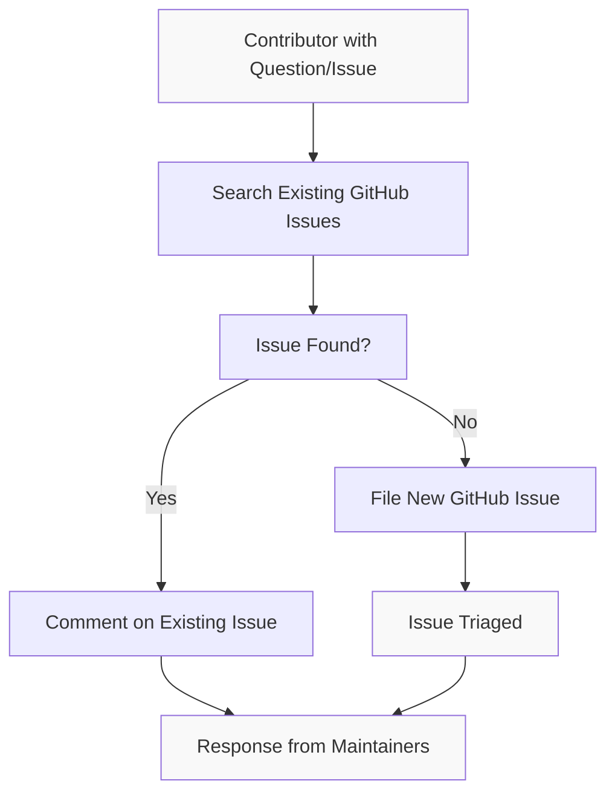
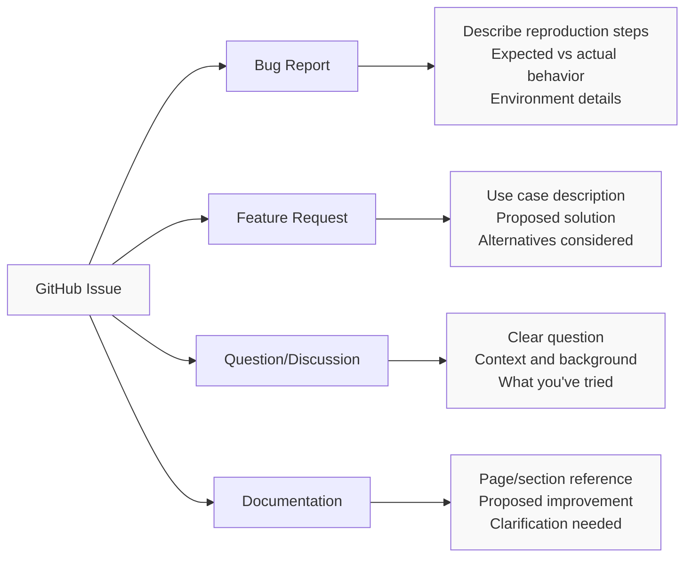
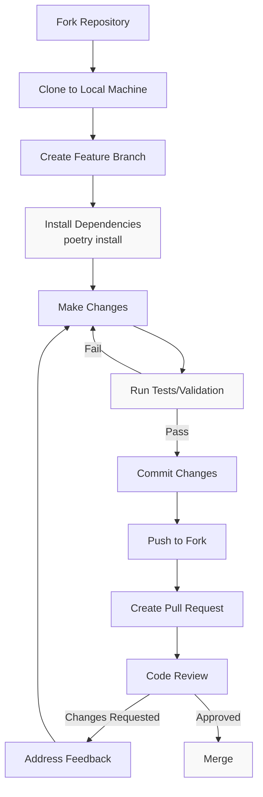
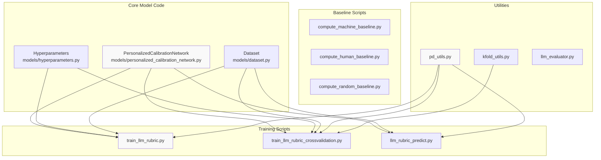

<!-- source: DeepWiki mcp.deepwiki.com · repo microsoft/LLM-Rubric · page 9.3 Contributing Guidelines · fetched 2026-10-26 -->

# Contributing Guidelines

<details>
<summary>Relevant source files</summary>

The following files were used as context for generating this wiki page:

- [CODE_OF_CONDUCT.md](CODE_OF_CONDUCT.md)
- [SUPPORT.md](SUPPORT.md)

</details>


## Purpose and Scope

This document provides guidelines for contributing to the LLM-Rubric project, including how to report issues, request features, and understand the support model. It covers the code of conduct, issue reporting procedures, and available support channels.

For information about setting up the development environment, see [Dependencies and Environment](#9.2). For the repository structure and module organization, see [Project Structure](#9.1).

---

## Code of Conduct

The LLM-Rubric project has adopted the Microsoft Open Source Code of Conduct. All contributors are expected to adhere to this code when participating in the project.

### Key Principles

| Principle | Description |
|-----------|-------------|
| **Respectful** | Treat all community members with respect and dignity |
| **Inclusive** | Welcome contributors from all backgrounds and experience levels |
| **Constructive** | Provide constructive feedback and criticism |
| **Professional** | Maintain professional conduct in all interactions |

### Resources

- **Code of Conduct**: [Microsoft Open Source Code of Conduct](https://opensource.microsoft.com/codeofconduct/)
- **FAQ**: [Microsoft Code of Conduct FAQ](https://opensource.microsoft.com/codeofconduct/faq/)
- **Contact**: For questions or concerns, email [opencode@microsoft.com](mailto:opencode@microsoft.com)

**Sources:** [CODE_OF_CONDUCT.md:1-10]()

---

## Support Channels

The project uses a focused support model with specific channels for different types of requests.

### Support Workflow



### GitHub Issues

The primary support channel for the project is **GitHub Issues**. This is where you should:

- Report bugs or defects
- Request new features or enhancements
- Ask questions about usage or behavior
- Discuss potential improvements

**Important Note**: There is currently no plan to release updated versions of LLM-Rubric in the future. The project is provided as-is for research and educational purposes.

### Before Filing an Issue

1. **Search existing issues**: Check if your issue has already been reported
2. **Check documentation**: Review the wiki pages for answers to common questions
3. **Verify your environment**: Ensure you're using the correct Python version and dependencies (see [Dependencies and Environment](#9.2))

**Sources:** [SUPPORT.md:1-12]()

---

## Issue Reporting Process

When filing a new issue, provide comprehensive information to help maintainers understand and address your concern.

### Issue Categories



### Bug Report Template

When reporting a bug, include the following information:

| Section | Required Information |
|---------|---------------------|
| **Description** | Clear, concise description of the bug |
| **Steps to Reproduce** | Numbered steps to reproduce the behavior |
| **Expected Behavior** | What you expected to happen |
| **Actual Behavior** | What actually happened |
| **Environment** | Python version, PyTorch version, operating system |
| **Data Context** | Dataset used (real/synthetic), number of samples |
| **Code Reference** | Relevant file paths and function names |
| **Error Messages** | Full stack traces or error output |

### Feature Request Template

When requesting a feature:

| Section | Content |
|---------|---------|
| **Problem Statement** | The problem this feature would solve |
| **Proposed Solution** | Your suggested implementation approach |
| **Alternatives** | Other solutions you've considered |
| **Use Case** | Specific scenarios where this would be useful |
| **Breaking Changes** | Whether this would affect existing functionality |

**Sources:** [SUPPORT.md:5-7]()

---

## Development Workflow

Contributors following standard open-source development practices can work with the LLM-Rubric codebase.

### Contribution Workflow



### Branch Naming Conventions

Use descriptive branch names that indicate the purpose of your changes:

- **Bug fixes**: `bugfix/description-of-issue`
- **New features**: `feature/description-of-feature`
- **Documentation**: `docs/description-of-changes`
- **Refactoring**: `refactor/description-of-changes`

### Commit Message Guidelines

Write clear, descriptive commit messages:

```
<type>: <short summary>

<optional detailed description>

<optional footer>
```

**Types:**
- `feat`: New feature
- `fix`: Bug fix
- `docs`: Documentation changes
- `refactor`: Code refactoring
- `test`: Test additions or modifications
- `chore`: Build process or dependency updates

**Sources:** General best practices for GitHub contributions

---

## Code Quality Standards

Contributions should maintain the project's code quality standards.

### Python Code Standards

| Aspect | Requirement |
|--------|-------------|
| **Python Version** | Python 3.10 or higher |
| **Type Hints** | Use type annotations where appropriate |
| **Imports** | Organize imports logically; remove unused imports |
| **Function Length** | Keep functions focused and reasonably sized |
| **Documentation** | Add docstrings for public functions and classes |

### Key Code Entities to Understand

When contributing, familiarize yourself with these core components:



### Testing Your Changes

Before submitting a pull request:

1. **Run existing evaluation scripts** to ensure your changes don't break functionality
2. **Test with both datasets** (real and synthetic) if modifying data processing
3. **Verify hyperparameter configurations** still work if changing model architecture
4. **Check cross-validation** if modifying training loops

**Example validation workflow:**

```bash
# Test baseline computation
python compute_machine_baseline.py
python compute_human_baseline.py

# Test model training on synthetic data
python train_llm_rubric.py

# Test prediction generation
python llm_rubric_predict.py

# Test evaluation metrics
python evaluate.py
```

**Sources:** [train_llm_rubric.py](), [compute_machine_baseline.py](), [evaluate.py]()

---

## Pull Request Guidelines

When submitting a pull request, provide context and documentation.

### Pull Request Description Template

```markdown
## Description
[Brief description of the changes]

## Motivation
[Why these changes are needed]

## Changes Made
- [List of specific changes]
- [File paths affected]

## Testing
[How you tested the changes]

## Related Issues
Fixes #[issue number]
```

### Checklist Before Submission

- [ ] Code follows project style conventions
- [ ] Changes are focused and limited to the stated purpose
- [ ] No unnecessary dependencies added
- [ ] Existing functionality remains unaffected
- [ ] Documentation updated if needed
- [ ] Commit messages are clear and descriptive

**Sources:** Standard GitHub pull request best practices

---

## Support Policy

Understanding the project's support model helps set appropriate expectations.

### Current Support Status

The LLM-Rubric project is provided as-is for research and educational purposes. According to the Microsoft Support Policy:

- **Limited Support**: Support is limited to the resources listed in GitHub Issues
- **No Planned Updates**: There is currently no plan to release updated versions
- **Community-Driven**: Improvements may come from community contributions
- **Research Focus**: The project serves as a reference implementation

### What This Means for Contributors

- **Contributions are welcome** but may not be immediately reviewed or merged
- **Feature requests** will be considered based on project scope and maintainer availability
- **Bug reports** help improve the codebase but may not receive immediate fixes
- **Questions** should be filed as GitHub Issues for community visibility

**Sources:** [SUPPORT.md:9-11]()

---

## Acknowledgments

Contributions to this project, whether code, documentation, or issue reports, help advance the research and practical application of personalized calibration for LLM evaluations. Thank you for your interest in contributing to LLM-Rubric.

For questions about the contribution process, file a GitHub Issue with the label "question" or contact the Microsoft Open Source Programs Office at [opencode@microsoft.com](mailto:opencode@microsoft.com).

**Sources:** [CODE_OF_CONDUCT.md:9](), [SUPPORT.md:1-12]()

---

