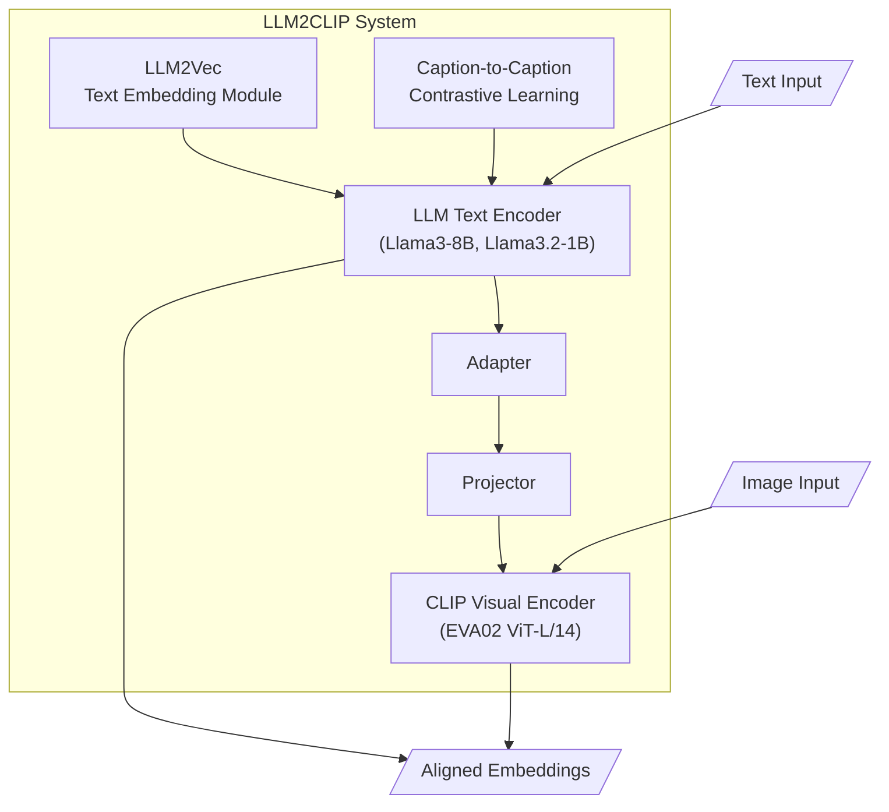
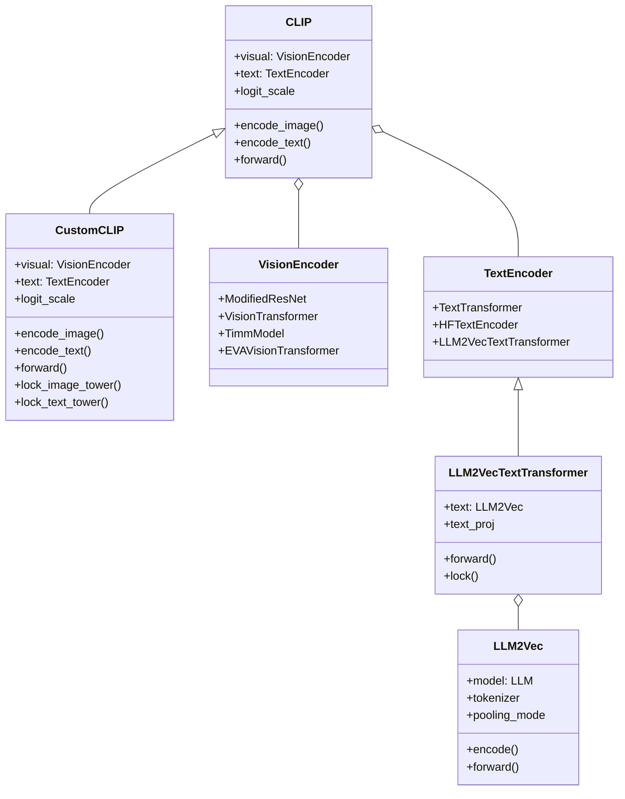
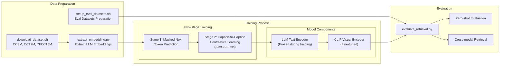
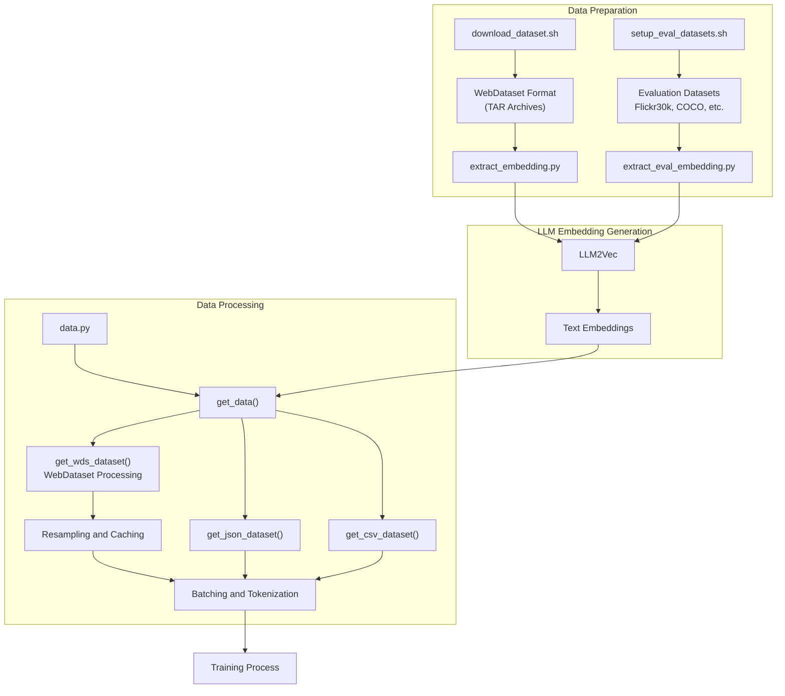

<!-- source: DeepWiki mcp.deepwiki.com · repo microsoft/LLM2CLIP · page 1 Overview · fetched 2026-10-26 -->

# Overview

Relevant source files

The following files were used as context for generating this wiki page:

- [FAQ.md](FAQ.md)
- [README.md](README.md)
- [docs/_site/static/images/New_LLM2CLIP_PR.jpg](docs/_site/static/images/New_LLM2CLIP_PR.jpg)
- [docs/index.html](docs/index.html)
- [docs/static/images/logo.png](docs/static/images/logo.png)
- [docs/static/images/radar_paper(4).png](docs/static/images/radar_paper(4).png)

LLM2CLIP is a system that leverages large language models (LLMs) as powerful textual teachers for CLIP's (Contrastive Language-Image Pre-training) visual encoder, enabling more nuanced and comprehensive multimodal learning. This overview introduces the core concepts, architecture, and components of the LLM2CLIP repository.

LLM2CLIP addresses the limitations of conventional CLIP models by integrating the capabilities of large language models to enhance visual-textual alignment, providing significant improvements in cross-modal tasks including zero-shot classification, detection, segmentation, and retrieval.

For detailed information about installation and setup procedures, see [Installation and Usage](#5).

## System Purpose and Key Innovations

LLM2CLIP was developed to overcome two primary limitations of existing CLIP models:

1. **Limited Context Window**: Standard CLIP text encoders have a short context window of only 77 tokens, restricting their ability to process lengthy inputs.

2. **Weak Text Comprehension**: Traditional CLIP text encoders have limited ability to understand complex text, often functioning more like bag-of-words models.

The key innovations of LLM2CLIP include:

- **Extended Input Window**: Leveraging LLMs to expand CLIP's input context window
- **Enhanced Textual Understanding**: Enabling CLIP to comprehend dense, complex captions
- **Open-World Knowledge Integration**: Using LLMs' pre-trained knowledge to improve multimodal alignment
- **Caption-to-Caption Contrastive Learning**: A novel training strategy to improve the separability of the LLM's output space

Sources: [README.md:27-45]()

## High-Level Architecture

The LLM2CLIP system integrates large language models with CLIP's visual encoder to create a more powerful multimodal representation system.

Sources: [README.md:52-53]()

## Core Components

LLM2CLIP consists of several key components that work together to enhance CLIP's visual-textual representation capabilities:

### 1. LLM Text Encoder

The LLM Text Encoder (implemented as `LLM2VecTextTransformer` in the codebase) replaces the standard CLIP text encoder with a large language model like Llama3-8B or Llama3.2-1B. This component provides superior text understanding and context modeling capabilities.

### 2. LLM2Vec Module

The LLM2Vec module serves as an interface between the LLM and the rest of the system, handling tokenization, text encoding, and embedding extraction. It transforms text inputs into high-dimensional embeddings that capture rich semantic information.

### 3. CLIP Visual Encoder

The CLIP Visual Encoder processes images and is fine-tuned to align with the LLM's text representations. LLM2CLIP supports various implementations such as EVA02 ViT-L/14 or other vision transformer architectures.

### 4. Adapter and Projector

These components connect the LLM to the CLIP Visual Encoder, ensuring proper alignment between the text and image modalities. They transform the LLM's output space to be compatible with the CLIP Visual Encoder.

Sources: [README.md:42-45]()

## Model Architecture

The following diagram illustrates the CLIP model architecture in LLM2CLIP, showing the relationship between different encoders and transformers:

Sources: [README.md:42-45]()

## Training Approach

LLM2CLIP employs a two-stage training approach to enhance CLIP's capabilities:

Key aspects of the training approach:

1. **Caption-to-Caption Contrastive Learning**: This strategy trains the LLM to better differentiate between captions of the same or different images, enhancing the separability of the LLM's output space.

2. **Frozen LLM Gradients**: During training, the LLM gradients are frozen while CLIP's visual encoder is fine-tuned, resulting in significant performance gains with limited data.

3. **Long and Dense Caption Processing**: The approach better utilizes the LLM's power to comprehend and process long and dense captions, improving overall representation capabilities.

Sources: [README.md:40-45](), [FAQ.md:44-52]()

## Data Processing Pipeline

The data processing workflow in LLM2CLIP handles the preparation of training and evaluation datasets:

Sources: [README.md:69-82]()

## Applications and Benefits

LLM2CLIP provides several key benefits and applications:

1. **Enhanced CLIP Models**: Fine-tuning pretrained CLIP models with dense captions or task-specific image-text datasets for various use cases.

2. **Improved Cross-Modal Retrieval**: Significantly better performance on text-to-image and image-to-text retrieval tasks.

3. **Cross-Language Capability**: Even when trained solely on English data, LLM2CLIP outperforms standard Chinese CLIP models on Chinese text-image retrieval tasks.

4. **VLM Enhancement**: LLM2CLIP can make visual language models like Llava more powerful and comprehensive in performance across a wide range of benchmarks.

5. **Domain Specialization Potential**: The approach can be adapted to specialized domains like medicine or law with limited domain-specific data.

Sources: [README.md:46-50](), [FAQ.md:24-33]()

## Model Zoo

LLM2CLIP provides several pretrained models in the Hugging Face Model Zoo, including:

- Caption-Contrastive finetuned Llama3-8B-CC
- OpenAI's CLIP and EVA02's ViT models (base and large)

Sources: [README.md:55-57](), [README.md:10-14]()

This overview provides an introduction to LLM2CLIP. For more detailed information about key concepts, see [Key Concepts](#1.1), or for a deeper dive into the system architecture, see [System Architecture](#2).

---

