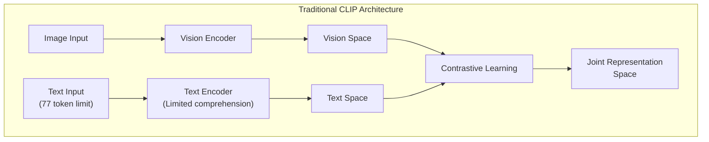
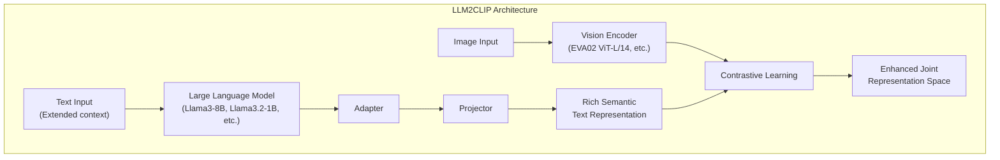
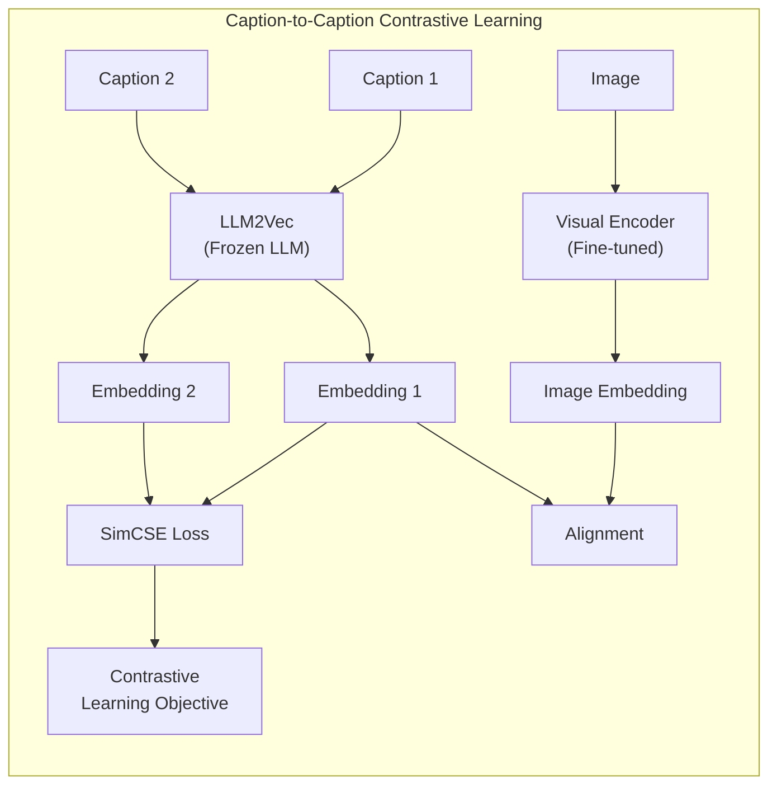
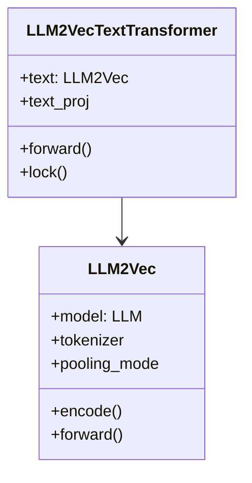
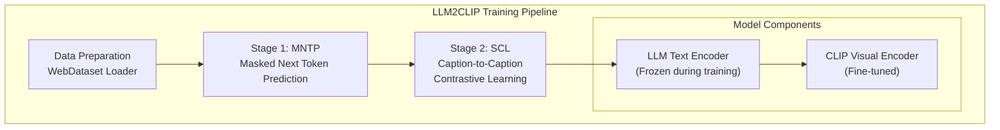
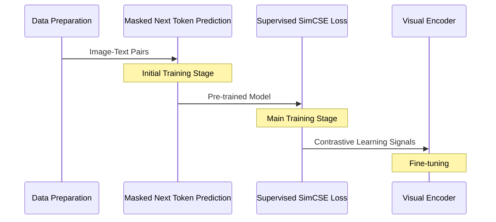
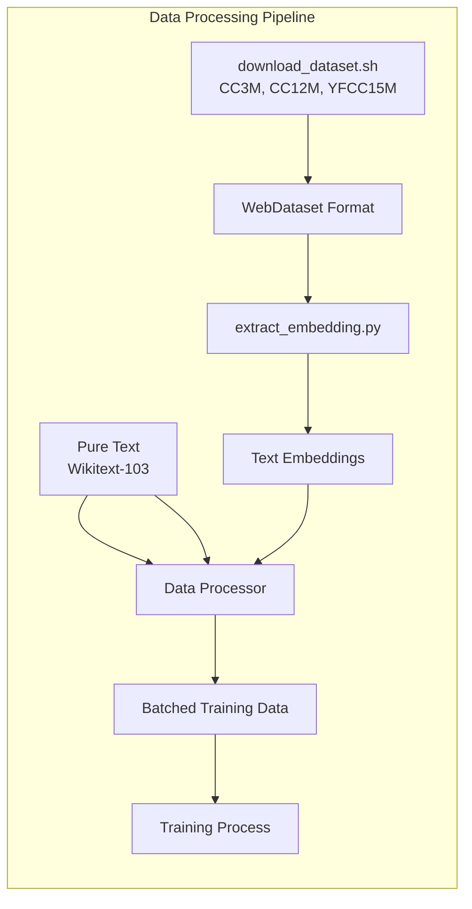
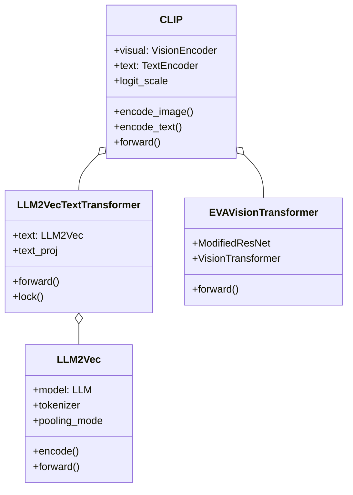
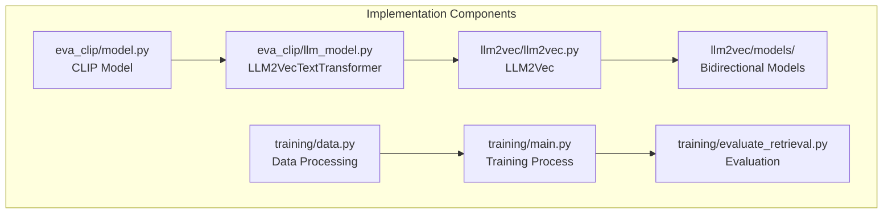

<!-- source: DeepWiki mcp.deepwiki.com · repo microsoft/LLM2CLIP · page 1.1 Key Concepts · fetched 2026-10-26 -->

# Key Concepts

Relevant source files

The following files were used as context for generating this wiki page:

- [FAQ.md](FAQ.md)
- [README.md](README.md)
- [docs/_site/static/images/New_LLM2CLIP_PR.jpg](docs/_site/static/images/New_LLM2CLIP_PR.jpg)
- [docs/index.html](docs/index.html)
- [docs/static/images/logo.png](docs/static/images/logo.png)
- [docs/static/images/radar_paper(4).png](docs/static/images/radar_paper(4).png)

This page provides an overview of the fundamental concepts behind LLM2CLIP, explaining how large language models (LLMs) are used to enhance CLIP (Contrastive Language-Image Pre-training) models. For detailed information about the system architecture, see [System Architecture](#2), and for training pipeline details, see [Training Pipeline](#3).

## CLIP Fundamentals and Limitations

CLIP (Contrastive Language-Image Pre-training) aligns visual and textual signals into a shared feature space using contrastive learning on image-text pairs. Traditional CLIP models face two key limitations:

1. **Limited Context Window**: The text encoder has a short context window of only 77 tokens, restricting understanding of lengthy inputs.
2. **Weak Text Comprehension**: The text encoder has limited ability to comprehend complex text, often functioning as a basic bag-of-words model.

Sources: README.md:20-26, FAQ.md:3-16

## LLM2CLIP Approach

LLM2CLIP addresses CLIP's limitations by leveraging large language models (LLMs) as powerful textual teachers for CLIP's visual encoder, enabling:

1. **Extended Context Window**: LLMs expand CLIP's input window, allowing richer textual context.
2. **Enhanced Understanding**: LLMs provide deeper comprehension of dense, complex captions.
3. **Open-World Knowledge**: LLMs contribute global knowledge that improves multimodal feature alignment.

Sources: README.md:27-34, docs/index.html:93-97

## Caption-to-Caption Contrastive Learning

A key innovation in LLM2CLIP is its **Caption-to-Caption Contrastive Learning** strategy. While LLMs have strong inherent text encoding capabilities, their output space is often not highly separable, limiting effectiveness for contrastive learning.

The Caption-to-Caption Contrastive Learning approach:

1. Trains the LLM to better differentiate between captions of the same or different images
2. Enhances the separability of the LLM's output space
3. Freezes LLM gradients while fine-tuning CLIP's visual encoder
4. Significantly improves the model's ability to process long and dense captions

Sources: README.md:35-45, FAQ.md:124-142

## System Components

### LLM2Vec

LLM2Vec is a text embedding module that leverages a large language model to create rich textual representations. It extends CLIP's capabilities by enhancing text understanding and expanding the context window.

Sources: README.md:27-34, FAQ.md:124-142

### Training Pipeline Components

The LLM2CLIP training pipeline consists of two main stages and several key components:

Sources: FAQ.md:45-47, README.md:40-45

## Two-Stage Training Process

The LLM2CLIP training process involves two distinct stages:

1. **Masked Next Token Prediction (MNTP)**: An initial stage that prepares the model
2. **Supervised SimCSE Loss**: The main stage that uses contrastive learning to make different captions of the same image positive samples for each other, while captions of different images serve as negative samples

This two-stage approach is critical to the effectiveness of LLM2CLIP, though the MNTP stage has relatively less impact on the final results than the SimCSE loss stage.

Sources: FAQ.md:134-137

## Data Processing and Embedding Extraction

The data processing pipeline in LLM2CLIP involves:

1. **Dataset Preparation**: Using datasets like CC3M, CC12M, YFCC15M
2. **Embedding Extraction**: Creating LLM embeddings from captions
3. **Mixed Datasets**: Combining pure text (e.g., Wikitext-103) and caption datasets (e.g., CC-3M)

This approach helps maintain the LLM's original distribution with minimal shift while providing rich supervision signals.

Sources: README.md:69-82, FAQ.md:138-139

## Model Architecture

The LLM2CLIP model architecture integrates a large language model with CLIP's visual encoder:

Sources: README.md:52-53, docs/index.html:102-105

## Key Benefits and Applications

LLM2CLIP offers several key benefits and applications:

1. **Enhanced CLIP Models**: Fine-tune existing CLIP models with dense captions or task-specific datasets
2. **Improved Performance**: Significant improvements in cross-modal tasks, especially for:
   - Long-text retrieval
   - Cross-language retrieval (even without explicit training on target languages)
   - Complex visual understanding tasks

The system can be applied to:

- Image-text retrieval
- Multimodal understanding
- Zero-shot classification
- Extended to specialized domains (medicine, law, etc.)

Table: Performance Improvements with LLM2CLIP

| Model | Flickr30k (I2T) | COCO (I2T) | ShareGPT4v (I2T) | Average |
|-------|-----------------|------------|------------------|---------|
| EVA02 ViT-L/14 | 89.8 | 63.8 | 89.3 | 76.2 |
| + Llama3-8B | 87.1 | 56.4 | 89.3 | 66.3 |
| + Llama3-8B-CC | 92.0 | 68.5 | 98.6 | 85.6 |

Sources: README.md:46-50, docs/index.html:178-309

## Technical Implementation

The key technical aspects of LLM2CLIP include:

1. **Model Initialization**: Using pre-trained CLIP models (e.g., EVA02 ViT-L/14) and LLMs (e.g., Llama3-8B)
2. **Adapter and Projector Layers**: Connecting the LLM outputs to the visual space
3. **Training Configuration**: 
   - Freezing LLM gradients 
   - Fine-tuning visual encoder
   - Using caption-to-caption contrastive learning

Sources: README.md:61-68, README.md:84-89

## Caption Contrastive Fine-tuning

The Caption Contrastive Fine-tuning (CC) approach is crucial to LLM2CLIP's success. This process:

1. Improves the textual discriminability of the LLM
2. Makes the LLM outputs more suitable for contrastive learning
3. Enables the LLM to better differentiate between captions of the same or different images

By applying this fine-tuning, the system can significantly outperform both standard CLIP models and models using untuned LLMs.

Table: Caption Retrieval Accuracy (CRA) Comparison

| Language Model | CRA |
|----------------|-----|
| CLIP-L/14 | 25.2 |
| EVA02-L/14 | 27.11 |
| Llama3-8B (untuned) | 5.2 |
| Llama3-8B-CC (tuned) | 29.5 |

Sources: docs/index.html:124-167, README.md:40-45

---

