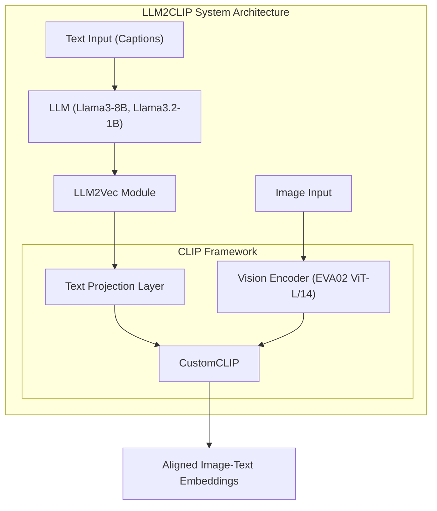
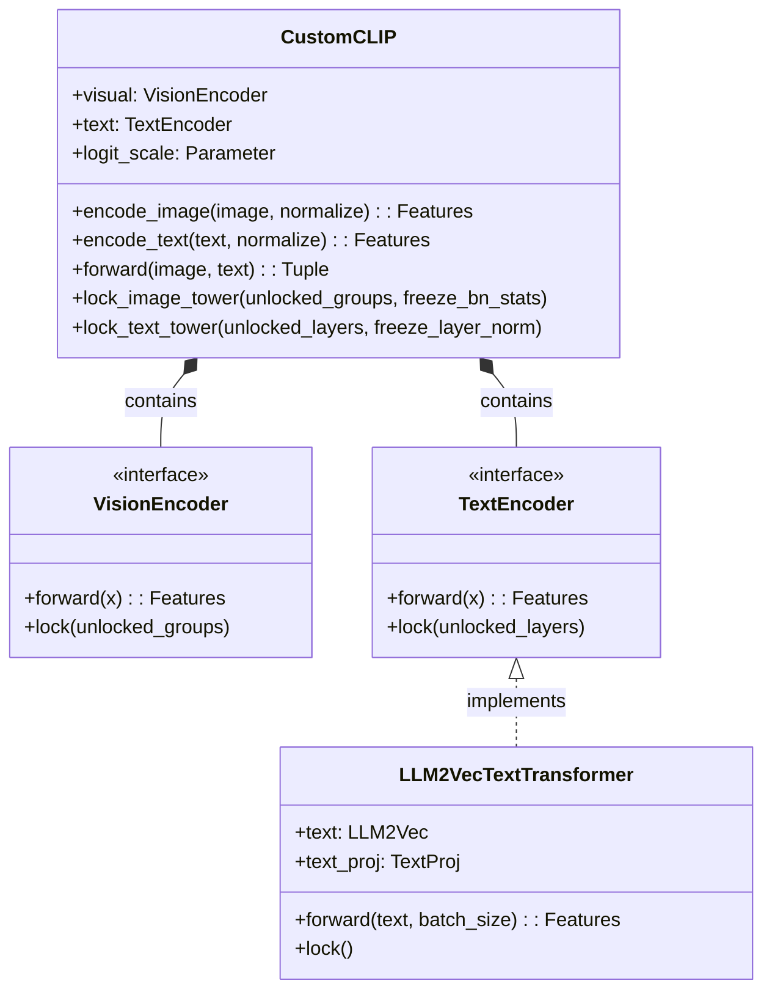
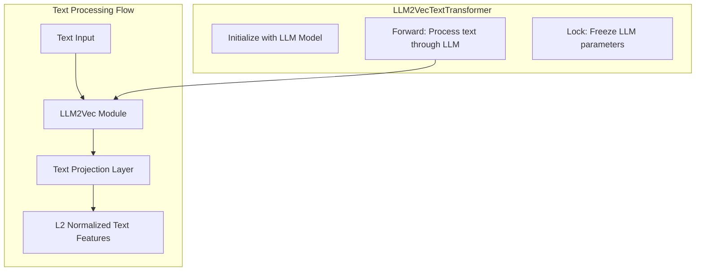
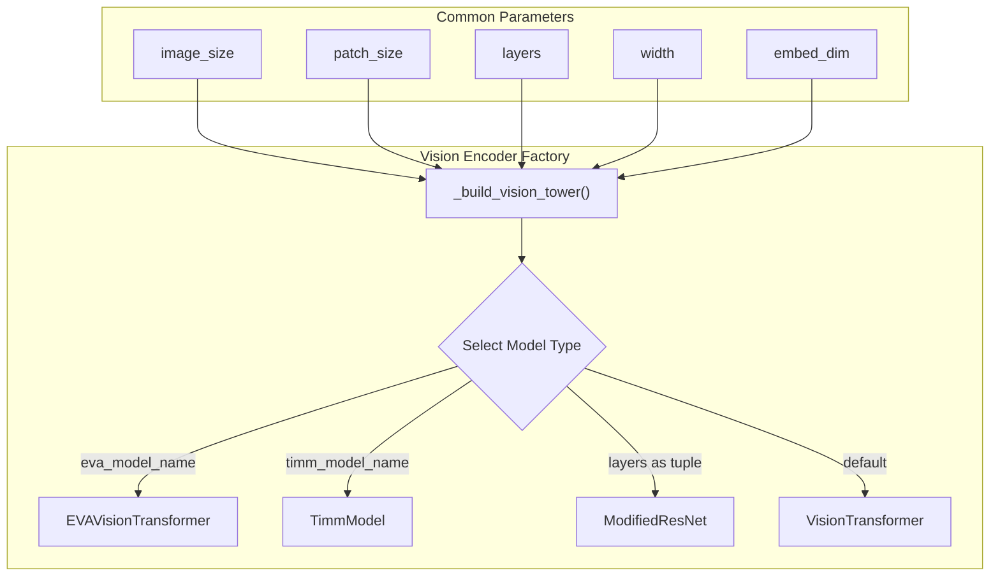
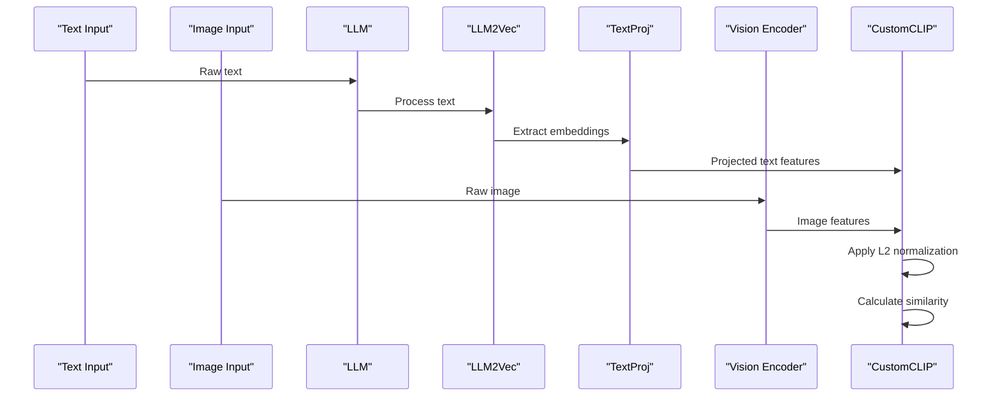

<!-- source: DeepWiki mcp.deepwiki.com · repo microsoft/LLM2CLIP · page 2 System Architecture · fetched 2026-10-26 -->

# System Architecture

<details>
<summary>Relevant source files</summary>

The following files were used as context for generating this wiki page:

- [README.md](README.md)
- [docs/index.html](docs/index.html)
- [docs/static/images/logo.png](docs/static/images/logo.png)
- [docs/static/images/radar_paper(4).png](docs/static/images/radar_paper(4).png)
- [llm2clip/eva_clip/llm_model.py](llm2clip/eva_clip/llm_model.py)
- [llm2clip/eva_clip/model.py](llm2clip/eva_clip/model.py)

</details>


This document provides a comprehensive overview of the LLM2CLIP system architecture, detailing the core components and their interactions. LLM2CLIP enhances CLIP (Contrastive Language-Image Pre-training) models by leveraging large language models (LLMs) as powerful textual teachers for CLIP's visual encoder.

For information about the training pipeline specifics, see [Training Pipeline](#3). For CLIP model architecture details, see [CLIP Model Architecture](#2.1). For information about LLM integration, see [LLM Integration](#2.2).

## High-Level Architecture Overview

LLM2CLIP combines the powerful language understanding capabilities of large language models with CLIP's multimodal learning framework to create more robust visual representations.



The system architecture consists of:

1. **Large Language Model (LLM)**: Processes text inputs with advanced language understanding. Implementation relies primarily on Llama family models.

2. **LLM2Vec Module**: Extracts embeddings from the LLM, converting text inputs into vector representations that capture semantic meaning.

3. **Text Projection Layer**: Projects LLM embeddings into CLIP's embedding space through a sequence of transformation layers.

4. **Vision Encoder**: Processes images to extract visual features, with support for multiple architectures including EVA02 ViT-L/14.

5. **CustomCLIP**: Integrates the LLM-enhanced text features with visual features for multimodal representation learning.

Sources: [llm2clip/eva_clip/model.py:315-360](), [llm2clip/eva_clip/llm_model.py:5-36](), [README.md:18-45]()

## Core Components

### CustomCLIP Implementation

The primary integration point is the CustomCLIP class, which extends the standard CLIP architecture:



The CustomCLIP class:
- Initializes vision and text encoders based on configuration
- Provides methods for encoding images and text independently
- Implements forward pass for joint image-text processing
- Includes methods to selectively freeze model components during training

Sources: [llm2clip/eva_clip/model.py:315-360]()

### Text Processing Component

The text processing component consists of the LLM2VecTextTransformer class that integrates the LLM with CLIP:



The LLM2VecTextTransformer:
- Wraps an LLM2Vec instance using a specified LLM (e.g., Llama3)
- Processes text inputs to produce embeddings
- Optionally applies additional projection through a TextProj layer
- Supports parameter freezing to prevent LLM fine-tuning

Sources: [llm2clip/eva_clip/llm_model.py:5-36]()

### Text Projection Layer

The TextProj class transforms LLM embeddings to match CLIP's embedding space:


TextProj consists of:
- A sequence of LinearBlocks for embedding transformation
- Each LinearBlock applies normalization, expansion, non-linearity, and contraction
- A final layer normalization and linear projection to the target dimension
- Support for optional L2 normalization of the output

Sources: [llm2clip/eva_clip/model.py:217-254]()

## Vision Encoder Options

LLM2CLIP supports multiple vision encoder architectures:



The vision encoder options include:
- **EVAVisionTransformer**: Enhanced Vision Transformer with advanced features
- **TimmModel**: Integration with timm library for various pre-trained models
- **ModifiedResNet**: ResNet-based vision encoder for CLIP
- **VisionTransformer**: Standard Vision Transformer implementation

Sources: [llm2clip/eva_clip/model.py:94-171]()

## Data Flow

The data flow through the LLM2CLIP system during inference:



During the forward pass:
1. Text input is processed by the LLM and LLM2Vec to extract embeddings
2. The extracted embeddings are projected into CLIP's embedding space
3. Images are processed by the vision encoder to extract visual features
4. Both features are normalized and their similarity is calculated

Sources: [llm2clip/eva_clip/model.py:346-360](), [llm2clip/eva_clip/llm_model.py:27-32]()

## Configuration Options

LLM2CLIP provides extensive configuration options for both vision and text encoders:

### Vision Configuration

The CLIPVisionCfg class defines vision encoder configuration:

| Parameter | Description | Default Value |
|-----------|-------------|---------------|
| layers | Number of transformer layers | 12 |
| width | Model dimension | 768 |
| patch_size | Image patch size | 16 |
| image_size | Input image dimensions | 224 |
| head_width | Width per attention head | 64 |
| mlp_ratio | MLP expansion ratio | 4.0 |
| eva_model_name | EVA model identifier | None |
| timm_model_name | Timm model identifier | None |
| drop_path_rate | Drop path rate | None |

### Text Configuration

The CLIPTextCfg class defines text encoder configuration:

| Parameter | Description | Default Value |
|-----------|-------------|---------------|
| use_embedding | Whether to use embeddings directly | True |
| llm_embedding_dim | LLM embedding dimension | 4096 |
| context_length | Maximum sequence length | 77 |
| vocab_size | Size of vocabulary | 49408 |
| width | Model dimension | 512 |
| heads | Number of attention heads | 8 |
| layers | Number of transformer layers | 12 |
| hf_model_name | HuggingFace model identifier | None |
| pooler_type | Pooling mechanism | "mean_pooler" |

Sources: [llm2clip/eva_clip/model.py:36-84]()

## Technical Implementation Details

### Model Initialization

The CustomCLIP model is initialized with separate vision and text encoders:

```python
def __init__(self, embed_dim, vision_cfg, text_cfg, quick_gelu=False, cast_dtype=None, itm_task=False):
    super().__init__()
    self.visual = _build_vision_tower(embed_dim, vision_cfg, quick_gelu, cast_dtype)
    self.text = _build_text_tower(embed_dim, text_cfg, quick_gelu, cast_dtype)
    self.logit_scale = nn.Parameter(torch.ones([]) * np.log(1 / 0.07))
```

The `_build_vision_tower` and `_build_text_tower` functions create the appropriate encoder components based on the provided configurations.

### LLM2VecTextTransformer Implementation

The LLM2VecTextTransformer integrates the LLM into CLIP:

```python
def __init__(self, text_proj=None):
    super().__init__()
    enable_bidirectional = True
    base_model_name_or_path = "meta-llama/Llama-3.1-8B-Instruct"
    peft_path = "checkpoints/LLM2CLIP-Llama-3.1-8B"
    self.text = LLM2Vec.from_pretrained(
            base_model_name_or_path,
            peft_path,
            merge_peft = True,
            enable_bidirectional=enable_bidirectional,
            attn_implementation = "flash_attention_2",
            torch_dtype=torch.bfloat16
        )
    self.text_proj = text_proj
```

During the forward pass, text is processed through the LLM and optionally projected:

```python
def forward(self, text, batch_size=32): 
    with torch.autocast("cuda"):        
        x = self.text.encode(text, batch_size=batch_size).to(torch.float16)
        if self.text_proj is not None:
            x = self.text_proj(x, l2_norm=False)
    return x
```

Sources: [llm2clip/eva_clip/llm_model.py:5-36]()

## System Capabilities and Constraints

### Capabilities

- **Enhanced Text Understanding**: Leverages LLM's advanced language understanding for richer text representations
- **Extended Context Window**: Supports longer text inputs beyond CLIP's traditional 77-token limit
- **Cross-Language Support**: Enables cross-lingual retrieval even when trained only on English data
- **Flexible Architecture**: Supports multiple vision encoder architectures and LLM models
- **Parameter Efficiency**: Allows freezing LLM parameters while fine-tuning only the vision encoder

### Constraints

- **Computational Requirements**: Requires significant computational resources to run large language models
- **Memory Usage**: High memory requirements for model inference
- **Pre-extraction Needs**: May require pre-extraction of LLM embeddings for efficient processing
- **Training Complexity**: Multi-stage training process with different loss functions

Sources: [README.md:20-45]()

## Conclusion

The LLM2CLIP architecture successfully integrates large language models with CLIP's vision-language framework, providing enhanced multimodal representations. By leveraging the advanced text understanding capabilities of LLMs, the system overcomes traditional limitations of CLIP models, such as limited context windows and weak text comprehension. The modular design supports various vision encoder architectures and LLM models, enabling flexible adaptation to different use cases.

Sources: [README.md:18-45](), [llm2clip/eva_clip/model.py](), [llm2clip/eva_clip/llm_model.py]()

---

