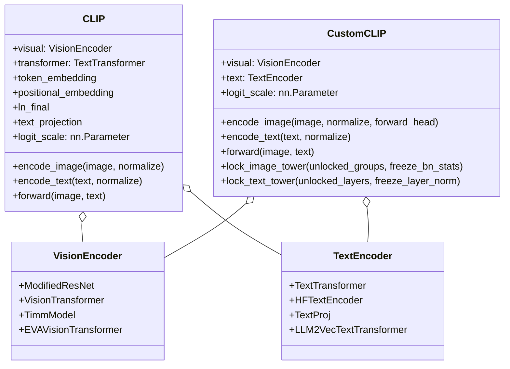
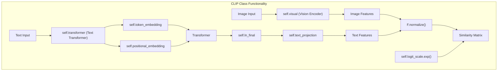
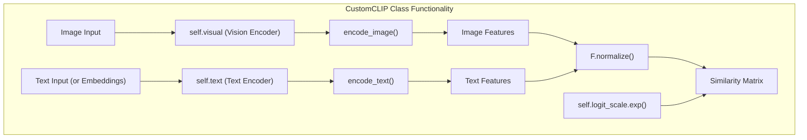
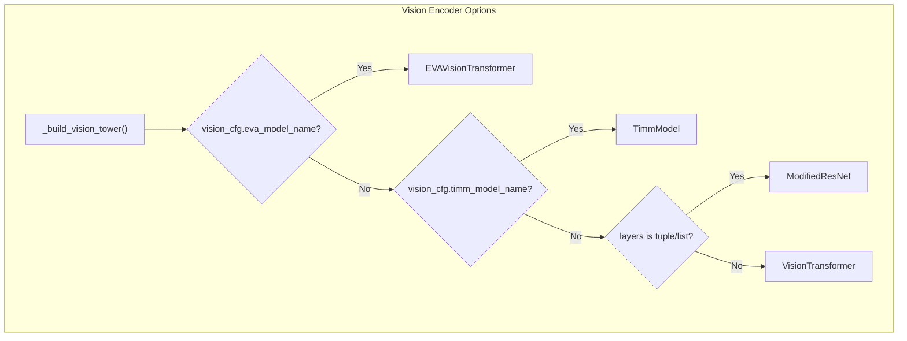
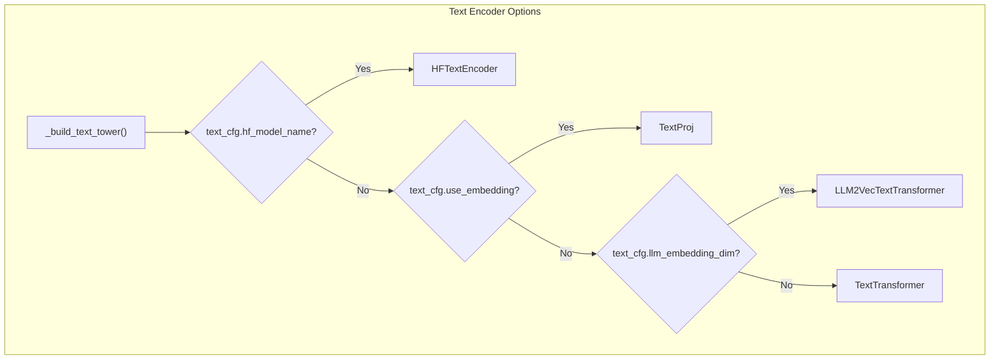
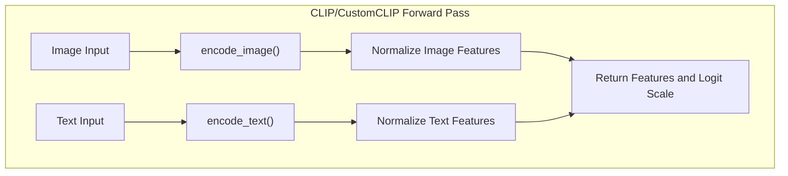

<!-- source: DeepWiki mcp.deepwiki.com · repo microsoft/LLM2CLIP · page 2.1 CLIP Model Architecture · fetched 2026-10-26 -->

# CLIP Model Architecture

Relevant source files

The following files were used as context for generating this wiki page:

- [llm2clip/eva_clip/__init__.py](llm2clip/eva_clip/__init__.py)
- [llm2clip/eva_clip/model.py](llm2clip/eva_clip/model.py)

This document provides a technical overview of the CLIP (Contrastive Language-Image Pre-training) model architecture as implemented in the LLM2CLIP codebase. It focuses specifically on the core CLIP model components and how they're implemented, including both the standard and customized versions used in this project. For information about how LLMs are integrated with CLIP, see [LLM Integration](#2.2).

## Overview

The CLIP model in LLM2CLIP follows the core architecture introduced by OpenAI, consisting of paired vision and text encoders designed to create aligned embeddings. LLM2CLIP extends this architecture with custom modifications for integrating Large Language Models.

Sources: [eva_clip/model.py:1-500](eva_clip/model.py:1-500), [eva_clip/__init__.py:1-12](eva_clip/__init__.py:1-12)

## CLIP and CustomCLIP Classes

LLM2CLIP implements two core CLIP model classes:

1. **CLIP**: The standard implementation based on OpenAI's architecture
2. **CustomCLIP**: An extended version designed specifically for LLM2CLIP

### Standard CLIP Class

The `CLIP` class represents a traditional CLIP architecture with integrated text transformer:

The `CLIP` class contains:
- A vision encoder (`self.visual`)
- Text transformer components:
  - Token embedding (`self.token_embedding`)
  - Positional embedding (`self.positional_embedding`)
  - Transformer layers (`self.transformer`)
  - Final layer normalization (`self.ln_final`)
  - Text projection layer (`self.text_projection`)
- A learnable temperature parameter (`self.logit_scale`)

Sources: [eva_clip/model.py:256-313](eva_clip/model.py:256-313)

### CustomCLIP Class

The `CustomCLIP` class provides a more flexible architecture, particularly for integrating external text encoders like LLMs:

The `CustomCLIP` class contains:
- A vision encoder (`self.visual`)
- A unified text encoder (`self.text`)
- A learnable temperature parameter (`self.logit_scale`)
- Additional methods to lock vision and text towers for partial fine-tuning

This architecture is more modular, replacing the integrated text transformer with a pluggable text encoder that can include an LLM-based encoder.

Sources: [eva_clip/model.py:315-360](eva_clip/model.py:315-360)

## Configuration Classes

Two configuration classes define the structure of the vision and text components:

### CLIPVisionCfg

The `CLIPVisionCfg` class configures the vision encoder with parameters such as:
- `layers`: Number of transformer layers or ResNet layer configuration
- `width`: Width of the transformer/ResNet
- `head_width`: Width per attention head
- `patch_size`: Size of image patches
- `image_size`: Input image dimensions
- `patch_dropout`: Dropout rate for patches during training
- `eva_model_name`: Name of EVA model to use
- `timm_model_name`: Name of timm model to use
- Other parameters for ViT configuration

Sources: [eva_clip/model.py:36-63](eva_clip/model.py:36-63)

### CLIPTextCfg

The `CLIPTextCfg` class configures the text encoder with parameters such as:
- `use_embedding`: Whether to use pre-computed embeddings
- `llm_embedding_dim`: Dimension of LLM embeddings
- `context_length`: Maximum text sequence length
- `vocab_size`: Size of the token vocabulary
- `width`: Transformer width
- `heads`: Number of attention heads
- `layers`: Number of transformer layers
- `hf_model_name`: Name of Hugging Face model to use
- `pooler_type`: Type of pooling to use
- Other transformer configuration parameters

Sources: [eva_clip/model.py:65-84](eva_clip/model.py:65-84)

## Vision Encoder Architecture

The vision encoder processes images into fixed-dimensional embeddings. LLM2CLIP supports multiple vision encoder architectures:

1. **EVAVisionTransformer**: An advanced Vision Transformer based on the EVA architecture, used by default in LLM2CLIP
2. **TimmModel**: Leverages models from the timm library
3. **ModifiedResNet**: A customized ResNet architecture (used in original CLIP)
4. **VisionTransformer**: A standard Vision Transformer (used in original CLIP)

The vision encoder is configured through the `_build_vision_tower` function, which selects the appropriate architecture based on the configuration.

Sources: [eva_clip/model.py:94-171](eva_clip/model.py:94-171)

## Text Encoder Architecture

The text encoder converts text into embeddings aligned with the vision encoder's output space. LLM2CLIP supports several text encoder architectures:

1. **HFTextEncoder**: Uses Hugging Face transformer models
2. **TextProj**: A simple projection layer for pre-computed embeddings
3. **LLM2VecTextTransformer**: Integrates Large Language Models through the LLM2Vec module
4. **TextTransformer**: A standard transformer encoder (used in original CLIP)

The text encoder is constructed by the `_build_text_tower` function, which selects the appropriate architecture based on the configuration.

Sources: [eva_clip/model.py:174-214](eva_clip/model.py:174-214)

## TextProj Component

The `TextProj` class is a specialized component that projects pre-computed text embeddings (often from an LLM) to the CLIP embedding space:

The `TextProj` class contains:
- A series of `LinearBlock` modules (residual blocks with layer normalization)
- A final layer normalization
- A projection linear layer to match the CLIP embedding dimension

This component is crucial for adapting LLM outputs to the CLIP embedding space.

Sources: [eva_clip/model.py:217-254](eva_clip/model.py:217-254)

## Forward Pass Workflow

The standard forward pass through either CLIP model variant follows this process:

1. **Image encoding**: The image is processed by the vision encoder
2. **Text encoding**: The text is processed by the text encoder
3. **Normalization**: Both embeddings are L2-normalized
4. **Output**: The model returns both embeddings and the exponentially scaled logit value

The `forward()` method combines these steps to enable contrastive learning between the modalities.

Sources: [eva_clip/model.py:308-312](eva_clip/model.py:308-312), [eva_clip/model.py:357-360](eva_clip/model.py:357-360)

## Key Differences Between CLIP and CustomCLIP

The main distinctions between the standard `CLIP` class and the `CustomCLIP` class are:

| Feature | CLIP | CustomCLIP |
|---------|------|------------|
| Text encoder design | Integrated components (transformer, embeddings, etc.) | Unified `text` encoder module |
| LLM integration | Not directly supported | Designed for LLM integration via `LLM2VecTextTransformer` |
| Tower locking | Only image tower | Both image and text towers |
| Forward head option | Not available | Supports `forward_head` parameter in `encode_image()` |
| Original design | Closer to OpenAI's implementation | Enhanced for LLM2CLIP use cases |

The `CustomCLIP` class is more appropriate for the LLM2CLIP system due to its enhanced modularity and support for LLM integration.

Sources: [eva_clip/model.py:256-360](eva_clip/model.py:256-360)

## Utility Functions

The module provides several utility functions for working with CLIP models:

1. **`convert_weights_to_lp`/`convert_weights_to_fp16`**: Converts model weights to low precision formats
2. **`convert_to_custom_text_state_dict`**: Converts state dictionaries between formats
3. **`build_model_from_openai_state_dict`**: Builds a CLIP model from an OpenAI checkpoint
4. **`trace_model`**: Creates a TorchScript traced version of the model

These utilities facilitate loading pre-trained models, format conversion, and optimization.

Sources: [eva_clip/model.py:363-499](eva_clip/model.py:363-499)

## Connection to LLM Integration

The CLIP model architecture in LLM2CLIP is designed to facilitate integration with Large Language Models through:

1. The modular `CustomCLIP` class that accepts different text encoders
2. The `LLM2VecTextTransformer` text encoder option
3. Support for embedding-based workflows via `TextProj`
4. The ability to selectively freeze or fine-tune model components

For details on how LLMs are specifically integrated with this architecture, see [LLM Integration](#2.2).

Sources: [eva_clip/model.py:192-196](eva_clip/model.py:192-196), [eva_clip/model.py:315-360](eva_clip/model.py:315-360)

---

