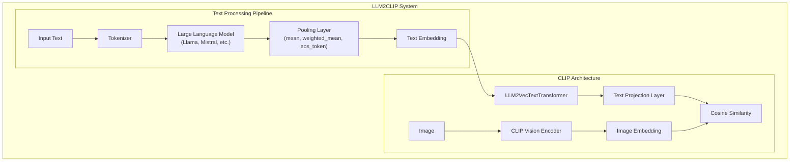
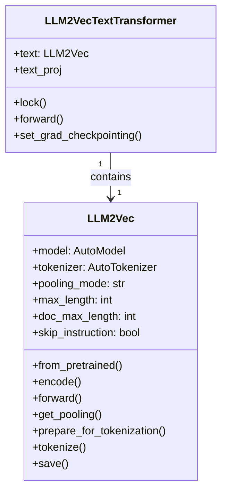
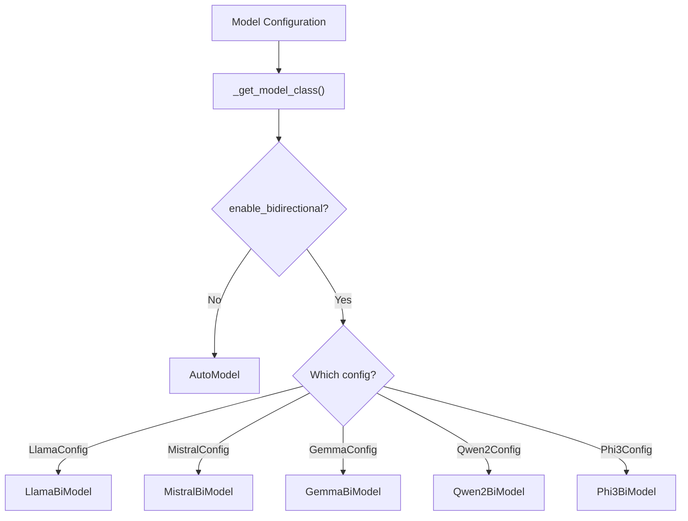
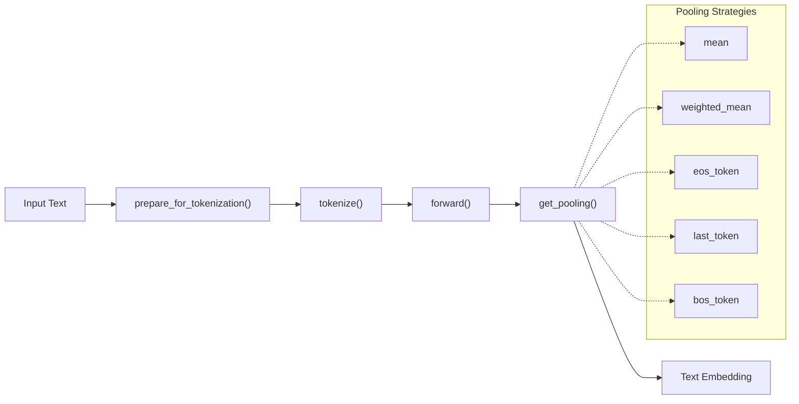
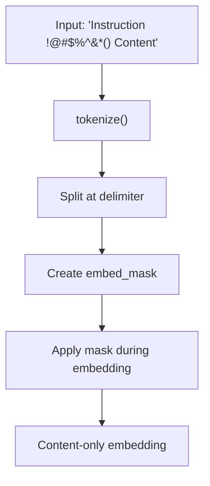
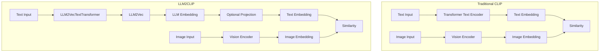

<!-- source: DeepWiki mcp.deepwiki.com · repo microsoft/LLM2CLIP · page 2.2 LLM Integration · fetched 2026-10-26 -->

# LLM Integration

<details>
<summary>Relevant source files</summary>

The following files were used as context for generating this wiki page:

- [llm2clip/eva_clip/llm_model.py](llm2clip/eva_clip/llm_model.py)
- [llm2clip/llm2vec/__init__.py](llm2clip/llm2vec/__init__.py)
- [llm2clip/llm2vec/llm2vec.py](llm2clip/llm2vec/llm2vec.py)

</details>


This document explains how Large Language Models (LLMs) are integrated into the LLM2CLIP system through the LLM2Vec module. This integration enables LLM2CLIP to leverage the semantic understanding capabilities of modern LLMs while maintaining CLIP's cross-modal alignment between text and images.

For information about the specific bidirectional LLM model implementations used in the system, see [Bidirectional LLM Models](#2.3).

## Architecture Overview

The LLM integration in LLM2CLIP enhances the traditional CLIP model by replacing the standard text encoder with a more powerful LLM-based text encoder. This integration is achieved through two primary components:

1. **LLM2Vec**: A wrapper around pretrained LLMs that handles text encoding and embedding generation
2. **LLM2VecTextTransformer**: A module that integrates LLM2Vec into the CLIP architecture

### LLM Integration Architecture



Sources: [llm2clip/eva_clip/llm_model.py:5-36](), [llm2clip/llm2vec/llm2vec.py:46-91]()

## LLM2Vec Module

The `LLM2Vec` class serves as the core component that wraps around large language models to produce text embeddings. It handles model loading, tokenization, text processing, and embedding generation.

### Class Structure and Initialization



`LLM2Vec` can be initialized from a pretrained model using the `from_pretrained` class method:

```python
LLM2Vec.from_pretrained(
    base_model_name_or_path,
    peft_model_name_or_path=None,
    merge_peft=False,
    enable_bidirectional=True,
    extra_model_name_or_path=None,
    **kwargs
)
```

Key parameters:
- `base_model_name_or_path`: Path or identifier of the base LLM
- `peft_model_name_or_path`: Path to PEFT adapter weights (optional)
- `merge_peft`: Whether to merge PEFT adapters into the base model
- `enable_bidirectional`: Whether to use bidirectional model variants
- `extra_model_name_or_path`: Additional model weights to load

Sources: [llm2clip/llm2vec/llm2vec.py:46-91](), [llm2clip/llm2vec/llm2vec.py:84-172]()

### Supported LLM Architectures

LLM2Vec supports multiple LLM architectures through model-specific implementations:

| Model Family | Bidirectional Implementation | Configuration Class |
|--------------|------------------------------|---------------------|
| Llama        | `LlamaBiModel`              | `LlamaConfig`       |
| Mistral      | `MistralBiModel`            | `MistralConfig`     |
| Gemma        | `GemmaBiModel`              | `GemmaConfig`       |
| Qwen2        | `Qwen2BiModel`              | `Qwen2Config`       |
| Phi3         | `Phi3BiModel`               | `Phi3Config`        |

The bidirectional implementation is selected based on the model configuration class:



Sources: [llm2clip/llm2vec/llm2vec.py:65-82](), [llm2clip/llm2vec/llm2vec.py:25-31]()

## Text Encoding Workflow

The encoding process in LLM2Vec follows these key steps:

1. **Text Preparation**: Adds model-specific instruction formats
2. **Tokenization**: Converts text to token IDs
3. **Forward Pass**: Processes tokens through the LLM
4. **Pooling**: Applies pooling to generate fixed-size embeddings



### Instruction Formatting

Different LLM architectures require specific instruction formats, which are handled by the `prepare_for_tokenization` method:

| Model                         | Instruction Format                                              |
|-------------------------------|----------------------------------------------------------------|
| Llama-3-Instruct             | `<\|start_header_id\|>user<\|end_header_id\|>\n\n[TEXT]<\|eot_id\|>` |
| Phi-3.5-mini-instruct        | `<\|user\|>\n[TEXT]<\|end\|>\n`                                 |
| Mistral-7B-Instruct          | `[INST] [TEXT] [/INST]`                                         |
| Gemma-2                      | `<bos><start_of_turn>user\n[TEXT]<end_of_turn>`                |
| Qwen2-Instruct               | `<\|im_start\|>user\n[TEXT]<\|im_end\|>`                        |

Sources: [llm2clip/llm2vec/llm2vec.py:174-213]()

### Pooling Strategies

LLM2Vec supports multiple pooling strategies to generate fixed-size embeddings:

1. **Mean Pooling** (`mean`): Averages all token embeddings
2. **Weighted Mean Pooling** (`weighted_mean`): Weighted average where later tokens have higher weights
3. **EOS Token Pooling** (`eos_token`): Uses the embedding of the end-of-sequence token
4. **Last Token Pooling** (`last_token`): Uses the embedding of the last token
5. **BOS Token Pooling** (`bos_token`): Uses the embedding of the beginning-of-sequence token

The pooling strategy is specified during LLM2Vec initialization via the `pooling_mode` parameter.

Sources: [llm2clip/llm2vec/llm2vec.py:274-306]()

## LLM2VecTextTransformer

The `LLM2VecTextTransformer` class integrates LLM2Vec into the CLIP architecture by serving as the text encoder component. It initializes an LLM2Vec instance and provides a forward pass method that processes text inputs and returns embeddings compatible with CLIP's contrastive learning framework.

### Initialization and Forward Pass

```python
class LLM2VecTextTransformer(nn.Module):
    def __init__(self, text_proj=None):
        # Initialize LLM2Vec with a specified model
        self.text = LLM2Vec.from_pretrained(...)
        self.text_proj = text_proj
        
    def forward(self, text, batch_size=32): 
        # Generate embeddings using LLM2Vec
        x = self.text.encode(text, batch_size=batch_size)
        # Optional projection layer
        if self.text_proj is not None:
            x = self.text_proj(x, l2_norm=False)
        return x
        
    def lock(self):
        # Freeze LLM2Vec parameters
        for param in self.text.parameters():
            param.requires_grad = False
```

In the implementation, `LLM2VecTextTransformer` is initialized with a specific LLM model (Llama-3.1-8B-Instruct by default) and optional PEFT adapter weights, which can be merged with the base model for efficiency.

Sources: [llm2clip/eva_clip/llm_model.py:5-36]()

## Skip-Instruction Feature

The `skip_instruction` feature in LLM2Vec allows the model to focus only on the main content of the text, ignoring instruction prompts. This is implemented by:

1. Separating the instruction from the main content during tokenization using a special delimiter (`!@#$%^&*()`)
2. Creating an `embed_mask` that masks out instruction tokens
3. Applying this mask during the embedding process

This feature helps maintain consistent embeddings across different instruction formats by focusing only on the content being described, not the instructions themselves.



Sources: [llm2clip/llm2vec/llm2vec.py:215-256](), [llm2clip/llm2vec/llm2vec.py:258-264]()

## Integration with CLIP Architecture

The final integration of LLM2Vec into CLIP creates a powerful multimodal model that combines the semantic understanding of LLMs with CLIP's vision capabilities:



This integration enhances CLIP's text understanding capabilities while maintaining its cross-modal alignment between text and images.

Sources: [llm2clip/eva_clip/llm_model.py:5-36](), [llm2clip/llm2vec/llm2vec.py:46-91]()

## Encoding Implementation

The actual encoding of text inputs is handled by the `encode` method in LLM2Vec, which:

1. Prepares the input text with model-specific formatting
2. Tokenizes the text in batches
3. Processes the tokens through the LLM
4. Applies the appropriate pooling strategy
5. Returns the resulting embeddings

The encoding process can be configured with parameters like `batch_size`, `convert_to_tensor`, and `device` to optimize performance based on available hardware.

Sources: [llm2clip/llm2vec/llm2vec.py:339-411](), [llm2clip/llm2vec/llm2vec.py:435-457]()

## Summary

The LLM integration in LLM2CLIP represents a significant enhancement to the traditional CLIP architecture by leveraging the semantic understanding capabilities of large language models. Through the LLM2Vec module and LLM2VecTextTransformer, LLM2CLIP enables more sophisticated text encoding while maintaining cross-modal alignment with images.

Key features of this integration include:
- Support for multiple LLM architectures
- Bidirectional processing capabilities
- Flexible pooling strategies
- Skip-instruction functionality
- Efficient parameter management through PEFT

These enhancements enable LLM2CLIP to achieve superior performance in cross-modal retrieval and zero-shot classification tasks compared to traditional CLIP models.

---

