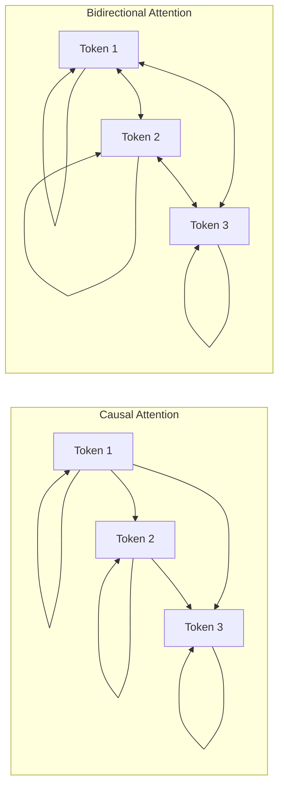
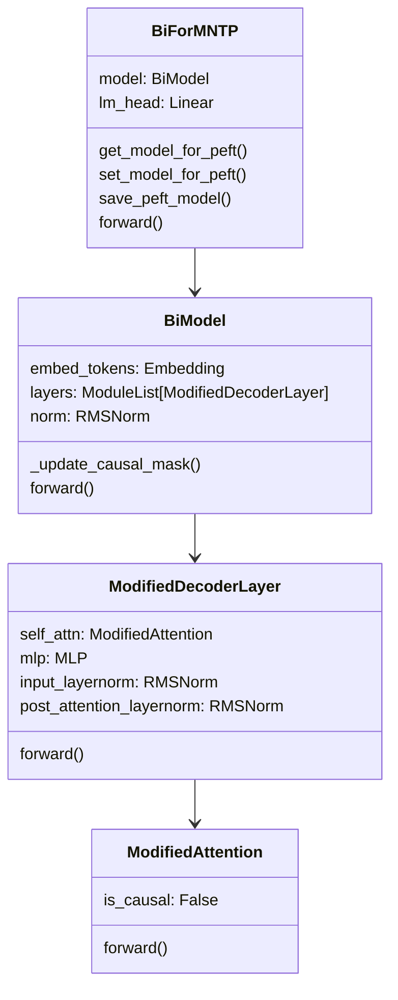
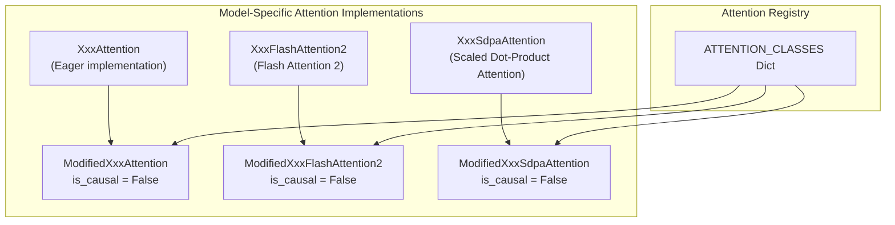
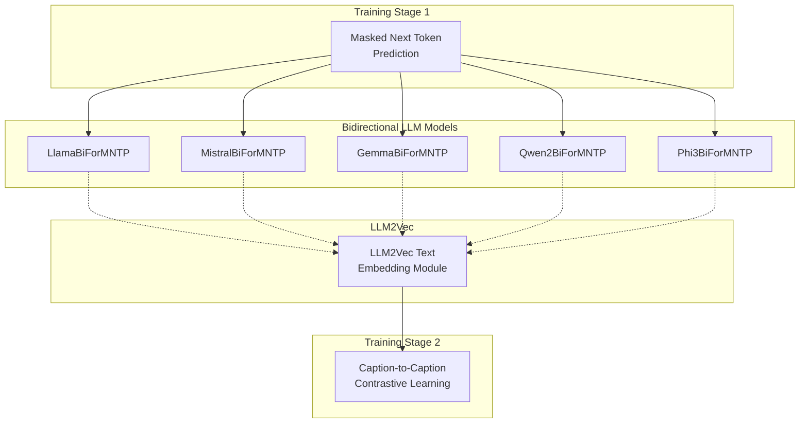

<!-- source: DeepWiki mcp.deepwiki.com · repo microsoft/LLM2CLIP · page 2.3 Bidirectional LLM Models · fetched 2026-10-26 -->

# Bidirectional LLM Models

<details>
<summary>Relevant source files</summary>

The following files were used as context for generating this wiki page:

- [llm2clip/llm2vec/models/__init__.py](llm2clip/llm2vec/models/__init__.py)
- [llm2clip/llm2vec/models/attn_mask_utils.py](llm2clip/llm2vec/models/attn_mask_utils.py)
- [llm2clip/llm2vec/models/bidirectional_gemma.py](llm2clip/llm2vec/models/bidirectional_gemma.py)
- [llm2clip/llm2vec/models/bidirectional_llama.py](llm2clip/llm2vec/models/bidirectional_llama.py)
- [llm2clip/llm2vec/models/bidirectional_mistral.py](llm2clip/llm2vec/models/bidirectional_mistral.py)

</details>


## Purpose and Scope

This page documents the bidirectional large language model (LLM) implementations used in the LLM2CLIP system. Unlike standard autoregressive LLMs that use causal masking to attend only to previous tokens, these bidirectional models are modified to attend to tokens in both directions, enabling more effective text representation learning. This bidirectional capability is particularly important for the Masked Next Token Prediction (MNTP) training objective used in LLM2CLIP. For information about how these models are integrated with CLIP, see [LLM Integration](#2.2).

Sources: [llm2clip/llm2vec/models/__init__.py:1-5]()

## Bidirectional vs. Causal Attention

Standard autoregressive language models use causal attention, where each token can only attend to itself and previous tokens in the sequence. In contrast, bidirectional models allow tokens to attend to both previous and future tokens, similar to BERT-style masked language models.



In the LLM2CLIP system, original decoder-only models (Llama, Mistral, etc.) are modified to support bidirectional attention by removing the causal mask constraint, allowing tokens to attend to future tokens during processing.

Sources: [llm2clip/llm2vec/models/bidirectional_llama.py:157-159](), [llm2clip/llm2vec/models/bidirectional_gemma.py:154-156]()

## Supported Model Architectures

LLM2CLIP implements bidirectional variants for several popular LLM architectures:

| Model Family | Base Model Class | Bidirectional Model Class | MNTP Model Class |
|--------------|------------------|---------------------------|-----------------|
| Mistral | MistralModel | MistralBiModel | MistralBiForMNTP |
| Llama | LlamaModel | LlamaBiModel | LlamaBiForMNTP |
| Gemma | GemmaModel | GemmaBiModel | GemmaBiForMNTP |
| Qwen2 | Qwen2Model | Qwen2BiModel | Qwen2BiForMNTP |
| Phi3 | Phi3Model | Phi3BiModel | Phi3BiForMNTP |

Each model family follows a similar pattern of implementation, with two main classes:
- `*BiModel`: The base bidirectional model that handles token embeddings and attention
- `*BiForMNTP`: The model with a language modeling head for Masked Next Token Prediction

Sources: [llm2clip/llm2vec/models/__init__.py:1-5]()

## Implementation Architecture

The implementation follows a consistent pattern across all model families:



Sources: [llm2clip/llm2vec/models/bidirectional_mistral.py:32-76](), [llm2clip/llm2vec/models/bidirectional_llama.py:46-85](), [llm2clip/llm2vec/models/bidirectional_gemma.py:37-73]()

## Key Modifications for Bidirectionality

### 1. Modified Attention Classes

Each model architecture has three attention implementations modified for bidirectional processing:



Where "Xxx" represents model-specific prefixes (Llama, Mistral, Gemma, etc.) and each attention class is modified by:
1. Inheriting from the original implementation
2. Setting `is_causal = False` to disable causal masking

Sources: [llm2clip/llm2vec/models/bidirectional_mistral.py:32-54](), [llm2clip/llm2vec/models/bidirectional_llama.py:46-68](), [llm2clip/llm2vec/models/bidirectional_gemma.py:37-59]()

### 2. Causal Mask Override

Each bidirectional model overrides the `_update_causal_mask` method to modify the original causal mask behavior:

1. Creating a zero tensor instead of a filled tensor with minimum float values
2. Commenting out the causal masking logic that fills the upper triangle
3. Maintaining padding mask functionality for proper handling of padding tokens

```python
# Original (commented out in bidirectional implementation):
# if sequence_length != 1:
#     causal_mask = torch.triu(causal_mask, diagonal=1)
```

Sources: [llm2clip/llm2vec/models/bidirectional_llama.py:154-159](), [llm2clip/llm2vec/models/bidirectional_gemma.py:151-156](), [llm2clip/llm2vec/models/bidirectional_mistral.py:192-208]()

### 3. Custom Attention Mask Utilities

The system provides utilities for preparing attention masks specifically for bidirectional attention:

- `_prepare_4d_causal_attention_mask`: Prepares 4D attention masks for regular attention implementations
- `_prepare_4d_causal_attention_mask_for_sdpa`: Prepares masks for Scaled Dot-Product Attention (SDPA)

Both utilities are modified to work with bidirectional attention by initializing the `AttentionMaskConverter` with `is_causal=False`.

Sources: [llm2clip/llm2vec/models/attn_mask_utils.py:6-160](), [llm2clip/llm2vec/models/bidirectional_mistral.py:192-208]()

## Integration with PEFT

The bidirectional models are designed to work with Parameter-Efficient Fine-Tuning (PEFT) techniques. Each `*BiForMNTP` class includes methods for PEFT integration:

```python
# getter for PEFT model
def get_model_for_peft(self):
    return self.model

# setter for PEFT model
def set_model_for_peft(self, model: PeftModel):
    self.model = model

# save the PEFT model
def save_peft_model(self, path):
    self.model.save_pretrained(path)
```

This allows efficient fine-tuning of the bidirectional models with techniques like LoRA (Low-Rank Adaptation).

Sources: [llm2clip/llm2vec/models/bidirectional_mistral.py:287-297](), [llm2clip/llm2vec/models/bidirectional_llama.py:217-227](), [llm2clip/llm2vec/models/bidirectional_gemma.py:202-212]()

## Usage in LLM2CLIP

In the LLM2CLIP system, these bidirectional models serve as the foundation for the Masked Next Token Prediction (MNTP) training stage. The bidirectional capability allows the model to effectively predict masked tokens by considering the full context, not just the preceding tokens.



The bidirectional architecture enables these models to capture richer contextual representations, which are crucial for the subsequent contrastive learning phase and ultimately for aligning text and image embeddings in the CLIP model.

Sources: [llm2clip/llm2vec/models/__init__.py:1-5]()

---

