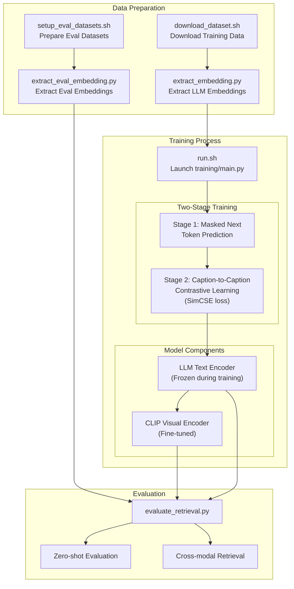
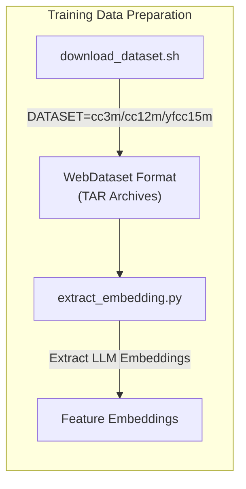
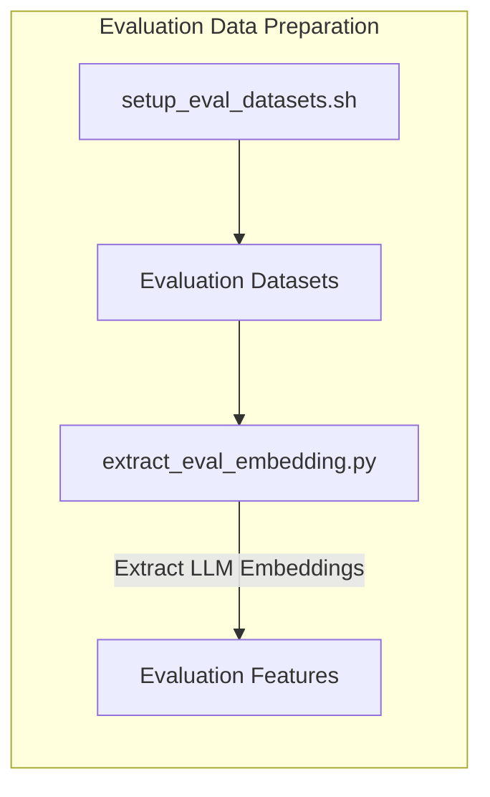
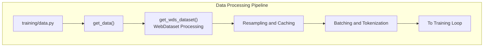
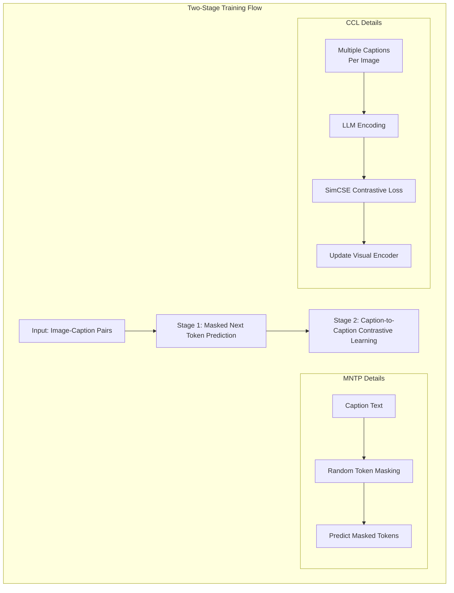
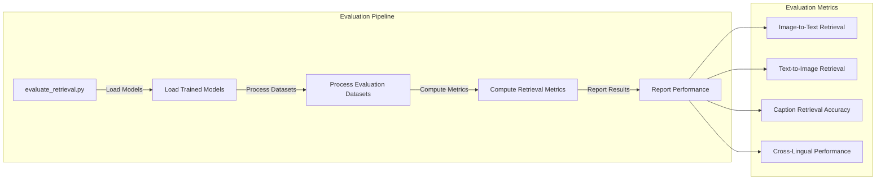

<!-- source: DeepWiki mcp.deepwiki.com · repo microsoft/LLM2CLIP · page 3 Training Pipeline · fetched 2026-10-26 -->

# Training Pipeline

Relevant source files

The following files were used as context for generating this wiki page:

- [README.md](README.md)
- [docs/index.html](docs/index.html)
- [docs/static/images/logo.png](docs/static/images/logo.png)
- [docs/static/images/radar_paper(4).png](docs/static/images/radar_paper(4).png)
- [llm2clip/run.sh](llm2clip/run.sh)
- [llm2clip/training/eval_datasets.yaml](llm2clip/training/eval_datasets.yaml)

## Purpose and Scope

This document describes the end-to-end training pipeline for LLM2CLIP, a system that enhances CLIP (Contrastive Language-Image Pre-training) models by leveraging large language models (LLMs). The training pipeline encompasses data preparation, model training configurations, and evaluation methodologies. For information about the underlying model architecture, see [System Architecture](#2) and [CLIP Model Architecture](#2.1).

## Overview

The LLM2CLIP training pipeline improves CLIP's capabilities through a two-stage approach that leverages LLMs to enhance visual representations. The process begins with data preparation, followed by training with specific loss functions, and concludes with comprehensive evaluation across multiple benchmarks.

Sources: [README.md:61-88](), [run.sh:1-43]()

## Data Preparation

The training pipeline begins with comprehensive data preparation, which is critical for the effectiveness of the LLM2CLIP approach.

### Training Datasets

LLM2CLIP uses several large-scale image-caption datasets:

- **CC3M (Conceptual Captions 3M)**: 3 million image-caption pairs
- **CC12M (Conceptual Captions 12M)**: 12 million image-caption pairs 
- **YFCC15M**: A subset of the YFCC100M dataset with 15 million image-caption pairs

These datasets are downloaded and prepared in WebDataset format (TAR archives) using the download script:

Sources: [README.md:74-77]()

### Evaluation Datasets

The evaluation pipeline uses several benchmark datasets to assess model performance:

- **Flickr30k**: Image-caption retrieval benchmark
- **COCO**: MS COCO dataset for image-caption retrieval
- **ShareGPT4V**: GPT-4V-based evaluation dataset
- **Urban1k**: Urban scene image-text dataset
- **DOCCI**: Dense visual captioning benchmark

These evaluation datasets are configured in `eval_datasets.yaml` which specifies the dataset details including paths to annotations, images, and pre-extracted LLM features.

Sources: [README.md:80-81](), [training/eval_datasets.yaml:1-25]()

## Training Process

The LLM2CLIP training process is orchestrated by the `run.sh` script, which configures and launches the training pipeline with appropriate parameters.

### Training Configuration

The primary configuration parameters include:

| Parameter | Value | Description |
|-----------|-------|-------------|
| Model | EVA02-CLIP-L-14-336 | Base CLIP model architecture |
| Batch Size | 512 | Training batch size |
| Eval Batch Size | 1024 | Evaluation batch size |
| Learning Rate | 1e-5 | Base learning rate |
| Visual LR | 1e-5 | Visual encoder learning rate |
| Text LR | 1e-5 | Text encoder learning rate |
| Epochs | 20 | Number of training epochs |
| Optimizer | ap_adamw | AdamW with automatic precision |
| Precision | fp16 | Mixed precision training |

Sources: [run.sh:1-43]()

### Dataset Pipeline

The training pipeline ingests WebDataset-formatted data, which is processed by the data pipeline:

The datasets are configured in the `run.sh` script using the `--train-data-list` parameter, which specifies multiple datasets with their respective paths and sample counts. The system supports dataset resampling with the `--dataset-resampled` flag.

Sources: [run.sh:13-14]()

### Two-Stage Training Approach

LLM2CLIP employs a two-stage training approach:

1. **Masked Next Token Prediction (MNTP)**:
   - Initial stage to help the model understand textual semantics
   - Prepares the model for the contrastive learning stage
   - Has minimal impact on final results but provides a foundation

2. **Caption-to-Caption Contrastive Learning (SimCSE loss)**:
   - Core training stage that aligns different captions of the same image
   - Uses supervised SimCSE loss with captions from the same image as positive samples
   - Captions from different images serve as negative samples
   - Enables the LLM to provide meaningful supervision signals to the visual encoder

During training, the LLM's gradients are frozen (the LLM is only used for feature extraction), while the CLIP visual encoder is fine-tuned, making the training process computationally efficient.

Sources: [README.md:127-140]()

### Loss Functions

LLM2CLIP uses two primary loss functions:

1. **Masked Next Token Prediction Loss**:
   - Standard language model prediction objective
   - Applied in the first stage of training

2. **Supervised SimCSE Loss**:
   - Contrastive loss that treats captions from the same image as positive pairs
   - Captions from different images serve as negative pairs
   - The key component that enables the LLM to provide supervision to the visual encoder

The training process employs a mixed dataset approach, combining caption datasets (CC3M, CC12M) with pure text datasets (like Wikitext-103) to maintain the LLM's original distribution while reducing potential bias from captions.

Sources: [README.md:127-140]()

## Evaluation Process

The evaluation process assesses model performance across multiple benchmarks and tasks.

### Evaluation Datasets Configuration

The evaluation datasets are configured in `training/eval_datasets.yaml`, which specifies:
- Dataset name
- Path to JSON annotation files
- Image root directories
- Pre-extracted LLM feature paths

Sources: [training/eval_datasets.yaml:1-25]()

### Zero-Shot Evaluation

The training pipeline performs regular zero-shot evaluations during training, controlled by the `--zeroshot-frequency` parameter. This helps monitor how the model generalizes to unseen tasks and datasets throughout the training process.

### Cross-Modal Retrieval Evaluation

The primary evaluation metric for LLM2CLIP is cross-modal retrieval performance, which measures:

- **Image-to-Text (I2T) Retrieval**: Retrieving relevant captions given an image query
- **Text-to-Image (T2I) Retrieval**: Retrieving relevant images given a text query

Performance is reported using standard retrieval metrics such as Recall@K (R@1, R@5, R@10), which represents the percentage of queries where the correct match is found within the top K retrieved results.

### Caption Retrieval Accuracy

A unique evaluation metric for LLM2CLIP is Caption Retrieval Accuracy (CRA), which measures the text model's ability to differentiate between captions. This metric helps determine which language model is better suited for CLIP training.

Sources: [README.md:123-140]()

## Conclusion

The LLM2CLIP training pipeline enables efficient integration of LLMs with CLIP models to enhance visual representation learning. Through its two-stage approach, the system leverages the textual understanding capabilities of LLMs while maintaining computational efficiency by freezing LLM gradients. The comprehensive evaluation methodology ensures that model improvements are well-documented across diverse tasks and benchmarks.

---

