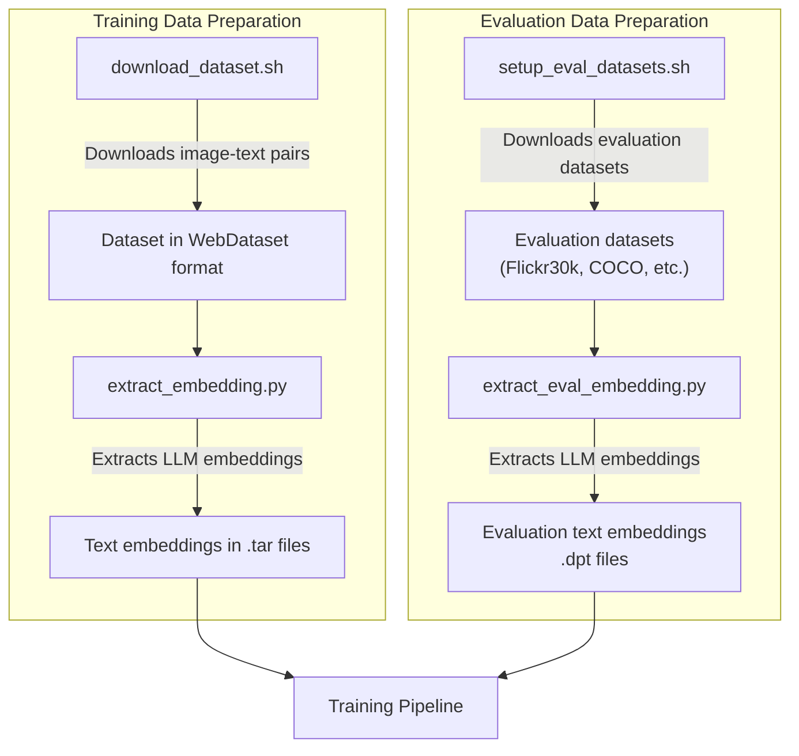
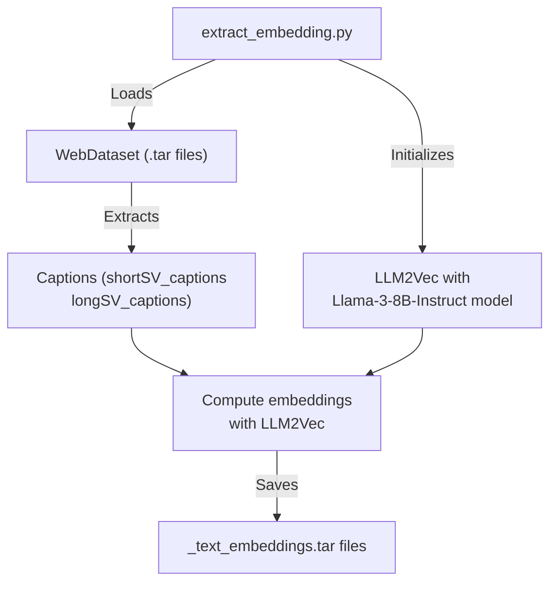
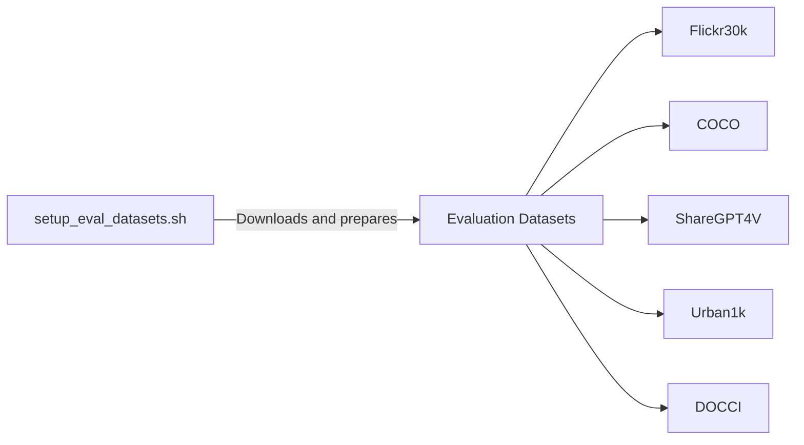
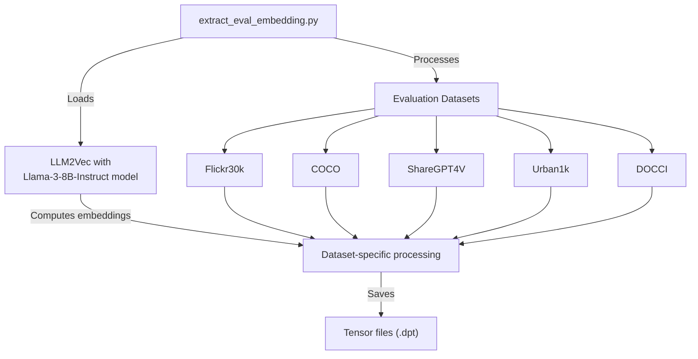
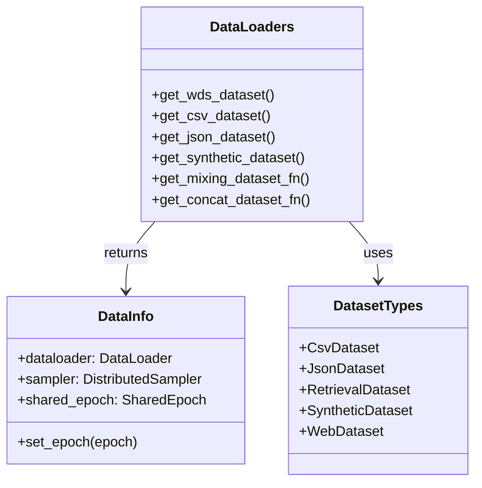
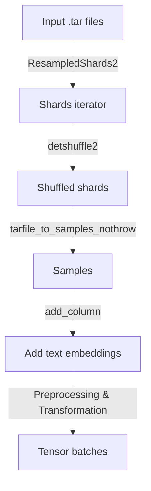

<!-- source: DeepWiki mcp.deepwiki.com · repo microsoft/LLM2CLIP · page 3.1 Data Preparation · fetched 2026-10-26 -->

# Data Preparation

<details>
<summary>Relevant source files</summary>

The following files were used as context for generating this wiki page:

- [llm2clip/data/README.md](llm2clip/data/README.md)
- [llm2clip/data/download_dataset.sh](llm2clip/data/download_dataset.sh)
- [llm2clip/data/extract_embedding.py](llm2clip/data/extract_embedding.py)
- [llm2clip/data/extract_eval_embedding.py](llm2clip/data/extract_eval_embedding.py)
- [llm2clip/data/setup_eval_datasets.sh](llm2clip/data/setup_eval_datasets.sh)
- [llm2clip/training/data.py](llm2clip/training/data.py)

</details>


This document explains the data preparation process for the LLM2CLIP system. It covers how training and evaluation datasets are downloaded, processed, and prepared for use in the training pipeline. For information on the actual training process, see [Training Process](#3.2).

## Overview

Before training the LLM2CLIP model, several data preparation steps are required:

1. Downloading training datasets (CC3M, CC12M, YFCC15M)
2. Extracting LLM embeddings from these datasets
3. Setting up evaluation datasets for model validation
4. Extracting embeddings for evaluation datasets

These steps ensure that the data is properly formatted and augmented with the necessary LLM-derived embeddings that are essential for the training process.

### Data Preparation Workflow



Sources: [data/download_dataset.sh:1-45](), [data/extract_embedding.py:1-83](), [data/setup_eval_datasets.sh:1-28](), [data/extract_eval_embedding.py:1-154]()

## Training Data Download

The repository provides a script to download training datasets with both short and long captions. Three datasets are supported:

- **CC3M**: Conceptual Captions 3M
- **CC12M**: Conceptual Captions 12M
- **YFCC15M**: Yahoo Flickr Creative Commons 15M

### Download Script Process


### Usage

```bash
# Choose dataset: cc3m, cc12m, or yfcc15m
DATASET=cc3m
bash download_dataset.sh $DATASET
```

The script:
1. Downloads a CSV file containing image URLs and captions (including short and long versions generated with various methods)
2. Converts the CSV to Parquet format
3. Uses `img2dataset` to download images and create WebDataset TAR archives
4. Saves multiple caption types in the resulting dataset:
   - Raw captions
   - Short/long captions generated with different models (SV, IB, LLA)

Sources: [data/download_dataset.sh:1-45](), [data/README.md:1-7]()

## Embedding Extraction

After downloading the dataset, LLM embeddings need to be extracted from the text captions using the `extract_embedding.py` script.

### Embedding Extraction Process



### Usage

```bash
python extract_embedding.py --data_path $DATASET
```

The script handles the following tasks:
1. Initializes the LLM2Vec model using a pre-trained Llama-3-8B-Instruct model
2. Processes each WebDataset TAR file
3. Extracts both short and long captions
4. Computes LLM embeddings for these captions
5. Saves the embeddings in corresponding TAR files with the suffix `_text_embeddings.tar`

The embedding extraction focuses on two specific caption types:
- `shortSV_captions`: Short captions generated with the SV model
- `longSV_captions`: Long captions generated with the SV model

Sources: [data/extract_embedding.py:1-83](), [data/README.md:1-7]()

## Evaluation Dataset Setup

The system includes a script to set up evaluation datasets for validating model performance:

### Evaluation Datasets



### Usage

```bash
bash setup_eval_datasets.sh
```

The script:
1. Creates necessary directory structures for each evaluation dataset
2. Downloads annotation files and metadata
3. Provides instructions to manually download the image files for each dataset

After running this script, you will need to download the actual image files for each dataset and update the paths in the configuration files as needed.

Sources: [data/setup_eval_datasets.sh:1-28](), [data/README.md:8-11]()

## Evaluation Embedding Extraction

Similar to training data, embeddings need to be extracted for evaluation datasets:

### Evaluation Embedding Process



### Usage

```bash
python extract_eval_embedding.py
```

The script:
1. Initializes the LLM2Vec model using the same pre-trained Llama model as for training data
2. Processes each evaluation dataset separately, with dataset-specific handling
3. For each dataset:
   - Loads captions/annotation files
   - Computes text embeddings using LLM2Vec
   - Saves embeddings in `.dpt` (serialized tensor) files

The resulting embedding files are used during evaluation to assess model performance on cross-modal retrieval tasks.

Sources: [data/extract_eval_embedding.py:1-154](), [data/README.md:8-11]()

## Data Loading and Processing

The LLM2CLIP system supports multiple data formats and provides a flexible data loading mechanism through the `training/data.py` module.

### Data Loading Pipeline



### Supported Dataset Types

| Dataset Type | Description | Input Format | Main Function |
|--------------|-------------|--------------|--------------|
| WebDataset | Efficient format for large datasets | TAR files | `get_wds_dataset()` |
| CSV | CSV/TSV files with image paths and captions | CSV/TSV | `get_csv_dataset()` |
| JSON | JSON files with annotations and image paths | JSON | `get_json_dataset()` |
| Retrieval | Special dataset for evaluation | JSON | `get_retrieval_dataset()` |
| Synthetic | Generated data for debugging | N/A | `get_synthetic_dataset()` |

### WebDataset Format Details

WebDataset is the primary data format used in LLM2CLIP due to its efficiency with large datasets. The processing flow for WebDataset is:



Key WebDataset functions:
- `get_wds_dataset()`: Main function for WebDataset loading
- `ResampledShards2`: Handles shard sampling with deterministic behavior
- `detshuffle2`: Provides deterministic shuffling across nodes
- `add_column`: Adds text embeddings from the `_text_embeddings.tar` files

Sources: [training/data.py:552-672]()

### Dataset Mixing and Concatenation

For training on multiple datasets simultaneously, LLM2CLIP provides:

1. **MixingDataLoader**: Combines multiple datasets using round-robin or weighted sampling
   - Supports mixing datasets of different types (WebDataset, JSON, CSV)
   - Can use sample weights based on dataset sizes
   - Handles epoch synchronization across distributed training

2. **Concatenation**: Concatenates multiple datasets into a single dataset
   - Uses PyTorch's `ConcatDataset`
   - Supports different data sources specified in a YAML configuration

Sources: [training/data.py:674-964]()

### Data Processing Components

Several utility classes facilitate data processing:

- `SharedEpoch`: Synchronizes epoch information across processes
- `DataInfo`: Wraps dataloader, sampler, and epoch information
- Filter functions: `filter_no_caption_or_no_image`, `log_and_continue`
- Dataset-specific transformation functions

Sources: [training/data.py:219-242](), [training/data.py:330-339]()

## Summary

The data preparation process in LLM2CLIP involves:

1. **Training data**:
   - Downloading datasets (CC3M, CC12M, YFCC15M)
   - Converting to WebDataset format
   - Extracting LLM embeddings

2. **Evaluation data**:
   - Setting up evaluation datasets
   - Extracting LLM embeddings for evaluation

3. **Data loading**:
   - Flexible data loading with support for multiple formats
   - Dataset mixing and concatenation capabilities
   - Distributed training support

This preparation enables the LLM2CLIP system to effectively utilize large-scale image-text datasets and leverage pre-computed LLM embeddings for training.

---

