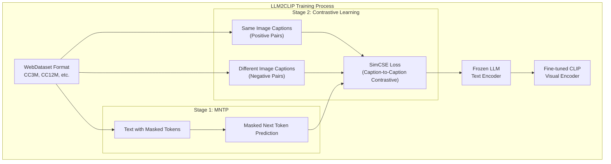
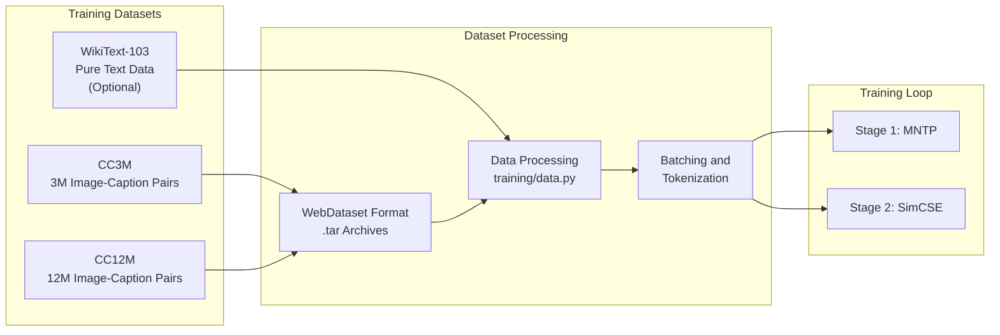
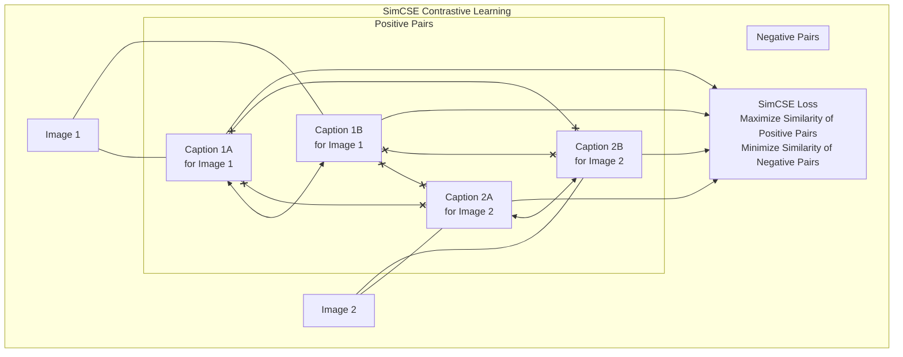
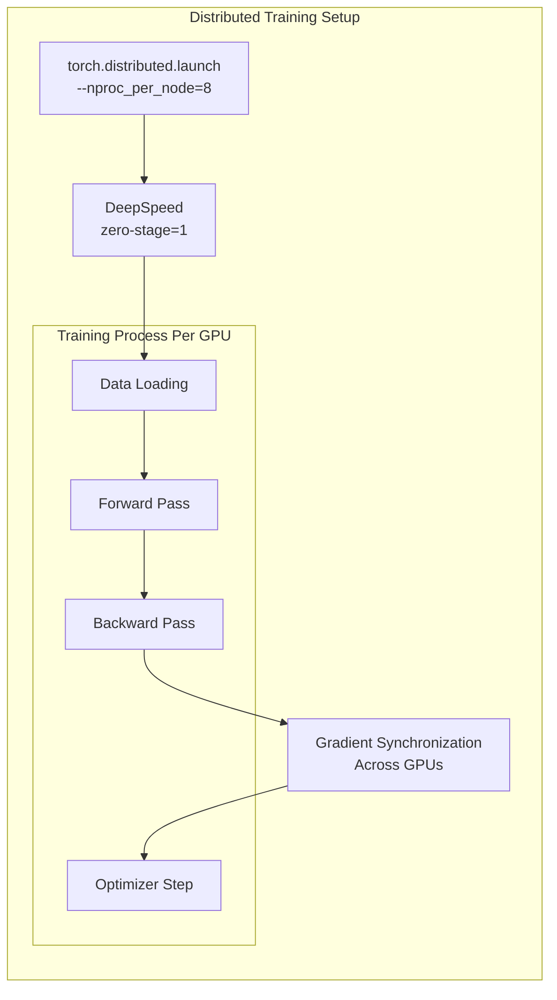
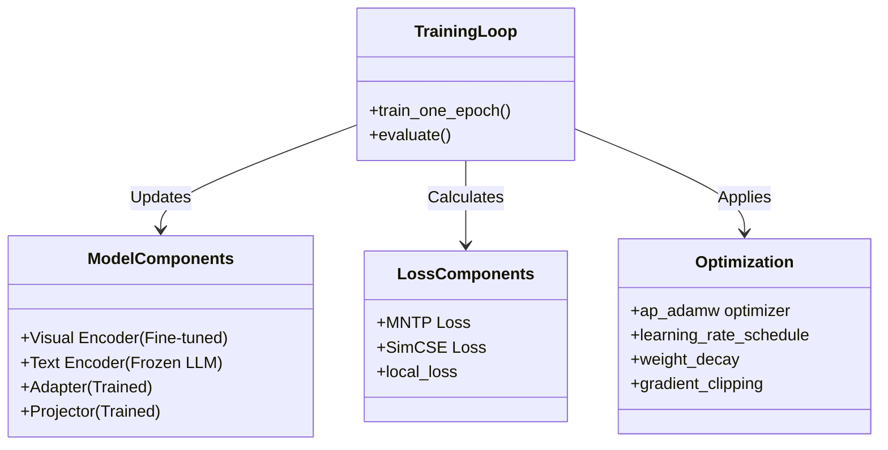

<!-- source: DeepWiki mcp.deepwiki.com · repo microsoft/LLM2CLIP · page 3.2 Training Process · fetched 2026-10-26 -->

# Training Process

<details>
<summary>Relevant source files</summary>

The following files were used as context for generating this wiki page:

- [FAQ.md](FAQ.md)
- [docs/_site/static/images/New_LLM2CLIP_PR.jpg](docs/_site/static/images/New_LLM2CLIP_PR.jpg)
- [llm2clip/run.sh](llm2clip/run.sh)
- [llm2clip/training/eval_datasets.yaml](llm2clip/training/eval_datasets.yaml)

</details>


This document details the training process of the LLM2CLIP system, focusing on the two-stage training approach and implementation details. For information about data preparation before training, see [Data Preparation](#3.1). For evaluation methods after training, see [Evaluation](#3.3).

## 1. Training Overview

LLM2CLIP employs a two-stage training approach to fine-tune CLIP models with LLM capabilities:

1. **Masked Next Token Prediction (MNTP)** - Initial stage to help the model learn textual representation
2. **Caption-to-Caption Contrastive Learning** - Main stage using SimCSE loss to align image and text embeddings

The training process uses a frozen LLM Text Encoder while fine-tuning the CLIP Visual Encoder components.



Sources: [llm2clip/run.sh:1-43](), [FAQ.md:37-47]()

## 2. Training Datasets

LLM2CLIP training uses a combination of:

1. **Image-caption datasets**: CC3M, CC12M
2. **Pure text datasets**: WikiText-103 (optional, for retention of original LLM language distribution)

The datasets are mixed and shuffled for training, with different sampling strategies possible depending on configuration.



Sources: [llm2clip/run.sh:13-14](), [FAQ.md:37-47]()

## 3. Training Stages in Detail

### 3.1 Masked Next Token Prediction (MNTP)

In this stage, the model is trained to predict masked tokens in the input text. This helps the model to:

1. Maintain and enhance the language understanding capabilities of the LLM
2. Prepare the model for the contrastive learning stage

MNTP is an initial pretraining phase that has minimal impact on the final results but helps stabilize training.

### 3.2 Caption-to-Caption Contrastive Learning (SimCSE)

This is the main training stage that aligns the image and text embeddings. The system uses a supervised SimCSE loss approach where:

- **Positive Pairs**: Different captions describing the same image
- **Negative Pairs**: Captions from different images

This approach enables the model to learn robust cross-modal representations that improve retrieval performance, particularly for long-text queries.



Sources: [FAQ.md:37-47]()

## 4. Training Configuration

LLM2CLIP training includes many configuration parameters that control the training process. Key parameters include:

| Parameter | Value | Description |
|-----------|-------|-------------|
| `batch-size` | 512 | Training batch size |
| `eval-batch-size` | 1024 | Evaluation batch size |
| `epochs` | 20 | Number of training epochs |
| `lr` | 1e-5 | Base learning rate |
| `visual-lr` | 1e-5 | Learning rate for visual components |
| `text-lr` | 1e-5 | Learning rate for text components |
| `wd` | 0.05 | Weight decay |
| `grad-clip-norm` | 5.0 | Gradient clipping norm |
| `optimizer` | "ap_adamw" | Optimizer type |
| `precision` | "fp16" | Training precision |

These parameters are specified in the training launch script and can be adjusted for different training scenarios.

Sources: [llm2clip/run.sh:19-42]()

## 5. Distributed Training

LLM2CLIP uses PyTorch Distributed Data Parallel (DDP) for multi-GPU training, with DeepSpeed optimization for improved memory efficiency and throughput:



Key distributed training settings:
- 8 GPUs per node (`--nproc_per_node=8`)
- DeepSpeed Zero Stage 1 for optimizer state partitioning
- Gradient checkpointing for memory efficiency
- Local loss computation with gradient gathering

Sources: [llm2clip/run.sh:3-5](), [llm2clip/run.sh:38-42]()

## 6. Model Components in Training

During training, different components are managed according to their roles:



The training process carefully manages which components are frozen and which are fine-tuned:
- The LLM text encoder is typically kept frozen
- The CLIP visual encoder is fine-tuned
- Adapter and projector components are trained to align the LLM output with the CLIP representation space

Sources: [llm2clip/run.sh:24-32]()

## 7. Evaluation During Training

During training, the model is periodically evaluated on benchmark datasets to track performance:

- Zero-shot evaluation frequency is set by `--zeroshot-frequency` parameter
- Model checkpoints are saved according to `--save-frequency`
- Evaluation datasets are defined in the `eval_datasets.yaml` file

The evaluation datasets include:

| Dataset | Purpose |
|---------|---------|
| Flickr30k | Image-text retrieval benchmark |
| COCO | Image-text retrieval benchmark |
| ShareGPT4V | Complex multimodal understanding |
| Urban1k | Domain-specific retrieval |
| DOCCI | Dense open-domain captions |

Sources: [llm2clip/run.sh:8-9](), [llm2clip/training/eval_datasets.yaml:1-25]()

## 8. Training Launch

The full training process is initiated with the `run.sh` script, which configures all training parameters and launches the distributed training:

```
# Example training launch command (simplified from run.sh)
python -m torch.distributed.launch --nproc_per_node=8 \
    --use_env training/main.py \
    --enable-deepspeed \
    --model=EVA02-CLIP-L-14-336 \
    --train-data-list "data/cc3m/{00..00287}.tar;data/cc12m/{00..01001}.tar" \
    --train-num-samples-list 2873538 10000225 \
    --batch-size=512 \
    --eval-batch-size=1024 \
    --epochs=20 \
    --lr=1e-5
```

Additional configuration options include:
- Reporting to TensorBoard and Weights & Biases
- Dataset sampling strategies
- Gradient accumulation settings
- Loss weighting parameters

Sources: [llm2clip/run.sh:1-43]()

## 9. Best Practices for Training

Based on the implementation and FAQ information, here are key practices for effective LLM2CLIP training:

1. **Two-stage approach**: Start with MNTP followed by SimCSE loss
2. **Dataset mixing**: Combine caption data with some pure text data to retain LLM capabilities
3. **Large batch sizes**: Use the largest batch size possible for contrastive learning
4. **Frozen LLM**: Keep the LLM frozen during training for efficiency and stability
5. **Distributed training**: Use multiple GPUs with DeepSpeed for faster training
6. **Gradient clipping**: Maintain stable training with appropriate gradient clipping
7. **Regular evaluation**: Monitor performance on diverse benchmark datasets
8. **Balanced learning rates**: Use similar learning rates for visual and text components

By following these practices, the training process effectively transfers the LLM's language understanding capabilities to enhance the CLIP model's cross-modal representation abilities.

Sources: [FAQ.md:37-51](), [llm2clip/run.sh:1-43]()

---

