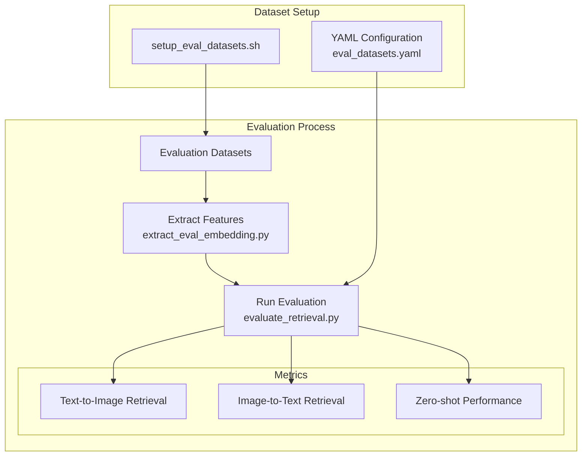
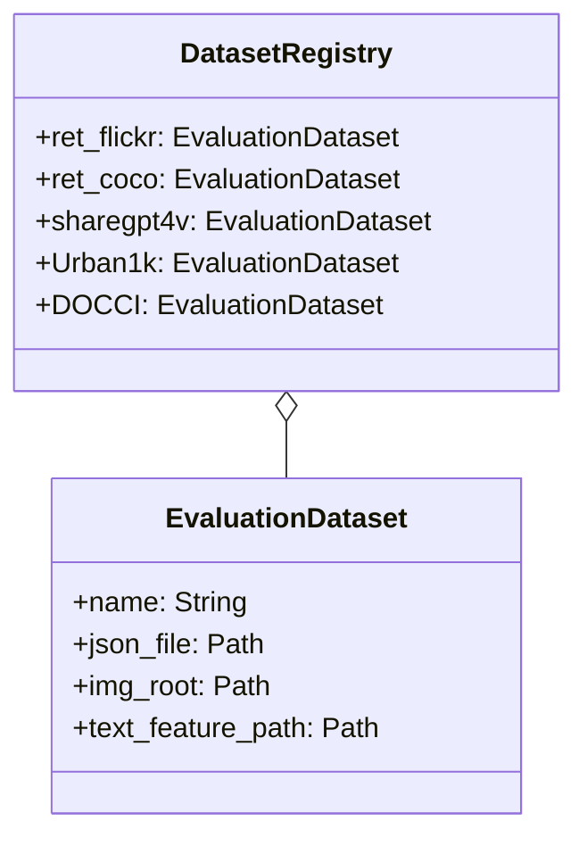
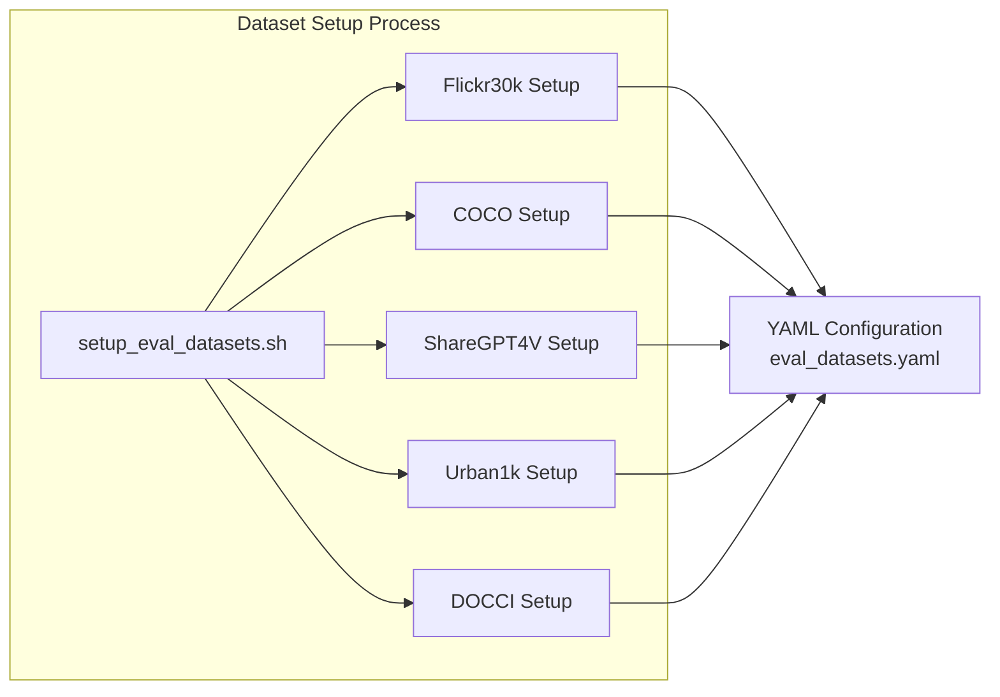
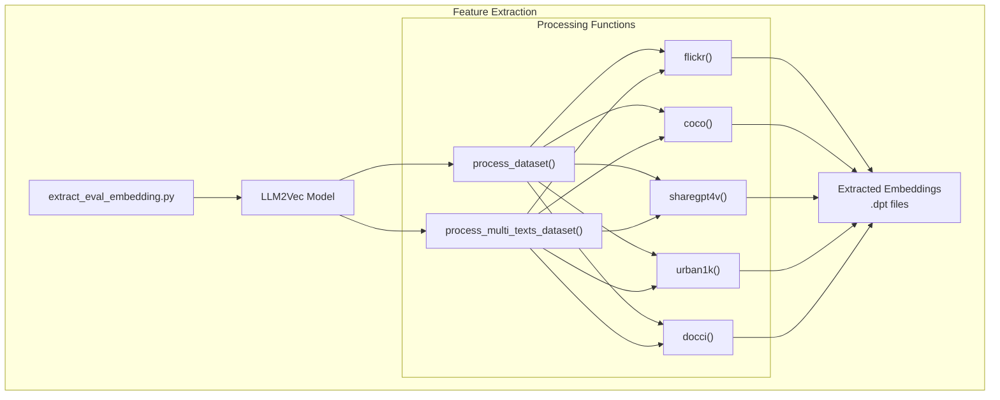
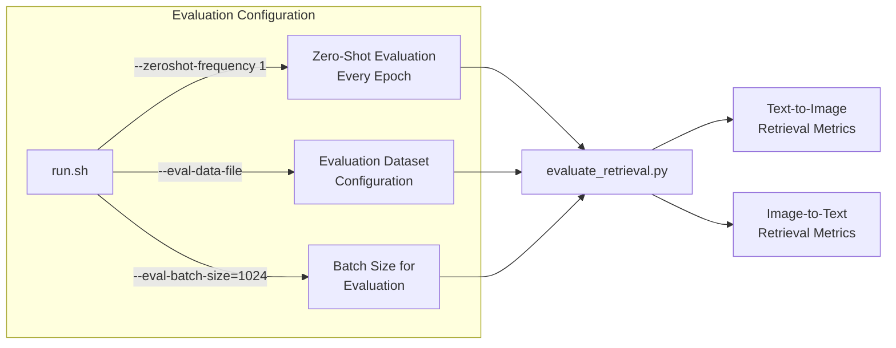
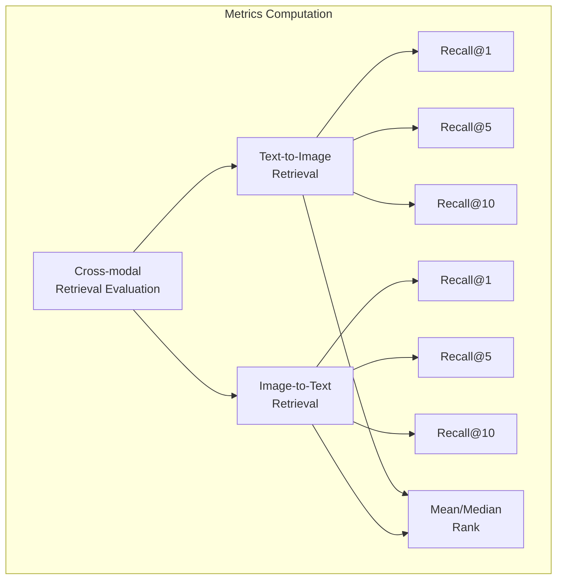

<!-- source: DeepWiki mcp.deepwiki.com · repo microsoft/LLM2CLIP · page 3.3 Evaluation · fetched 2026-10-26 -->

# Evaluation

<details>
<summary>Relevant source files</summary>

The following files were used as context for generating this wiki page:

- [llm2clip/data/README.md](llm2clip/data/README.md)
- [llm2clip/data/extract_eval_embedding.py](llm2clip/data/extract_eval_embedding.py)
- [llm2clip/data/setup_eval_datasets.sh](llm2clip/data/setup_eval_datasets.sh)
- [llm2clip/run.sh](llm2clip/run.sh)
- [llm2clip/training/eval_datasets.yaml](llm2clip/training/eval_datasets.yaml)

</details>


This document describes the evaluation process and metrics used to assess the performance of LLM2CLIP models. The evaluation system focuses on cross-modal retrieval capabilities across multiple benchmark datasets. For information about the training process itself, see [Training Process](#3.2).

## Evaluation Overview

LLM2CLIP's evaluation framework is designed to measure the model's effectiveness at aligning image and text representations in a shared embedding space. The system primarily evaluates zero-shot cross-modal retrieval performance across multiple datasets with varying characteristics.



Sources: [llm2clip/data/setup_eval_datasets.sh](), [llm2clip/training/eval_datasets.yaml](), [llm2clip/data/extract_eval_embedding.py]()

## Evaluation Datasets

LLM2CLIP evaluates performance on five standard benchmark datasets, each offering different challenges and domain characteristics:

| Dataset | Description | Features |
|---------|-------------|----------|
| Flickr30k | 1,000 test images with 5 captions each | Multiple references per image |
| COCO | Karpathy test split | General domain images with varied content |
| ShareGPT4V | High-quality conversational captions | Conversational descriptions |
| Urban1k | Urban environment images | Domain-specific visual content |
| DOCCI | Document images with descriptions | Text-heavy visual content |

The datasets are configured in the YAML configuration file with references to annotation files, image directories, and pre-extracted LLM embeddings:



Sources: [llm2clip/training/eval_datasets.yaml]()

## Evaluation Workflow

The evaluation process follows a three-step workflow:

### 1. Dataset Setup

Evaluation datasets are prepared using the setup script:



The setup script downloads dataset annotations and creates the necessary directory structure, though image files must be downloaded manually.

Sources: [llm2clip/data/setup_eval_datasets.sh]()

### 2. LLM Feature Extraction

Before evaluation, LLM embeddings are extracted for all text data using the LLM2Vec component:



The extraction process:
1. Loads the text data from dataset annotations
2. Encodes texts using the LLM2Vec model (batch processing)
3. Saves embeddings in `.dpt` format for each dataset

Sources: [llm2clip/data/extract_eval_embedding.py]()

### 3. Evaluation Execution

Evaluation is run during or after training, configured through parameters in the main run script:



Sources: [llm2clip/run.sh]()

## Evaluation Metrics

LLM2CLIP primarily measures performance on bidirectional retrieval tasks:

1. **Text-to-Image Retrieval**: Given a text query, rank images by relevance
2. **Image-to-Text Retrieval**: Given an image query, rank text descriptions by relevance

Standard retrieval metrics are reported:
- **Recall@K** (R@1, R@5, R@10): Percentage of queries where the correct match is in the top K results
- **Mean Rank**: Average position of the correct match in the ranked list
- **Median Rank**: Median position of the correct match



## Running Evaluation

To run evaluation on your own LLM2CLIP model:

1. **Set up evaluation datasets**:
   ```bash
   bash data/setup_eval_datasets.sh
   ```

2. **Extract LLM embeddings**:
   ```bash
   python data/extract_eval_embedding.py
   ```

3. **Run evaluation** during training by configuring in `run.sh`:
   - Set `--zeroshot-frequency` to control how often evaluation runs
   - Set `--eval-data-file` to point to your YAML configuration
   - Set `--eval-batch-size` to adjust batch size during evaluation

The LLM2CLIP framework integrates evaluation directly into the training loop, allowing continuous monitoring of model performance during training.

Sources: [llm2clip/data/README.md](), [llm2clip/run.sh]()

---

