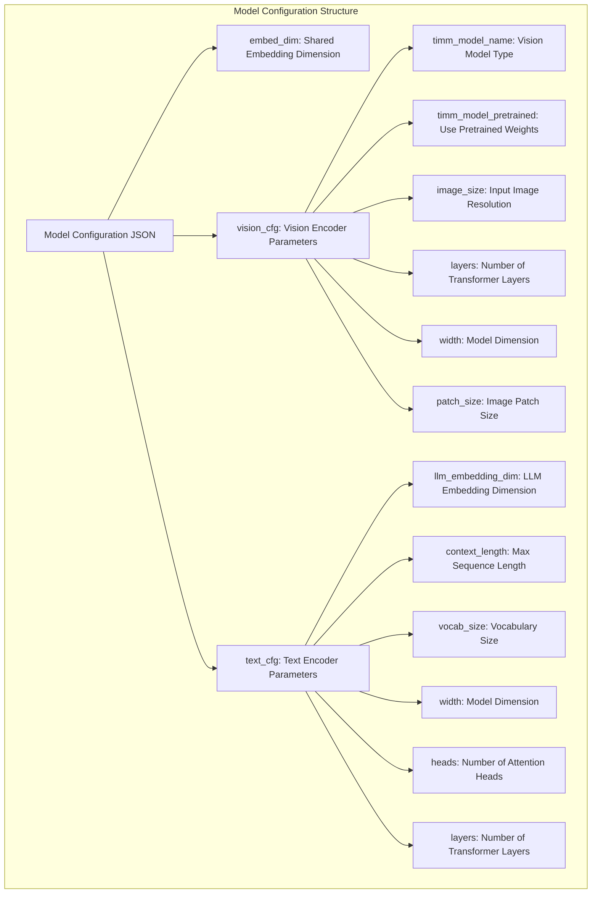
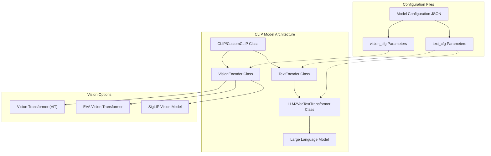
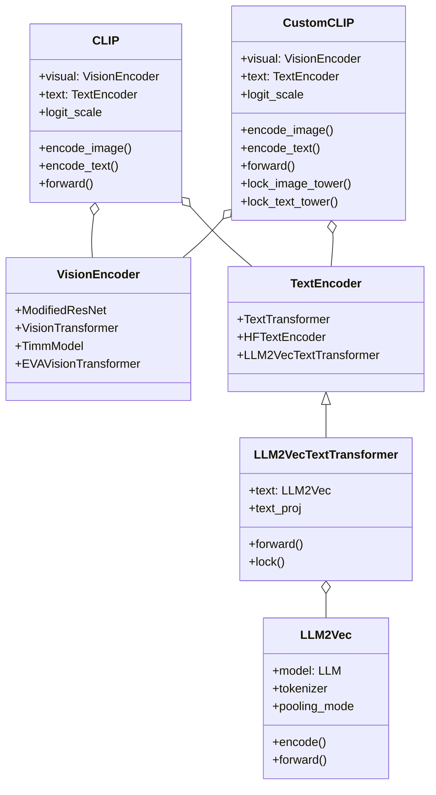

<!-- source: DeepWiki mcp.deepwiki.com · repo microsoft/LLM2CLIP · page 4 Model Configurations · fetched 2026-10-26 -->

# Model Configurations

<details>
<summary>Relevant source files</summary>

The following files were used as context for generating this wiki page:

- [llm2clip/.gitignore](llm2clip/.gitignore)
- [llm2clip/eva_clip/__init__.py](llm2clip/eva_clip/__init__.py)
- [llm2clip/eva_clip/bpe_simple_vocab_16e6.txt.gz](llm2clip/eva_clip/bpe_simple_vocab_16e6.txt.gz)
- [llm2clip/eva_clip/model_configs/Llama3.1-8B-Siglip2-So-L-14-224.json](llm2clip/eva_clip/model_configs/Llama3.1-8B-Siglip2-So-L-14-224.json)

</details>


This page documents the various model configurations available in LLM2CLIP, explaining how to define, customize, and use different model architectures. Model configurations define the structure and parameters of both the vision and text encoders in the CLIP model, including how large language models (LLMs) are integrated into the system.

For information on training models, see [Training Pipeline](#3), and for details on LLM integration, see [LLM Integration](#2.2).

## Model Configuration Overview

In LLM2CLIP, model configurations are JSON structures that define the architecture and parameters for CLIP models. These configurations specify:

1. The shared embedding dimension (`embed_dim`)
2. Vision encoder parameters (`vision_cfg`)
3. Text encoder parameters (`text_cfg`)

### Configuration Structure



Sources: [llm2clip/eva_clip/model_configs/Llama3.1-8B-Siglip2-So-L-14-224.json:1-22]()

## Configuration to Model Architecture Mapping

Model configurations in LLM2CLIP map directly to the CLIP model architecture components:



Sources: [llm2clip/eva_clip/__init__.py:2-6](), [llm2clip/eva_clip/model_configs/Llama3.1-8B-Siglip2-So-L-14-224.json:1-22]()

## Available Model Configurations

LLM2CLIP includes pre-configured model configurations in the `eva_clip/model_configs/` directory. Here's an example:

### Llama3.1-8B-Siglip2-So-L-14-224

This configuration combines the Llama3.1-8B language model with a SigLIP vision transformer:

```json
{
    "embed_dim": 1152,
    "vision_cfg": {
        "timm_model_name": "vit_so400m_patch14_siglip_224.v2_webli",
        "timm_model_pretrained": true,
        "timm_pool": "map",
        "timm_proj": "none",
        "image_size": 224,
        "layers": 27,
        "width": 1152,
        "patch_size": 14
    },
    "text_cfg": {
        "use_embedding": false,
        "llm_embedding_dim": 4096,
        "context_length": 77,
        "vocab_size": 49408,
        "width": 768,
        "heads": 12,
        "layers": 12
    }
}
```

Key features of this configuration:
- Shared embedding dimension: 1152
- Vision: SigLIP model with 27 layers and 224px input resolution
- Text: Configuration for Llama3.1-8B with 4096-dimensional embeddings

Sources: [llm2clip/eva_clip/model_configs/Llama3.1-8B-Siglip2-So-L-14-224.json:1-22]()

## Working with Model Configurations

### Model Configuration API

LLM2CLIP provides several functions for working with model configurations:

| Function | Description |
|----------|-------------|
| `list_models()` | List all available model configurations |
| `get_model_config(model_name)` | Get configuration for a specific model |
| `add_model_config(model_name, config)` | Add a new model configuration |
| `create_model(model_name)` | Create a model using a specific configuration |
| `create_model_and_transforms(model_name)` | Create a model with appropriate transforms |
| `create_model_from_pretrained(model_name)` | Load a pretrained model |

### Using Model Configurations

Examples of how to use model configurations:

```python
from eva_clip import list_models, get_model_config, create_model

# List all available model configurations
available_models = list_models()
print(available_models)

# Get configuration details for a specific model
config = get_model_config('Llama3.1-8B-Siglip2-So-L-14-224')
print(config)

# Create a model using a specific configuration
model, preprocess = create_model('Llama3.1-8B-Siglip2-So-L-14-224')
```

Sources: [llm2clip/eva_clip/__init__.py:2-3]()

## Configuration Parameters

### Vision Configuration Parameters

The following table describes the parameters for configuring the vision encoder:

| Parameter | Description | Example |
|-----------|-------------|---------|
| `timm_model_name` | Vision model type from TIMM library | `"vit_so400m_patch14_siglip_224.v2_webli"` |
| `timm_model_pretrained` | Whether to use pretrained weights | `true` |
| `timm_pool` | Pooling method for feature extraction | `"map"` |
| `timm_proj` | Projection method | `"none"` |
| `image_size` | Input image resolution | `224` |
| `layers` | Number of transformer layers | `27` |
| `width` | Model dimension | `1152` |
| `patch_size` | Size of image patches | `14` |

### Text Configuration Parameters

The following table describes the parameters for configuring the text encoder:

| Parameter | Description | Example |
|-----------|-------------|---------|
| `use_embedding` | Use token embeddings | `false` |
| `llm_embedding_dim` | LLM embedding dimension | `4096` |
| `context_length` | Maximum sequence length | `77` |
| `vocab_size` | Tokenizer vocabulary size | `49408` |
| `width` | Model dimension | `768` |
| `heads` | Number of attention heads | `12` |
| `layers` | Number of transformer layers | `12` |

Sources: [llm2clip/eva_clip/model_configs/Llama3.1-8B-Siglip2-So-L-14-224.json:1-22]()

## Creating Custom Model Configurations

You can create and register custom model configurations:

```python
from eva_clip import add_model_config, create_model

# Define a custom configuration
custom_config = {
    "embed_dim": 1024,
    "vision_cfg": {
        "timm_model_name": "vit_large_patch14_clip_224.openai",
        "timm_model_pretrained": true,
        "timm_pool": "map",
        "timm_proj": "none",
        "image_size": 224,
        "layers": 24,
        "width": 1024,
        "patch_size": 14
    },
    "text_cfg": {
        "use_embedding": false,
        "llm_embedding_dim": 4096,
        "context_length": 77,
        "vocab_size": 49408,
        "width": 768,
        "heads": 12,
        "layers": 12
    }
}

# Register the custom configuration
add_model_config('my_custom_model', custom_config)

# Create a model using the custom configuration
model, _ = create_model('my_custom_model')
```

Sources: [llm2clip/eva_clip/__init__.py:3]()

## Relationship Between Model Components

The following diagram illustrates how the different model components work together:



Sources: [llm2clip/eva_clip/__init__.py:5-6](), [llm2clip/eva_clip/__init__.py:12]()

## Best Practices

When working with model configurations:

1. **Embedding Dimension Alignment**: Ensure the embedding dimensions are compatible between components. The projector will align dimensions to the shared `embed_dim`.

2. **Vision Model Selection**: Choose vision models based on your specific requirements:
   - SigLIP models for state-of-the-art performance
   - EVA models for strong overall capabilities
   - Smaller ViT models for efficiency

3. **Resource Considerations**: Balance model size with available compute resources. Larger models require more GPU memory.

4. **Pretrained Initialization**: Utilize pretrained weights when available by setting `timm_model_pretrained` to `true`.

5. **Documentation**: Maintain clear documentation for custom configurations.

## Troubleshooting

Common issues and solutions:

1. **Memory Errors**: If encountering out-of-memory errors:
   - Reduce model size (fewer layers, smaller width)
   - Lower batch size
   - Use mixed precision training

2. **Compatibility Issues**: Ensure vision and text components are compatible in their architectures.

3. **Performance Problems**: If experiencing poor performance:
   - Check initialization and training procedures
   - Verify correct configuration parameters
   - Consider using a larger model or more training data

4. **Loading Errors**: When loading fails:
   - Verify model configuration exists
   - Check for typos in model names
   - Ensure required dependencies are installed

Sources: [llm2clip/eva_clip/__init__.py:2-6](), [llm2clip/eva_clip/model_configs/Llama3.1-8B-Siglip2-So-L-14-224.json:1-22]()

---

