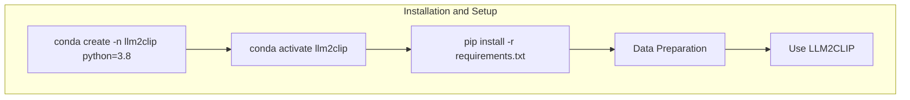
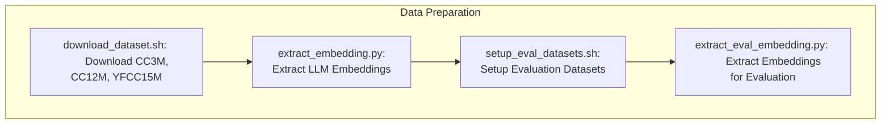
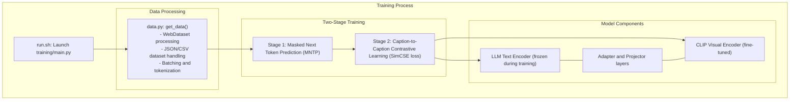
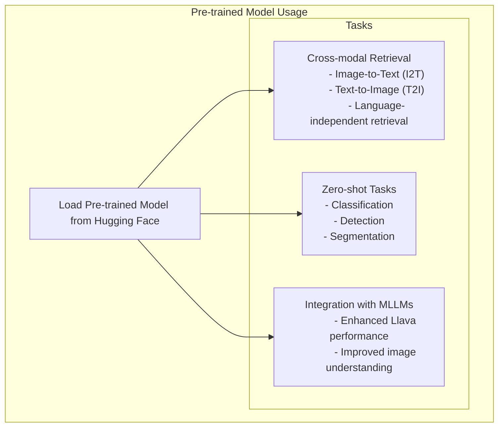
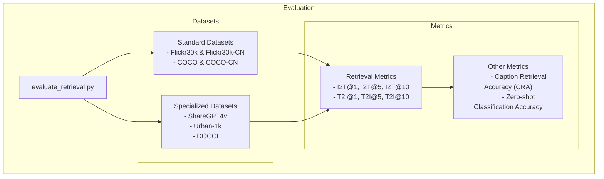

<!-- source: DeepWiki mcp.deepwiki.com · repo microsoft/LLM2CLIP · page 5 Installation and Usage · fetched 2026-10-26 -->

# Installation and Usage

<details>
<summary>Relevant source files</summary>

The following files were used as context for generating this wiki page:

- [FAQ.md](FAQ.md)
- [README.md](README.md)
- [docs/_site/static/images/New_LLM2CLIP_PR.jpg](docs/_site/static/images/New_LLM2CLIP_PR.jpg)
- [docs/index.html](docs/index.html)
- [docs/static/images/logo.png](docs/static/images/logo.png)
- [docs/static/images/radar_paper(4).png](docs/static/images/radar_paper(4).png)

</details>


This page provides detailed instructions for installing and using the LLM2CLIP system, which leverages large language models to enhance CLIP's visual representation capabilities. This guide covers environment setup, data preparation, training new models, and using pre-trained models. For information about the system architecture, see [System Architecture](#2).

## Prerequisites and Environment Setup

To use LLM2CLIP, you'll need:
- Python 3.8
- Conda (recommended for environment management)
- GPU with CUDA support (for training)

Follow these steps to set up your environment:

1. Create a new conda environment:
```bash
conda create -n llm2clip python=3.8
conda activate llm2clip
```

2. Install the required dependencies:
```bash
pip install -r requirements.txt
```

### Installation and Setup Workflow



Sources: [README.md:61-67]()

## Data Preparation

Before training or using LLM2CLIP, you need to prepare the necessary datasets. LLM2CLIP supports several datasets for training: CC3M, CC12M, and YFCC15M.

### Data Preparation Workflow



Follow these steps to prepare the data:

1. **Download training datasets**:
```bash
cd llm2clip/data

# Choose a dataset: "cc3m", "cc12m", "yfcc15m"
DATASET=cc3m
bash download_dataset.sh $DATASET
```

2. **Extract LLM embeddings**:
```bash
python extract_embedding.py $DATASET
```

3. **Set up evaluation datasets**:
```bash
bash setup_eval_datasets.sh
python extract_eval_embedding.py
```

Sources: [README.md:69-82]()

## Training a New Model

After preparing the data, you can train a new LLM2CLIP model using the `run.sh` script:

```bash
sh run.sh
```

### Training Pipeline



The training process involves two main stages:

1. **Masked Next Token Prediction (MNTP)**: 
   - Initial pretraining stage
   - The model learns from masked tokens in text
   - Has minimal impact on final results but is used for optimal performance

2. **Caption-to-Caption Contrastive Learning**: 
   - Main training stage using supervised SimCSE loss
   - Makes different captions of the same image positive samples
   - Captions of different images serve as negative samples
   - Enables the LLM to provide meaningful supervision signals to the image encoder

During training, the LLM gradients are frozen while CLIP's visual encoder is fine-tuned. This approach is efficient and yields significant performance gains with limited data (3M to 60M samples).

Sources: [README.md:84-88](), [FAQ.md:36-50]()

## Using Pre-trained Models

LLM2CLIP provides pre-trained models through the Hugging Face Model Zoo that can be used for various multimodal tasks.

### Available Pre-trained Models

The pre-trained models are available in the [Hugging Face Collection](https://huggingface.co/collections/microsoft/llm2clip-672323a266173cfa40b32d4c) and include:

- LLM2CLIP-Llama-3-8B-Instruct-CC-Finetuned
- OpenAI's CLIP with EVA02's ViT base and large models

### Using Pre-trained Models for Different Tasks



LLM2CLIP pre-trained models offer several advantages:

- **Enhanced CLIP Models**: Fine-tuned with dense captions for better performance
- **Long-Text Processing**: Extended input window allows richer textual context
- **Cross-Language Support**: Even when trained only on English data, provides strong performance for Chinese cross-modal retrieval
- **Improved Integration**: Can enhance existing multimodal LLMs like Llava

Sources: [README.md:11-58](), [docs/index.html:135-430]()

## Evaluation

To evaluate your trained models, use the `evaluate_retrieval.py` script.

### Evaluation Process



The evaluation process assesses model performance across various datasets:

- **Standard Benchmarks**: Flickr30k, COCO, and their Chinese variants
- **Specialized Tasks**: ShareGPT4v (dense captions), Urban-1k (urban scenes), DOCCI (document understanding)

Key metrics include:
- **Image-to-Text Retrieval**: I2T@1, I2T@5, I2T@10 (retrieval accuracy at top-1, top-5, top-10)
- **Text-to-Image Retrieval**: T2I@1, T2I@5, T2I@10
- **Caption Retrieval Accuracy (CRA)**: Measures the ability to differentiate between captions

Sources: [docs/index.html:173-430]()

## Common Issues and Troubleshooting

When using LLM2CLIP, you might encounter the following common issues:

| Issue | Solution |
|-------|----------|
| Out of memory errors | Reduce batch size in run.sh |
| Dataset download failures | Verify internet connection and try using a mirror server |
| Model loading errors | Ensure you have the correct dependencies installed |
| Poor performance | Check if you're using the recommended LLM model (Llama3-8B-CC performs best) |

For more detailed information on specific issues and solutions, refer to the [FAQ](#6) page.

Sources: [README.md:90-143](), [FAQ.md:1-134]()

## Next Steps

After successfully installing and running LLM2CLIP, you might want to:

1. Fine-tune LLM2CLIP on your domain-specific datasets
2. Integrate LLM2CLIP with other multimodal systems like Llava
3. Explore the effect of different LLMs as the text encoder
4. Experiment with specialized applications in fields like medicine or law

For more detailed instructions on training a new model, see [Training a New Model](#5.1). For information about using pre-trained models, see [Using Pre-trained Models](#5.2).

Sources: [README.md:46-50](), [FAQ.md:19-34]()

---

