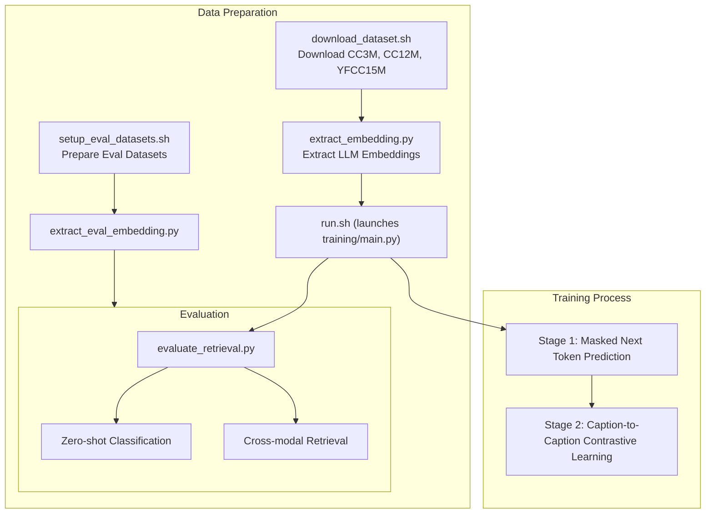
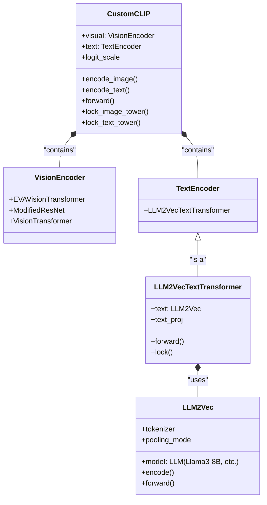
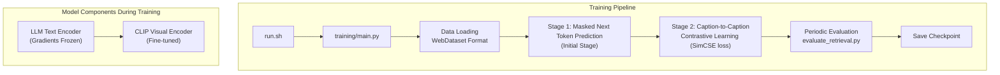

<!-- source: DeepWiki mcp.deepwiki.com · repo microsoft/LLM2CLIP · page 5.1 Training a New Model · fetched 2026-10-26 -->

# Training a New Model

<details>
<summary>Relevant source files</summary>

The following files were used as context for generating this wiki page:

- [FAQ.md](FAQ.md)
- [README.md](README.md)
- [docs/_site/static/images/New_LLM2CLIP_PR.jpg](docs/_site/static/images/New_LLM2CLIP_PR.jpg)
- [docs/index.html](docs/index.html)
- [docs/static/images/logo.png](docs/static/images/logo.png)
- [docs/static/images/radar_paper(4).png](docs/static/images/radar_paper(4).png)
- [llm2clip/run.sh](llm2clip/run.sh)
- [llm2clip/training/eval_datasets.yaml](llm2clip/training/eval_datasets.yaml)

</details>


This document provides a comprehensive, technical guide for training a new LLM2CLIP model from scratch. It covers the entire pipeline from data preparation to model evaluation. For information about using pre-trained models, see [Using Pre-trained Models](#5.2).

## Overview of the Training Process

LLM2CLIP training enhances CLIP models by leveraging large language models (LLMs) as textual teachers for the visual encoder. The process involves preparing datasets, extracting LLM embeddings, and training with a two-stage approach: Masked Next Token Prediction followed by Caption-to-Caption Contrastive Learning.



Sources: [README.md:61-88](), [llm2clip/run.sh:1-44]()

## Prerequisites

Before beginning training, ensure you have:

1. **Hardware Requirements**:
   - CUDA-capable GPU with at least 24GB VRAM
   - At least 32GB system RAM

2. **Software Setup**:
   ```bash
   conda create -n llm2clip python=3.8
   conda activate llm2clip
   pip install -r requirements.txt
   ```

3. **Datasets**: Space for downloading CC3M, CC12M, or YFCC15M datasets

4. **LLM Models**: Access to pre-trained models (Llama-3-8B, Llama-3.2-1B, etc.)

## Data Preparation

The first crucial step is preparing the datasets and extracting embeddings:

### 1. Downloading Datasets

```bash
cd llm2clip/data

# Select one of the available datasets
DATASET=cc3m  # options: "cc3m", "cc12m", "yfcc15m"
bash download_dataset.sh $DATASET
```

The `download_dataset.sh` script downloads the WebDataset-formatted TAR archives containing image-caption pairs.

### 2. Extracting LLM Embeddings

```bash
python extract_embedding.py $DATASET
```

This step processes the downloaded datasets through an LLM to generate text embeddings that will be used during training.

### 3. Preparing Evaluation Datasets

```bash
bash setup_eval_datasets.sh
python extract_eval_embedding.py
```

These scripts prepare standard benchmarking datasets (Flickr30k, COCO, ShareGPT4v, etc.) and extract their LLM embeddings for evaluation.

Sources: [README.md:69-81]()

## Model Architecture

LLM2CLIP's architecture integrates a large language model with CLIP's visual encoder:



During training, the LLM gradients are typically frozen while CLIP's visual encoder is fine-tuned.

Sources: [README.md:40-45]()

## Training Configuration

Training is configured through the `run.sh` script, which sets parameters for the training process:

### Key Configuration Parameters

| Parameter | Description | Typical Value |
|-----------|-------------|---------------|
| `--model` | CLIP architecture | `EVA02-CLIP-L-14-336` |
| `--train-data-list` | Path to training data | `"data/cc3m/{00..00287}.tar;data/cc12m/{00..01001}.tar"` |
| `--batch-size` | Training batch size | `512` |
| `--eval-batch-size` | Evaluation batch size | `1024` |
| `--epochs` | Number of training epochs | `20` |
| `--lr` | Base learning rate | `1e-5` |
| `--visual-lr` | Visual encoder learning rate | `1e-5` |
| `--text-lr` | Text encoder learning rate | `1e-5` |
| `--wd` | Weight decay | `0.05` |
| `--precision` | Training precision | `"fp16"` |
| `--save-frequency` | Checkpoint save frequency | `1` (epochs) |
| `--zeroshot-frequency` | Evaluation frequency | `1` (epochs) |

### Evaluation Configuration

Evaluation datasets are specified in `training/eval_datasets.yaml`:

```yaml
- name: ret_flickr
  json_file: data/eval_data/flickr30k/annotations/test.json
  img_root: data/eval_data/flickr30k/
  text_feature_path: data/eval_data/flickr30k/flickr30k_8B_llm_features.dpt

- name: ret_coco
  json_file: data/eval_data/coco/annotations/coco_karpathy_test.json
  img_root: data/eval_data/coco/images/
  text_feature_path: data/eval_data/coco/coco_8B_llm_features.dpt
```

Each evaluation dataset entry specifies:
- JSON file with annotations
- Root directory for images
- Path to pre-extracted LLM text features

Sources: [llm2clip/run.sh:1-44](), [llm2clip/training/eval_datasets.yaml:1-25]()

## The Training Process



### Running the Training

Execute the training process with:

```bash
sh run.sh
```

This script launches the training process using distributed training with DeepSpeed:

```bash
python -m torch.distributed.launch --nproc_per_node=8 \
  --use_env training/main.py \
  --enable-deepspeed \
  --grad-checkpointing \
  # Additional parameters...
```

### Training Stages

1. **Masked Next Token Prediction (MNTP)**:
   - Initial stage before contrastive learning
   - Helps maintain the LLM's language understanding capabilities
   - Has minimal impact on final performance but helps stabilize training

2. **Caption-to-Caption Contrastive Learning**:
   - Core training stage
   - Uses supervised SimCSE loss
   - Makes captions of the same image positive samples for each other
   - Captions of different images serve as negative samples
   - Allows the LLM to provide meaningful supervisory signals to the image encoder

During training:
- LLM gradients are frozen (used only for feature extraction)
- Only the CLIP visual encoder and projection layers are updated
- This makes training efficient with minimal GPU resources

Sources: [README.md:83-88](), [llm2clip/run.sh:1-44](), [FAQ.md:35-51]()

## Monitoring Training

Training progress can be monitored through:

1. **TensorBoard**:
   ```bash
   tensorboard --logdir=./logs/
   ```

2. **Weights & Biases**:
   The `--report-to="tensorboard, wandb"` parameter enables W&B logging.
   Parameters like `--wandb-project-name="LLM2CLIP"` configure the W&B project.

Key metrics to monitor:
- Training loss
- Retrieval performance (I2T and T2I scores)
- Zero-shot classification accuracy

## Evaluating the Model

Evaluation is performed automatically at intervals specified by `--zeroshot-frequency`:

### Retrieval Evaluation

Measures the model's ability to:
- Retrieve relevant text given an image (I2T)
- Retrieve relevant images given text (T2I)

Metrics include:
- Recall@1, Recall@5, Recall@10
- Cross-modal retrieval scores

### Zero-shot Classification

Evaluates the model's ability to classify images without task-specific training by projecting class names into the embedding space.

### Advanced Evaluation

For more comprehensive evaluation, run manually:

```bash
python training/evaluate_retrieval.py \
  --model-path /path/to/trained/model \
  --eval-data-file training/eval_datasets.yaml
```

Sources: [llm2clip/run.sh:7-11]()

## Optimizing Training Performance

### Hyperparameter Optimization

For best results, consider tuning:

1. **Learning Rates**:
   - Base learning rate (`--lr`)
   - Visual encoder rate (`--visual-lr`)
   - Text encoder rate (`--text-lr`)

2. **Batch Size**:
   - Larger batch sizes generally improve contrastive learning
   - Limited by GPU memory; use `--grad-checkpointing` to fit larger models

3. **Training Duration**:
   - Aim for 10-20 epochs on CC3M/CC12M datasets
   - Monitor validation performance to prevent overfitting

### Dataset Selection

Training performance is strongly affected by dataset quality:

1. **Caption Quality**:
   - Dense, descriptive captions provide better supervision
   - Consider using multiple caption datasets

2. **Dataset Size**:
   - Larger datasets (CC12M, YFCC15M) generally produce better models
   - Even limited data (3M samples) shows substantial improvements

3. **Mixed Datasets**:
   - Combining pure text (e.g., Wikitext-103) with image-caption pairs can help
   - Maintains the original language model distribution with minimal shift

Sources: [FAQ.md:37-51]()

## Common Issues and Solutions

| Issue | Solution |
|-------|----------|
| CUDA out of memory | Reduce batch size or use gradient accumulation |
| Slow training | Ensure proper data loading with `--workers=8` and `--dataset-resampled` |
| Poor retrieval performance | Verify LLM embedding extraction, try different LLM models |
| Unstable training | Adjust learning rates, particularly `--visual-lr` |
| Low accuracy on certain datasets | Fine-tune specifically on domain-relevant data |

## Conclusion

Training a new LLM2CLIP model involves several key steps: data preparation, embedding extraction, and a two-stage training process. By following this guide, you can train models that effectively leverage the language understanding capabilities of LLMs to enhance CLIP's visual representations.

The training is remarkably efficient - requiring only a few epochs on limited data (3M-15M samples) compared to the 1-2B samples used in traditional CLIP pre-training, yet still yielding substantial performance improvements.

Sources: [README.md:45-53](), [README.md:126-143](), [FAQ.md:25-33]()

---

