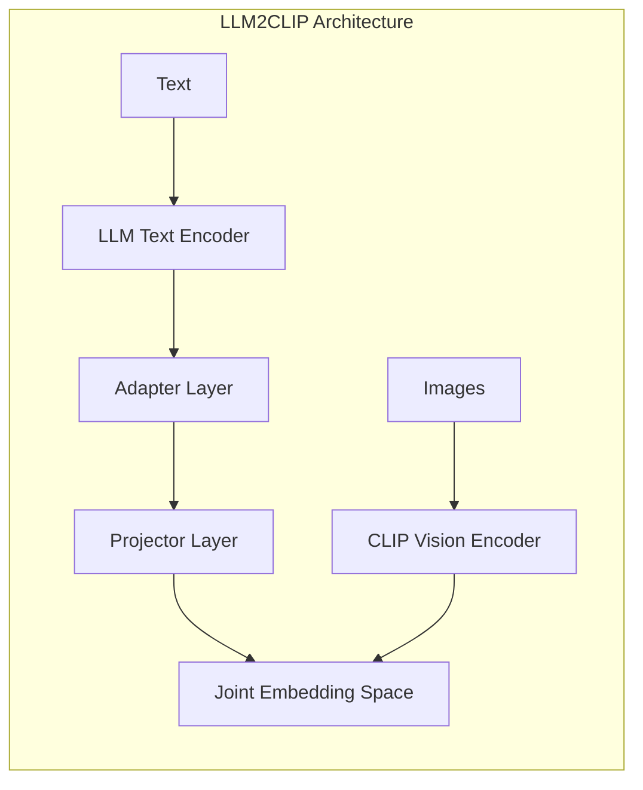
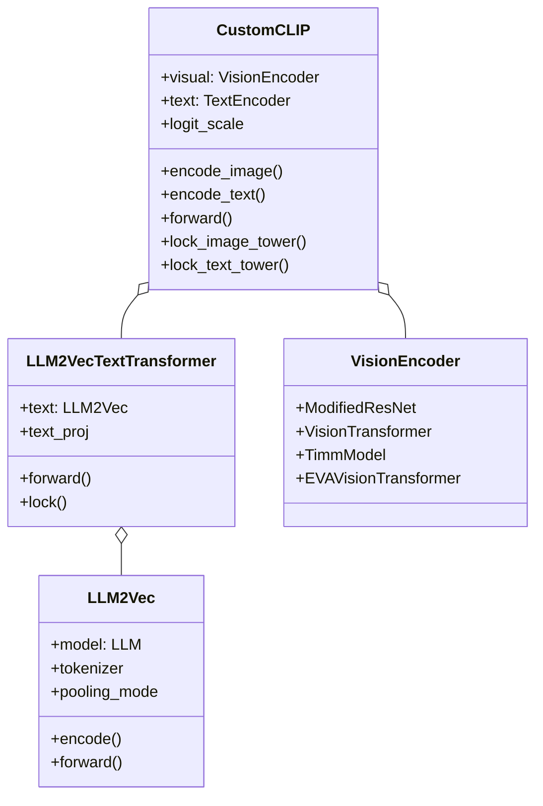
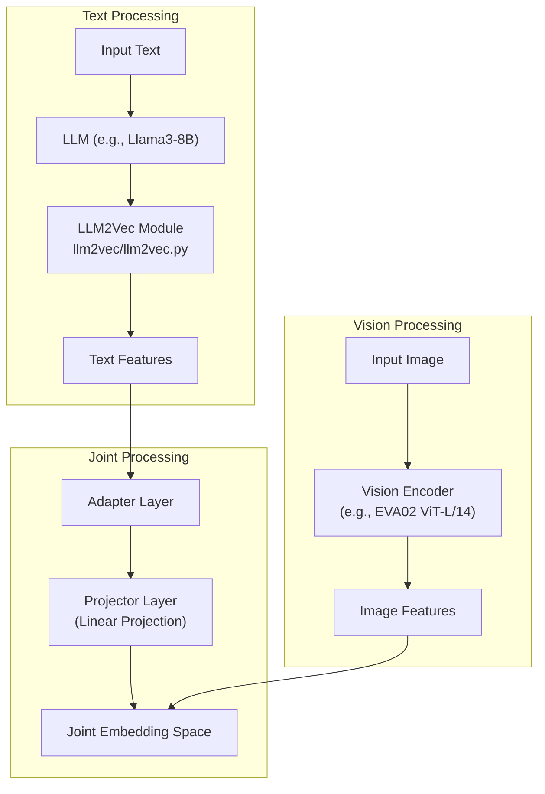
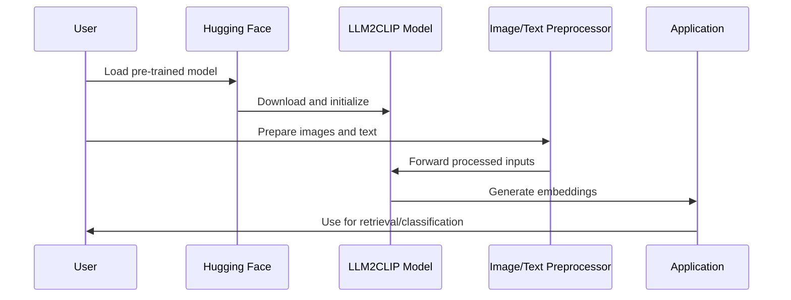
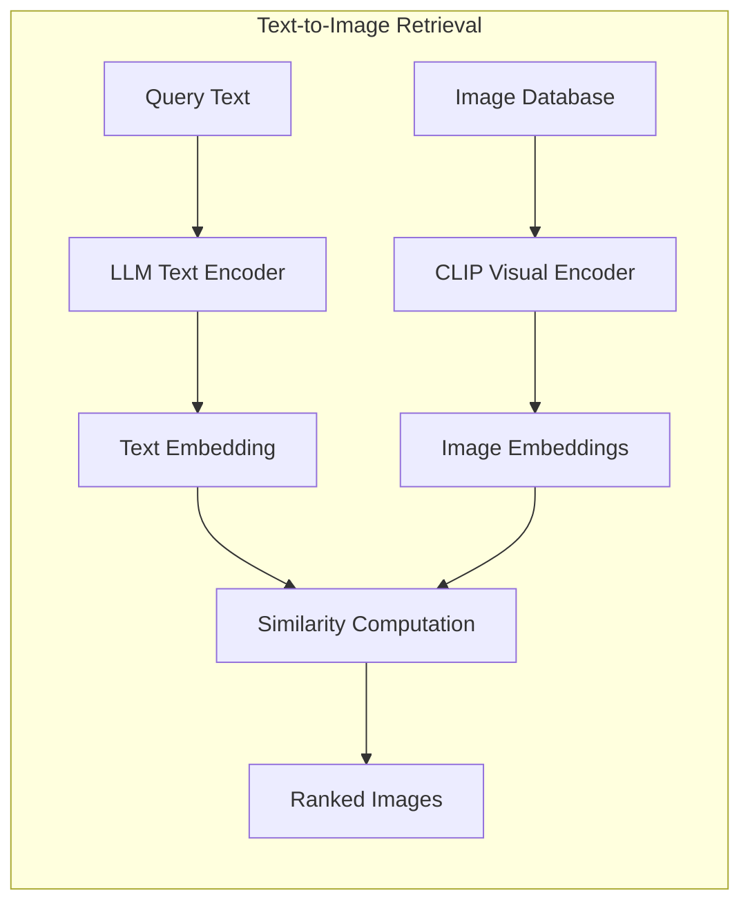
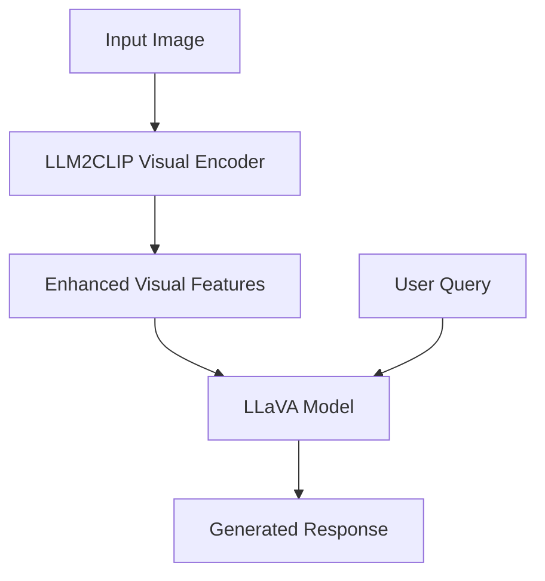
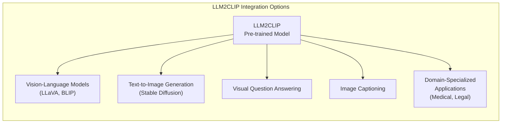

<!-- source: DeepWiki mcp.deepwiki.com · repo microsoft/LLM2CLIP · page 5.2 Using Pre-trained Models · fetched 2026-10-26 -->

# Using Pre-trained Models

<details>
<summary>Relevant source files</summary>

The following files were used as context for generating this wiki page:

- [FAQ.md](FAQ.md)
- [README.md](README.md)
- [docs/_site/static/images/New_LLM2CLIP_PR.jpg](docs/_site/static/images/New_LLM2CLIP_PR.jpg)
- [docs/index.html](docs/index.html)
- [docs/static/images/logo.png](docs/static/images/logo.png)
- [docs/static/images/radar_paper(4).png](docs/static/images/radar_paper(4).png)

</details>


This document provides comprehensive instructions for using pre-trained LLM2CLIP models in your applications. It covers how to load, configure, and utilize these models for a variety of multimodal tasks. If you're interested in training your own models from scratch instead, please refer to [Training a New Model](#5.1).

## 1. Available Pre-trained Models

LLM2CLIP offers several pre-trained models with different configurations and capabilities, all available through the Hugging Face Model Zoo.

### 1.1 Model Collection

All pre-trained models are published in the [LLM2CLIP Hugging Face Collection](https://huggingface.co/collections/microsoft/llm2clip-672323a266173cfa40b32d4c), which includes:

| Model Name | Base Vision Encoder | Base Language Model | Description |
|------------|---------------------|---------------------|-------------|
| LLM2CLIP-Llama-3-8B-Instruct-CC-Finetuned | - | Llama-3-8B | Caption-Contrastive finetuned Llama3-8B |
| LLM2CLIP-EVA02-L-14-336 | EVA02 ViT-L/14 | - | EVA02-based CLIP model enhanced with LLM2CLIP |
| LLM2CLIP-Openai-L-14-336 | OpenAI ViT-L/14 | - | OpenAI CLIP model enhanced with LLM2CLIP |

Sources: [README.md:10-14](), [FAQ.md:77-80]()

### 1.2 Model Naming Convention

LLM2CLIP models follow this naming convention:

```
LLM2CLIP-[VisionEncoder]-[Size]-[PatchSize]-[Resolution]
```

For LLM models:
```
LLM2CLIP-[LLMName]-[Size]-[TrainingStrategy]
```

Where:
- **VisionEncoder**: Base vision model architecture (EVA02, OpenAI)
- **Size**: Model size (B for Base, L for Large)
- **PatchSize**: Vision encoder patch size (14, 16)
- **Resolution**: Input resolution (336 for 336x336)
- **LLMName**: Base language model (Llama-3, Llama3.2)
- **TrainingStrategy**: Fine-tuning approach (CC for Caption-Contrastive)

Sources: [README.md:56-57]()

## 2. Model Architecture Overview

Understanding the LLM2CLIP architecture is crucial for effectively using pre-trained models.

### 2.1 High-Level Architecture

LLM2CLIP enhances CLIP by replacing the traditional text encoder with a large language model (LLM) that provides richer textual understanding.



Sources: [README.md:28-34]()

### 2.2 Component Structure

The following diagram shows the detailed structure of LLM2CLIP components and their relationships in code:



Sources: [README.md:52-54]()

### 2.3 Integration Details

In LLM2CLIP, the LLM serves as the text encoder, while adapters and projectors connect the LLM outputs to the CLIP visual encoder:



Sources: [README.md:18-19](), [README.md:42-44]()

## 3. Loading and Using Pre-trained Models

This section explains how to load LLM2CLIP models and use them in your applications.

### 3.1 Basic Model Loading

Here's how to load LLM2CLIP models from Hugging Face:

```python
# Using transformers/Hugging Face API
from transformers import CLIPProcessor, CLIPModel

# Load the pre-trained model
model_name = "microsoft/LLM2CLIP-EVA02-L-14-336"
model = CLIPModel.from_pretrained(model_name)
processor = CLIPProcessor.from_pretrained(model_name)

# For LLM-specific models (e.g., Llama-3 finetuned)
llm_model_name = "microsoft/LLM2CLIP-Llama-3-8B-Instruct-CC-Finetuned"
llm_model = AutoModelForCausalLM.from_pretrained(llm_model_name)
llm_tokenizer = AutoTokenizer.from_pretrained(llm_model_name)
```

### 3.2 Integration Flow

The following diagram illustrates the process of using pre-trained LLM2CLIP models:



Sources: [FAQ.md:77-85]()

### 3.3 Using Caption-Contrastive Finetuned LLM

To use the caption-contrastive finetuned Llama-3 model:

```python
# Load the finetuned LLM
from transformers import AutoModelForCausalLM, AutoTokenizer

llm_model = AutoModelForCausalLM.from_pretrained("microsoft/LLM2CLIP-Llama-3-8B-Instruct-CC-Finetuned")
llm_tokenizer = AutoTokenizer.from_pretrained("microsoft/LLM2CLIP-Llama-3-8B-Instruct-CC-Finetuned")

# Now integrate with the adapter and projector
# The adapter and projector parameters are available in the OpenAI ViT-L repository
adapter_projector = torch.load("path_to_adapter_projector")

# Create custom model using the LLM, adapter, and projector
```

Sources: [FAQ.md:77-83]()

## 4. Common Use Cases

This section covers the most common applications of LLM2CLIP pre-trained models.

### 4.1 Cross-Modal Retrieval

LLM2CLIP models excel at cross-modal retrieval tasks, including image-to-text and text-to-image retrieval:



Example code for retrieval:

```python
# Generate embeddings for a query text
text = "a photo of a cat sitting on a chair"
text_inputs = processor(text=text, return_tensors="pt")
text_embeddings = model.get_text_features(**text_inputs)

# Generate embeddings for images
image_embeddings = []
for image in images:
    image_inputs = processor(images=image, return_tensors="pt")
    image_embedding = model.get_image_features(**image_inputs)
    image_embeddings.append(image_embedding)

# Compute similarities
similarities = torch.nn.functional.cosine_similarity(
    text_embeddings.unsqueeze(1), 
    torch.stack(image_embeddings), 
    dim=2
)

# Get ranked indices
ranked_indices = similarities.argsort(descending=True)
```

Sources: [README.md:46-49](), [docs/index.html:172-217]()

### 4.2 Zero-Shot Classification

LLM2CLIP models can be used for zero-shot image classification:

```python
# Define class names
class_names = ["cat", "dog", "horse", "elephant", "bird"]

# Create text descriptions
text_descriptions = [f"a photo of a {name}" for name in class_names]
text_inputs = processor(text=text_descriptions, return_tensors="pt", padding=True)
text_embeddings = model.get_text_features(**text_inputs)

# Process image
image_inputs = processor(images=image, return_tensors="pt")
image_embeddings = model.get_image_features(**image_inputs)

# Calculate probabilities
similarities = torch.nn.functional.cosine_similarity(
    image_embeddings.unsqueeze(1), 
    text_embeddings, 
    dim=2
)
probabilities = similarities.softmax(dim=1)

# Get the most likely class
predicted_class = class_names[probabilities.argmax().item()]
```

Sources: [README.md:46-49]()

### 4.3 Integration with LLaVA

LLM2CLIP models can enhance multimodal models like LLaVA:



Performance improvements from integration with LLaVA:

| Task/Benchmark | LLaVA | LLaVA + LLM2CLIP | Improvement |
|----------------|-------|-----------------|-------------|
| VQAv2          | 79.04 | 79.80          | +0.76       |
| GQA            | 62.86 | 63.15          | +0.29       |
| VizWiz         | 50.57 | 52.37          | +1.80       |
| SQA-IMG        | 67.97 | 69.92          | +1.95       |
| MME            | 1476.69 | 1505.82      | +29.13      |
| MMBench        | 66.66 | 68.29          | +1.63       |

Sources: [docs/index.html:434-532]()

## 5. Model Performance

LLM2CLIP models demonstrate superior performance compared to standard CLIP models across various benchmarks.

### 5.1 Retrieval Performance

Performance comparison on various retrieval benchmarks:

| Model | Flickr30k I2T | Flickr30k T2I | COCO I2T | COCO T2I | ShareGPT4v I2T | ShareGPT4v T2I | Urban-1k I2T | Urban-1k T2I | DOCCI I2T | DOCCI T2I | Average |
|-------|---------------|---------------|----------|----------|----------------|----------------|--------------|--------------|-----------|-----------|---------|
| EVA02 ViT-L/14 | 89.8 | 73.3 | 63.8 | 63.8 | 89.3 | 91.9 | 68.5 | 73.3 | 75.0 | 73.4 | 76.2 |
| + Llama3-8B-CC | 92.0 | 82.8 | 68.5 | 54.8 | 98.6 | 99.0 | 88.1 | 94.0 | 88.2 | 90.4 | 85.6 |
| + Mistral-Nemo-12B-CC | 93.5 | 83.7 | 68.5 | 54.7 | 98.6 | 98.9 | 90.4 | 94.3 | 88.0 | 89.7 | 86.0 |

Sources: [docs/index.html:178-217]()

### 5.2 Cross-Language Capabilities

Even though LLM2CLIP is trained only on English data, it demonstrates impressive cross-language capabilities:

| Methods | Flickr-CN I2T@1 | Flickr-CN T2I@1 | COCO-CN I2T@1 | COCO-CN T2I@1 |
|---------|-----------------|-----------------|---------------|---------------|
| Wukong  | 76.1 | 51.7 | 53.4 | 55.2 |
| CN-CLIP | 80.2 | 68.0 | 63.4 | 64.0 |
| EVA02   | 4.40 | 0.94 | 2.7  | 1.0  |
| EVA02 + LLM2CLIP | 86.9 | 75.1 | 69.1 | 70.0 |

Sources: [docs/index.html:324-352](), [README.md:29-30]()

## 6. Advanced Usage

This section covers more advanced usage scenarios for LLM2CLIP models.

### 6.1 Customizing Model Configuration

You can customize how the model processes inputs:

```python
# Customize text processing
def process_text_with_custom_prompt(text):
    # Add a custom prompt template
    return f"Describe the image with: {text}"

# Use the custom processor
custom_texts = [process_text_with_custom_prompt(t) for t in texts]
text_inputs = processor(text=custom_texts, return_tensors="pt", padding=True)
```

### 6.2 Using Pre-trained Models for Domain-Specific Tasks

LLM2CLIP models can be fine-tuned on domain-specific data with minimal resources:

```python
# Load pre-trained model
model = CLIPModel.from_pretrained("microsoft/LLM2CLIP-EVA02-L-14-336")

# Freeze LLM components
model.text.requires_grad_(False)

# Fine-tune only vision encoder on domain-specific data
# Define optimizer for visual components only
optimizer = torch.optim.Adam(model.visual.parameters(), lr=1e-5)

# Train loop
for batch in domain_specific_dataloader:
    # Training code...
```

Sources: [FAQ.md:114-121](), [FAQ.md:26-30]()

### 6.3 Integration with Other Frameworks

LLM2CLIP can be integrated with various frameworks for generation and understanding tasks:



Sources: [FAQ.md:133-134](), [FAQ.md:26-33]()

## 7. Troubleshooting and FAQ

### Common Issues

1. **Model precision mismatches**: When using EVA series models, there might be precision mismatches during conversion to Hugging Face.
   
   **Solution**: Refer to the model card for specific handling of precision issues or updates on fixed versions.

2. **Text encoder configuration**: The configuration file might still show parameters for the original CLIP text encoder.
   
   **Solution**: Use the updated adapter and projector parameters available in the OpenAI ViT-L repository.

3. **Memory issues with large models**: Llama-3-8B models may require significant memory.
   
   **Solution**: Consider using smaller models like Llama3.2-1B-CC which offers good performance with lower memory requirements.

Sources: [FAQ.md:77-85](), [FAQ.md:101-103]()

### Frequently Asked Questions

**Q: How can I replace the original text encoder with the tuned Llama 3 model?**

A: The caption contrastive fine-tuned version of Llama3-8B-CC is available on Hugging Face to assist with retrieval experiments and training custom CLIP models. Additionally, the parameters for the adapter and projector are available in the OpenAI ViT-L repository.

**Q: What are the differences between various fine-tuning strategies (TC vs. CC)?**

A: CC (Caption-Contrastive) refers to the supervised SimCSE loss to make different captions of the same image positive samples for each other. TC likely refers to text-contrastive approaches. CC shows better performance in most benchmarks.

Sources: [FAQ.md:77-83](), [FAQ.md:134-137]()

## 8. Conclusion

LLM2CLIP pre-trained models offer powerful tools for multimodal applications, leveraging the strengths of large language models to enhance visual representation learning. By following the instructions and examples in this document, you can effectively utilize these models for tasks ranging from cross-modal retrieval to zero-shot classification and beyond.

For training your own LLM2CLIP models, please refer to [Training a New Model](#5.1).

Sources: [README.md:3-4](), [README.md:46-49]()

---

