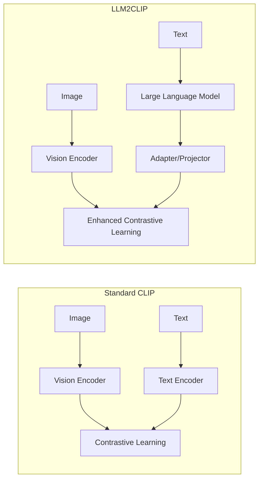
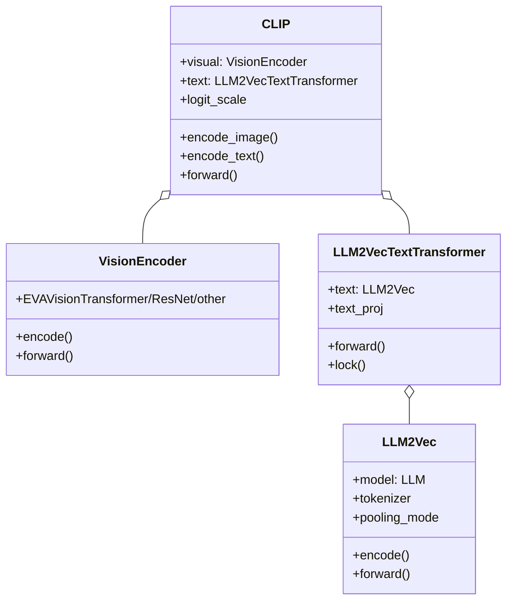
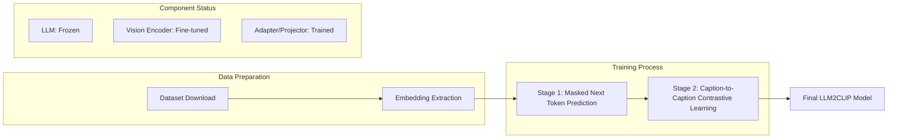
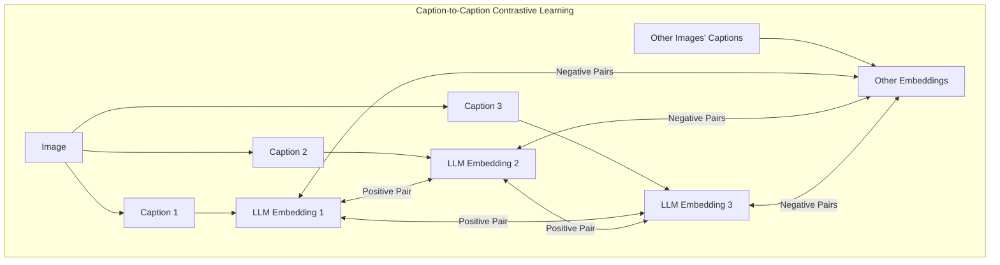
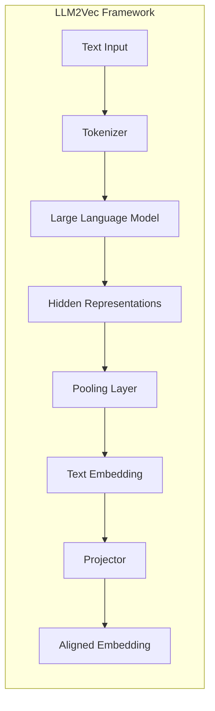

<!-- source: DeepWiki mcp.deepwiki.com · repo microsoft/LLM2CLIP · page 6 Frequently Asked Questions · fetched 2026-10-26 -->

# Frequently Asked Questions

Relevant source files

The following files were used as context for generating this wiki page:

- [FAQ.md](FAQ.md)
- [docs/_site/static/images/New_LLM2CLIP_PR.jpg](docs/_site/static/images/New_LLM2CLIP_PR.jpg)

This page addresses common questions about the LLM2CLIP system, including its functionality, performance, training process, and practical usage. For a general introduction to LLM2CLIP, please see the [Overview](#1) section. For detailed installation and usage instructions, refer to [Installation and Usage](#5).

## General Questions

### What is LLM2CLIP and how does it differ from standard CLIP?

LLM2CLIP enhances CLIP (Contrastive Language-Image Pre-training) models by replacing the traditional text encoder with a large language model (LLM). While standard CLIP models use specialized text encoders with limited capacity, LLM2CLIP leverages the rich semantic understanding of LLMs like Llama 3 to create more powerful multimodal representations.

Sources: llm2vec/llm2vec.py, eva_clip/llm_model.py

### What are the main advantages of using LLM2CLIP?

LLM2CLIP offers several key advantages:

1. **Improved long-text understanding**: Better handling of captions, descriptions, and dense text compared to traditional CLIP models
2. **Enhanced cross-modal alignment**: More precise mapping between text and image semantics
3. **Stronger performance on retrieval tasks**: Particularly for complex queries and detailed captions
4. **Better zero-shot capabilities**: Improved ability to generalize to unseen concepts
5. **Integration with the broader LLM ecosystem**: Potential for using specialized LLMs for domain-specific applications

Sources: FAQ.md

### What language models are supported by LLM2CLIP?

LLM2CLIP has been tested with various language models including:

- Llama3-8B
- Llama3.2-1B
- Other bidirectional LLM models

The system is designed to be model-agnostic and can integrate with different LLMs through the LLM2Vec module.

Sources: llm2vec/models/

## Performance and Capabilities

### How does LLM2CLIP perform on standard benchmarks?

LLM2CLIP shows significant improvements over standard CLIP models on various benchmarks:

- **Text-to-image retrieval**: Superior performance on datasets like COCO and Flickr30K
- **Image-to-text retrieval**: Enhanced ability to match images with appropriate textual descriptions
- **Dense caption understanding**: Better handling of complex, detailed captions
- **Zero-shot classification**: Some improvement on datasets like ImageNet-1K, though less dramatic than retrieval tasks

Performance on ImageNet classification shows modest improvement (~1 point), with larger gains observed in retrieval tasks involving complex textual descriptions.

Sources: FAQ.md

### How well does LLM2CLIP handle long text compared to standard CLIP?

LLM2CLIP significantly outperforms standard CLIP on long text understanding. While traditional CLIP models struggle with captions exceeding their token limit (typically 77 tokens), LLM2CLIP leverages the LLM's capacity to process longer sequences and extract meaningful representations.

This allows LLM2CLIP to better understand detailed descriptions, dense captions, and complex queries, resulting in improved performance on tasks requiring nuanced text interpretation.

Sources: FAQ.md

### Can LLM2CLIP be applied to specialized domains like medicine or law?

Yes, LLM2CLIP shows strong potential for domain-specific applications. Because the system can be fine-tuned with relatively small amounts of data (3M-60M samples compared to 1-2B for standard CLIP pre-training), it's well-suited for adaptation to specialized fields.

Domain-specific LLM2CLIP models could leverage the LLM's existing knowledge combined with domain-specific training data to create powerful multimodal systems for fields like medicine, law, or other specialized domains with their own terminology and visual characteristics.

Sources: FAQ.md

## Implementation and Usage

### How can I use the pre-trained LLM2CLIP models?

Pre-trained LLM2CLIP models are available on Hugging Face. You can use them for tasks like cross-modal retrieval as follows:

1. Load the pre-trained models from Hugging Face:
   - Caption contrastive fine-tuned Llama3-8B-CC: `microsoft/LLM2CLIP-Llama-3-8B-Instruct-CC-Finetuned`
   - Adapter and projector parameters: `microsoft/LLM2CLIP-Openai-L-14-336`

2. Follow the retrieval testing methods documented in the model card for reference.

For more detailed instructions, see [Using Pre-trained Models](#5.2).

Sources: FAQ.md

### What is the architecture of LLM2CLIP?

LLM2CLIP consists of several key components:

The system replaces the standard CLIP text encoder with an LLM2VecTextTransformer that contains:
1. An LLM2Vec module wrapping a large language model
2. A projector that aligns the LLM embeddings with the vision encoder output space

Sources: eva_clip/model.py, eva_clip/llm_model.py, llm2vec/llm2vec.py

## Training and Fine-tuning

### How is LLM2CLIP trained?

LLM2CLIP employs a two-stage training process:

1. **Data Preparation**: Download datasets and extract LLM embeddings
2. **Stage 1 (MNTP)**: Masked Next Token Prediction to help the model understand text
3. **Stage 2 (SimCSE)**: Caption-to-Caption Contrastive Learning where different captions of the same image are positive samples

During training, the LLM weights are typically kept frozen, while the vision encoder and adapter/projector are fine-tuned. This approach maintains computational efficiency while still allowing the system to learn powerful multimodal representations.

Sources: training/main.py, FAQ.md

### What datasets are used for training LLM2CLIP?

LLM2CLIP training uses a combination of:

1. **Image-caption datasets**:
   - CC-3M (Conceptual Captions)
   - CC-12M
   - YFCC15M

2. **Pure text datasets**:
   - Wikitext-103

The datasets are mixed and shuffled during training, with the text-only data helping to retain the LLM's original language understanding capabilities while the image-caption data enables cross-modal alignment.

For evaluation, benchmarks like Flickr30K, COCO, and others are used.

Sources: download_dataset.sh, setup_eval_datasets.sh, FAQ.md

### Does LLM2CLIP require a lot of computational resources to train?

LLM2CLIP is designed to be relatively efficient to train compared to training CLIP models from scratch. Key efficiency considerations include:

1. **Frozen LLM**: The LLM weights are typically kept frozen during training, significantly reducing memory requirements and computational cost
2. **Parameter-efficient fine-tuning**: When LLM fine-tuning is needed, techniques like LoRA can be used
3. **Limited data requirements**: LLM2CLIP achieves good results with 3M-60M samples, far less than the 1-2B samples used in standard CLIP pre-training

However, the exact computational requirements will depend on the specific LLM used, the vision encoder size, and the training dataset size.

Sources: FAQ.md

## Technical Questions

### How does caption-to-caption contrastive learning work?

Caption-to-caption contrastive learning (SimCSE loss) is a key innovation in LLM2CLIP:

In this approach:
1. Multiple captions for the same image are treated as positive pairs for each other
2. Captions from different images serve as negative examples
3. The system learns to pull together embeddings from captions describing the same image and push apart embeddings from captions describing different images

This process helps the LLM develop more discriminative text representations that better align with visual content.

Sources: FAQ.md

### What is the role of the LLM2Vec module?

The LLM2Vec module serves as a bridge between the LLM and the CLIP architecture:

Key functions of LLM2Vec include:
1. Text tokenization and processing through the LLM
2. Extraction of hidden representations from the LLM
3. Pooling these representations into a fixed-size embedding
4. Projecting the embedding to align with the visual space

The module essentially transforms the LLM into a powerful text encoder that can be integrated with the CLIP architecture.

Sources: llm2vec/llm2vec.py

### Can LLM2CLIP be integrated with diffusion models?

Yes, LLM2CLIP shows potential for integration with diffusion models for text-to-image generation. Initial experiments indicate that using LLM2CLIP's Llama3 with Stable Diffusion 3 performs significantly better than using a standard Llama3 model.

This suggests that LLM2CLIP's enhanced text-to-image understanding could enable more precise control and better adherence to complex prompts in generative models.

Sources: FAQ.md

## Future Directions

### What improvements are planned for future versions of LLM2CLIP?

Future directions for LLM2CLIP include:

1. **Scaling up data and model size**: Plans to release models 10-100x larger than current versions
2. **Video-based extensions**: Development of video-based versions of LLM2CLIP
3. **Domain-specific applications**: Exploration of specialized models for fields like medicine
4. **Improved captioning**: Integration of GPT-4o recaptioned data
5. **Fine-tuning instructions**: More detailed guidance on using LLM2CLIP to fine-tune custom CLIP models

Sources: FAQ.md

### Can LLM2CLIP be extended to other modalities beyond images?

Yes, one of the key future directions for LLM2CLIP is extending it to other modalities like video and audio. The team is already exploring a video-based version of LLM2CLIP that would be scaled up significantly in terms of both dataset size and model parameters.

Challenges in extending to new modalities include:
1. Enhancing supervisory signals in contrastive learning for complex temporal data
2. Expanding contrastive learning across additional dimensions (e.g., temporal)
3. Handling complex temporal logic in modalities like video

Sources: FAQ.md

## Common Issues

### Why do I see different parameters in the configuration file than expected?

Some users have reported confusion about the model parameters in configuration files like `configuration_evaclip.py`, which may still show the original CLIP text encoder parameters rather than the LLM parameters.

This is because the LLM2CLIP architecture uses a wrapper approach where the LLM is integrated through the LLM2Vec module and adapter/projector layers. The Hugging Face model conversion process may sometimes have precision mismatches or configuration discrepancies which are being addressed in ongoing updates.

For the most up-to-date models, refer to the official Hugging Face repositories:
- `microsoft/LLM2CLIP-Llama-3-8B-Instruct-CC-Finetuned`
- `microsoft/LLM2CLIP-Openai-L-14-336`

Sources: FAQ.md