# Page: Overview

# Overview

<details>
<summary>Relevant source files</summary>

The following files were used as context for generating this wiki page:

- [FAQ.md](FAQ.md)
- [README.md](README.md)
- [docs/_site/static/images/New_LLM2CLIP_PR.jpg](docs/_site/static/images/New_LLM2CLIP_PR.jpg)
- [docs/index.html](docs/index.html)
- [docs/static/images/logo.png](docs/static/images/logo.png)
- [docs/static/images/radar_paper(4).png](docs/static/images/radar_paper(4).png)

</details>


LLM2CLIP is a system that leverages large language models (LLMs) as powerful textual teachers for CLIP's (Contrastive Language-Image Pre-training) visual encoder, enabling more nuanced and comprehensive multimodal learning. This overview introduces the core concepts, architecture, and components of the LLM2CLIP repository.

LLM2CLIP addresses the limitations of conventional CLIP models by integrating the capabilities of large language models to enhance visual-textual alignment, providing significant improvements in cross-modal tasks including zero-shot classification, detection, segmentation, and retrieval.

For detailed information about installation and setup procedures, see [Installation and Usage](#5).

## System Purpose and Key Innovations

LLM2CLIP was developed to overcome two primary limitations of existing CLIP models:

1. **Limited Context Window**: Standard CLIP text encoders have a short context window of only 77 tokens, restricting their ability to process lengthy inputs.

2. **Weak Text Comprehension**: Traditional CLIP text encoders have limited ability to understand complex text, often functioning more like bag-of-words models.

The key innovations of LLM2CLIP include:

- **Extended Input Window**: Leveraging LLMs to expand CLIP's input context window
- **Enhanced Textual Understanding**: Enabling CLIP to comprehend dense, complex captions
- **Open-World Knowledge Integration**: Using LLMs' pre-trained knowledge to improve multimodal alignment
- **Caption-to-Caption Contrastive Learning**: A novel training strategy to improve the separability of the LLM's output space

Sources: [README.md:27-45]()

## High-Level Architecture

The LLM2CLIP system integrates large language models with CLIP's visual encoder to create a more powerful multimodal representation system.

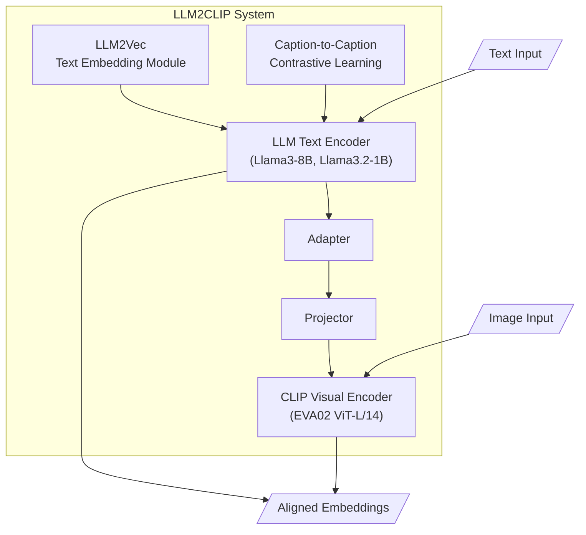

Sources: [README.md:52-53]()

## Core Components

LLM2CLIP consists of several key components that work together to enhance CLIP's visual-textual representation capabilities:

### 1. LLM Text Encoder

The LLM Text Encoder (implemented as `LLM2VecTextTransformer` in the codebase) replaces the standard CLIP text encoder with a large language model like Llama3-8B or Llama3.2-1B. This component provides superior text understanding and context modeling capabilities.

### 2. LLM2Vec Module

The LLM2Vec module serves as an interface between the LLM and the rest of the system, handling tokenization, text encoding, and embedding extraction. It transforms text inputs into high-dimensional embeddings that capture rich semantic information.

### 3. CLIP Visual Encoder

The CLIP Visual Encoder processes images and is fine-tuned to align with the LLM's text representations. LLM2CLIP supports various implementations such as EVA02 ViT-L/14 or other vision transformer architectures.

### 4. Adapter and Projector

These components connect the LLM to the CLIP Visual Encoder, ensuring proper alignment between the text and image modalities. They transform the LLM's output space to be compatible with the CLIP Visual Encoder.

Sources: [README.md:42-45]()

## Model Architecture

The following diagram illustrates the CLIP model architecture in LLM2CLIP, showing the relationship between different encoders and transformers:

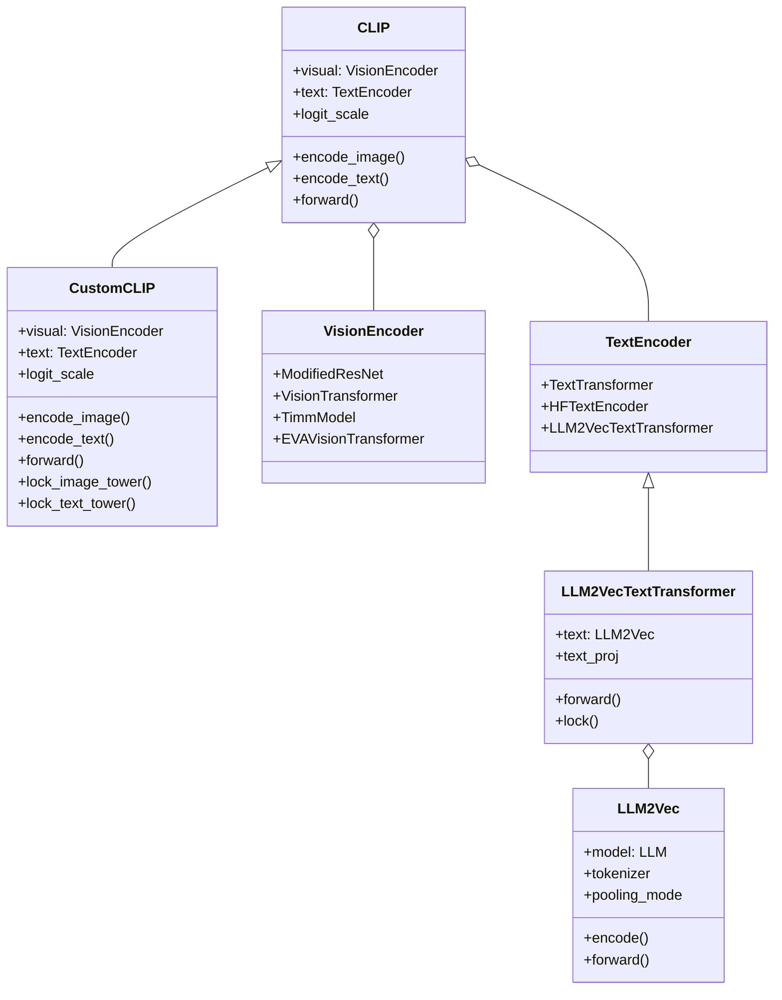

Sources: [README.md:42-45]()

## Training Approach

LLM2CLIP employs a two-stage training approach to enhance CLIP's capabilities:

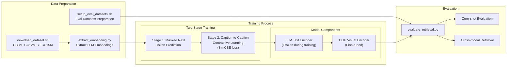

Key aspects of the training approach:

1. **Caption-to-Caption Contrastive Learning**: This strategy trains the LLM to better differentiate between captions of the same or different images, enhancing the separability of the LLM's output space.

2. **Frozen LLM Gradients**: During training, the LLM gradients are frozen while CLIP's visual encoder is fine-tuned, resulting in significant performance gains with limited data.

3. **Long and Dense Caption Processing**: The approach better utilizes the LLM's power to comprehend and process long and dense captions, improving overall representation capabilities.

Sources: [README.md:40-45](), [FAQ.md:44-52]()

## Data Processing Pipeline

The data processing workflow in LLM2CLIP handles the preparation of training and evaluation datasets:

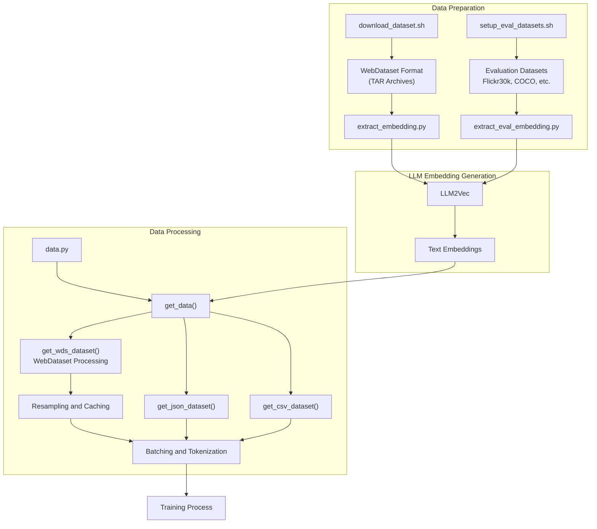

Sources: [README.md:69-82]()

## Applications and Benefits

LLM2CLIP provides several key benefits and applications:

1. **Enhanced CLIP Models**: Fine-tuning pretrained CLIP models with dense captions or task-specific image-text datasets for various use cases.

2. **Improved Cross-Modal Retrieval**: Significantly better performance on text-to-image and image-to-text retrieval tasks.

3. **Cross-Language Capability**: Even when trained solely on English data, LLM2CLIP outperforms standard Chinese CLIP models on Chinese text-image retrieval tasks.

4. **VLM Enhancement**: LLM2CLIP can make visual language models like Llava more powerful and comprehensive in performance across a wide range of benchmarks.

5. **Domain Specialization Potential**: The approach can be adapted to specialized domains like medicine or law with limited domain-specific data.

Sources: [README.md:46-50](), [FAQ.md:24-33]()

## Model Zoo

LLM2CLIP provides several pretrained models in the Hugging Face Model Zoo, including:

- Caption-Contrastive finetuned Llama3-8B-CC
- OpenAI's CLIP and EVA02's ViT models (base and large)

Sources: [README.md:55-57](), [README.md:10-14]()

This overview provides an introduction to LLM2CLIP. For more detailed information about key concepts, see [Key Concepts](#1.1), or for a deeper dive into the system architecture, see [System Architecture](#2).

---

# Page: Key Concepts

# Key Concepts

<details>
<summary>Relevant source files</summary>

The following files were used as context for generating this wiki page:

- [FAQ.md](FAQ.md)
- [README.md](README.md)
- [docs/_site/static/images/New_LLM2CLIP_PR.jpg](docs/_site/static/images/New_LLM2CLIP_PR.jpg)
- [docs/index.html](docs/index.html)
- [docs/static/images/logo.png](docs/static/images/logo.png)
- [docs/static/images/radar_paper(4).png](docs/static/images/radar_paper(4).png)

</details>


This page provides an overview of the fundamental concepts behind LLM2CLIP, explaining how large language models (LLMs) are used to enhance CLIP (Contrastive Language-Image Pre-training) models. For detailed information about the system architecture, see [System Architecture](#2), and for training pipeline details, see [Training Pipeline](#3).

## CLIP Fundamentals and Limitations

CLIP (Contrastive Language-Image Pre-training) aligns visual and textual signals into a shared feature space using contrastive learning on image-text pairs. Traditional CLIP models face two key limitations:

1. **Limited Context Window**: The text encoder has a short context window of only 77 tokens, restricting understanding of lengthy inputs.
2. **Weak Text Comprehension**: The text encoder has limited ability to comprehend complex text, often functioning as a basic bag-of-words model.

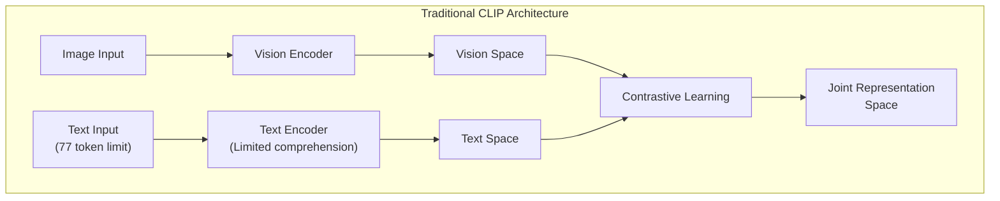

Sources: README.md:20-26, FAQ.md:3-16

## LLM2CLIP Approach

LLM2CLIP addresses CLIP's limitations by leveraging large language models (LLMs) as powerful textual teachers for CLIP's visual encoder, enabling:

1. **Extended Context Window**: LLMs expand CLIP's input window, allowing richer textual context.
2. **Enhanced Understanding**: LLMs provide deeper comprehension of dense, complex captions.
3. **Open-World Knowledge**: LLMs contribute global knowledge that improves multimodal feature alignment.

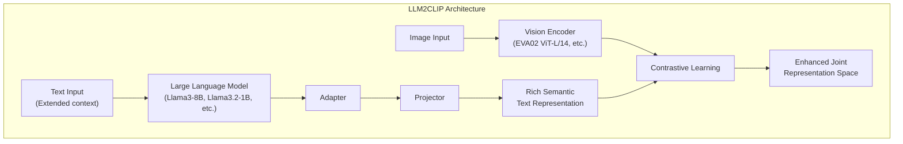

Sources: README.md:27-34, docs/index.html:93-97

## Caption-to-Caption Contrastive Learning

A key innovation in LLM2CLIP is its **Caption-to-Caption Contrastive Learning** strategy. While LLMs have strong inherent text encoding capabilities, their output space is often not highly separable, limiting effectiveness for contrastive learning.

The Caption-to-Caption Contrastive Learning approach:

1. Trains the LLM to better differentiate between captions of the same or different images
2. Enhances the separability of the LLM's output space
3. Freezes LLM gradients while fine-tuning CLIP's visual encoder
4. Significantly improves the model's ability to process long and dense captions

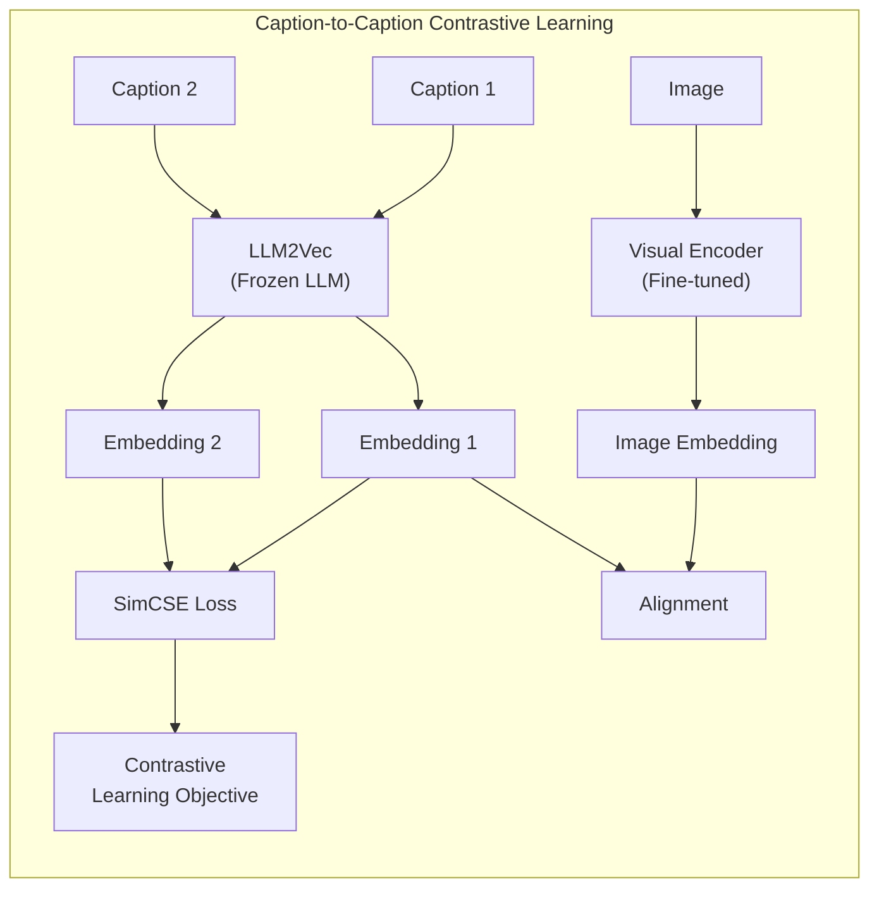

Sources: README.md:35-45, FAQ.md:124-142

## System Components

### LLM2Vec

LLM2Vec is a text embedding module that leverages a large language model to create rich textual representations. It extends CLIP's capabilities by enhancing text understanding and expanding the context window.

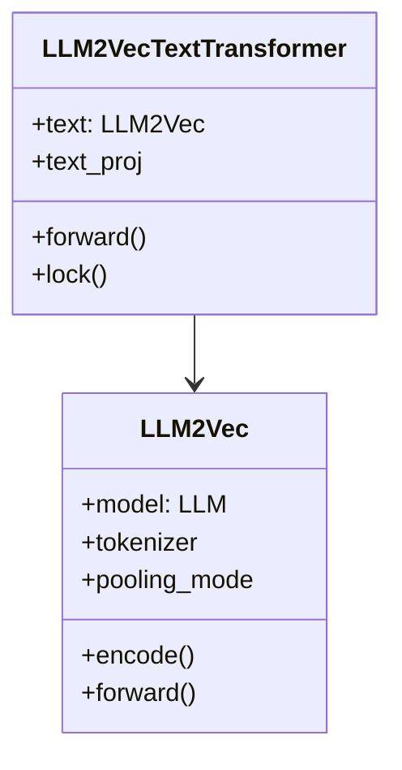

Sources: README.md:27-34, FAQ.md:124-142

### Training Pipeline Components

The LLM2CLIP training pipeline consists of two main stages and several key components:

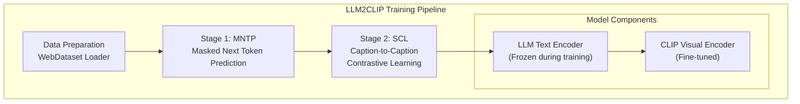

Sources: FAQ.md:45-47, README.md:40-45

## Two-Stage Training Process

The LLM2CLIP training process involves two distinct stages:

1. **Masked Next Token Prediction (MNTP)**: An initial stage that prepares the model
2. **Supervised SimCSE Loss**: The main stage that uses contrastive learning to make different captions of the same image positive samples for each other, while captions of different images serve as negative samples

This two-stage approach is critical to the effectiveness of LLM2CLIP, though the MNTP stage has relatively less impact on the final results than the SimCSE loss stage.

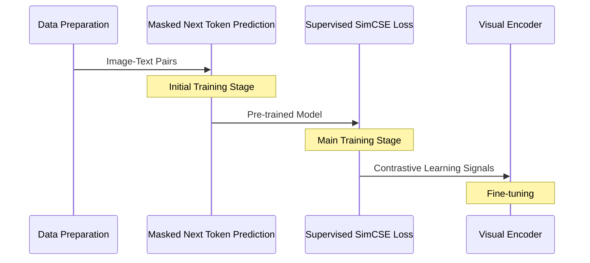

Sources: FAQ.md:134-137

## Data Processing and Embedding Extraction

The data processing pipeline in LLM2CLIP involves:

1. **Dataset Preparation**: Using datasets like CC3M, CC12M, YFCC15M
2. **Embedding Extraction**: Creating LLM embeddings from captions
3. **Mixed Datasets**: Combining pure text (e.g., Wikitext-103) and caption datasets (e.g., CC-3M)

This approach helps maintain the LLM's original distribution with minimal shift while providing rich supervision signals.

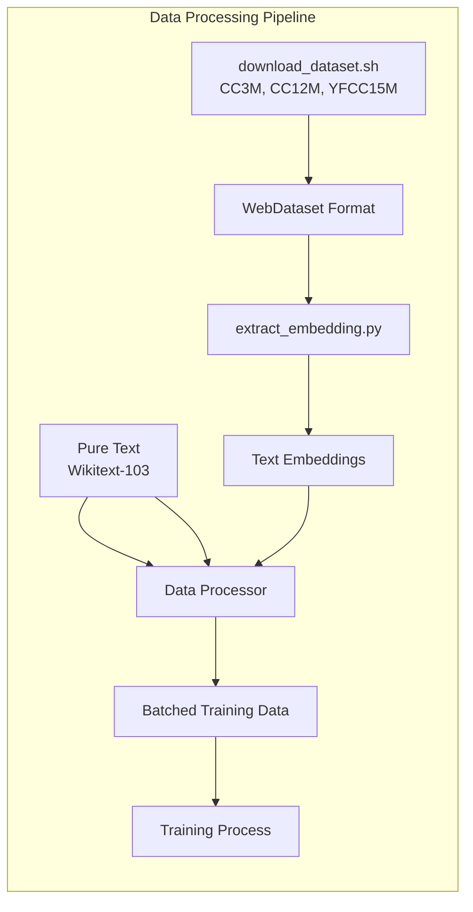

Sources: README.md:69-82, FAQ.md:138-139

## Model Architecture

The LLM2CLIP model architecture integrates a large language model with CLIP's visual encoder:

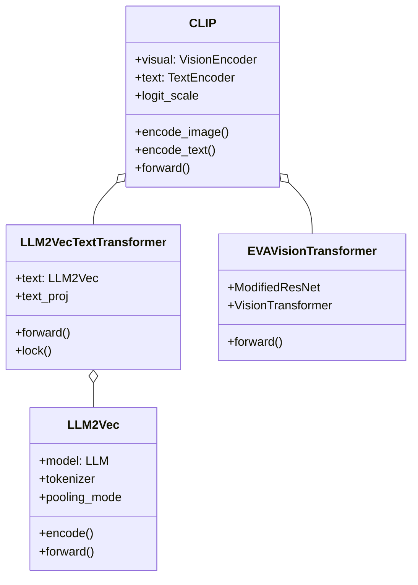

Sources: README.md:52-53, docs/index.html:102-105

## Key Benefits and Applications

LLM2CLIP offers several key benefits and applications:

1. **Enhanced CLIP Models**: Fine-tune existing CLIP models with dense captions or task-specific datasets
2. **Improved Performance**: Significant improvements in cross-modal tasks, especially for:
   - Long-text retrieval
   - Cross-language retrieval (even without explicit training on target languages)
   - Complex visual understanding tasks

The system can be applied to:

- Image-text retrieval
- Multimodal understanding
- Zero-shot classification
- Extended to specialized domains (medicine, law, etc.)

Table: Performance Improvements with LLM2CLIP

| Model | Flickr30k (I2T) | COCO (I2T) | ShareGPT4v (I2T) | Average |
|-------|-----------------|------------|------------------|---------|
| EVA02 ViT-L/14 | 89.8 | 63.8 | 89.3 | 76.2 |
| + Llama3-8B | 87.1 | 56.4 | 89.3 | 66.3 |
| + Llama3-8B-CC | 92.0 | 68.5 | 98.6 | 85.6 |

Sources: README.md:46-50, docs/index.html:178-309

## Technical Implementation

The key technical aspects of LLM2CLIP include:

1. **Model Initialization**: Using pre-trained CLIP models (e.g., EVA02 ViT-L/14) and LLMs (e.g., Llama3-8B)
2. **Adapter and Projector Layers**: Connecting the LLM outputs to the visual space
3. **Training Configuration**: 
   - Freezing LLM gradients 
   - Fine-tuning visual encoder
   - Using caption-to-caption contrastive learning

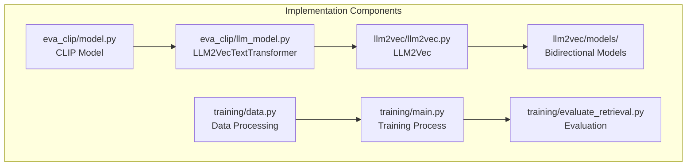

Sources: README.md:61-68, README.md:84-89

## Caption Contrastive Fine-tuning

The Caption Contrastive Fine-tuning (CC) approach is crucial to LLM2CLIP's success. This process:

1. Improves the textual discriminability of the LLM
2. Makes the LLM outputs more suitable for contrastive learning
3. Enables the LLM to better differentiate between captions of the same or different images

By applying this fine-tuning, the system can significantly outperform both standard CLIP models and models using untuned LLMs.

Table: Caption Retrieval Accuracy (CRA) Comparison

| Language Model | CRA |
|----------------|-----|
| CLIP-L/14 | 25.2 |
| EVA02-L/14 | 27.11 |
| Llama3-8B (untuned) | 5.2 |
| Llama3-8B-CC (tuned) | 29.5 |

Sources: docs/index.html:124-167, README.md:40-45

---

# Page: System Architecture

# System Architecture

<details>
<summary>Relevant source files</summary>

The following files were used as context for generating this wiki page:

- [README.md](README.md)
- [docs/index.html](docs/index.html)
- [docs/static/images/logo.png](docs/static/images/logo.png)
- [docs/static/images/radar_paper(4).png](docs/static/images/radar_paper(4).png)
- [llm2clip/eva_clip/llm_model.py](llm2clip/eva_clip/llm_model.py)
- [llm2clip/eva_clip/model.py](llm2clip/eva_clip/model.py)

</details>


This document provides a comprehensive overview of the LLM2CLIP system architecture, detailing the core components and their interactions. LLM2CLIP enhances CLIP (Contrastive Language-Image Pre-training) models by leveraging large language models (LLMs) as powerful textual teachers for CLIP's visual encoder.

For information about the training pipeline specifics, see [Training Pipeline](#3). For CLIP model architecture details, see [CLIP Model Architecture](#2.1). For information about LLM integration, see [LLM Integration](#2.2).

## High-Level Architecture Overview

LLM2CLIP combines the powerful language understanding capabilities of large language models with CLIP's multimodal learning framework to create more robust visual representations.

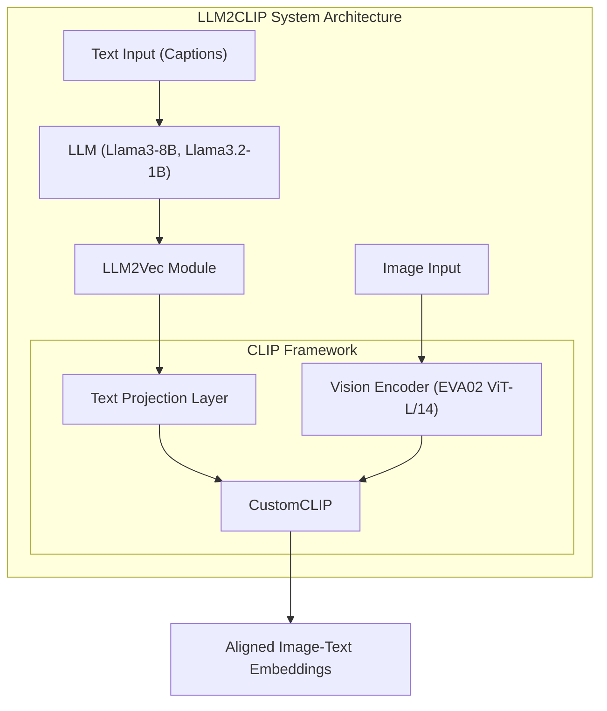

The system architecture consists of:

1. **Large Language Model (LLM)**: Processes text inputs with advanced language understanding. Implementation relies primarily on Llama family models.

2. **LLM2Vec Module**: Extracts embeddings from the LLM, converting text inputs into vector representations that capture semantic meaning.

3. **Text Projection Layer**: Projects LLM embeddings into CLIP's embedding space through a sequence of transformation layers.

4. **Vision Encoder**: Processes images to extract visual features, with support for multiple architectures including EVA02 ViT-L/14.

5. **CustomCLIP**: Integrates the LLM-enhanced text features with visual features for multimodal representation learning.

Sources: [llm2clip/eva_clip/model.py:315-360](), [llm2clip/eva_clip/llm_model.py:5-36](), [README.md:18-45]()

## Core Components

### CustomCLIP Implementation

The primary integration point is the CustomCLIP class, which extends the standard CLIP architecture:

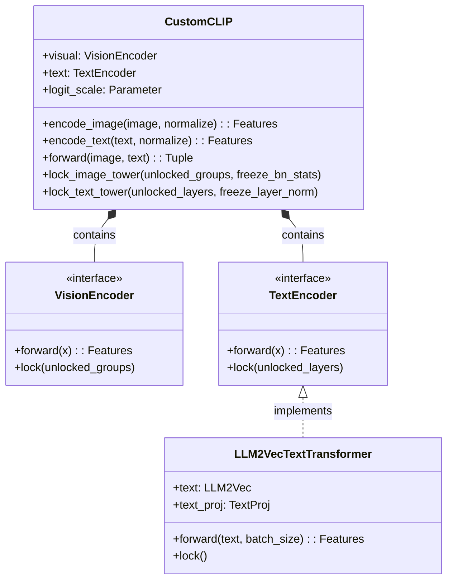

The CustomCLIP class:
- Initializes vision and text encoders based on configuration
- Provides methods for encoding images and text independently
- Implements forward pass for joint image-text processing
- Includes methods to selectively freeze model components during training

Sources: [llm2clip/eva_clip/model.py:315-360]()

### Text Processing Component

The text processing component consists of the LLM2VecTextTransformer class that integrates the LLM with CLIP:

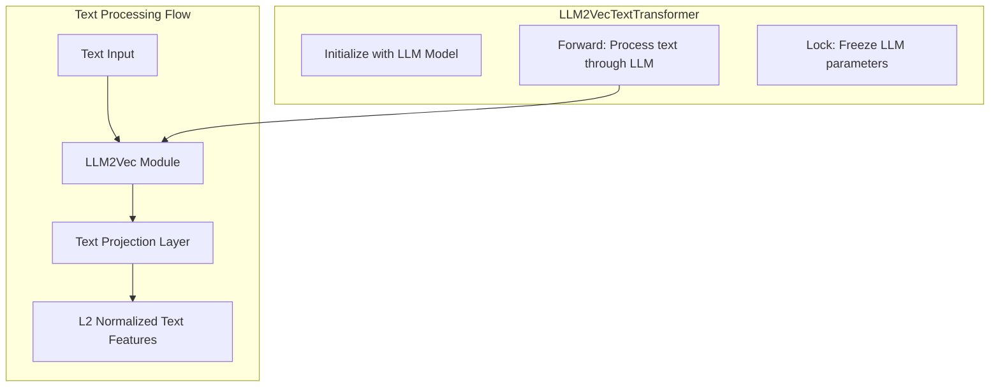

The LLM2VecTextTransformer:
- Wraps an LLM2Vec instance using a specified LLM (e.g., Llama3)
- Processes text inputs to produce embeddings
- Optionally applies additional projection through a TextProj layer
- Supports parameter freezing to prevent LLM fine-tuning

Sources: [llm2clip/eva_clip/llm_model.py:5-36]()

### Text Projection Layer

The TextProj class transforms LLM embeddings to match CLIP's embedding space:

```mermaid
graph TD
    subgraph "TextProj"
        Input["LLM Embeddings (4096d)"] --> LinearBlocks["LinearBlocks (Multiple Layers)"]
        LinearBlocks --> Norm["LayerNorm"]
        Norm --> Linear["Linear Projection"]
        Linear --> Output["CLIP Space Embeddings (512d)"]
    end

    subgraph "LinearBlock Structure"
        Input2["Input"] --> LN["LayerNorm"]
        LN --> Expand["Linear Expansion"]
        Expand --> GELU["GELU Activation"]
        GELU --> Dropout["Dropout"]
        Dropout --> Contract["Linear Contraction"]
        Contract --> Residual["Residual Connection"]
    end
```

TextProj consists of:
- A sequence of LinearBlocks for embedding transformation
- Each LinearBlock applies normalization, expansion, non-linearity, and contraction
- A final layer normalization and linear projection to the target dimension
- Support for optional L2 normalization of the output

Sources: [llm2clip/eva_clip/model.py:217-254]()

## Vision Encoder Options

LLM2CLIP supports multiple vision encoder architectures:

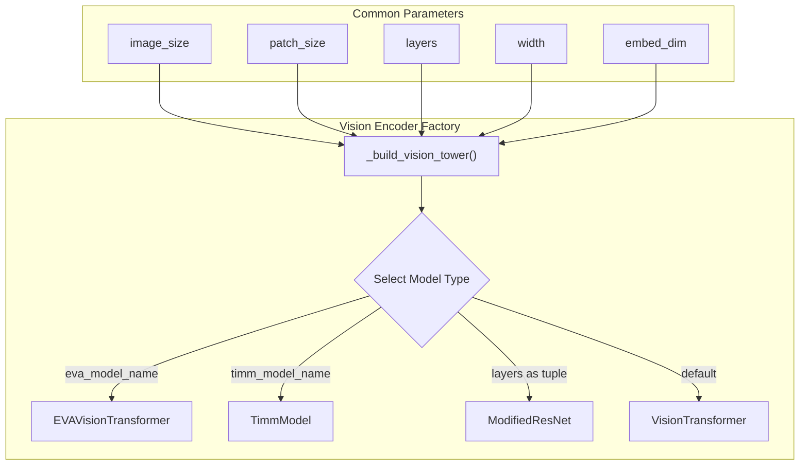

The vision encoder options include:
- **EVAVisionTransformer**: Enhanced Vision Transformer with advanced features
- **TimmModel**: Integration with timm library for various pre-trained models
- **ModifiedResNet**: ResNet-based vision encoder for CLIP
- **VisionTransformer**: Standard Vision Transformer implementation

Sources: [llm2clip/eva_clip/model.py:94-171]()

## Data Flow

The data flow through the LLM2CLIP system during inference:

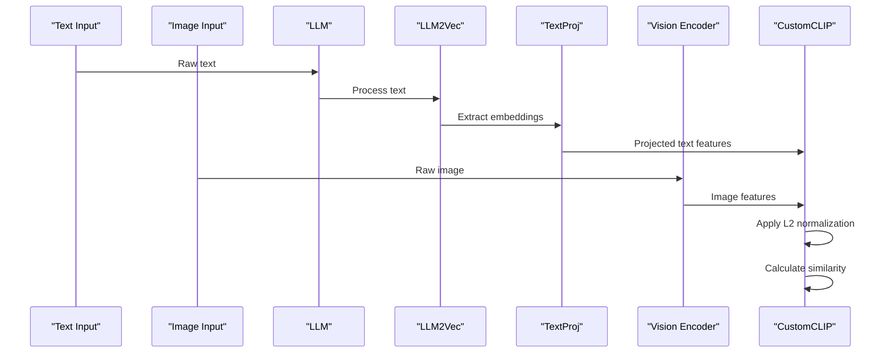

During the forward pass:
1. Text input is processed by the LLM and LLM2Vec to extract embeddings
2. The extracted embeddings are projected into CLIP's embedding space
3. Images are processed by the vision encoder to extract visual features
4. Both features are normalized and their similarity is calculated

Sources: [llm2clip/eva_clip/model.py:346-360](), [llm2clip/eva_clip/llm_model.py:27-32]()

## Configuration Options

LLM2CLIP provides extensive configuration options for both vision and text encoders:

### Vision Configuration

The CLIPVisionCfg class defines vision encoder configuration:

| Parameter | Description | Default Value |
|-----------|-------------|---------------|
| layers | Number of transformer layers | 12 |
| width | Model dimension | 768 |
| patch_size | Image patch size | 16 |
| image_size | Input image dimensions | 224 |
| head_width | Width per attention head | 64 |
| mlp_ratio | MLP expansion ratio | 4.0 |
| eva_model_name | EVA model identifier | None |
| timm_model_name | Timm model identifier | None |
| drop_path_rate | Drop path rate | None |

### Text Configuration

The CLIPTextCfg class defines text encoder configuration:

| Parameter | Description | Default Value |
|-----------|-------------|---------------|
| use_embedding | Whether to use embeddings directly | True |
| llm_embedding_dim | LLM embedding dimension | 4096 |
| context_length | Maximum sequence length | 77 |
| vocab_size | Size of vocabulary | 49408 |
| width | Model dimension | 512 |
| heads | Number of attention heads | 8 |
| layers | Number of transformer layers | 12 |
| hf_model_name | HuggingFace model identifier | None |
| pooler_type | Pooling mechanism | "mean_pooler" |

Sources: [llm2clip/eva_clip/model.py:36-84]()

## Technical Implementation Details

### Model Initialization

The CustomCLIP model is initialized with separate vision and text encoders:

```python
def __init__(self, embed_dim, vision_cfg, text_cfg, quick_gelu=False, cast_dtype=None, itm_task=False):
    super().__init__()
    self.visual = _build_vision_tower(embed_dim, vision_cfg, quick_gelu, cast_dtype)
    self.text = _build_text_tower(embed_dim, text_cfg, quick_gelu, cast_dtype)
    self.logit_scale = nn.Parameter(torch.ones([]) * np.log(1 / 0.07))
```

The `_build_vision_tower` and `_build_text_tower` functions create the appropriate encoder components based on the provided configurations.

### LLM2VecTextTransformer Implementation

The LLM2VecTextTransformer integrates the LLM into CLIP:

```python
def __init__(self, text_proj=None):
    super().__init__()
    enable_bidirectional = True
    base_model_name_or_path = "meta-llama/Llama-3.1-8B-Instruct"
    peft_path = "checkpoints/LLM2CLIP-Llama-3.1-8B"
    self.text = LLM2Vec.from_pretrained(
            base_model_name_or_path,
            peft_path,
            merge_peft = True,
            enable_bidirectional=enable_bidirectional,
            attn_implementation = "flash_attention_2",
            torch_dtype=torch.bfloat16
        )
    self.text_proj = text_proj
```

During the forward pass, text is processed through the LLM and optionally projected:

```python
def forward(self, text, batch_size=32): 
    with torch.autocast("cuda"):        
        x = self.text.encode(text, batch_size=batch_size).to(torch.float16)
        if self.text_proj is not None:
            x = self.text_proj(x, l2_norm=False)
    return x
```

Sources: [llm2clip/eva_clip/llm_model.py:5-36]()

## System Capabilities and Constraints

### Capabilities

- **Enhanced Text Understanding**: Leverages LLM's advanced language understanding for richer text representations
- **Extended Context Window**: Supports longer text inputs beyond CLIP's traditional 77-token limit
- **Cross-Language Support**: Enables cross-lingual retrieval even when trained only on English data
- **Flexible Architecture**: Supports multiple vision encoder architectures and LLM models
- **Parameter Efficiency**: Allows freezing LLM parameters while fine-tuning only the vision encoder

### Constraints

- **Computational Requirements**: Requires significant computational resources to run large language models
- **Memory Usage**: High memory requirements for model inference
- **Pre-extraction Needs**: May require pre-extraction of LLM embeddings for efficient processing
- **Training Complexity**: Multi-stage training process with different loss functions

Sources: [README.md:20-45]()

## Conclusion

The LLM2CLIP architecture successfully integrates large language models with CLIP's vision-language framework, providing enhanced multimodal representations. By leveraging the advanced text understanding capabilities of LLMs, the system overcomes traditional limitations of CLIP models, such as limited context windows and weak text comprehension. The modular design supports various vision encoder architectures and LLM models, enabling flexible adaptation to different use cases.

Sources: [README.md:18-45](), [llm2clip/eva_clip/model.py](), [llm2clip/eva_clip/llm_model.py]()

---

# Page: CLIP Model Architecture

# CLIP Model Architecture

<details>
<summary>Relevant source files</summary>

The following files were used as context for generating this wiki page:

- [llm2clip/eva_clip/__init__.py](llm2clip/eva_clip/__init__.py)
- [llm2clip/eva_clip/model.py](llm2clip/eva_clip/model.py)

</details>


This document provides a technical overview of the CLIP (Contrastive Language-Image Pre-training) model architecture as implemented in the LLM2CLIP codebase. It focuses specifically on the core CLIP model components and how they're implemented, including both the standard and customized versions used in this project. For information about how LLMs are integrated with CLIP, see [LLM Integration](#2.2).

## Overview

The CLIP model in LLM2CLIP follows the core architecture introduced by OpenAI, consisting of paired vision and text encoders designed to create aligned embeddings. LLM2CLIP extends this architecture with custom modifications for integrating Large Language Models.

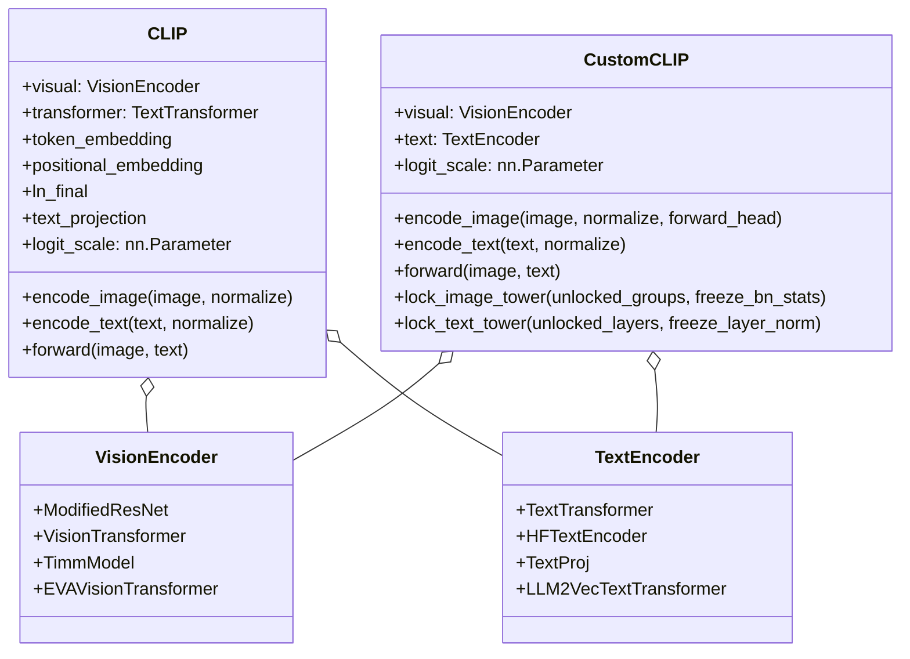

Sources: [eva_clip/model.py:1-500](eva_clip/model.py:1-500), [eva_clip/__init__.py:1-12](eva_clip/__init__.py:1-12)

## CLIP and CustomCLIP Classes

LLM2CLIP implements two core CLIP model classes:

1. **CLIP**: The standard implementation based on OpenAI's architecture
2. **CustomCLIP**: An extended version designed specifically for LLM2CLIP

### Standard CLIP Class

The `CLIP` class represents a traditional CLIP architecture with integrated text transformer:

```mermaid
graph TD
    subgraph "CLIP Class Functionality"
        I["Image Input"] --> VE["self.visual (Vision Encoder)"]
        T["Text Input"] --> TE["self.transformer (Text Transformer)"]
        TE --> TokEmb["self.token_embedding"]
        TE --> PosEmb["self.positional_embedding"]
        TokEmb & PosEmb --> Trans["Transformer"]
        Trans --> LN["self.ln_final"]
        LN --> TP["self.text_projection"]
        VE --> ImgFeat["Image Features"]
        TP --> TextFeat["Text Features"]
        ImgFeat & TextFeat --> Norm["F.normalize()"]
        Norm --> Sim["Similarity Matrix"]
        LS["self.logit_scale.exp()"] --> Sim
    end
```

The `CLIP` class contains:
- A vision encoder (`self.visual`)
- Text transformer components:
  - Token embedding (`self.token_embedding`)
  - Positional embedding (`self.positional_embedding`)
  - Transformer layers (`self.transformer`)
  - Final layer normalization (`self.ln_final`)
  - Text projection layer (`self.text_projection`)
- A learnable temperature parameter (`self.logit_scale`)

Sources: [eva_clip/model.py:256-313](eva_clip/model.py:256-313)

### CustomCLIP Class

The `CustomCLIP` class provides a more flexible architecture, particularly for integrating external text encoders like LLMs:

```mermaid
graph TD
    subgraph "CustomCLIP Class Functionality"
        I["Image Input"] --> VE["self.visual (Vision Encoder)"]
        T["Text Input (or Embeddings)"] --> TE["self.text (Text Encoder)"]
        VE --> EI["encode_image()"]
        TE --> ET["encode_text()"]
        EI --> ImgFeat["Image Features"]
        ET --> TextFeat["Text Features"]
        ImgFeat & TextFeat --> Norm["F.normalize()"]
        Norm --> Sim["Similarity Matrix"]
        LS["self.logit_scale.exp()"] --> Sim
    end
```

The `CustomCLIP` class contains:
- A vision encoder (`self.visual`)
- A unified text encoder (`self.text`)
- A learnable temperature parameter (`self.logit_scale`)
- Additional methods to lock vision and text towers for partial fine-tuning

This architecture is more modular, replacing the integrated text transformer with a pluggable text encoder that can include an LLM-based encoder.

Sources: [eva_clip/model.py:315-360](eva_clip/model.py:315-360)

## Configuration Classes

Two configuration classes define the structure of the vision and text components:

### CLIPVisionCfg

The `CLIPVisionCfg` class configures the vision encoder with parameters such as:
- `layers`: Number of transformer layers or ResNet layer configuration
- `width`: Width of the transformer/ResNet
- `head_width`: Width per attention head
- `patch_size`: Size of image patches
- `image_size`: Input image dimensions
- `patch_dropout`: Dropout rate for patches during training
- `eva_model_name`: Name of EVA model to use
- `timm_model_name`: Name of timm model to use
- Other parameters for ViT configuration

Sources: [eva_clip/model.py:36-63](eva_clip/model.py:36-63)

### CLIPTextCfg

The `CLIPTextCfg` class configures the text encoder with parameters such as:
- `use_embedding`: Whether to use pre-computed embeddings
- `llm_embedding_dim`: Dimension of LLM embeddings
- `context_length`: Maximum text sequence length
- `vocab_size`: Size of the token vocabulary
- `width`: Transformer width
- `heads`: Number of attention heads
- `layers`: Number of transformer layers
- `hf_model_name`: Name of Hugging Face model to use
- `pooler_type`: Type of pooling to use
- Other transformer configuration parameters

Sources: [eva_clip/model.py:65-84](eva_clip/model.py:65-84)

## Vision Encoder Architecture

The vision encoder processes images into fixed-dimensional embeddings. LLM2CLIP supports multiple vision encoder architectures:

```mermaid
graph TD
    subgraph "Vision Encoder Options"
        VE["_build_vision_tower()"] --> EVA{"vision_cfg.eva_model_name?"}
        EVA -->|Yes| EVAVIT["EVAVisionTransformer"]
        EVA -->|No| TIMM{"vision_cfg.timm_model_name?"}
        TIMM -->|Yes| TIMMM["TimmModel"]
        TIMM -->|No| LAYERS{"layers is tuple/list?"}
        LAYERS -->|Yes| MRES["ModifiedResNet"]
        LAYERS -->|No| VIT["VisionTransformer"]
    end
```

1. **EVAVisionTransformer**: An advanced Vision Transformer based on the EVA architecture, used by default in LLM2CLIP
2. **TimmModel**: Leverages models from the timm library
3. **ModifiedResNet**: A customized ResNet architecture (used in original CLIP)
4. **VisionTransformer**: A standard Vision Transformer (used in original CLIP)

The vision encoder is configured through the `_build_vision_tower` function, which selects the appropriate architecture based on the configuration.

Sources: [eva_clip/model.py:94-171](eva_clip/model.py:94-171)

## Text Encoder Architecture

The text encoder converts text into embeddings aligned with the vision encoder's output space. LLM2CLIP supports several text encoder architectures:

```mermaid
graph TD
    subgraph "Text Encoder Options"
        TE["_build_text_tower()"] --> HF{"text_cfg.hf_model_name?"}
        HF -->|Yes| HFE["HFTextEncoder"]
        HF -->|No| EMB{"text_cfg.use_embedding?"}
        EMB -->|Yes| TP["TextProj"]
        EMB -->|No| LLM{"text_cfg.llm_embedding_dim?"}
        LLM -->|Yes| L2V["LLM2VecTextTransformer"]
        LLM -->|No| TT["TextTransformer"]
    end
```

1. **HFTextEncoder**: Uses Hugging Face transformer models
2. **TextProj**: A simple projection layer for pre-computed embeddings
3. **LLM2VecTextTransformer**: Integrates Large Language Models through the LLM2Vec module
4. **TextTransformer**: A standard transformer encoder (used in original CLIP)

The text encoder is constructed by the `_build_text_tower` function, which selects the appropriate architecture based on the configuration.

Sources: [eva_clip/model.py:174-214](eva_clip/model.py:174-214)

## TextProj Component

The `TextProj` class is a specialized component that projects pre-computed text embeddings (often from an LLM) to the CLIP embedding space:

```mermaid
graph TD
    subgraph "TextProj Architecture"
        TE["text embeddings input"] --> LN1["LinearBlock 1"]
        LN1 --> LN2["LinearBlock 2"]
        LN2 --> LN3["LinearBlock 3"]
        LN3 --> LN4["LinearBlock 4"]
        LN4 --> NORM["nn.LayerNorm"]
        NORM --> PROJ["nn.Linear"]
        PROJ --> OUT["projected embeddings"]
    end
```

The `TextProj` class contains:
- A series of `LinearBlock` modules (residual blocks with layer normalization)
- A final layer normalization
- A projection linear layer to match the CLIP embedding dimension

This component is crucial for adapting LLM outputs to the CLIP embedding space.

Sources: [eva_clip/model.py:217-254](eva_clip/model.py:217-254)

## Forward Pass Workflow

The standard forward pass through either CLIP model variant follows this process:

```mermaid
flowchart TD
    subgraph "CLIP/CustomCLIP Forward Pass"
        I["Image Input"] --> EI["encode_image()"]
        T["Text Input"] --> ET["encode_text()"]
        EI --> NI["Normalize Image Features"]
        ET --> NT["Normalize Text Features"]
        NI & NT --> RET["Return Features and Logit Scale"]
    end
```

1. **Image encoding**: The image is processed by the vision encoder
2. **Text encoding**: The text is processed by the text encoder
3. **Normalization**: Both embeddings are L2-normalized
4. **Output**: The model returns both embeddings and the exponentially scaled logit value

The `forward()` method combines these steps to enable contrastive learning between the modalities.

Sources: [eva_clip/model.py:308-312](eva_clip/model.py:308-312), [eva_clip/model.py:357-360](eva_clip/model.py:357-360)

## Key Differences Between CLIP and CustomCLIP

The main distinctions between the standard `CLIP` class and the `CustomCLIP` class are:

| Feature | CLIP | CustomCLIP |
|---------|------|------------|
| Text encoder design | Integrated components (transformer, embeddings, etc.) | Unified `text` encoder module |
| LLM integration | Not directly supported | Designed for LLM integration via `LLM2VecTextTransformer` |
| Tower locking | Only image tower | Both image and text towers |
| Forward head option | Not available | Supports `forward_head` parameter in `encode_image()` |
| Original design | Closer to OpenAI's implementation | Enhanced for LLM2CLIP use cases |

The `CustomCLIP` class is more appropriate for the LLM2CLIP system due to its enhanced modularity and support for LLM integration.

Sources: [eva_clip/model.py:256-360](eva_clip/model.py:256-360)

## Utility Functions

The module provides several utility functions for working with CLIP models:

1. **`convert_weights_to_lp`/`convert_weights_to_fp16`**: Converts model weights to low precision formats
2. **`convert_to_custom_text_state_dict`**: Converts state dictionaries between formats
3. **`build_model_from_openai_state_dict`**: Builds a CLIP model from an OpenAI checkpoint
4. **`trace_model`**: Creates a TorchScript traced version of the model

These utilities facilitate loading pre-trained models, format conversion, and optimization.

Sources: [eva_clip/model.py:363-499](eva_clip/model.py:363-499)

## Connection to LLM Integration

The CLIP model architecture in LLM2CLIP is designed to facilitate integration with Large Language Models through:

1. The modular `CustomCLIP` class that accepts different text encoders
2. The `LLM2VecTextTransformer` text encoder option
3. Support for embedding-based workflows via `TextProj`
4. The ability to selectively freeze or fine-tune model components

For details on how LLMs are specifically integrated with this architecture, see [LLM Integration](#2.2).

Sources: [eva_clip/model.py:192-196](eva_clip/model.py:192-196), [eva_clip/model.py:315-360](eva_clip/model.py:315-360)

---

# Page: LLM Integration

# LLM Integration

<details>
<summary>Relevant source files</summary>

The following files were used as context for generating this wiki page:

- [llm2clip/eva_clip/llm_model.py](llm2clip/eva_clip/llm_model.py)
- [llm2clip/llm2vec/__init__.py](llm2clip/llm2vec/__init__.py)
- [llm2clip/llm2vec/llm2vec.py](llm2clip/llm2vec/llm2vec.py)

</details>


This document explains how Large Language Models (LLMs) are integrated into the LLM2CLIP system through the LLM2Vec module. This integration enables LLM2CLIP to leverage the semantic understanding capabilities of modern LLMs while maintaining CLIP's cross-modal alignment between text and images.

For information about the specific bidirectional LLM model implementations used in the system, see [Bidirectional LLM Models](#2.3).

## Architecture Overview

The LLM integration in LLM2CLIP enhances the traditional CLIP model by replacing the standard text encoder with a more powerful LLM-based text encoder. This integration is achieved through two primary components:

1. **LLM2Vec**: A wrapper around pretrained LLMs that handles text encoding and embedding generation
2. **LLM2VecTextTransformer**: A module that integrates LLM2Vec into the CLIP architecture

### LLM Integration Architecture

```mermaid
flowchart TB
    subgraph "LLM2CLIP System"
        subgraph "Text Processing Pipeline"
            Text["Input Text"] --> Tokenizer["Tokenizer"]
            Tokenizer --> LLM["Large Language Model<br>(Llama, Mistral, etc.)"]
            LLM --> Pooling["Pooling Layer<br>(mean, weighted_mean, eos_token)"]
            Pooling --> TextEmbedding["Text Embedding"]
        end
        
        subgraph "CLIP Architecture"
            TextEmbedding --> L2VTT["LLM2VecTextTransformer"]
            L2VTT --> TextProj["Text Projection Layer"]
            
            Image --> VisionEncoder["CLIP Vision Encoder"]
            VisionEncoder --> ImageEmbedding["Image Embedding"]
            
            TextProj & ImageEmbedding --> Similarity["Cosine Similarity"]
        end
    end
```

Sources: [llm2clip/eva_clip/llm_model.py:5-36](), [llm2clip/llm2vec/llm2vec.py:46-91]()

## LLM2Vec Module

The `LLM2Vec` class serves as the core component that wraps around large language models to produce text embeddings. It handles model loading, tokenization, text processing, and embedding generation.

### Class Structure and Initialization

```mermaid
classDiagram
    class LLM2Vec {
        +model: AutoModel
        +tokenizer: AutoTokenizer
        +pooling_mode: str
        +max_length: int
        +doc_max_length: int
        +skip_instruction: bool
        +from_pretrained()
        +encode()
        +forward()
        +get_pooling()
        +prepare_for_tokenization()
        +tokenize()
        +save()
    }
    
    class LLM2VecTextTransformer {
        +text: LLM2Vec
        +text_proj
        +lock()
        +forward()
        +set_grad_checkpointing()
    }
    
    LLM2VecTextTransformer "1" --> "1" LLM2Vec : contains
```

`LLM2Vec` can be initialized from a pretrained model using the `from_pretrained` class method:

```python
LLM2Vec.from_pretrained(
    base_model_name_or_path,
    peft_model_name_or_path=None,
    merge_peft=False,
    enable_bidirectional=True,
    extra_model_name_or_path=None,
    **kwargs
)
```

Key parameters:
- `base_model_name_or_path`: Path or identifier of the base LLM
- `peft_model_name_or_path`: Path to PEFT adapter weights (optional)
- `merge_peft`: Whether to merge PEFT adapters into the base model
- `enable_bidirectional`: Whether to use bidirectional model variants
- `extra_model_name_or_path`: Additional model weights to load

Sources: [llm2clip/llm2vec/llm2vec.py:46-91](), [llm2clip/llm2vec/llm2vec.py:84-172]()

### Supported LLM Architectures

LLM2Vec supports multiple LLM architectures through model-specific implementations:

| Model Family | Bidirectional Implementation | Configuration Class |
|--------------|------------------------------|---------------------|
| Llama        | `LlamaBiModel`              | `LlamaConfig`       |
| Mistral      | `MistralBiModel`            | `MistralConfig`     |
| Gemma        | `GemmaBiModel`              | `GemmaConfig`       |
| Qwen2        | `Qwen2BiModel`              | `Qwen2Config`       |
| Phi3         | `Phi3BiModel`               | `Phi3Config`        |

The bidirectional implementation is selected based on the model configuration class:

```mermaid
flowchart TD
    Config["Model Configuration"] --> ConfigCheck["_get_model_class()"]
    ConfigCheck --> BiCheck{"enable_bidirectional?"}
    
    BiCheck -->|"No"| AutoModel["AutoModel"]
    BiCheck -->|"Yes"| ModelCheck{"Which config?"}
    
    ModelCheck -->|"LlamaConfig"| LlamaBi["LlamaBiModel"]
    ModelCheck -->|"MistralConfig"| MistralBi["MistralBiModel"]
    ModelCheck -->|"GemmaConfig"| GemmaBi["GemmaBiModel"]
    ModelCheck -->|"Qwen2Config"| Qwen2Bi["Qwen2BiModel"]
    ModelCheck -->|"Phi3Config"| Phi3Bi["Phi3BiModel"]
```

Sources: [llm2clip/llm2vec/llm2vec.py:65-82](), [llm2clip/llm2vec/llm2vec.py:25-31]()

## Text Encoding Workflow

The encoding process in LLM2Vec follows these key steps:

1. **Text Preparation**: Adds model-specific instruction formats
2. **Tokenization**: Converts text to token IDs
3. **Forward Pass**: Processes tokens through the LLM
4. **Pooling**: Applies pooling to generate fixed-size embeddings

```mermaid
flowchart LR
    Text["Input Text"] --> PrepText["prepare_for_tokenization()"]
    PrepText --> Tokenize["tokenize()"]
    Tokenize --> Forward["forward()"]
    Forward --> GetPool["get_pooling()"]
    GetPool --> Embed["Text Embedding"]
    
    subgraph "Pooling Strategies"
        Mean["mean"]
        WeightedMean["weighted_mean"]
        EOSToken["eos_token"]
        LastToken["last_token"]
        BOSToken["bos_token"]
    end
    
    GetPool -.-> Mean & WeightedMean & EOSToken & LastToken & BOSToken
```

### Instruction Formatting

Different LLM architectures require specific instruction formats, which are handled by the `prepare_for_tokenization` method:

| Model                         | Instruction Format                                              |
|-------------------------------|----------------------------------------------------------------|
| Llama-3-Instruct             | `<\|start_header_id\|>user<\|end_header_id\|>\n\n[TEXT]<\|eot_id\|>` |
| Phi-3.5-mini-instruct        | `<\|user\|>\n[TEXT]<\|end\|>\n`                                 |
| Mistral-7B-Instruct          | `[INST] [TEXT] [/INST]`                                         |
| Gemma-2                      | `<bos><start_of_turn>user\n[TEXT]<end_of_turn>`                |
| Qwen2-Instruct               | `<\|im_start\|>user\n[TEXT]<\|im_end\|>`                        |

Sources: [llm2clip/llm2vec/llm2vec.py:174-213]()

### Pooling Strategies

LLM2Vec supports multiple pooling strategies to generate fixed-size embeddings:

1. **Mean Pooling** (`mean`): Averages all token embeddings
2. **Weighted Mean Pooling** (`weighted_mean`): Weighted average where later tokens have higher weights
3. **EOS Token Pooling** (`eos_token`): Uses the embedding of the end-of-sequence token
4. **Last Token Pooling** (`last_token`): Uses the embedding of the last token
5. **BOS Token Pooling** (`bos_token`): Uses the embedding of the beginning-of-sequence token

The pooling strategy is specified during LLM2Vec initialization via the `pooling_mode` parameter.

Sources: [llm2clip/llm2vec/llm2vec.py:274-306]()

## LLM2VecTextTransformer

The `LLM2VecTextTransformer` class integrates LLM2Vec into the CLIP architecture by serving as the text encoder component. It initializes an LLM2Vec instance and provides a forward pass method that processes text inputs and returns embeddings compatible with CLIP's contrastive learning framework.

### Initialization and Forward Pass

```python
class LLM2VecTextTransformer(nn.Module):
    def __init__(self, text_proj=None):
        # Initialize LLM2Vec with a specified model
        self.text = LLM2Vec.from_pretrained(...)
        self.text_proj = text_proj
        
    def forward(self, text, batch_size=32): 
        # Generate embeddings using LLM2Vec
        x = self.text.encode(text, batch_size=batch_size)
        # Optional projection layer
        if self.text_proj is not None:
            x = self.text_proj(x, l2_norm=False)
        return x
        
    def lock(self):
        # Freeze LLM2Vec parameters
        for param in self.text.parameters():
            param.requires_grad = False
```

In the implementation, `LLM2VecTextTransformer` is initialized with a specific LLM model (Llama-3.1-8B-Instruct by default) and optional PEFT adapter weights, which can be merged with the base model for efficiency.

Sources: [llm2clip/eva_clip/llm_model.py:5-36]()

## Skip-Instruction Feature

The `skip_instruction` feature in LLM2Vec allows the model to focus only on the main content of the text, ignoring instruction prompts. This is implemented by:

1. Separating the instruction from the main content during tokenization using a special delimiter (`!@#$%^&*()`)
2. Creating an `embed_mask` that masks out instruction tokens
3. Applying this mask during the embedding process

This feature helps maintain consistent embeddings across different instruction formats by focusing only on the content being described, not the instructions themselves.

```mermaid
flowchart TD
    Input["Input: 'Instruction !@#$%^&*() Content'"] --> Tokenize["tokenize()"]
    Tokenize --> SplitText["Split at delimiter"]
    SplitText --> CreateMask["Create embed_mask"]
    CreateMask --> ApplyMask["Apply mask during embedding"]
    ApplyMask --> Content["Content-only embedding"]
```

Sources: [llm2clip/llm2vec/llm2vec.py:215-256](), [llm2clip/llm2vec/llm2vec.py:258-264]()

## Integration with CLIP Architecture

The final integration of LLM2Vec into CLIP creates a powerful multimodal model that combines the semantic understanding of LLMs with CLIP's vision capabilities:

```mermaid
flowchart TB
    subgraph "Traditional CLIP"
        TInput["Text Input"] --> TEncoder["Transformer Text Encoder"]
        IInput1["Image Input"] --> VEncoder1["Vision Encoder"]
        TEncoder --> TEmbed["Text Embedding"]
        VEncoder1 --> IEmbed1["Image Embedding"]
        TEmbed & IEmbed1 --> Sim1["Similarity"]
    end
    
    subgraph "LLM2CLIP"
        TInput2["Text Input"] --> LLM2VecTT["LLM2VecTextTransformer"]
        LLM2VecTT --> L2Vec["LLM2Vec"]
        L2Vec --> LLMEmbed["LLM Embedding"]
        LLMEmbed --> Proj["Optional Projection"]
        IInput2["Image Input"] --> VEncoder2["Vision Encoder"]
        Proj --> TEmbed2["Text Embedding"]
        VEncoder2 --> IEmbed2["Image Embedding"]
        TEmbed2 & IEmbed2 --> Sim2["Similarity"]
    end
```

This integration enhances CLIP's text understanding capabilities while maintaining its cross-modal alignment between text and images.

Sources: [llm2clip/eva_clip/llm_model.py:5-36](), [llm2clip/llm2vec/llm2vec.py:46-91]()

## Encoding Implementation

The actual encoding of text inputs is handled by the `encode` method in LLM2Vec, which:

1. Prepares the input text with model-specific formatting
2. Tokenizes the text in batches
3. Processes the tokens through the LLM
4. Applies the appropriate pooling strategy
5. Returns the resulting embeddings

The encoding process can be configured with parameters like `batch_size`, `convert_to_tensor`, and `device` to optimize performance based on available hardware.

Sources: [llm2clip/llm2vec/llm2vec.py:339-411](), [llm2clip/llm2vec/llm2vec.py:435-457]()

## Summary

The LLM integration in LLM2CLIP represents a significant enhancement to the traditional CLIP architecture by leveraging the semantic understanding capabilities of large language models. Through the LLM2Vec module and LLM2VecTextTransformer, LLM2CLIP enables more sophisticated text encoding while maintaining cross-modal alignment with images.

Key features of this integration include:
- Support for multiple LLM architectures
- Bidirectional processing capabilities
- Flexible pooling strategies
- Skip-instruction functionality
- Efficient parameter management through PEFT

These enhancements enable LLM2CLIP to achieve superior performance in cross-modal retrieval and zero-shot classification tasks compared to traditional CLIP models.

---

# Page: Bidirectional LLM Models

# Bidirectional LLM Models

<details>
<summary>Relevant source files</summary>

The following files were used as context for generating this wiki page:

- [llm2clip/llm2vec/models/__init__.py](llm2clip/llm2vec/models/__init__.py)
- [llm2clip/llm2vec/models/attn_mask_utils.py](llm2clip/llm2vec/models/attn_mask_utils.py)
- [llm2clip/llm2vec/models/bidirectional_gemma.py](llm2clip/llm2vec/models/bidirectional_gemma.py)
- [llm2clip/llm2vec/models/bidirectional_llama.py](llm2clip/llm2vec/models/bidirectional_llama.py)
- [llm2clip/llm2vec/models/bidirectional_mistral.py](llm2clip/llm2vec/models/bidirectional_mistral.py)

</details>


## Purpose and Scope

This page documents the bidirectional large language model (LLM) implementations used in the LLM2CLIP system. Unlike standard autoregressive LLMs that use causal masking to attend only to previous tokens, these bidirectional models are modified to attend to tokens in both directions, enabling more effective text representation learning. This bidirectional capability is particularly important for the Masked Next Token Prediction (MNTP) training objective used in LLM2CLIP. For information about how these models are integrated with CLIP, see [LLM Integration](#2.2).

Sources: [llm2clip/llm2vec/models/__init__.py:1-5]()

## Bidirectional vs. Causal Attention

Standard autoregressive language models use causal attention, where each token can only attend to itself and previous tokens in the sequence. In contrast, bidirectional models allow tokens to attend to both previous and future tokens, similar to BERT-style masked language models.

```mermaid
graph LR
    subgraph "Causal Attention"
        A1["Token 1"] --> A1
        A1 --> A2["Token 2"]
        A1 --> A3["Token 3"]
        A2 --> A2
        A2 --> A3
        A3 --> A3
    end

    subgraph "Bidirectional Attention"
        B1["Token 1"] <--> B2["Token 2"]
        B1 <--> B3["Token 3"]
        B2 <--> B3
        B1 --> B1
        B2 --> B2
        B3 --> B3
    end
```

In the LLM2CLIP system, original decoder-only models (Llama, Mistral, etc.) are modified to support bidirectional attention by removing the causal mask constraint, allowing tokens to attend to future tokens during processing.

Sources: [llm2clip/llm2vec/models/bidirectional_llama.py:157-159](), [llm2clip/llm2vec/models/bidirectional_gemma.py:154-156]()

## Supported Model Architectures

LLM2CLIP implements bidirectional variants for several popular LLM architectures:

| Model Family | Base Model Class | Bidirectional Model Class | MNTP Model Class |
|--------------|------------------|---------------------------|-----------------|
| Mistral | MistralModel | MistralBiModel | MistralBiForMNTP |
| Llama | LlamaModel | LlamaBiModel | LlamaBiForMNTP |
| Gemma | GemmaModel | GemmaBiModel | GemmaBiForMNTP |
| Qwen2 | Qwen2Model | Qwen2BiModel | Qwen2BiForMNTP |
| Phi3 | Phi3Model | Phi3BiModel | Phi3BiForMNTP |

Each model family follows a similar pattern of implementation, with two main classes:
- `*BiModel`: The base bidirectional model that handles token embeddings and attention
- `*BiForMNTP`: The model with a language modeling head for Masked Next Token Prediction

Sources: [llm2clip/llm2vec/models/__init__.py:1-5]()

## Implementation Architecture

The implementation follows a consistent pattern across all model families:

```mermaid
classDiagram
    class ModifiedAttention {
        is_causal: False
        forward()
    }

    class ModifiedDecoderLayer {
        self_attn: ModifiedAttention
        mlp: MLP
        input_layernorm: RMSNorm
        post_attention_layernorm: RMSNorm
        forward()
    }

    class BiModel {
        embed_tokens: Embedding
        layers: ModuleList[ModifiedDecoderLayer]
        norm: RMSNorm
        _update_causal_mask()
        forward()
    }

    class BiForMNTP {
        model: BiModel
        lm_head: Linear
        get_model_for_peft()
        set_model_for_peft()
        save_peft_model()
        forward()
    }

    ModifiedDecoderLayer --> ModifiedAttention
    BiModel --> ModifiedDecoderLayer
    BiForMNTP --> BiModel
```

Sources: [llm2clip/llm2vec/models/bidirectional_mistral.py:32-76](), [llm2clip/llm2vec/models/bidirectional_llama.py:46-85](), [llm2clip/llm2vec/models/bidirectional_gemma.py:37-73]()

## Key Modifications for Bidirectionality

### 1. Modified Attention Classes

Each model architecture has three attention implementations modified for bidirectional processing:

```mermaid
graph TD
    subgraph "Model-Specific Attention Implementations"
        A1["XxxAttention<br>(Eager implementation)"] --> MA1["ModifiedXxxAttention<br>is_causal = False"]
        A2["XxxFlashAttention2<br>(Flash Attention 2)"] --> MA2["ModifiedXxxFlashAttention2<br>is_causal = False"] 
        A3["XxxSdpaAttention<br>(Scaled Dot-Product Attention)"] --> MA3["ModifiedXxxSdpaAttention<br>is_causal = False"]
    end

    subgraph "Attention Registry"
        D["ATTENTION_CLASSES Dict"] --> MA1
        D --> MA2
        D --> MA3
    end
```

Where "Xxx" represents model-specific prefixes (Llama, Mistral, Gemma, etc.) and each attention class is modified by:
1. Inheriting from the original implementation
2. Setting `is_causal = False` to disable causal masking

Sources: [llm2clip/llm2vec/models/bidirectional_mistral.py:32-54](), [llm2clip/llm2vec/models/bidirectional_llama.py:46-68](), [llm2clip/llm2vec/models/bidirectional_gemma.py:37-59]()

### 2. Causal Mask Override

Each bidirectional model overrides the `_update_causal_mask` method to modify the original causal mask behavior:

1. Creating a zero tensor instead of a filled tensor with minimum float values
2. Commenting out the causal masking logic that fills the upper triangle
3. Maintaining padding mask functionality for proper handling of padding tokens

```python
# Original (commented out in bidirectional implementation):
# if sequence_length != 1:
#     causal_mask = torch.triu(causal_mask, diagonal=1)
```

Sources: [llm2clip/llm2vec/models/bidirectional_llama.py:154-159](), [llm2clip/llm2vec/models/bidirectional_gemma.py:151-156](), [llm2clip/llm2vec/models/bidirectional_mistral.py:192-208]()

### 3. Custom Attention Mask Utilities

The system provides utilities for preparing attention masks specifically for bidirectional attention:

- `_prepare_4d_causal_attention_mask`: Prepares 4D attention masks for regular attention implementations
- `_prepare_4d_causal_attention_mask_for_sdpa`: Prepares masks for Scaled Dot-Product Attention (SDPA)

Both utilities are modified to work with bidirectional attention by initializing the `AttentionMaskConverter` with `is_causal=False`.

Sources: [llm2clip/llm2vec/models/attn_mask_utils.py:6-160](), [llm2clip/llm2vec/models/bidirectional_mistral.py:192-208]()

## Integration with PEFT

The bidirectional models are designed to work with Parameter-Efficient Fine-Tuning (PEFT) techniques. Each `*BiForMNTP` class includes methods for PEFT integration:

```python
# getter for PEFT model
def get_model_for_peft(self):
    return self.model

# setter for PEFT model
def set_model_for_peft(self, model: PeftModel):
    self.model = model

# save the PEFT model
def save_peft_model(self, path):
    self.model.save_pretrained(path)
```

This allows efficient fine-tuning of the bidirectional models with techniques like LoRA (Low-Rank Adaptation).

Sources: [llm2clip/llm2vec/models/bidirectional_mistral.py:287-297](), [llm2clip/llm2vec/models/bidirectional_llama.py:217-227](), [llm2clip/llm2vec/models/bidirectional_gemma.py:202-212]()

## Usage in LLM2CLIP

In the LLM2CLIP system, these bidirectional models serve as the foundation for the Masked Next Token Prediction (MNTP) training stage. The bidirectional capability allows the model to effectively predict masked tokens by considering the full context, not just the preceding tokens.

```mermaid
graph TD
    subgraph "Bidirectional LLM Models"
        LL["LlamaBiForMNTP"] 
        MM["MistralBiForMNTP"]
        GG["GemmaBiForMNTP"]
        QQ["Qwen2BiForMNTP"]
        PP["Phi3BiForMNTP"]
    end
    
    subgraph "Training Stage 1"
        MNTP["Masked Next Token<br>Prediction"]
    end
    
    subgraph "Training Stage 2"
        SCL["Caption-to-Caption<br>Contrastive Learning"]
    end
    
    subgraph "LLM2Vec"
        L2V["LLM2Vec Text<br>Embedding Module"]
    end
    
    MNTP --> LL & MM & GG & QQ & PP
    LL & MM & GG & QQ & PP -.-> L2V
    L2V --> SCL
```

The bidirectional architecture enables these models to capture richer contextual representations, which are crucial for the subsequent contrastive learning phase and ultimately for aligning text and image embeddings in the CLIP model.

Sources: [llm2clip/llm2vec/models/__init__.py:1-5]()

---

# Page: Training Pipeline

# Training Pipeline

<details>
<summary>Relevant source files</summary>

The following files were used as context for generating this wiki page:

- [README.md](README.md)
- [docs/index.html](docs/index.html)
- [docs/static/images/logo.png](docs/static/images/logo.png)
- [docs/static/images/radar_paper(4).png](docs/static/images/radar_paper(4).png)
- [llm2clip/run.sh](llm2clip/run.sh)
- [llm2clip/training/eval_datasets.yaml](llm2clip/training/eval_datasets.yaml)

</details>


## Purpose and Scope

This document describes the end-to-end training pipeline for LLM2CLIP, a system that enhances CLIP (Contrastive Language-Image Pre-training) models by leveraging large language models (LLMs). The training pipeline encompasses data preparation, model training configurations, and evaluation methodologies. For information about the underlying model architecture, see [System Architecture](#2) and [CLIP Model Architecture](#2.1).

## Overview

The LLM2CLIP training pipeline improves CLIP's capabilities through a two-stage approach that leverages LLMs to enhance visual representations. The process begins with data preparation, followed by training with specific loss functions, and concludes with comprehensive evaluation across multiple benchmarks.

```mermaid
flowchart TD
    subgraph "Data Preparation"
        DD["download_dataset.sh<br>Download Training Data"]
        EE["extract_embedding.py<br>Extract LLM Embeddings"]
        ESD["setup_eval_datasets.sh<br>Prepare Eval Datasets"]
        EEE["extract_eval_embedding.py<br>Extract Eval Embeddings"]
    end
    
    subgraph "Training Process"
        TP["run.sh<br>Launch training/main.py"]
        
        subgraph "Two-Stage Training"
            MNTP["Stage 1: Masked Next<br>Token Prediction"]
            CCL["Stage 2: Caption-to-Caption<br>Contrastive Learning<br>(SimCSE loss)"]
        end
        
        subgraph "Model Components"
            LLM["LLM Text Encoder<br>(Frozen during training)"]
            CLIP_V["CLIP Visual Encoder<br>(Fine-tuned)"]
        end
        
        TP --> MNTP
        MNTP --> CCL
        CCL --> LLM
        LLM --> CLIP_V
    end
    
    subgraph "Evaluation"
        EM["evaluate_retrieval.py"]
        ZS["Zero-shot Evaluation"]
        CR["Cross-modal Retrieval"]
    end
    
    DD --> EE
    EE --> TP
    ESD --> EEE
    EEE --> EM
    
    CLIP_V --> EM
    LLM --> EM
    EM --> ZS
    EM --> CR
```

Sources: [README.md:61-88](), [run.sh:1-43]()

## Data Preparation

The training pipeline begins with comprehensive data preparation, which is critical for the effectiveness of the LLM2CLIP approach.

### Training Datasets

LLM2CLIP uses several large-scale image-caption datasets:

- **CC3M (Conceptual Captions 3M)**: 3 million image-caption pairs
- **CC12M (Conceptual Captions 12M)**: 12 million image-caption pairs 
- **YFCC15M**: A subset of the YFCC100M dataset with 15 million image-caption pairs

These datasets are downloaded and prepared in WebDataset format (TAR archives) using the download script:

```mermaid
flowchart LR
    subgraph "Training Data Preparation"
        DD["download_dataset.sh"] --> |"DATASET=cc3m/cc12m/yfcc15m"| WD["WebDataset Format<br>(TAR Archives)"]
        WD --> EE["extract_embedding.py"]
        EE --> |"Extract LLM Embeddings"| FE["Feature Embeddings"]
    end
```

Sources: [README.md:74-77]()

### Evaluation Datasets

The evaluation pipeline uses several benchmark datasets to assess model performance:

- **Flickr30k**: Image-caption retrieval benchmark
- **COCO**: MS COCO dataset for image-caption retrieval
- **ShareGPT4V**: GPT-4V-based evaluation dataset
- **Urban1k**: Urban scene image-text dataset
- **DOCCI**: Dense visual captioning benchmark

These evaluation datasets are configured in `eval_datasets.yaml` which specifies the dataset details including paths to annotations, images, and pre-extracted LLM features.

```mermaid
flowchart LR
    subgraph "Evaluation Data Preparation"
        ESD["setup_eval_datasets.sh"] --> ED["Evaluation Datasets"]
        ED --> EEE["extract_eval_embedding.py"]
        EEE --> |"Extract LLM Embeddings"| EF["Evaluation Features"]
    end
```

Sources: [README.md:80-81](), [training/eval_datasets.yaml:1-25]()

## Training Process

The LLM2CLIP training process is orchestrated by the `run.sh` script, which configures and launches the training pipeline with appropriate parameters.

### Training Configuration

The primary configuration parameters include:

| Parameter | Value | Description |
|-----------|-------|-------------|
| Model | EVA02-CLIP-L-14-336 | Base CLIP model architecture |
| Batch Size | 512 | Training batch size |
| Eval Batch Size | 1024 | Evaluation batch size |
| Learning Rate | 1e-5 | Base learning rate |
| Visual LR | 1e-5 | Visual encoder learning rate |
| Text LR | 1e-5 | Text encoder learning rate |
| Epochs | 20 | Number of training epochs |
| Optimizer | ap_adamw | AdamW with automatic precision |
| Precision | fp16 | Mixed precision training |

Sources: [run.sh:1-43]()

### Dataset Pipeline

The training pipeline ingests WebDataset-formatted data, which is processed by the data pipeline:

```mermaid
flowchart TD
    subgraph "Data Processing Pipeline"
        DP["training/data.py"] --> GD["get_data()"]
        
        GD --> WDS["get_wds_dataset()<br>WebDataset Processing"]
        WDS --> RC["Resampling and Caching"]
        RC --> BT["Batching and Tokenization"]
        BT --> TR["To Training Loop"]
    end
```

The datasets are configured in the `run.sh` script using the `--train-data-list` parameter, which specifies multiple datasets with their respective paths and sample counts. The system supports dataset resampling with the `--dataset-resampled` flag.

Sources: [run.sh:13-14]()

### Two-Stage Training Approach

LLM2CLIP employs a two-stage training approach:

1. **Masked Next Token Prediction (MNTP)**:
   - Initial stage to help the model understand textual semantics
   - Prepares the model for the contrastive learning stage
   - Has minimal impact on final results but provides a foundation

2. **Caption-to-Caption Contrastive Learning (SimCSE loss)**:
   - Core training stage that aligns different captions of the same image
   - Uses supervised SimCSE loss with captions from the same image as positive samples
   - Captions from different images serve as negative samples
   - Enables the LLM to provide meaningful supervision signals to the visual encoder

During training, the LLM's gradients are frozen (the LLM is only used for feature extraction), while the CLIP visual encoder is fine-tuned, making the training process computationally efficient.

```mermaid
flowchart TD
    subgraph "Two-Stage Training Flow"
        INP["Input: Image-Caption Pairs"] --> MNTP["Stage 1: Masked Next Token Prediction"]
        MNTP --> CCL["Stage 2: Caption-to-Caption Contrastive Learning"]
        
        subgraph "MNTP Details"
            M_INP["Caption Text"] --> M_MASK["Random Token Masking"]
            M_MASK --> M_PRED["Predict Masked Tokens"]
        end
        
        subgraph "CCL Details"
            C_INP["Multiple Captions<br>Per Image"] --> C_ENC["LLM Encoding"]
            C_ENC --> C_LOSS["SimCSE Contrastive Loss"]
            C_LOSS --> C_OUT["Update Visual Encoder"]
        end
    end
```

Sources: [README.md:127-140]()

### Loss Functions

LLM2CLIP uses two primary loss functions:

1. **Masked Next Token Prediction Loss**:
   - Standard language model prediction objective
   - Applied in the first stage of training

2. **Supervised SimCSE Loss**:
   - Contrastive loss that treats captions from the same image as positive pairs
   - Captions from different images serve as negative pairs
   - The key component that enables the LLM to provide supervision to the visual encoder

The training process employs a mixed dataset approach, combining caption datasets (CC3M, CC12M) with pure text datasets (like Wikitext-103) to maintain the LLM's original distribution while reducing potential bias from captions.

Sources: [README.md:127-140]()

## Evaluation Process

The evaluation process assesses model performance across multiple benchmarks and tasks.

### Evaluation Datasets Configuration

The evaluation datasets are configured in `training/eval_datasets.yaml`, which specifies:
- Dataset name
- Path to JSON annotation files
- Image root directories
- Pre-extracted LLM feature paths

```mermaid
flowchart LR
    subgraph "Evaluation Pipeline"
        EM["evaluate_retrieval.py"] --> |"Load Models"| LM["Load Trained Models"]
        LM --> |"Process Datasets"| ED["Process Evaluation Datasets"]
        ED --> |"Compute Metrics"| MET["Compute Retrieval Metrics"]
        MET --> |"Report Results"| RES["Report Performance"]
    end
    
    subgraph "Evaluation Metrics"
        I2T["Image-to-Text Retrieval"]
        T2I["Text-to-Image Retrieval"]
        CRA["Caption Retrieval Accuracy"]
        XLING["Cross-Lingual Performance"]
    end
    
    RES --> I2T
    RES --> T2I
    RES --> CRA
    RES --> XLING
```

Sources: [training/eval_datasets.yaml:1-25]()

### Zero-Shot Evaluation

The training pipeline performs regular zero-shot evaluations during training, controlled by the `--zeroshot-frequency` parameter. This helps monitor how the model generalizes to unseen tasks and datasets throughout the training process.

### Cross-Modal Retrieval Evaluation

The primary evaluation metric for LLM2CLIP is cross-modal retrieval performance, which measures:

- **Image-to-Text (I2T) Retrieval**: Retrieving relevant captions given an image query
- **Text-to-Image (T2I) Retrieval**: Retrieving relevant images given a text query

Performance is reported using standard retrieval metrics such as Recall@K (R@1, R@5, R@10), which represents the percentage of queries where the correct match is found within the top K retrieved results.

### Caption Retrieval Accuracy

A unique evaluation metric for LLM2CLIP is Caption Retrieval Accuracy (CRA), which measures the text model's ability to differentiate between captions. This metric helps determine which language model is better suited for CLIP training.

Sources: [README.md:123-140]()

## Conclusion

The LLM2CLIP training pipeline enables efficient integration of LLMs with CLIP models to enhance visual representation learning. Through its two-stage approach, the system leverages the textual understanding capabilities of LLMs while maintaining computational efficiency by freezing LLM gradients. The comprehensive evaluation methodology ensures that model improvements are well-documented across diverse tasks and benchmarks.

---

# Page: Data Preparation

# Data Preparation

<details>
<summary>Relevant source files</summary>

The following files were used as context for generating this wiki page:

- [llm2clip/data/README.md](llm2clip/data/README.md)
- [llm2clip/data/download_dataset.sh](llm2clip/data/download_dataset.sh)
- [llm2clip/data/extract_embedding.py](llm2clip/data/extract_embedding.py)
- [llm2clip/data/extract_eval_embedding.py](llm2clip/data/extract_eval_embedding.py)
- [llm2clip/data/setup_eval_datasets.sh](llm2clip/data/setup_eval_datasets.sh)
- [llm2clip/training/data.py](llm2clip/training/data.py)

</details>


This document explains the data preparation process for the LLM2CLIP system. It covers how training and evaluation datasets are downloaded, processed, and prepared for use in the training pipeline. For information on the actual training process, see [Training Process](#3.2).

## Overview

Before training the LLM2CLIP model, several data preparation steps are required:

1. Downloading training datasets (CC3M, CC12M, YFCC15M)
2. Extracting LLM embeddings from these datasets
3. Setting up evaluation datasets for model validation
4. Extracting embeddings for evaluation datasets

These steps ensure that the data is properly formatted and augmented with the necessary LLM-derived embeddings that are essential for the training process.

### Data Preparation Workflow

```mermaid
flowchart TD
    subgraph "Training Data Preparation"
        A["download_dataset.sh"] -->|"Downloads image-text pairs"| B["Dataset in WebDataset format"]
        B --> C["extract_embedding.py"]
        C -->|"Extracts LLM embeddings"| D["Text embeddings in .tar files"]
    end
    
    subgraph "Evaluation Data Preparation"
        E["setup_eval_datasets.sh"] -->|"Downloads evaluation datasets"| F["Evaluation datasets<br>(Flickr30k, COCO, etc.)"]
        F --> G["extract_eval_embedding.py"]
        G -->|"Extracts LLM embeddings"| H["Evaluation text embeddings<br>.dpt files"]
    end
    
    D --> I["Training Pipeline"]
    H --> I
```

Sources: [data/download_dataset.sh:1-45](), [data/extract_embedding.py:1-83](), [data/setup_eval_datasets.sh:1-28](), [data/extract_eval_embedding.py:1-154]()

## Training Data Download

The repository provides a script to download training datasets with both short and long captions. Three datasets are supported:

- **CC3M**: Conceptual Captions 3M
- **CC12M**: Conceptual Captions 12M
- **YFCC15M**: Yahoo Flickr Creative Commons 15M

### Download Script Process

```mermaid
flowchart LR
    A["download_dataset.sh"] -->|"1. Downloads"| B["CSV file with URLs and captions"]
    B -->|"2. Converts"| C["Parquet format"]
    C -->|"3. Uses img2dataset"| D["WebDataset format (.tar)"]
    D -->|"Contains"| E["Images + Multiple caption versions"]
```

### Usage

```bash
# Choose dataset: cc3m, cc12m, or yfcc15m
DATASET=cc3m
bash download_dataset.sh $DATASET
```

The script:
1. Downloads a CSV file containing image URLs and captions (including short and long versions generated with various methods)
2. Converts the CSV to Parquet format
3. Uses `img2dataset` to download images and create WebDataset TAR archives
4. Saves multiple caption types in the resulting dataset:
   - Raw captions
   - Short/long captions generated with different models (SV, IB, LLA)

Sources: [data/download_dataset.sh:1-45](), [data/README.md:1-7]()

## Embedding Extraction

After downloading the dataset, LLM embeddings need to be extracted from the text captions using the `extract_embedding.py` script.

### Embedding Extraction Process

```mermaid
flowchart TD
    A["extract_embedding.py"] -->|"Loads"| B["WebDataset (.tar files)"]
    B -->|"Extracts"| C["Captions (shortSV_captions<br>longSV_captions)"]
    A -->|"Initializes"| D["LLM2Vec with<br>Llama-3-8B-Instruct model"]
    C --> E["Compute embeddings<br>with LLM2Vec"]
    D --> E
    E -->|"Saves"| F["_text_embeddings.tar files"]
```

### Usage

```bash
python extract_embedding.py --data_path $DATASET
```

The script handles the following tasks:
1. Initializes the LLM2Vec model using a pre-trained Llama-3-8B-Instruct model
2. Processes each WebDataset TAR file
3. Extracts both short and long captions
4. Computes LLM embeddings for these captions
5. Saves the embeddings in corresponding TAR files with the suffix `_text_embeddings.tar`

The embedding extraction focuses on two specific caption types:
- `shortSV_captions`: Short captions generated with the SV model
- `longSV_captions`: Long captions generated with the SV model

Sources: [data/extract_embedding.py:1-83](), [data/README.md:1-7]()

## Evaluation Dataset Setup

The system includes a script to set up evaluation datasets for validating model performance:

### Evaluation Datasets

```mermaid
flowchart LR
    A["setup_eval_datasets.sh"] -->|"Downloads and prepares"| B["Evaluation Datasets"]
    B --> C["Flickr30k"]
    B --> D["COCO"]
    B --> E["ShareGPT4V"]
    B --> F["Urban1k"]
    B --> G["DOCCI"]
```

### Usage

```bash
bash setup_eval_datasets.sh
```

The script:
1. Creates necessary directory structures for each evaluation dataset
2. Downloads annotation files and metadata
3. Provides instructions to manually download the image files for each dataset

After running this script, you will need to download the actual image files for each dataset and update the paths in the configuration files as needed.

Sources: [data/setup_eval_datasets.sh:1-28](), [data/README.md:8-11]()

## Evaluation Embedding Extraction

Similar to training data, embeddings need to be extracted for evaluation datasets:

### Evaluation Embedding Process

```mermaid
flowchart TD
    A["extract_eval_embedding.py"] -->|"Loads"| B["LLM2Vec with<br>Llama-3-8B-Instruct model"]
    A -->|"Processes"| C["Evaluation Datasets"]
    C --> D["Flickr30k"]
    C --> E["COCO"]
    C --> F["ShareGPT4V"]
    C --> G["Urban1k"]
    C --> H["DOCCI"]
    B -->|"Computes embeddings"| I["Dataset-specific processing"]
    D & E & F & G & H --> I
    I -->|"Saves"| J["Tensor files (.dpt)"]
```

### Usage

```bash
python extract_eval_embedding.py
```

The script:
1. Initializes the LLM2Vec model using the same pre-trained Llama model as for training data
2. Processes each evaluation dataset separately, with dataset-specific handling
3. For each dataset:
   - Loads captions/annotation files
   - Computes text embeddings using LLM2Vec
   - Saves embeddings in `.dpt` (serialized tensor) files

The resulting embedding files are used during evaluation to assess model performance on cross-modal retrieval tasks.

Sources: [data/extract_eval_embedding.py:1-154](), [data/README.md:8-11]()

## Data Loading and Processing

The LLM2CLIP system supports multiple data formats and provides a flexible data loading mechanism through the `training/data.py` module.

### Data Loading Pipeline

```mermaid
classDiagram
    class DataInfo {
        +dataloader: DataLoader
        +sampler: DistributedSampler
        +shared_epoch: SharedEpoch
        +set_epoch(epoch)
    }
    
    class DataLoaders {
        +get_wds_dataset()
        +get_csv_dataset()
        +get_json_dataset()
        +get_synthetic_dataset()
        +get_mixing_dataset_fn()
        +get_concat_dataset_fn()
    }
    
    class DatasetTypes {
        +CsvDataset
        +JsonDataset
        +RetrievalDataset
        +SyntheticDataset
        +WebDataset
    }
    
    DataLoaders --> DataInfo : returns
    DataLoaders --> DatasetTypes : uses
```

### Supported Dataset Types

| Dataset Type | Description | Input Format | Main Function |
|--------------|-------------|--------------|--------------|
| WebDataset | Efficient format for large datasets | TAR files | `get_wds_dataset()` |
| CSV | CSV/TSV files with image paths and captions | CSV/TSV | `get_csv_dataset()` |
| JSON | JSON files with annotations and image paths | JSON | `get_json_dataset()` |
| Retrieval | Special dataset for evaluation | JSON | `get_retrieval_dataset()` |
| Synthetic | Generated data for debugging | N/A | `get_synthetic_dataset()` |

### WebDataset Format Details

WebDataset is the primary data format used in LLM2CLIP due to its efficiency with large datasets. The processing flow for WebDataset is:

```mermaid
flowchart TD
    A["Input .tar files"] -->|"ResampledShards2"| B["Shards iterator"]
    B -->|"detshuffle2"| C["Shuffled shards"]
    C -->|"tarfile_to_samples_nothrow"| D["Samples"]
    D -->|"add_column"| E["Add text embeddings"]
    E -->|"Preprocessing & Transformation"| F["Tensor batches"]
```

Key WebDataset functions:
- `get_wds_dataset()`: Main function for WebDataset loading
- `ResampledShards2`: Handles shard sampling with deterministic behavior
- `detshuffle2`: Provides deterministic shuffling across nodes
- `add_column`: Adds text embeddings from the `_text_embeddings.tar` files

Sources: [training/data.py:552-672]()

### Dataset Mixing and Concatenation

For training on multiple datasets simultaneously, LLM2CLIP provides:

1. **MixingDataLoader**: Combines multiple datasets using round-robin or weighted sampling
   - Supports mixing datasets of different types (WebDataset, JSON, CSV)
   - Can use sample weights based on dataset sizes
   - Handles epoch synchronization across distributed training

2. **Concatenation**: Concatenates multiple datasets into a single dataset
   - Uses PyTorch's `ConcatDataset`
   - Supports different data sources specified in a YAML configuration

Sources: [training/data.py:674-964]()

### Data Processing Components

Several utility classes facilitate data processing:

- `SharedEpoch`: Synchronizes epoch information across processes
- `DataInfo`: Wraps dataloader, sampler, and epoch information
- Filter functions: `filter_no_caption_or_no_image`, `log_and_continue`
- Dataset-specific transformation functions

Sources: [training/data.py:219-242](), [training/data.py:330-339]()

## Summary

The data preparation process in LLM2CLIP involves:

1. **Training data**:
   - Downloading datasets (CC3M, CC12M, YFCC15M)
   - Converting to WebDataset format
   - Extracting LLM embeddings

2. **Evaluation data**:
   - Setting up evaluation datasets
   - Extracting LLM embeddings for evaluation

3. **Data loading**:
   - Flexible data loading with support for multiple formats
   - Dataset mixing and concatenation capabilities
   - Distributed training support

This preparation enables the LLM2CLIP system to effectively utilize large-scale image-text datasets and leverage pre-computed LLM embeddings for training.

---

# Page: Training Process

# Training Process

<details>
<summary>Relevant source files</summary>

The following files were used as context for generating this wiki page:

- [FAQ.md](FAQ.md)
- [docs/_site/static/images/New_LLM2CLIP_PR.jpg](docs/_site/static/images/New_LLM2CLIP_PR.jpg)
- [llm2clip/run.sh](llm2clip/run.sh)
- [llm2clip/training/eval_datasets.yaml](llm2clip/training/eval_datasets.yaml)

</details>


This document details the training process of the LLM2CLIP system, focusing on the two-stage training approach and implementation details. For information about data preparation before training, see [Data Preparation](#3.1). For evaluation methods after training, see [Evaluation](#3.3).

## 1. Training Overview

LLM2CLIP employs a two-stage training approach to fine-tune CLIP models with LLM capabilities:

1. **Masked Next Token Prediction (MNTP)** - Initial stage to help the model learn textual representation
2. **Caption-to-Caption Contrastive Learning** - Main stage using SimCSE loss to align image and text embeddings

The training process uses a frozen LLM Text Encoder while fine-tuning the CLIP Visual Encoder components.

```mermaid
flowchart TD
    subgraph "LLM2CLIP Training Process"
        Data["WebDataset Format<br>CC3M, CC12M, etc."]
        
        subgraph "Stage 1: MNTP"
            MNTP["Masked Next Token Prediction"]
            MaskedText["Text with Masked Tokens"]
            MaskedText --> MNTP
        end
        
        subgraph "Stage 2: Contrastive Learning"
            SCL["SimCSE Loss<br>(Caption-to-Caption Contrastive)"]
            Pos["Same Image Captions<br>(Positive Pairs)"]
            Neg["Different Image Captions<br>(Negative Pairs)"]
            Pos --> SCL
            Neg --> SCL
        end
        
        LLM["Frozen LLM<br>Text Encoder"]
        CLIP_V["Fine-tuned CLIP<br>Visual Encoder"]
        
        Data --> MaskedText
        Data --> Pos
        Data --> Neg
        MNTP --> SCL
        SCL --> LLM
        LLM --> CLIP_V
    end
```

Sources: [llm2clip/run.sh:1-43](), [FAQ.md:37-47]()

## 2. Training Datasets

LLM2CLIP training uses a combination of:

1. **Image-caption datasets**: CC3M, CC12M
2. **Pure text datasets**: WikiText-103 (optional, for retention of original LLM language distribution)

The datasets are mixed and shuffled for training, with different sampling strategies possible depending on configuration.

```mermaid
flowchart LR
    subgraph "Training Datasets"
        CC3M["CC3M<br>3M Image-Caption Pairs"]
        CC12M["CC12M<br>12M Image-Caption Pairs"]
        Wikitext["WikiText-103<br>Pure Text Data<br>(Optional)"]
    end
    
    subgraph "Dataset Processing"
        WebDS["WebDataset Format<br>.tar Archives"]
        DP["Data Processing<br>training/data.py"]
        BT["Batching and<br>Tokenization"]
    end
    
    subgraph "Training Loop"
        MNTP["Stage 1: MNTP"]
        SimCSE["Stage 2: SimCSE"]
    end
    
    CC3M & CC12M --> WebDS
    Wikitext --> DP
    WebDS --> DP
    DP --> BT
    BT --> MNTP
    BT --> SimCSE
```

Sources: [llm2clip/run.sh:13-14](), [FAQ.md:37-47]()

## 3. Training Stages in Detail

### 3.1 Masked Next Token Prediction (MNTP)

In this stage, the model is trained to predict masked tokens in the input text. This helps the model to:

1. Maintain and enhance the language understanding capabilities of the LLM
2. Prepare the model for the contrastive learning stage

MNTP is an initial pretraining phase that has minimal impact on the final results but helps stabilize training.

### 3.2 Caption-to-Caption Contrastive Learning (SimCSE)

This is the main training stage that aligns the image and text embeddings. The system uses a supervised SimCSE loss approach where:

- **Positive Pairs**: Different captions describing the same image
- **Negative Pairs**: Captions from different images

This approach enables the model to learn robust cross-modal representations that improve retrieval performance, particularly for long-text queries.

```mermaid
flowchart TD
    subgraph "SimCSE Contrastive Learning"
        Img1["Image 1"]
        Img2["Image 2"]
        
        Cap1A["Caption 1A<br>for Image 1"]
        Cap1B["Caption 1B<br>for Image 1"]
        Cap2A["Caption 2A<br>for Image 2"]
        Cap2B["Caption 2B<br>for Image 2"]
        
        Img1 --- Cap1A & Cap1B
        Img2 --- Cap2A & Cap2B
        
        subgraph "Positive Pairs"
            Cap1A <--> Cap1B
            Cap2A <--> Cap2B
        end
        
        subgraph "Negative Pairs"
            Cap1A x--x Cap2A
            Cap1A x--x Cap2B
            Cap1B x--x Cap2A
            Cap1B x--x Cap2B
        end
        
        Loss["SimCSE Loss<br>Maximize Similarity of Positive Pairs<br>Minimize Similarity of Negative Pairs"]
        
        Cap1A & Cap1B & Cap2A & Cap2B --> Loss
    end
```

Sources: [FAQ.md:37-47]()

## 4. Training Configuration

LLM2CLIP training includes many configuration parameters that control the training process. Key parameters include:

| Parameter | Value | Description |
|-----------|-------|-------------|
| `batch-size` | 512 | Training batch size |
| `eval-batch-size` | 1024 | Evaluation batch size |
| `epochs` | 20 | Number of training epochs |
| `lr` | 1e-5 | Base learning rate |
| `visual-lr` | 1e-5 | Learning rate for visual components |
| `text-lr` | 1e-5 | Learning rate for text components |
| `wd` | 0.05 | Weight decay |
| `grad-clip-norm` | 5.0 | Gradient clipping norm |
| `optimizer` | "ap_adamw" | Optimizer type |
| `precision` | "fp16" | Training precision |

These parameters are specified in the training launch script and can be adjusted for different training scenarios.

Sources: [llm2clip/run.sh:19-42]()

## 5. Distributed Training

LLM2CLIP uses PyTorch Distributed Data Parallel (DDP) for multi-GPU training, with DeepSpeed optimization for improved memory efficiency and throughput:

```mermaid
flowchart LR
    subgraph "Distributed Training Setup"
        Launch["torch.distributed.launch<br>--nproc_per_node=8"]
        DS["DeepSpeed<br>zero-stage=1"]
        
        subgraph "Training Process Per GPU"
            DL["Data Loading"]
            FWD["Forward Pass"]
            BWD["Backward Pass"]
            OPT["Optimizer Step"]
        end
        
        Sync["Gradient Synchronization<br>Across GPUs"]
    end
    
    Launch --> DS
    DS --> DL
    DL --> FWD --> BWD --> Sync --> OPT
```

Key distributed training settings:
- 8 GPUs per node (`--nproc_per_node=8`)
- DeepSpeed Zero Stage 1 for optimizer state partitioning
- Gradient checkpointing for memory efficiency
- Local loss computation with gradient gathering

Sources: [llm2clip/run.sh:3-5](), [llm2clip/run.sh:38-42]()

## 6. Model Components in Training

During training, different components are managed according to their roles:

```mermaid
classDiagram
    class TrainingLoop {
        +train_one_epoch()
        +evaluate()
    }
    
    class ModelComponents {
        +Visual Encoder (Fine-tuned)
        +Text Encoder (Frozen LLM)
        +Adapter (Trained)
        +Projector (Trained)
    }
    
    class LossComponents {
        +MNTP Loss
        +SimCSE Loss
        +local_loss
    }
    
    class Optimization {
        +ap_adamw optimizer
        +learning_rate_schedule
        +weight_decay
        +gradient_clipping
    }
    
    TrainingLoop --> ModelComponents: Updates
    TrainingLoop --> LossComponents: Calculates
    TrainingLoop --> Optimization: Applies
```

The training process carefully manages which components are frozen and which are fine-tuned:
- The LLM text encoder is typically kept frozen
- The CLIP visual encoder is fine-tuned
- Adapter and projector components are trained to align the LLM output with the CLIP representation space

Sources: [llm2clip/run.sh:24-32]()

## 7. Evaluation During Training

During training, the model is periodically evaluated on benchmark datasets to track performance:

- Zero-shot evaluation frequency is set by `--zeroshot-frequency` parameter
- Model checkpoints are saved according to `--save-frequency`
- Evaluation datasets are defined in the `eval_datasets.yaml` file

The evaluation datasets include:

| Dataset | Purpose |
|---------|---------|
| Flickr30k | Image-text retrieval benchmark |
| COCO | Image-text retrieval benchmark |
| ShareGPT4V | Complex multimodal understanding |
| Urban1k | Domain-specific retrieval |
| DOCCI | Dense open-domain captions |

Sources: [llm2clip/run.sh:8-9](), [llm2clip/training/eval_datasets.yaml:1-25]()

## 8. Training Launch

The full training process is initiated with the `run.sh` script, which configures all training parameters and launches the distributed training:

```
# Example training launch command (simplified from run.sh)
python -m torch.distributed.launch --nproc_per_node=8 \
    --use_env training/main.py \
    --enable-deepspeed \
    --model=EVA02-CLIP-L-14-336 \
    --train-data-list "data/cc3m/{00..00287}.tar;data/cc12m/{00..01001}.tar" \
    --train-num-samples-list 2873538 10000225 \
    --batch-size=512 \
    --eval-batch-size=1024 \
    --epochs=20 \
    --lr=1e-5
```

Additional configuration options include:
- Reporting to TensorBoard and Weights & Biases
- Dataset sampling strategies
- Gradient accumulation settings
- Loss weighting parameters

Sources: [llm2clip/run.sh:1-43]()

## 9. Best Practices for Training

Based on the implementation and FAQ information, here are key practices for effective LLM2CLIP training:

1. **Two-stage approach**: Start with MNTP followed by SimCSE loss
2. **Dataset mixing**: Combine caption data with some pure text data to retain LLM capabilities
3. **Large batch sizes**: Use the largest batch size possible for contrastive learning
4. **Frozen LLM**: Keep the LLM frozen during training for efficiency and stability
5. **Distributed training**: Use multiple GPUs with DeepSpeed for faster training
6. **Gradient clipping**: Maintain stable training with appropriate gradient clipping
7. **Regular evaluation**: Monitor performance on diverse benchmark datasets
8. **Balanced learning rates**: Use similar learning rates for visual and text components

By following these practices, the training process effectively transfers the LLM's language understanding capabilities to enhance the CLIP model's cross-modal representation abilities.

Sources: [FAQ.md:37-51](), [llm2clip/run.sh:1-43]()

---

# Page: Evaluation

# Evaluation

<details>
<summary>Relevant source files</summary>

The following files were used as context for generating this wiki page:

- [llm2clip/data/README.md](llm2clip/data/README.md)
- [llm2clip/data/extract_eval_embedding.py](llm2clip/data/extract_eval_embedding.py)
- [llm2clip/data/setup_eval_datasets.sh](llm2clip/data/setup_eval_datasets.sh)
- [llm2clip/run.sh](llm2clip/run.sh)
- [llm2clip/training/eval_datasets.yaml](llm2clip/training/eval_datasets.yaml)

</details>


This document describes the evaluation process and metrics used to assess the performance of LLM2CLIP models. The evaluation system focuses on cross-modal retrieval capabilities across multiple benchmark datasets. For information about the training process itself, see [Training Process](#3.2).

## Evaluation Overview

LLM2CLIP's evaluation framework is designed to measure the model's effectiveness at aligning image and text representations in a shared embedding space. The system primarily evaluates zero-shot cross-modal retrieval performance across multiple datasets with varying characteristics.

```mermaid
flowchart TD
    subgraph "Evaluation Process"
        ED["Evaluation Datasets"]
        EF["Extract Features<br>extract_eval_embedding.py"]
        ER["Run Evaluation<br>evaluate_retrieval.py"]
        
        subgraph "Metrics"
            T2I["Text-to-Image Retrieval"]
            I2T["Image-to-Text Retrieval"]
            ZS["Zero-shot Performance"]
        end
    end
    
    ED --> EF
    EF --> ER
    ER --> T2I & I2T & ZS
    
    subgraph "Dataset Setup"
        SD["setup_eval_datasets.sh"]
        YC["YAML Configuration<br>eval_datasets.yaml"]
    end
    
    SD --> ED
    YC --> ER
```

Sources: [llm2clip/data/setup_eval_datasets.sh](), [llm2clip/training/eval_datasets.yaml](), [llm2clip/data/extract_eval_embedding.py]()

## Evaluation Datasets

LLM2CLIP evaluates performance on five standard benchmark datasets, each offering different challenges and domain characteristics:

| Dataset | Description | Features |
|---------|-------------|----------|
| Flickr30k | 1,000 test images with 5 captions each | Multiple references per image |
| COCO | Karpathy test split | General domain images with varied content |
| ShareGPT4V | High-quality conversational captions | Conversational descriptions |
| Urban1k | Urban environment images | Domain-specific visual content |
| DOCCI | Document images with descriptions | Text-heavy visual content |

The datasets are configured in the YAML configuration file with references to annotation files, image directories, and pre-extracted LLM embeddings:

```mermaid
classDiagram
    class EvaluationDataset {
        +name: String
        +json_file: Path
        +img_root: Path
        +text_feature_path: Path
    }
    
    class DatasetRegistry {
        +ret_flickr: EvaluationDataset
        +ret_coco: EvaluationDataset
        +sharegpt4v: EvaluationDataset
        +Urban1k: EvaluationDataset
        +DOCCI: EvaluationDataset
    }
    
    DatasetRegistry o-- EvaluationDataset
```

Sources: [llm2clip/training/eval_datasets.yaml]()

## Evaluation Workflow

The evaluation process follows a three-step workflow:

### 1. Dataset Setup

Evaluation datasets are prepared using the setup script:

```mermaid
flowchart LR
    subgraph "Dataset Setup Process"
        SD["setup_eval_datasets.sh"] --> F["Flickr30k Setup"]
        SD --> C["COCO Setup"]
        SD --> S["ShareGPT4V Setup"]
        SD --> U["Urban1k Setup"]
        SD --> D["DOCCI Setup"]
    end
    
    F & C & S & U & D --> YC["YAML Configuration<br>eval_datasets.yaml"]
```

The setup script downloads dataset annotations and creates the necessary directory structure, though image files must be downloaded manually.

Sources: [llm2clip/data/setup_eval_datasets.sh]()

### 2. LLM Feature Extraction

Before evaluation, LLM embeddings are extracted for all text data using the LLM2Vec component:

```mermaid
flowchart TD
    subgraph "Feature Extraction"
        EE["extract_eval_embedding.py"]
        LM["LLM2Vec Model"]
        
        subgraph "Processing Functions"
            PD["process_dataset()"]
            PMT["process_multi_texts_dataset()"]
            FS["flickr()"]
            CS["coco()"]
            SG["sharegpt4v()"]
            UB["urban1k()"]
            DC["docci()"]
        end
        
        EM["Extracted Embeddings<br>.dpt files"]
    end
    
    EE --> LM
    LM --> PD & PMT
    PD & PMT --> FS & CS & SG & UB & DC
    FS & CS & SG & UB & DC --> EM
```

The extraction process:
1. Loads the text data from dataset annotations
2. Encodes texts using the LLM2Vec model (batch processing)
3. Saves embeddings in `.dpt` format for each dataset

Sources: [llm2clip/data/extract_eval_embedding.py]()

### 3. Evaluation Execution

Evaluation is run during or after training, configured through parameters in the main run script:

```mermaid
flowchart LR
    subgraph "Evaluation Configuration"
        RS["run.sh"] -->|"--zeroshot-frequency 1"| ZS["Zero-Shot Evaluation<br>Every Epoch"]
        RS -->|"--eval-data-file"| EDF["Evaluation Dataset<br>Configuration"]
        RS -->|"--eval-batch-size=1024"| BS["Batch Size for<br>Evaluation"]
    end
    
    ZS & EDF & BS --> ER["evaluate_retrieval.py"]
    
    ER --> T2I["Text-to-Image<br>Retrieval Metrics"]
    ER --> I2T["Image-to-Text<br>Retrieval Metrics"]
```

Sources: [llm2clip/run.sh]()

## Evaluation Metrics

LLM2CLIP primarily measures performance on bidirectional retrieval tasks:

1. **Text-to-Image Retrieval**: Given a text query, rank images by relevance
2. **Image-to-Text Retrieval**: Given an image query, rank text descriptions by relevance

Standard retrieval metrics are reported:
- **Recall@K** (R@1, R@5, R@10): Percentage of queries where the correct match is in the top K results
- **Mean Rank**: Average position of the correct match in the ranked list
- **Median Rank**: Median position of the correct match

```mermaid
flowchart TD
    subgraph "Metrics Computation"
        CR["Cross-modal<br>Retrieval Evaluation"]
        
        CR --> T2I["Text-to-Image<br>Retrieval"]
        CR --> I2T["Image-to-Text<br>Retrieval"]
        
        T2I --> R1T["Recall@1"]
        T2I --> R5T["Recall@5"]
        T2I --> R10T["Recall@10"]
        
        I2T --> R1I["Recall@1"]
        I2T --> R5I["Recall@5"]
        I2T --> R10I["Recall@10"]
        
        T2I & I2T --> MR["Mean/Median<br>Rank"]
    end
```

## Running Evaluation

To run evaluation on your own LLM2CLIP model:

1. **Set up evaluation datasets**:
   ```bash
   bash data/setup_eval_datasets.sh
   ```

2. **Extract LLM embeddings**:
   ```bash
   python data/extract_eval_embedding.py
   ```

3. **Run evaluation** during training by configuring in `run.sh`:
   - Set `--zeroshot-frequency` to control how often evaluation runs
   - Set `--eval-data-file` to point to your YAML configuration
   - Set `--eval-batch-size` to adjust batch size during evaluation

The LLM2CLIP framework integrates evaluation directly into the training loop, allowing continuous monitoring of model performance during training.

Sources: [llm2clip/data/README.md](), [llm2clip/run.sh]()

---

# Page: Model Configurations

# Model Configurations

<details>
<summary>Relevant source files</summary>

The following files were used as context for generating this wiki page:

- [llm2clip/.gitignore](llm2clip/.gitignore)
- [llm2clip/eva_clip/__init__.py](llm2clip/eva_clip/__init__.py)
- [llm2clip/eva_clip/bpe_simple_vocab_16e6.txt.gz](llm2clip/eva_clip/bpe_simple_vocab_16e6.txt.gz)
- [llm2clip/eva_clip/model_configs/Llama3.1-8B-Siglip2-So-L-14-224.json](llm2clip/eva_clip/model_configs/Llama3.1-8B-Siglip2-So-L-14-224.json)

</details>


This page documents the various model configurations available in LLM2CLIP, explaining how to define, customize, and use different model architectures. Model configurations define the structure and parameters of both the vision and text encoders in the CLIP model, including how large language models (LLMs) are integrated into the system.

For information on training models, see [Training Pipeline](#3), and for details on LLM integration, see [LLM Integration](#2.2).

## Model Configuration Overview

In LLM2CLIP, model configurations are JSON structures that define the architecture and parameters for CLIP models. These configurations specify:

1. The shared embedding dimension (`embed_dim`)
2. Vision encoder parameters (`vision_cfg`)
3. Text encoder parameters (`text_cfg`)

### Configuration Structure

```mermaid
graph TD
    subgraph "Model Configuration Structure"
        config["Model Configuration JSON"]
        config --> embed["embed_dim: Shared Embedding Dimension"]
        config --> vision["vision_cfg: Vision Encoder Parameters"]
        config --> text["text_cfg: Text Encoder Parameters"]
        
        vision --> v_model["timm_model_name: Vision Model Type"]
        vision --> v_pretrained["timm_model_pretrained: Use Pretrained Weights"]
        vision --> v_size["image_size: Input Image Resolution"]
        vision --> v_layers["layers: Number of Transformer Layers"]
        vision --> v_width["width: Model Dimension"]
        vision --> v_patch["patch_size: Image Patch Size"]
        
        text --> t_llm["llm_embedding_dim: LLM Embedding Dimension"]
        text --> t_context["context_length: Max Sequence Length"]
        text --> t_vocab["vocab_size: Vocabulary Size"]
        text --> t_width["width: Model Dimension"]
        text --> t_heads["heads: Number of Attention Heads"]
        text --> t_layers["layers: Number of Transformer Layers"]
    end
```

Sources: [llm2clip/eva_clip/model_configs/Llama3.1-8B-Siglip2-So-L-14-224.json:1-22]()

## Configuration to Model Architecture Mapping

Model configurations in LLM2CLIP map directly to the CLIP model architecture components:

```mermaid
graph TD
    subgraph "Configuration Files"
        config["Model Configuration JSON"]
        v_config["vision_cfg Parameters"]
        t_config["text_cfg Parameters"]
        
        config --> v_config
        config --> t_config
    end
    
    subgraph "CLIP Model Architecture"
        clip["CLIP/CustomCLIP Class"]
        visual["VisionEncoder Class"]
        textenc["TextEncoder Class"]
        l2v["LLM2VecTextTransformer Class"]
        llm["Large Language Model"]
        
        clip --> visual
        clip --> textenc
        textenc --> l2v
        l2v --> llm
    end
    
    subgraph "Vision Options"
        vit["Vision Transformer (ViT)"]
        eva["EVA Vision Transformer"]
        siglip["SigLIP Vision Model"]
        
        visual --> vit
        visual --> eva
        visual --> siglip
    end
    
    v_config -.-> visual
    t_config -.-> textenc
    t_config -.-> l2v
```

Sources: [llm2clip/eva_clip/__init__.py:2-6](), [llm2clip/eva_clip/model_configs/Llama3.1-8B-Siglip2-So-L-14-224.json:1-22]()

## Available Model Configurations

LLM2CLIP includes pre-configured model configurations in the `eva_clip/model_configs/` directory. Here's an example:

### Llama3.1-8B-Siglip2-So-L-14-224

This configuration combines the Llama3.1-8B language model with a SigLIP vision transformer:

```json
{
    "embed_dim": 1152,
    "vision_cfg": {
        "timm_model_name": "vit_so400m_patch14_siglip_224.v2_webli",
        "timm_model_pretrained": true,
        "timm_pool": "map",
        "timm_proj": "none",
        "image_size": 224,
        "layers": 27,
        "width": 1152,
        "patch_size": 14
    },
    "text_cfg": {
        "use_embedding": false,
        "llm_embedding_dim": 4096,
        "context_length": 77,
        "vocab_size": 49408,
        "width": 768,
        "heads": 12,
        "layers": 12
    }
}
```

Key features of this configuration:
- Shared embedding dimension: 1152
- Vision: SigLIP model with 27 layers and 224px input resolution
- Text: Configuration for Llama3.1-8B with 4096-dimensional embeddings

Sources: [llm2clip/eva_clip/model_configs/Llama3.1-8B-Siglip2-So-L-14-224.json:1-22]()

## Working with Model Configurations

### Model Configuration API

LLM2CLIP provides several functions for working with model configurations:

| Function | Description |
|----------|-------------|
| `list_models()` | List all available model configurations |
| `get_model_config(model_name)` | Get configuration for a specific model |
| `add_model_config(model_name, config)` | Add a new model configuration |
| `create_model(model_name)` | Create a model using a specific configuration |
| `create_model_and_transforms(model_name)` | Create a model with appropriate transforms |
| `create_model_from_pretrained(model_name)` | Load a pretrained model |

### Using Model Configurations

Examples of how to use model configurations:

```python
from eva_clip import list_models, get_model_config, create_model

# List all available model configurations
available_models = list_models()
print(available_models)

# Get configuration details for a specific model
config = get_model_config('Llama3.1-8B-Siglip2-So-L-14-224')
print(config)

# Create a model using a specific configuration
model, preprocess = create_model('Llama3.1-8B-Siglip2-So-L-14-224')
```

Sources: [llm2clip/eva_clip/__init__.py:2-3]()

## Configuration Parameters

### Vision Configuration Parameters

The following table describes the parameters for configuring the vision encoder:

| Parameter | Description | Example |
|-----------|-------------|---------|
| `timm_model_name` | Vision model type from TIMM library | `"vit_so400m_patch14_siglip_224.v2_webli"` |
| `timm_model_pretrained` | Whether to use pretrained weights | `true` |
| `timm_pool` | Pooling method for feature extraction | `"map"` |
| `timm_proj` | Projection method | `"none"` |
| `image_size` | Input image resolution | `224` |
| `layers` | Number of transformer layers | `27` |
| `width` | Model dimension | `1152` |
| `patch_size` | Size of image patches | `14` |

### Text Configuration Parameters

The following table describes the parameters for configuring the text encoder:

| Parameter | Description | Example |
|-----------|-------------|---------|
| `use_embedding` | Use token embeddings | `false` |
| `llm_embedding_dim` | LLM embedding dimension | `4096` |
| `context_length` | Maximum sequence length | `77` |
| `vocab_size` | Tokenizer vocabulary size | `49408` |
| `width` | Model dimension | `768` |
| `heads` | Number of attention heads | `12` |
| `layers` | Number of transformer layers | `12` |

Sources: [llm2clip/eva_clip/model_configs/Llama3.1-8B-Siglip2-So-L-14-224.json:1-22]()

## Creating Custom Model Configurations

You can create and register custom model configurations:

```python
from eva_clip import add_model_config, create_model

# Define a custom configuration
custom_config = {
    "embed_dim": 1024,
    "vision_cfg": {
        "timm_model_name": "vit_large_patch14_clip_224.openai",
        "timm_model_pretrained": true,
        "timm_pool": "map",
        "timm_proj": "none",
        "image_size": 224,
        "layers": 24,
        "width": 1024,
        "patch_size": 14
    },
    "text_cfg": {
        "use_embedding": false,
        "llm_embedding_dim": 4096,
        "context_length": 77,
        "vocab_size": 49408,
        "width": 768,
        "heads": 12,
        "layers": 12
    }
}

# Register the custom configuration
add_model_config('my_custom_model', custom_config)

# Create a model using the custom configuration
model, _ = create_model('my_custom_model')
```

Sources: [llm2clip/eva_clip/__init__.py:3]()

## Relationship Between Model Components

The following diagram illustrates how the different model components work together:

```mermaid
classDiagram
    class CLIP {
        +visual: VisionEncoder
        +text: TextEncoder
        +logit_scale
        +encode_image()
        +encode_text()
        +forward()
    }
    
    class CustomCLIP {
        +visual: VisionEncoder
        +text: TextEncoder
        +logit_scale
        +encode_image()
        +encode_text()
        +forward()
        +lock_image_tower()
        +lock_text_tower()
    }
    
    class VisionEncoder {
        +ModifiedResNet
        +VisionTransformer
        +TimmModel
        +EVAVisionTransformer
    }
    
    class TextEncoder {
        +TextTransformer
        +HFTextEncoder
        +LLM2VecTextTransformer
    }
    
    class LLM2VecTextTransformer {
        +text: LLM2Vec
        +text_proj
        +forward()
        +lock()
    }
    
    class LLM2Vec {
        +model: LLM
        +tokenizer
        +pooling_mode
        +encode()
        +forward()
    }
    
    CLIP o-- VisionEncoder
    CLIP o-- TextEncoder
    CustomCLIP o-- VisionEncoder
    CustomCLIP o-- TextEncoder
    TextEncoder <|-- LLM2VecTextTransformer
    LLM2VecTextTransformer o-- LLM2Vec
```

Sources: [llm2clip/eva_clip/__init__.py:5-6](), [llm2clip/eva_clip/__init__.py:12]()

## Best Practices

When working with model configurations:

1. **Embedding Dimension Alignment**: Ensure the embedding dimensions are compatible between components. The projector will align dimensions to the shared `embed_dim`.

2. **Vision Model Selection**: Choose vision models based on your specific requirements:
   - SigLIP models for state-of-the-art performance
   - EVA models for strong overall capabilities
   - Smaller ViT models for efficiency

3. **Resource Considerations**: Balance model size with available compute resources. Larger models require more GPU memory.

4. **Pretrained Initialization**: Utilize pretrained weights when available by setting `timm_model_pretrained` to `true`.

5. **Documentation**: Maintain clear documentation for custom configurations.

## Troubleshooting

Common issues and solutions:

1. **Memory Errors**: If encountering out-of-memory errors:
   - Reduce model size (fewer layers, smaller width)
   - Lower batch size
   - Use mixed precision training

2. **Compatibility Issues**: Ensure vision and text components are compatible in their architectures.

3. **Performance Problems**: If experiencing poor performance:
   - Check initialization and training procedures
   - Verify correct configuration parameters
   - Consider using a larger model or more training data

4. **Loading Errors**: When loading fails:
   - Verify model configuration exists
   - Check for typos in model names
   - Ensure required dependencies are installed

Sources: [llm2clip/eva_clip/__init__.py:2-6](), [llm2clip/eva_clip/model_configs/Llama3.1-8B-Siglip2-So-L-14-224.json:1-22]()

---

# Page: Installation and Usage

# Installation and Usage

<details>
<summary>Relevant source files</summary>

The following files were used as context for generating this wiki page:

- [FAQ.md](FAQ.md)
- [README.md](README.md)
- [docs/_site/static/images/New_LLM2CLIP_PR.jpg](docs/_site/static/images/New_LLM2CLIP_PR.jpg)
- [docs/index.html](docs/index.html)
- [docs/static/images/logo.png](docs/static/images/logo.png)
- [docs/static/images/radar_paper(4).png](docs/static/images/radar_paper(4).png)

</details>


This page provides detailed instructions for installing and using the LLM2CLIP system, which leverages large language models to enhance CLIP's visual representation capabilities. This guide covers environment setup, data preparation, training new models, and using pre-trained models. For information about the system architecture, see [System Architecture](#2).

## Prerequisites and Environment Setup

To use LLM2CLIP, you'll need:
- Python 3.8
- Conda (recommended for environment management)
- GPU with CUDA support (for training)

Follow these steps to set up your environment:

1. Create a new conda environment:
```bash
conda create -n llm2clip python=3.8
conda activate llm2clip
```

2. Install the required dependencies:
```bash
pip install -r requirements.txt
```

### Installation and Setup Workflow

```mermaid
flowchart TB
    subgraph "Installation and Setup"
        CreateEnv["conda create -n llm2clip python=3.8"]
        ActivateEnv["conda activate llm2clip"]
        InstallDep["pip install -r requirements.txt"]
        PrepareData["Data Preparation"]
        UseModel["Use LLM2CLIP"]
    end
    
    CreateEnv --> ActivateEnv
    ActivateEnv --> InstallDep
    InstallDep --> PrepareData
    PrepareData --> UseModel
```

Sources: [README.md:61-67]()

## Data Preparation

Before training or using LLM2CLIP, you need to prepare the necessary datasets. LLM2CLIP supports several datasets for training: CC3M, CC12M, and YFCC15M.

### Data Preparation Workflow

```mermaid
flowchart TB
    subgraph "Data Preparation"
        DownData["download_dataset.sh: 
        Download CC3M, CC12M, YFCC15M"]
        ExtEmbed["extract_embedding.py: 
        Extract LLM Embeddings"]
        SetupEval["setup_eval_datasets.sh: 
        Setup Evaluation Datasets"]
        ExtractEval["extract_eval_embedding.py: 
        Extract Embeddings for Evaluation"]
    end
    
    DownData --> ExtEmbed
    ExtEmbed --> SetupEval
    SetupEval --> ExtractEval
```

Follow these steps to prepare the data:

1. **Download training datasets**:
```bash
cd llm2clip/data

# Choose a dataset: "cc3m", "cc12m", "yfcc15m"
DATASET=cc3m
bash download_dataset.sh $DATASET
```

2. **Extract LLM embeddings**:
```bash
python extract_embedding.py $DATASET
```

3. **Set up evaluation datasets**:
```bash
bash setup_eval_datasets.sh
python extract_eval_embedding.py
```

Sources: [README.md:69-82]()

## Training a New Model

After preparing the data, you can train a new LLM2CLIP model using the `run.sh` script:

```bash
sh run.sh
```

### Training Pipeline

```mermaid
flowchart TB
    subgraph "Training Process"
        RunScript["run.sh: Launch training/main.py"]
        
        subgraph "Data Processing"
            DataModule["data.py: get_data()
            - WebDataset processing
            - JSON/CSV dataset handling
            - Batching and tokenization"]
        end
        
        subgraph "Two-Stage Training"
            MNTP["Stage 1: Masked Next Token Prediction (MNTP)"]
            CL["Stage 2: Caption-to-Caption Contrastive Learning (SimCSE loss)"]
        end
        
        subgraph "Model Components"
            LLM["LLM Text Encoder (frozen during training)"]
            VisualEncoder["CLIP Visual Encoder (fine-tuned)"]
            Adapter["Adapter and Projector layers"]
        end
    end
    
    RunScript --> DataModule
    DataModule --> MNTP
    MNTP --> CL
    CL --> LLM
    CL --> VisualEncoder
    LLM --- Adapter
    Adapter --- VisualEncoder
```

The training process involves two main stages:

1. **Masked Next Token Prediction (MNTP)**: 
   - Initial pretraining stage
   - The model learns from masked tokens in text
   - Has minimal impact on final results but is used for optimal performance

2. **Caption-to-Caption Contrastive Learning**: 
   - Main training stage using supervised SimCSE loss
   - Makes different captions of the same image positive samples
   - Captions of different images serve as negative samples
   - Enables the LLM to provide meaningful supervision signals to the image encoder

During training, the LLM gradients are frozen while CLIP's visual encoder is fine-tuned. This approach is efficient and yields significant performance gains with limited data (3M to 60M samples).

Sources: [README.md:84-88](), [FAQ.md:36-50]()

## Using Pre-trained Models

LLM2CLIP provides pre-trained models through the Hugging Face Model Zoo that can be used for various multimodal tasks.

### Available Pre-trained Models

The pre-trained models are available in the [Hugging Face Collection](https://huggingface.co/collections/microsoft/llm2clip-672323a266173cfa40b32d4c) and include:

- LLM2CLIP-Llama-3-8B-Instruct-CC-Finetuned
- OpenAI's CLIP with EVA02's ViT base and large models

### Using Pre-trained Models for Different Tasks

```mermaid
flowchart TB
    subgraph "Pre-trained Model Usage"
        LoadModel["Load Pre-trained Model from Hugging Face"]
        
        subgraph "Tasks"
            CrossModal["Cross-modal Retrieval
            - Image-to-Text (I2T)
            - Text-to-Image (T2I)
            - Language-independent retrieval"]
            
            ZeroShot["Zero-shot Tasks
            - Classification
            - Detection
            - Segmentation"]
            
            MLLMs["Integration with MLLMs
            - Enhanced Llava performance
            - Improved image understanding"]
        end
    end
    
    LoadModel --> CrossModal
    LoadModel --> ZeroShot
    LoadModel --> MLLMs
```

LLM2CLIP pre-trained models offer several advantages:

- **Enhanced CLIP Models**: Fine-tuned with dense captions for better performance
- **Long-Text Processing**: Extended input window allows richer textual context
- **Cross-Language Support**: Even when trained only on English data, provides strong performance for Chinese cross-modal retrieval
- **Improved Integration**: Can enhance existing multimodal LLMs like Llava

Sources: [README.md:11-58](), [docs/index.html:135-430]()

## Evaluation

To evaluate your trained models, use the `evaluate_retrieval.py` script.

### Evaluation Process

```mermaid
flowchart TB
    subgraph "Evaluation"
        EvalScript["evaluate_retrieval.py"]
        
        subgraph "Datasets"
            StandardDatasets["Standard Datasets
            - Flickr30k & Flickr30k-CN
            - COCO & COCO-CN"]
            
            SpecializedDatasets["Specialized Datasets
            - ShareGPT4v
            - Urban-1k
            - DOCCI"]
        end
        
        subgraph "Metrics"
            RetrievalMetrics["Retrieval Metrics
            - I2T@1, I2T@5, I2T@10
            - T2I@1, T2I@5, T2I@10"]
            
            OtherMetrics["Other Metrics
            - Caption Retrieval Accuracy (CRA)
            - Zero-shot Classification Accuracy"]
        end
    end
    
    EvalScript --> StandardDatasets
    EvalScript --> SpecializedDatasets
    StandardDatasets --> RetrievalMetrics
    SpecializedDatasets --> RetrievalMetrics
    RetrievalMetrics --> OtherMetrics
```

The evaluation process assesses model performance across various datasets:

- **Standard Benchmarks**: Flickr30k, COCO, and their Chinese variants
- **Specialized Tasks**: ShareGPT4v (dense captions), Urban-1k (urban scenes), DOCCI (document understanding)

Key metrics include:
- **Image-to-Text Retrieval**: I2T@1, I2T@5, I2T@10 (retrieval accuracy at top-1, top-5, top-10)
- **Text-to-Image Retrieval**: T2I@1, T2I@5, T2I@10
- **Caption Retrieval Accuracy (CRA)**: Measures the ability to differentiate between captions

Sources: [docs/index.html:173-430]()

## Common Issues and Troubleshooting

When using LLM2CLIP, you might encounter the following common issues:

| Issue | Solution |
|-------|----------|
| Out of memory errors | Reduce batch size in run.sh |
| Dataset download failures | Verify internet connection and try using a mirror server |
| Model loading errors | Ensure you have the correct dependencies installed |
| Poor performance | Check if you're using the recommended LLM model (Llama3-8B-CC performs best) |

For more detailed information on specific issues and solutions, refer to the [FAQ](#6) page.

Sources: [README.md:90-143](), [FAQ.md:1-134]()

## Next Steps

After successfully installing and running LLM2CLIP, you might want to:

1. Fine-tune LLM2CLIP on your domain-specific datasets
2. Integrate LLM2CLIP with other multimodal systems like Llava
3. Explore the effect of different LLMs as the text encoder
4. Experiment with specialized applications in fields like medicine or law

For more detailed instructions on training a new model, see [Training a New Model](#5.1). For information about using pre-trained models, see [Using Pre-trained Models](#5.2).

Sources: [README.md:46-50](), [FAQ.md:19-34]()

---

# Page: Training a New Model

# Training a New Model

<details>
<summary>Relevant source files</summary>

The following files were used as context for generating this wiki page:

- [FAQ.md](FAQ.md)
- [README.md](README.md)
- [docs/_site/static/images/New_LLM2CLIP_PR.jpg](docs/_site/static/images/New_LLM2CLIP_PR.jpg)
- [docs/index.html](docs/index.html)
- [docs/static/images/logo.png](docs/static/images/logo.png)
- [docs/static/images/radar_paper(4).png](docs/static/images/radar_paper(4).png)
- [llm2clip/run.sh](llm2clip/run.sh)
- [llm2clip/training/eval_datasets.yaml](llm2clip/training/eval_datasets.yaml)

</details>


This document provides a comprehensive, technical guide for training a new LLM2CLIP model from scratch. It covers the entire pipeline from data preparation to model evaluation. For information about using pre-trained models, see [Using Pre-trained Models](#5.2).

## Overview of the Training Process

LLM2CLIP training enhances CLIP models by leveraging large language models (LLMs) as textual teachers for the visual encoder. The process involves preparing datasets, extracting LLM embeddings, and training with a two-stage approach: Masked Next Token Prediction followed by Caption-to-Caption Contrastive Learning.

```mermaid
flowchart TD
    subgraph "Data Preparation"
        D1["download_dataset.sh<br>Download CC3M, CC12M, YFCC15M"]
        D2["extract_embedding.py<br>Extract LLM Embeddings"]
        D3["setup_eval_datasets.sh<br>Prepare Eval Datasets"]
        
        D1 --> D2
        D2 --> Training
        D3 --> Eval["extract_eval_embedding.py"]
        Eval --> Evaluation
    end
    
    subgraph "Training Process"
        Training["run.sh (launches training/main.py)"]
        MNTP["Stage 1: Masked Next Token Prediction"]
        CCC["Stage 2: Caption-to-Caption Contrastive Learning"]
        
        Training --> MNTP
        MNTP --> CCC
    end
    
    subgraph "Evaluation"
        ER["evaluate_retrieval.py"]
        ZS["Zero-shot Classification"]
        CMR["Cross-modal Retrieval"]
        
        ER --> ZS
        ER --> CMR
    end
    
    Training --> ER
```

Sources: [README.md:61-88](), [llm2clip/run.sh:1-44]()

## Prerequisites

Before beginning training, ensure you have:

1. **Hardware Requirements**:
   - CUDA-capable GPU with at least 24GB VRAM
   - At least 32GB system RAM

2. **Software Setup**:
   ```bash
   conda create -n llm2clip python=3.8
   conda activate llm2clip
   pip install -r requirements.txt
   ```

3. **Datasets**: Space for downloading CC3M, CC12M, or YFCC15M datasets

4. **LLM Models**: Access to pre-trained models (Llama-3-8B, Llama-3.2-1B, etc.)

## Data Preparation

The first crucial step is preparing the datasets and extracting embeddings:

### 1. Downloading Datasets

```bash
cd llm2clip/data

# Select one of the available datasets
DATASET=cc3m  # options: "cc3m", "cc12m", "yfcc15m"
bash download_dataset.sh $DATASET
```

The `download_dataset.sh` script downloads the WebDataset-formatted TAR archives containing image-caption pairs.

### 2. Extracting LLM Embeddings

```bash
python extract_embedding.py $DATASET
```

This step processes the downloaded datasets through an LLM to generate text embeddings that will be used during training.

### 3. Preparing Evaluation Datasets

```bash
bash setup_eval_datasets.sh
python extract_eval_embedding.py
```

These scripts prepare standard benchmarking datasets (Flickr30k, COCO, ShareGPT4v, etc.) and extract their LLM embeddings for evaluation.

Sources: [README.md:69-81]()

## Model Architecture

LLM2CLIP's architecture integrates a large language model with CLIP's visual encoder:

```mermaid
classDiagram
    class CustomCLIP {
        +visual: VisionEncoder
        +text: TextEncoder
        +logit_scale
        +encode_image()
        +encode_text()
        +forward()
        +lock_image_tower()
        +lock_text_tower()
    }
    
    class VisionEncoder {
        +EVAVisionTransformer
        +ModifiedResNet
        +VisionTransformer
    }
    
    class TextEncoder {
        +LLM2VecTextTransformer
    }
    
    class LLM2VecTextTransformer {
        +text: LLM2Vec
        +text_proj
        +forward()
        +lock()
    }
    
    class LLM2Vec {
        +model: LLM (Llama3-8B, etc.)
        +tokenizer
        +pooling_mode
        +encode()
        +forward()
    }
    
    CustomCLIP *-- VisionEncoder : "contains"
    CustomCLIP *-- TextEncoder : "contains"
    TextEncoder <|-- LLM2VecTextTransformer : "is a"
    LLM2VecTextTransformer *-- LLM2Vec : "uses"
```

During training, the LLM gradients are typically frozen while CLIP's visual encoder is fine-tuned.

Sources: [README.md:40-45]()

## Training Configuration

Training is configured through the `run.sh` script, which sets parameters for the training process:

### Key Configuration Parameters

| Parameter | Description | Typical Value |
|-----------|-------------|---------------|
| `--model` | CLIP architecture | `EVA02-CLIP-L-14-336` |
| `--train-data-list` | Path to training data | `"data/cc3m/{00..00287}.tar;data/cc12m/{00..01001}.tar"` |
| `--batch-size` | Training batch size | `512` |
| `--eval-batch-size` | Evaluation batch size | `1024` |
| `--epochs` | Number of training epochs | `20` |
| `--lr` | Base learning rate | `1e-5` |
| `--visual-lr` | Visual encoder learning rate | `1e-5` |
| `--text-lr` | Text encoder learning rate | `1e-5` |
| `--wd` | Weight decay | `0.05` |
| `--precision` | Training precision | `"fp16"` |
| `--save-frequency` | Checkpoint save frequency | `1` (epochs) |
| `--zeroshot-frequency` | Evaluation frequency | `1` (epochs) |

### Evaluation Configuration

Evaluation datasets are specified in `training/eval_datasets.yaml`:

```yaml
- name: ret_flickr
  json_file: data/eval_data/flickr30k/annotations/test.json
  img_root: data/eval_data/flickr30k/
  text_feature_path: data/eval_data/flickr30k/flickr30k_8B_llm_features.dpt

- name: ret_coco
  json_file: data/eval_data/coco/annotations/coco_karpathy_test.json
  img_root: data/eval_data/coco/images/
  text_feature_path: data/eval_data/coco/coco_8B_llm_features.dpt
```

Each evaluation dataset entry specifies:
- JSON file with annotations
- Root directory for images
- Path to pre-extracted LLM text features

Sources: [llm2clip/run.sh:1-44](), [llm2clip/training/eval_datasets.yaml:1-25]()

## The Training Process

```mermaid
flowchart TD
    subgraph "Training Pipeline"
        Run["run.sh"]
        Main["training/main.py"]
        Data["Data Loading<br>WebDataset Format"]
        
        Run --> Main
        Main --> Data
        
        Data --> MNTP["Stage 1: Masked Next Token Prediction<br>(Initial Stage)"]
        MNTP --> CCL["Stage 2: Caption-to-Caption<br>Contrastive Learning (SimCSE loss)"]
        
        CCL --> Eval["Periodic Evaluation<br>evaluate_retrieval.py"]
        Eval --> Save["Save Checkpoint"]
    end
    
    subgraph "Model Components During Training"
        LLM["LLM Text Encoder<br>(Gradients Frozen)"]
        Visual["CLIP Visual Encoder<br>(Fine-tuned)"]
        
        LLM --> Visual
    end
```

### Running the Training

Execute the training process with:

```bash
sh run.sh
```

This script launches the training process using distributed training with DeepSpeed:

```bash
python -m torch.distributed.launch --nproc_per_node=8 \
  --use_env training/main.py \
  --enable-deepspeed \
  --grad-checkpointing \
  # Additional parameters...
```

### Training Stages

1. **Masked Next Token Prediction (MNTP)**:
   - Initial stage before contrastive learning
   - Helps maintain the LLM's language understanding capabilities
   - Has minimal impact on final performance but helps stabilize training

2. **Caption-to-Caption Contrastive Learning**:
   - Core training stage
   - Uses supervised SimCSE loss
   - Makes captions of the same image positive samples for each other
   - Captions of different images serve as negative samples
   - Allows the LLM to provide meaningful supervisory signals to the image encoder

During training:
- LLM gradients are frozen (used only for feature extraction)
- Only the CLIP visual encoder and projection layers are updated
- This makes training efficient with minimal GPU resources

Sources: [README.md:83-88](), [llm2clip/run.sh:1-44](), [FAQ.md:35-51]()

## Monitoring Training

Training progress can be monitored through:

1. **TensorBoard**:
   ```bash
   tensorboard --logdir=./logs/
   ```

2. **Weights & Biases**:
   The `--report-to="tensorboard, wandb"` parameter enables W&B logging.
   Parameters like `--wandb-project-name="LLM2CLIP"` configure the W&B project.

Key metrics to monitor:
- Training loss
- Retrieval performance (I2T and T2I scores)
- Zero-shot classification accuracy

## Evaluating the Model

Evaluation is performed automatically at intervals specified by `--zeroshot-frequency`:

### Retrieval Evaluation

Measures the model's ability to:
- Retrieve relevant text given an image (I2T)
- Retrieve relevant images given text (T2I)

Metrics include:
- Recall@1, Recall@5, Recall@10
- Cross-modal retrieval scores

### Zero-shot Classification

Evaluates the model's ability to classify images without task-specific training by projecting class names into the embedding space.

### Advanced Evaluation

For more comprehensive evaluation, run manually:

```bash
python training/evaluate_retrieval.py \
  --model-path /path/to/trained/model \
  --eval-data-file training/eval_datasets.yaml
```

Sources: [llm2clip/run.sh:7-11]()

## Optimizing Training Performance

### Hyperparameter Optimization

For best results, consider tuning:

1. **Learning Rates**:
   - Base learning rate (`--lr`)
   - Visual encoder rate (`--visual-lr`)
   - Text encoder rate (`--text-lr`)

2. **Batch Size**:
   - Larger batch sizes generally improve contrastive learning
   - Limited by GPU memory; use `--grad-checkpointing` to fit larger models

3. **Training Duration**:
   - Aim for 10-20 epochs on CC3M/CC12M datasets
   - Monitor validation performance to prevent overfitting

### Dataset Selection

Training performance is strongly affected by dataset quality:

1. **Caption Quality**:
   - Dense, descriptive captions provide better supervision
   - Consider using multiple caption datasets

2. **Dataset Size**:
   - Larger datasets (CC12M, YFCC15M) generally produce better models
   - Even limited data (3M samples) shows substantial improvements

3. **Mixed Datasets**:
   - Combining pure text (e.g., Wikitext-103) with image-caption pairs can help
   - Maintains the original language model distribution with minimal shift

Sources: [FAQ.md:37-51]()

## Common Issues and Solutions

| Issue | Solution |
|-------|----------|
| CUDA out of memory | Reduce batch size or use gradient accumulation |
| Slow training | Ensure proper data loading with `--workers=8` and `--dataset-resampled` |
| Poor retrieval performance | Verify LLM embedding extraction, try different LLM models |
| Unstable training | Adjust learning rates, particularly `--visual-lr` |
| Low accuracy on certain datasets | Fine-tune specifically on domain-relevant data |

## Conclusion

Training a new LLM2CLIP model involves several key steps: data preparation, embedding extraction, and a two-stage training process. By following this guide, you can train models that effectively leverage the language understanding capabilities of LLMs to enhance CLIP's visual representations.

The training is remarkably efficient - requiring only a few epochs on limited data (3M-15M samples) compared to the 1-2B samples used in traditional CLIP pre-training, yet still yielding substantial performance improvements.

Sources: [README.md:45-53](), [README.md:126-143](), [FAQ.md:25-33]()

---

# Page: Using Pre-trained Models

# Using Pre-trained Models

<details>
<summary>Relevant source files</summary>

The following files were used as context for generating this wiki page:

- [FAQ.md](FAQ.md)
- [README.md](README.md)
- [docs/_site/static/images/New_LLM2CLIP_PR.jpg](docs/_site/static/images/New_LLM2CLIP_PR.jpg)
- [docs/index.html](docs/index.html)
- [docs/static/images/logo.png](docs/static/images/logo.png)
- [docs/static/images/radar_paper(4).png](docs/static/images/radar_paper(4).png)

</details>


This document provides comprehensive instructions for using pre-trained LLM2CLIP models in your applications. It covers how to load, configure, and utilize these models for a variety of multimodal tasks. If you're interested in training your own models from scratch instead, please refer to [Training a New Model](#5.1).

## 1. Available Pre-trained Models

LLM2CLIP offers several pre-trained models with different configurations and capabilities, all available through the Hugging Face Model Zoo.

### 1.1 Model Collection

All pre-trained models are published in the [LLM2CLIP Hugging Face Collection](https://huggingface.co/collections/microsoft/llm2clip-672323a266173cfa40b32d4c), which includes:

| Model Name | Base Vision Encoder | Base Language Model | Description |
|------------|---------------------|---------------------|-------------|
| LLM2CLIP-Llama-3-8B-Instruct-CC-Finetuned | - | Llama-3-8B | Caption-Contrastive finetuned Llama3-8B |
| LLM2CLIP-EVA02-L-14-336 | EVA02 ViT-L/14 | - | EVA02-based CLIP model enhanced with LLM2CLIP |
| LLM2CLIP-Openai-L-14-336 | OpenAI ViT-L/14 | - | OpenAI CLIP model enhanced with LLM2CLIP |

Sources: [README.md:10-14](), [FAQ.md:77-80]()

### 1.2 Model Naming Convention

LLM2CLIP models follow this naming convention:

```
LLM2CLIP-[VisionEncoder]-[Size]-[PatchSize]-[Resolution]
```

For LLM models:
```
LLM2CLIP-[LLMName]-[Size]-[TrainingStrategy]
```

Where:
- **VisionEncoder**: Base vision model architecture (EVA02, OpenAI)
- **Size**: Model size (B for Base, L for Large)
- **PatchSize**: Vision encoder patch size (14, 16)
- **Resolution**: Input resolution (336 for 336x336)
- **LLMName**: Base language model (Llama-3, Llama3.2)
- **TrainingStrategy**: Fine-tuning approach (CC for Caption-Contrastive)

Sources: [README.md:56-57]()

## 2. Model Architecture Overview

Understanding the LLM2CLIP architecture is crucial for effectively using pre-trained models.

### 2.1 High-Level Architecture

LLM2CLIP enhances CLIP by replacing the traditional text encoder with a large language model (LLM) that provides richer textual understanding.

```mermaid
flowchart LR
    subgraph "LLM2CLIP Architecture"
        LLM["LLM Text Encoder"]
        Adapter["Adapter Layer"]
        Projector["Projector Layer"]
        CLIP_V["CLIP Vision Encoder"]
        
        Text --> LLM
        LLM --> Adapter
        Adapter --> Projector
        Projector --> EmbeddingSpace["Joint Embedding Space"]
        
        Images --> CLIP_V
        CLIP_V --> EmbeddingSpace
    end
```

Sources: [README.md:28-34]()

### 2.2 Component Structure

The following diagram shows the detailed structure of LLM2CLIP components and their relationships in code:

```mermaid
classDiagram
    class LLM2VecTextTransformer {
        +text: LLM2Vec
        +text_proj
        +forward()
        +lock()
    }
    
    class LLM2Vec {
        +model: LLM
        +tokenizer
        +pooling_mode
        +encode()
        +forward()
    }
    
    class CustomCLIP {
        +visual: VisionEncoder
        +text: TextEncoder
        +logit_scale
        +encode_image()
        +encode_text()
        +forward()
        +lock_image_tower()
        +lock_text_tower()
    }
    
    class VisionEncoder {
        +ModifiedResNet
        +VisionTransformer
        +TimmModel
        +EVAVisionTransformer
    }
    
    CustomCLIP o-- VisionEncoder
    CustomCLIP o-- LLM2VecTextTransformer
    LLM2VecTextTransformer o-- LLM2Vec
```

Sources: [README.md:52-54]()

### 2.3 Integration Details

In LLM2CLIP, the LLM serves as the text encoder, while adapters and projectors connect the LLM outputs to the CLIP visual encoder:

```mermaid
flowchart TD
    subgraph "Text Processing"
        InputText["Input Text"]
        LLM["LLM (e.g., Llama3-8B)"]
        LLM2VecModule["LLM2Vec Module<br>llm2vec/llm2vec.py"]
        TextFeatures["Text Features"]
    end
    
    subgraph "Vision Processing"
        InputImage["Input Image"]
        VisionEncoder["Vision Encoder<br>(e.g., EVA02 ViT-L/14)"]
        ImageFeatures["Image Features"]
    end
    
    subgraph "Joint Processing"
        Adapter["Adapter Layer"]
        Projector["Projector Layer<br>(Linear Projection)"]
        JointSpace["Joint Embedding Space"]
    end
    
    InputText --> LLM
    LLM --> LLM2VecModule
    LLM2VecModule --> TextFeatures
    TextFeatures --> Adapter
    Adapter --> Projector
    Projector --> JointSpace
    
    InputImage --> VisionEncoder
    VisionEncoder --> ImageFeatures
    ImageFeatures --> JointSpace
```

Sources: [README.md:18-19](), [README.md:42-44]()

## 3. Loading and Using Pre-trained Models

This section explains how to load LLM2CLIP models and use them in your applications.

### 3.1 Basic Model Loading

Here's how to load LLM2CLIP models from Hugging Face:

```python
# Using transformers/Hugging Face API
from transformers import CLIPProcessor, CLIPModel

# Load the pre-trained model
model_name = "microsoft/LLM2CLIP-EVA02-L-14-336"
model = CLIPModel.from_pretrained(model_name)
processor = CLIPProcessor.from_pretrained(model_name)

# For LLM-specific models (e.g., Llama-3 finetuned)
llm_model_name = "microsoft/LLM2CLIP-Llama-3-8B-Instruct-CC-Finetuned"
llm_model = AutoModelForCausalLM.from_pretrained(llm_model_name)
llm_tokenizer = AutoTokenizer.from_pretrained(llm_model_name)
```

### 3.2 Integration Flow

The following diagram illustrates the process of using pre-trained LLM2CLIP models:

```mermaid
sequenceDiagram
    participant User
    participant HuggingFace as Hugging Face
    participant LLM2CLIPModel as LLM2CLIP Model
    participant Preprocessor as Image/Text Preprocessor
    participant Application
    
    User->>HuggingFace: Load pre-trained model
    HuggingFace->>LLM2CLIPModel: Download and initialize
    User->>Preprocessor: Prepare images and text
    Preprocessor->>LLM2CLIPModel: Forward processed inputs
    LLM2CLIPModel->>Application: Generate embeddings
    Application->>User: Use for retrieval/classification
```

Sources: [FAQ.md:77-85]()

### 3.3 Using Caption-Contrastive Finetuned LLM

To use the caption-contrastive finetuned Llama-3 model:

```python
# Load the finetuned LLM
from transformers import AutoModelForCausalLM, AutoTokenizer

llm_model = AutoModelForCausalLM.from_pretrained("microsoft/LLM2CLIP-Llama-3-8B-Instruct-CC-Finetuned")
llm_tokenizer = AutoTokenizer.from_pretrained("microsoft/LLM2CLIP-Llama-3-8B-Instruct-CC-Finetuned")

# Now integrate with the adapter and projector
# The adapter and projector parameters are available in the OpenAI ViT-L repository
adapter_projector = torch.load("path_to_adapter_projector")

# Create custom model using the LLM, adapter, and projector
```

Sources: [FAQ.md:77-83]()

## 4. Common Use Cases

This section covers the most common applications of LLM2CLIP pre-trained models.

### 4.1 Cross-Modal Retrieval

LLM2CLIP models excel at cross-modal retrieval tasks, including image-to-text and text-to-image retrieval:

```mermaid
flowchart LR
    subgraph "Text-to-Image Retrieval"
        QueryText["Query Text"] --> TextEncoder["LLM Text Encoder"]
        TextEncoder --> TextEmbed["Text Embedding"]
        
        ImageDB["Image Database"] --> VisualEncoder["CLIP Visual Encoder"]
        VisualEncoder --> ImageEmbeds["Image Embeddings"]
        
        TextEmbed --> Similarity["Similarity Computation"]
        ImageEmbeds --> Similarity
        Similarity --> RankedImages["Ranked Images"]
    end
```

Example code for retrieval:

```python
# Generate embeddings for a query text
text = "a photo of a cat sitting on a chair"
text_inputs = processor(text=text, return_tensors="pt")
text_embeddings = model.get_text_features(**text_inputs)

# Generate embeddings for images
image_embeddings = []
for image in images:
    image_inputs = processor(images=image, return_tensors="pt")
    image_embedding = model.get_image_features(**image_inputs)
    image_embeddings.append(image_embedding)

# Compute similarities
similarities = torch.nn.functional.cosine_similarity(
    text_embeddings.unsqueeze(1), 
    torch.stack(image_embeddings), 
    dim=2
)

# Get ranked indices
ranked_indices = similarities.argsort(descending=True)
```

Sources: [README.md:46-49](), [docs/index.html:172-217]()

### 4.2 Zero-Shot Classification

LLM2CLIP models can be used for zero-shot image classification:

```python
# Define class names
class_names = ["cat", "dog", "horse", "elephant", "bird"]

# Create text descriptions
text_descriptions = [f"a photo of a {name}" for name in class_names]
text_inputs = processor(text=text_descriptions, return_tensors="pt", padding=True)
text_embeddings = model.get_text_features(**text_inputs)

# Process image
image_inputs = processor(images=image, return_tensors="pt")
image_embeddings = model.get_image_features(**image_inputs)

# Calculate probabilities
similarities = torch.nn.functional.cosine_similarity(
    image_embeddings.unsqueeze(1), 
    text_embeddings, 
    dim=2
)
probabilities = similarities.softmax(dim=1)

# Get the most likely class
predicted_class = class_names[probabilities.argmax().item()]
```

Sources: [README.md:46-49]()

### 4.3 Integration with LLaVA

LLM2CLIP models can enhance multimodal models like LLaVA:

```mermaid
flowchart TD
    Input["Input Image"] --> LLM2CLIP["LLM2CLIP Visual Encoder"]
    LLM2CLIP --> VisualFeatures["Enhanced Visual Features"]
    VisualFeatures --> LLaVA["LLaVA Model"]
    Query["User Query"] --> LLaVA
    LLaVA --> Response["Generated Response"]
```

Performance improvements from integration with LLaVA:

| Task/Benchmark | LLaVA | LLaVA + LLM2CLIP | Improvement |
|----------------|-------|-----------------|-------------|
| VQAv2          | 79.04 | 79.80          | +0.76       |
| GQA            | 62.86 | 63.15          | +0.29       |
| VizWiz         | 50.57 | 52.37          | +1.80       |
| SQA-IMG        | 67.97 | 69.92          | +1.95       |
| MME            | 1476.69 | 1505.82      | +29.13      |
| MMBench        | 66.66 | 68.29          | +1.63       |

Sources: [docs/index.html:434-532]()

## 5. Model Performance

LLM2CLIP models demonstrate superior performance compared to standard CLIP models across various benchmarks.

### 5.1 Retrieval Performance

Performance comparison on various retrieval benchmarks:

| Model | Flickr30k I2T | Flickr30k T2I | COCO I2T | COCO T2I | ShareGPT4v I2T | ShareGPT4v T2I | Urban-1k I2T | Urban-1k T2I | DOCCI I2T | DOCCI T2I | Average |
|-------|---------------|---------------|----------|----------|----------------|----------------|--------------|--------------|-----------|-----------|---------|
| EVA02 ViT-L/14 | 89.8 | 73.3 | 63.8 | 63.8 | 89.3 | 91.9 | 68.5 | 73.3 | 75.0 | 73.4 | 76.2 |
| + Llama3-8B-CC | 92.0 | 82.8 | 68.5 | 54.8 | 98.6 | 99.0 | 88.1 | 94.0 | 88.2 | 90.4 | 85.6 |
| + Mistral-Nemo-12B-CC | 93.5 | 83.7 | 68.5 | 54.7 | 98.6 | 98.9 | 90.4 | 94.3 | 88.0 | 89.7 | 86.0 |

Sources: [docs/index.html:178-217]()

### 5.2 Cross-Language Capabilities

Even though LLM2CLIP is trained only on English data, it demonstrates impressive cross-language capabilities:

| Methods | Flickr-CN I2T@1 | Flickr-CN T2I@1 | COCO-CN I2T@1 | COCO-CN T2I@1 |
|---------|-----------------|-----------------|---------------|---------------|
| Wukong  | 76.1 | 51.7 | 53.4 | 55.2 |
| CN-CLIP | 80.2 | 68.0 | 63.4 | 64.0 |
| EVA02   | 4.40 | 0.94 | 2.7  | 1.0  |
| EVA02 + LLM2CLIP | 86.9 | 75.1 | 69.1 | 70.0 |

Sources: [docs/index.html:324-352](), [README.md:29-30]()

## 6. Advanced Usage

This section covers more advanced usage scenarios for LLM2CLIP models.

### 6.1 Customizing Model Configuration

You can customize how the model processes inputs:

```python
# Customize text processing
def process_text_with_custom_prompt(text):
    # Add a custom prompt template
    return f"Describe the image with: {text}"

# Use the custom processor
custom_texts = [process_text_with_custom_prompt(t) for t in texts]
text_inputs = processor(text=custom_texts, return_tensors="pt", padding=True)
```

### 6.2 Using Pre-trained Models for Domain-Specific Tasks

LLM2CLIP models can be fine-tuned on domain-specific data with minimal resources:

```python
# Load pre-trained model
model = CLIPModel.from_pretrained("microsoft/LLM2CLIP-EVA02-L-14-336")

# Freeze LLM components
model.text.requires_grad_(False)

# Fine-tune only vision encoder on domain-specific data
# Define optimizer for visual components only
optimizer = torch.optim.Adam(model.visual.parameters(), lr=1e-5)

# Train loop
for batch in domain_specific_dataloader:
    # Training code...
```

Sources: [FAQ.md:114-121](), [FAQ.md:26-30]()

### 6.3 Integration with Other Frameworks

LLM2CLIP can be integrated with various frameworks for generation and understanding tasks:

```mermaid
flowchart LR
    subgraph "LLM2CLIP Integration Options"
        LLM2CLIP["LLM2CLIP<br>Pre-trained Model"]
        
        LLM2CLIP --> VLMs["Vision-Language Models<br>(LLaVA, BLIP)"]
        LLM2CLIP --> T2I["Text-to-Image Generation<br>(Stable Diffusion)"]
        LLM2CLIP --> VQA["Visual Question Answering"]
        LLM2CLIP --> ImageCap["Image Captioning"]
        LLM2CLIP --> Specialized["Domain-Specialized<br>Applications<br>(Medical, Legal)"]
    end
```

Sources: [FAQ.md:133-134](), [FAQ.md:26-33]()

## 7. Troubleshooting and FAQ

### Common Issues

1. **Model precision mismatches**: When using EVA series models, there might be precision mismatches during conversion to Hugging Face.
   
   **Solution**: Refer to the model card for specific handling of precision issues or updates on fixed versions.

2. **Text encoder configuration**: The configuration file might still show parameters for the original CLIP text encoder.
   
   **Solution**: Use the updated adapter and projector parameters available in the OpenAI ViT-L repository.

3. **Memory issues with large models**: Llama-3-8B models may require significant memory.
   
   **Solution**: Consider using smaller models like Llama3.2-1B-CC which offers good performance with lower memory requirements.

Sources: [FAQ.md:77-85](), [FAQ.md:101-103]()

### Frequently Asked Questions

**Q: How can I replace the original text encoder with the tuned Llama 3 model?**

A: The caption contrastive fine-tuned version of Llama3-8B-CC is available on Hugging Face to assist with retrieval experiments and training custom CLIP models. Additionally, the parameters for the adapter and projector are available in the OpenAI ViT-L repository.

**Q: What are the differences between various fine-tuning strategies (TC vs. CC)?**

A: CC (Caption-Contrastive) refers to the supervised SimCSE loss to make different captions of the same image positive samples for each other. TC likely refers to text-contrastive approaches. CC shows better performance in most benchmarks.

Sources: [FAQ.md:77-83](), [FAQ.md:134-137]()

## 8. Conclusion

LLM2CLIP pre-trained models offer powerful tools for multimodal applications, leveraging the strengths of large language models to enhance visual representation learning. By following the instructions and examples in this document, you can effectively utilize these models for tasks ranging from cross-modal retrieval to zero-shot classification and beyond.

For training your own LLM2CLIP models, please refer to [Training a New Model](#5.1).

Sources: [README.md:3-4](), [README.md:46-49]()

---

# Page: Frequently Asked Questions

# Frequently Asked Questions

<details>
<summary>Relevant source files</summary>

The following files were used as context for generating this wiki page:

- [FAQ.md](FAQ.md)
- [docs/_site/static/images/New_LLM2CLIP_PR.jpg](docs/_site/static/images/New_LLM2CLIP_PR.jpg)

</details>


This page addresses common questions about the LLM2CLIP system, including its functionality, performance, training process, and practical usage. For a general introduction to LLM2CLIP, please see the [Overview](#1) section. For detailed installation and usage instructions, refer to [Installation and Usage](#5).

## General Questions

### What is LLM2CLIP and how does it differ from standard CLIP?

LLM2CLIP enhances CLIP (Contrastive Language-Image Pre-training) models by replacing the traditional text encoder with a large language model (LLM). While standard CLIP models use specialized text encoders with limited capacity, LLM2CLIP leverages the rich semantic understanding of LLMs like Llama 3 to create more powerful multimodal representations.

```mermaid
flowchart LR
    subgraph "Standard CLIP"
        I1["Image"] --> VE1["Vision Encoder"]
        T1["Text"] --> TE1["Text Encoder"]
        VE1 --> CE1["Contrastive Learning"]
        TE1 --> CE1
    end
    
    subgraph "LLM2CLIP"
        I2["Image"] --> VE2["Vision Encoder"]
        T2["Text"] --> LLM["Large Language Model"]
        LLM --> AP["Adapter/Projector"]
        VE2 --> CE2["Enhanced Contrastive Learning"]
        AP --> CE2
    end
```

Sources: llm2vec/llm2vec.py, eva_clip/llm_model.py

### What are the main advantages of using LLM2CLIP?

LLM2CLIP offers several key advantages:

1. **Improved long-text understanding**: Better handling of captions, descriptions, and dense text compared to traditional CLIP models
2. **Enhanced cross-modal alignment**: More precise mapping between text and image semantics
3. **Stronger performance on retrieval tasks**: Particularly for complex queries and detailed captions
4. **Better zero-shot capabilities**: Improved ability to generalize to unseen concepts
5. **Integration with the broader LLM ecosystem**: Potential for using specialized LLMs for domain-specific applications

Sources: FAQ.md

### What language models are supported by LLM2CLIP?

LLM2CLIP has been tested with various language models including:

- Llama3-8B
- Llama3.2-1B
- Other bidirectional LLM models

The system is designed to be model-agnostic and can integrate with different LLMs through the LLM2Vec module.

Sources: llm2vec/models/

## Performance and Capabilities

### How does LLM2CLIP perform on standard benchmarks?

LLM2CLIP shows significant improvements over standard CLIP models on various benchmarks:

- **Text-to-image retrieval**: Superior performance on datasets like COCO and Flickr30K
- **Image-to-text retrieval**: Enhanced ability to match images with appropriate textual descriptions
- **Dense caption understanding**: Better handling of complex, detailed captions
- **Zero-shot classification**: Some improvement on datasets like ImageNet-1K, though less dramatic than retrieval tasks

Performance on ImageNet classification shows modest improvement (~1 point), with larger gains observed in retrieval tasks involving complex textual descriptions.

Sources: FAQ.md

### How well does LLM2CLIP handle long text compared to standard CLIP?

LLM2CLIP significantly outperforms standard CLIP on long text understanding. While traditional CLIP models struggle with captions exceeding their token limit (typically 77 tokens), LLM2CLIP leverages the LLM's capacity to process longer sequences and extract meaningful representations.

This allows LLM2CLIP to better understand detailed descriptions, dense captions, and complex queries, resulting in improved performance on tasks requiring nuanced text interpretation.

Sources: FAQ.md

### Can LLM2CLIP be applied to specialized domains like medicine or law?

Yes, LLM2CLIP shows strong potential for domain-specific applications. Because the system can be fine-tuned with relatively small amounts of data (3M-60M samples compared to 1-2B for standard CLIP pre-training), it's well-suited for adaptation to specialized fields.

Domain-specific LLM2CLIP models could leverage the LLM's existing knowledge combined with domain-specific training data to create powerful multimodal systems for fields like medicine, law, or other specialized domains with their own terminology and visual characteristics.

Sources: FAQ.md

## Implementation and Usage

### How can I use the pre-trained LLM2CLIP models?

Pre-trained LLM2CLIP models are available on Hugging Face. You can use them for tasks like cross-modal retrieval as follows:

1. Load the pre-trained models from Hugging Face:
   - Caption contrastive fine-tuned Llama3-8B-CC: `microsoft/LLM2CLIP-Llama-3-8B-Instruct-CC-Finetuned`
   - Adapter and projector parameters: `microsoft/LLM2CLIP-Openai-L-14-336`

2. Follow the retrieval testing methods documented in the model card for reference.

For more detailed instructions, see [Using Pre-trained Models](#5.2).

Sources: FAQ.md

### What is the architecture of LLM2CLIP?

LLM2CLIP consists of several key components:

```mermaid
classDiagram
    class CLIP {
        +visual: VisionEncoder
        +text: LLM2VecTextTransformer
        +logit_scale
        +encode_image()
        +encode_text()
        +forward()
    }
    
    class VisionEncoder {
        +EVAVisionTransformer/ResNet/other
        +encode()
        +forward()
    }
    
    class LLM2VecTextTransformer {
        +text: LLM2Vec
        +text_proj
        +forward()
        +lock()
    }
    
    class LLM2Vec {
        +model: LLM
        +tokenizer
        +pooling_mode
        +encode()
        +forward()
    }
    
    CLIP o-- VisionEncoder
    CLIP o-- LLM2VecTextTransformer
    LLM2VecTextTransformer o-- LLM2Vec
```

The system replaces the standard CLIP text encoder with an LLM2VecTextTransformer that contains:
1. An LLM2Vec module wrapping a large language model
2. A projector that aligns the LLM embeddings with the vision encoder output space

Sources: eva_clip/model.py, eva_clip/llm_model.py, llm2vec/llm2vec.py

## Training and Fine-tuning

### How is LLM2CLIP trained?

LLM2CLIP employs a two-stage training process:

```mermaid
flowchart LR
    subgraph "Data Preparation"
        DD["Dataset Download"] --> EE["Embedding Extraction"]
    end
    
    subgraph "Training Process"
        MNTP["Stage 1: Masked Next Token Prediction"] --> SCL["Stage 2: Caption-to-Caption Contrastive Learning"]
    end
    
    EE --> MNTP
    SCL --> Model["Final LLM2CLIP Model"]
    
    subgraph "Component Status"
        direction TB
        LLM["LLM: Frozen"]
        VE["Vision Encoder: Fine-tuned"]
        AD["Adapter/Projector: Trained"]
    end
```

1. **Data Preparation**: Download datasets and extract LLM embeddings
2. **Stage 1 (MNTP)**: Masked Next Token Prediction to help the model understand text
3. **Stage 2 (SimCSE)**: Caption-to-Caption Contrastive Learning where different captions of the same image are positive samples

During training, the LLM weights are typically kept frozen, while the vision encoder and adapter/projector are fine-tuned. This approach maintains computational efficiency while still allowing the system to learn powerful multimodal representations.

Sources: training/main.py, FAQ.md

### What datasets are used for training LLM2CLIP?

LLM2CLIP training uses a combination of:

1. **Image-caption datasets**:
   - CC-3M (Conceptual Captions)
   - CC-12M
   - YFCC15M

2. **Pure text datasets**:
   - Wikitext-103

The datasets are mixed and shuffled during training, with the text-only data helping to retain the LLM's original language understanding capabilities while the image-caption data enables cross-modal alignment.

For evaluation, benchmarks like Flickr30K, COCO, and others are used.

Sources: download_dataset.sh, setup_eval_datasets.sh, FAQ.md

### Does LLM2CLIP require a lot of computational resources to train?

LLM2CLIP is designed to be relatively efficient to train compared to training CLIP models from scratch. Key efficiency considerations include:

1. **Frozen LLM**: The LLM weights are typically kept frozen during training, significantly reducing memory requirements and computational cost
2. **Parameter-efficient fine-tuning**: When LLM fine-tuning is needed, techniques like LoRA can be used
3. **Limited data requirements**: LLM2CLIP achieves good results with 3M-60M samples, far less than the 1-2B samples used in standard CLIP pre-training

However, the exact computational requirements will depend on the specific LLM used, the vision encoder size, and the training dataset size.

Sources: FAQ.md

## Technical Questions

### How does caption-to-caption contrastive learning work?

Caption-to-caption contrastive learning (SimCSE loss) is a key innovation in LLM2CLIP:

```mermaid
flowchart TD
    subgraph "Caption-to-Caption Contrastive Learning"
        I["Image"] --> C1["Caption 1"]
        I --> C2["Caption 2"]
        I --> C3["Caption 3"]
        
        C1 --> E1["LLM Embedding 1"]
        C2 --> E2["LLM Embedding 2"]
        C3 --> E3["LLM Embedding 3"]
        
        E1 <-->|"Positive Pair"| E2
        E1 <-->|"Positive Pair"| E3
        E2 <-->|"Positive Pair"| E3
        
        OI["Other Images' Captions"] --> OE["Other Embeddings"]
        
        E1 <-->|"Negative Pairs"| OE
        E2 <-->|"Negative Pairs"| OE
        E3 <-->|"Negative Pairs"| OE
    end
```

In this approach:
1. Multiple captions for the same image are treated as positive pairs for each other
2. Captions from different images serve as negative examples
3. The system learns to pull together embeddings from captions describing the same image and push apart embeddings from captions describing different images

This process helps the LLM develop more discriminative text representations that better align with visual content.

Sources: FAQ.md

### What is the role of the LLM2Vec module?

The LLM2Vec module serves as a bridge between the LLM and the CLIP architecture:

```mermaid
flowchart LR
    subgraph "LLM2Vec Framework"
        T["Text Input"] --> TOK["Tokenizer"]
        TOK --> LLM["Large Language Model"]
        LLM --> HP["Hidden Representations"]
        HP --> P["Pooling Layer"]
        P --> TE["Text Embedding"]
        TE --> PROJ["Projector"]
        PROJ --> AE["Aligned Embedding"]
    end
```

Key functions of LLM2Vec include:
1. Text tokenization and processing through the LLM
2. Extraction of hidden representations from the LLM
3. Pooling these representations into a fixed-size embedding
4. Projecting the embedding to align with the visual space

The module essentially transforms the LLM into a powerful text encoder that can be integrated with the CLIP architecture.

Sources: llm2vec/llm2vec.py

### Can LLM2CLIP be integrated with diffusion models?

Yes, LLM2CLIP shows potential for integration with diffusion models for text-to-image generation. Initial experiments indicate that using LLM2CLIP's Llama3 with Stable Diffusion 3 performs significantly better than using a standard Llama3 model.

This suggests that LLM2CLIP's enhanced text-to-image understanding could enable more precise control and better adherence to complex prompts in generative models.

Sources: FAQ.md

## Future Directions

### What improvements are planned for future versions of LLM2CLIP?

Future directions for LLM2CLIP include:

1. **Scaling up data and model size**: Plans to release models 10-100x larger than current versions
2. **Video-based extensions**: Development of video-based versions of LLM2CLIP
3. **Domain-specific applications**: Exploration of specialized models for fields like medicine
4. **Improved captioning**: Integration of GPT-4o recaptioned data
5. **Fine-tuning instructions**: More detailed guidance on using LLM2CLIP to fine-tune custom CLIP models

Sources: FAQ.md

### Can LLM2CLIP be extended to other modalities beyond images?

Yes, one of the key future directions for LLM2CLIP is extending it to other modalities like video and audio. The team is already exploring a video-based version of LLM2CLIP that would be scaled up significantly in terms of both dataset size and model parameters.

Challenges in extending to new modalities include:
1. Enhancing supervisory signals in contrastive learning for complex temporal data
2. Expanding contrastive learning across additional dimensions (e.g., temporal)
3. Handling complex temporal logic in modalities like video

Sources: FAQ.md

## Common Issues

### Why do I see different parameters in the configuration file than expected?

Some users have reported confusion about the model parameters in configuration files like `configuration_evaclip.py`, which may still show the original CLIP text encoder parameters rather than the LLM parameters.

This is because the LLM2CLIP architecture uses a wrapper approach where the LLM is integrated through the LLM2Vec module and adapter/projector layers. The Hugging Face model conversion process may sometimes have precision mismatches or configuration discrepancies which are being addressed in ongoing updates.

For the most up-to-date models, refer to the official Hugging Face repositories:
- `microsoft/LLM2CLIP-Llama-3-8B-Instruct-CC-Finetuned`
- `microsoft/LLM2CLIP-Openai-L-14-336`

Sources: FAQ.md