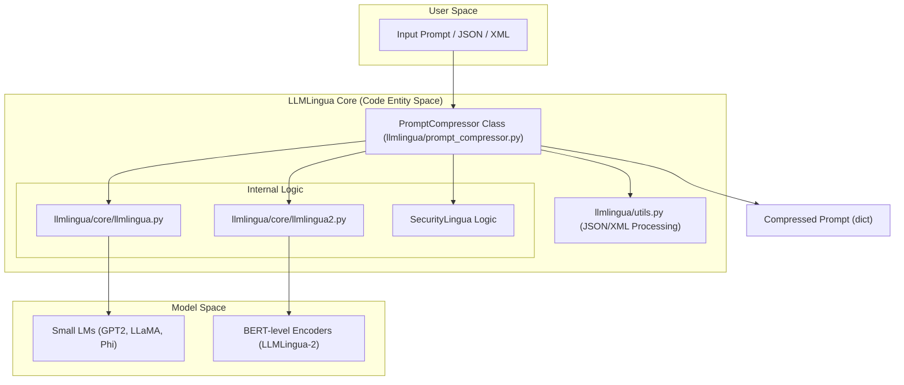
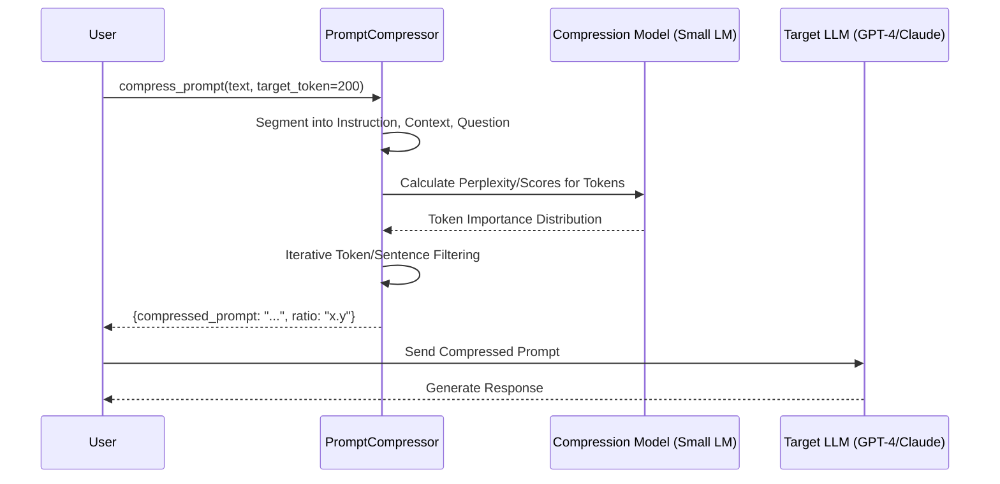

<!-- source: DeepWiki mcp.deepwiki.com · repo microsoft/LLMLingua · page 1 Overview · fetched 2026-10-26 -->

# Overview

Relevant source files

The following files were used as context for generating this wiki page:

- [README.md](README.md)
- [Transparency_FAQ.md](Transparency_FAQ.md)
- [llmlingua/__init__.py](llmlingua/__init__.py)
- [llmlingua/version.py](llmlingua/version.py)

LLMLingua is a prompt compression framework designed to efficiently reduce the size of prompts for Large Language Models (LLMs) while preserving their semantic meaning and reasoning capabilities. By utilizing compact, well-trained language models to identify and remove non-essential tokens, LLMLingua enables up to 20x compression with minimal performance loss, significantly reducing API costs and latency.

The LLMLingua series consists of four primary subsystems: **LLMLingua**, **LongLLMLingua**, **LLMLingua-2**, and **SecurityLingua**.

## Purpose and Benefits

LLMLingua addresses critical bottlenecks in LLM deployment and interaction:

1.  **Token Limitations**: Compresses lengthy prompts to fit within the context window of models like GPT-4 or Claude [README.md:60-64]().
2.  **Cost Reduction**: Minimizes the number of tokens processed by black-box LLM APIs, leading to direct cost savings [README.md:72]().
3.  **Performance Enhancement**: Mitigates the "lost in the middle" phenomenon in long-context scenarios by reordering and filtering information [README.md:41-44]().
4.  **Inference Acceleration**: Reduces KV-cache size and generation length, speeding up the end-to-end inference process [README.md:76](), [Transparency_FAQ.md:16]().
5.  **Security**: Provides a guardrail layer to detect and neutralize jailbreak attacks through security-aware compression [README.md:51-54]().

Sources: [README.md:34-77](), [Transparency_FAQ.md:3-16]()

## LLMLingua Series Subsystems

The framework has evolved into four specialized subsystems, each targeting specific challenges in prompt engineering:

| Subsystem | Primary Focus | Key Mechanism |
| :--- | :--- | :--- |
| **LLMLingua** | General Compression | Perplexity-based token filtering using small LMs (e.g., GPT2-small, LLaMA-7B) [README.md:36-39](). |
| **LongLLMLingua** | Long-Context / RAG | Question-aware coarse-to-fine compression and document reordering [README.md:41-44](). |
| **LLMLingua-2** | Speed & Generalization | Token classification via BERT-level encoders (3x-6x faster than original) [README.md:46-49](). |
| **SecurityLingua** | Safety & Defense | Security-aware compression to reveal malicious intent in jailbreak attacks [README.md:51-54](). |

Sources: [README.md:34-55]()

## Core Architecture and Data Flow

The central entry point for the library is the `PromptCompressor` class defined in `llmlingua/prompt_compressor.py`. It manages the lifecycle of the compression models and provides the high-level API for various compression tasks.

### System Components Diagram
The following diagram illustrates how the `PromptCompressor` interacts with internal modules and external models.

Sources: [llmlingua/__init__.py:5-8](), [llmlingua/prompt_compressor.py:17-40](), [README.md:79-83]()

### High-Level Data Flow
LLMLingua treats prompt compression as a distribution alignment problem. It uses a small model to estimate the importance of tokens based on their perplexity or a classification score.

Sources: [README.md:36-38](), [Transparency_FAQ.md:35-42]()

## Key Use Cases

*   **Retrieval-Augmented Generation (RAG)**: Using `LongLLMLingua` to compress retrieved documents, saving costs and improving accuracy by reducing noise [README.md:30]().
*   **Online Meeting Summarization**: Handling long transcripts by protecting speaker identifiers and key instructions via `structured_compress_prompt` [README.md:31-32]().
*   **Chain-of-Thought (CoT)**: Compressing reasoning demonstrations to fit more examples into a single prompt [README.md:31-32]().
*   **Code Completion**: Compressing large codebases or documentation while preserving syntax-critical tokens [README.md:32]().
*   **Security Defense**: Using `SecurityLingua` as a lightweight guardrail to detect adversarial prompts [README.md:51-54]().

## Technical Implementation Details

### The PromptCompressor Class
The `PromptCompressor` is the primary interface. It is initialized with a `model_name` (e.g., `microsoft/phi-2`) and a `device_map`.
*   **Initialization**: Loads the tokenizer and the compression model [llmlingua/prompt_compressor.py:17-40]().
*   **Methods**:
    *   `compress_prompt`: Standard text compression [llmlingua/prompt_compressor.py:148]().
    *   `structured_compress_prompt`: Handles XML-like tags for fine-grained control [llmlingua/prompt_compressor.py:421]().
    *   `compress_json`: Specifically for JSON data structures [llmlingua/prompt_compressor.py:539]().

### Prompt Segmentation
LLMLingua distinguishes between three functional modules within a prompt:
1.  **Instruction**: High sensitivity; describes the task.
2.  **Context**: Low sensitivity; provides background data (e.g., RAG results).
3.  **Question**: High sensitivity; the specific user request.

This segmentation allows the `PromptCompressor` to apply different compression ratios dynamically to different parts of the prompt to ensure the final output remains functional for the target LLM.

Sources: [Transparency_FAQ.md:35-42](), [llmlingua/prompt_compressor.py:148-180]()

---

