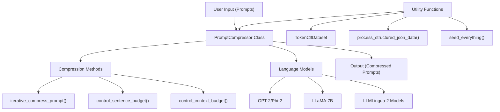
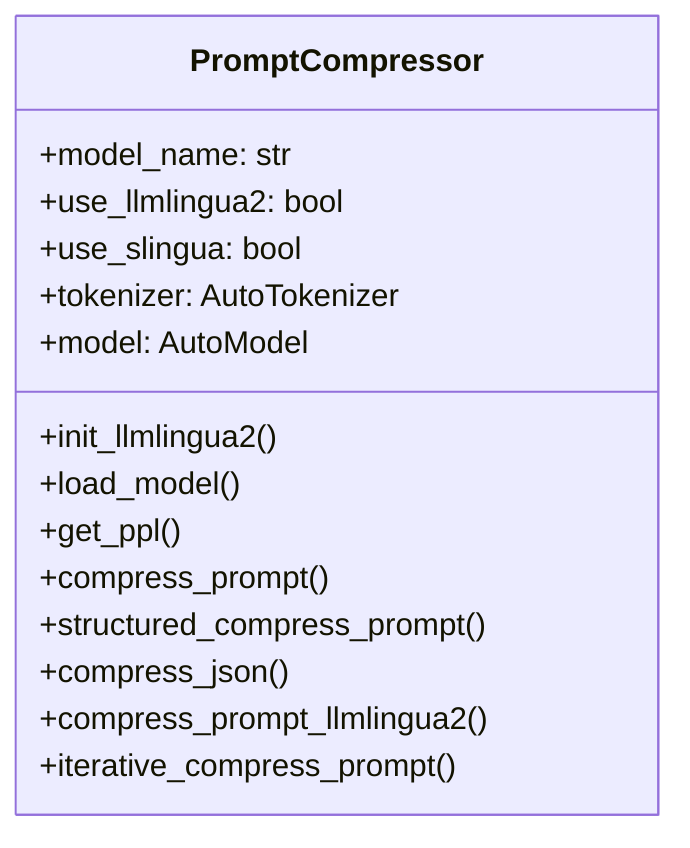
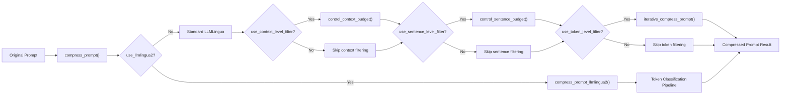
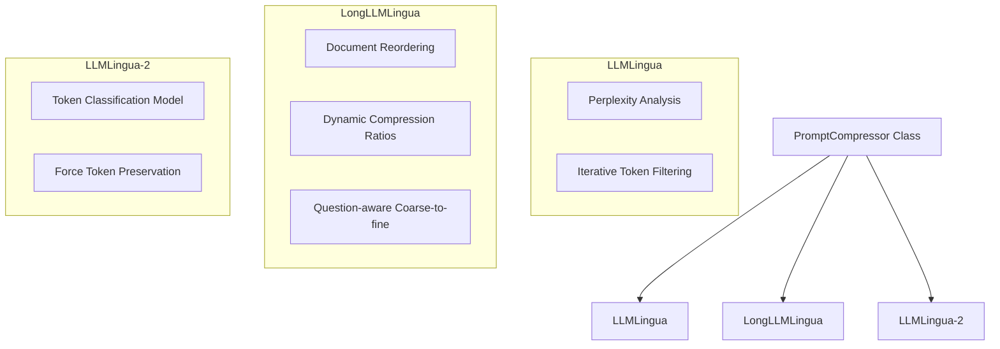

<!-- source: DeepWiki mcp.deepwiki.com · repo microsoft/LLMLingua · page 2 Core Architecture · fetched 2026-10-26 -->

# Core Architecture

Relevant source files

The following files were used as context for generating this wiki page:

- [DOCUMENT.md](DOCUMENT.md)
- [llmlingua/prompt_compressor.py](llmlingua/prompt_compressor.py)
- [llmlingua/utils.py](llmlingua/utils.py)
- [tests/test_llmlingua2.py](tests/test_llmlingua2.py)

This document outlines the core architectural components and design principles of the LLMLingua system, which enables efficient prompt compression for Large Language Models (LLMs). For specific implementation details of the PromptCompressor class, see [PromptCompressor Class](#2.1). For details on specific compression techniques, see [Compression Techniques](#2.2).

## System Purpose and Overview

LLMLingua is designed to compress prompts for LLMs while preserving essential information, achieving compression ratios of up to 20x with minimal performance degradation. The system uses smaller, more efficient language models to identify and eliminate non-essential tokens, optimizing token usage in LLM interactions.

The core architecture enables several main variants with progressively more advanced capabilities:

1.  **LLMLingua**: Basic prompt compression using token perplexity analysis [llmlingua/prompt_compressor.py:43-44]().
2.  **LongLLMLingua**: Addresses 'lost in the middle' issue with document reordering and dynamic compression [DOCUMENT.md:34-52]().
3.  **LLMLingua-2**: Data-distillation-based compression using token classification, offering 3-6x faster performance than the original [llmlingua/prompt_compressor.py:51-54]().
4.  **SecurityLingua**: A security-aware layer for detecting jailbreak attacks, sharing the LLMLingua-2 backend [llmlingua/prompt_compressor.py:78-92]().

### High-Level Architecture Overview

Sources: [llmlingua/prompt_compressor.py:36-70](), [llmlingua/utils.py:13-69]()

## Core Components

The LLMLingua system consists of several key components that work together to enable efficient prompt compression:

### PromptCompressor Class

The `PromptCompressor` class is the central component of the system, providing methods for compressing prompts using different techniques [llmlingua/prompt_compressor.py:36-41](). It initializes with a language model and various configuration options, supporting both causal LMs and token classification models [llmlingua/prompt_compressor.py:131-135]().

Sources: [llmlingua/prompt_compressor.py:36-117]()

### Language Models

LLMLingua uses smaller language models to analyze token importance:

1.  **Small LMs for Compression**:
    *   **GPT-2/Phi-2**: Lightweight models with minimal resource requirements [DOCUMENT.md:76-83]().
    *   **LLaMA-7B**: Medium-sized model offering better compression quality [llmlingua/prompt_compressor.py:47]().
    *   **LLMLingua-2 Models**: Specialized token classification models (e.g., XLM-RoBERTa or BERT-base) [DOCUMENT.md:59-70]().
2.  **Quantized Models**: Supports GPTQ models for low-memory environments (<8GB GPU) [DOCUMENT.md:86-102]().

Sources: [llmlingua/prompt_compressor.py:118-164](), [DOCUMENT.md:72-102]()

### Utility Functions

Several utility functions support the compression process:

*   `TokenClfDataset`: Dataset class for token classification in LLMLingua-2 [llmlingua/utils.py:13-69]().
*   `seed_everything()`: Ensures reproducible results by setting random seeds [llmlingua/utils.py:71-79]().
*   `process_structured_json_data()`: Processes JSON data for structured compression [llmlingua/utils.py:123-151]().
*   `is_begin_of_new_word()`: Determines word boundaries across different tokenizer types [llmlingua/utils.py:81-102]().

Sources: [llmlingua/utils.py:13-151]()

## Compression Pipeline Flow

The core information flow through the system varies depending on the selected compression backend:

Sources: [llmlingua/prompt_compressor.py:424-723](), [llmlingua/prompt_compressor.py:725-785]()

### Structured and JSON Processing

LLMLingua supports structured data via XML-like tags or raw JSON:

1.  **Structured Prompt Processing**: `structured_compress_prompt()` parses `<llmlingua>` tags to apply different rates to different segments [llmlingua/prompt_compressor.py:272-422]().
2.  **JSON Processing**: `compress_json()` utilizes `process_structured_json_data()` to convert JSON into a tag-based format for compression while maintaining key-value integrity [llmlingua/prompt_compressor.py:213-270](), [llmlingua/utils.py:123-151]().

Sources: [llmlingua/prompt_compressor.py:213-422](), [llmlingua/utils.py:123-211]()

## Variant-Specific Architecture

Each LLMLingua variant builds on the base architecture with specialized logic:

Sources: [llmlingua/prompt_compressor.py:424-785](), [DOCUMENT.md:34-70]()

## Configuration Parameters

The `PromptCompressor` class accepts numerous parameters to customize compression [llmlingua/prompt_compressor.py:71-80]():

| Parameter | Description | Default Value |
|-----------|-------------|---------------|
| `model_name` | Small LM for importance analysis | "NousResearch/Llama-2-7b-hf" |
| `use_llmlingua2` | Use token classification backend | False |
| `use_slingua` | Enable SecurityLingua layer | False |
| `device_map` | Device for model loading | "cuda" |
| `rate` | Target compression rate | 0.5 |
| `target_token` | Target token count | -1 |

Sources: [llmlingua/prompt_compressor.py:71-92](), [llmlingua/prompt_compressor.py:425-466]()

## Design Principles

The LLMLingua architecture follows several core design principles:

1.  **Prompt Sensitivity**: Different components (instructions vs contexts) vary in sensitivity to compression [DOCUMENT.md:5]().
2.  **Granular Division**: Divide contexts into independent granularities for better budget control [DOCUMENT.md:6]().
3.  **Essential Character Preservation**: Support for preserving critical tokens (force tokens) [DOCUMENT.md:7]().
4.  **Optimization through Experimentation**: Hyperparameters should be tuned for specific scenarios [DOCUMENT.md:8-9]().

Sources: [DOCUMENT.md:3-9]()

---

