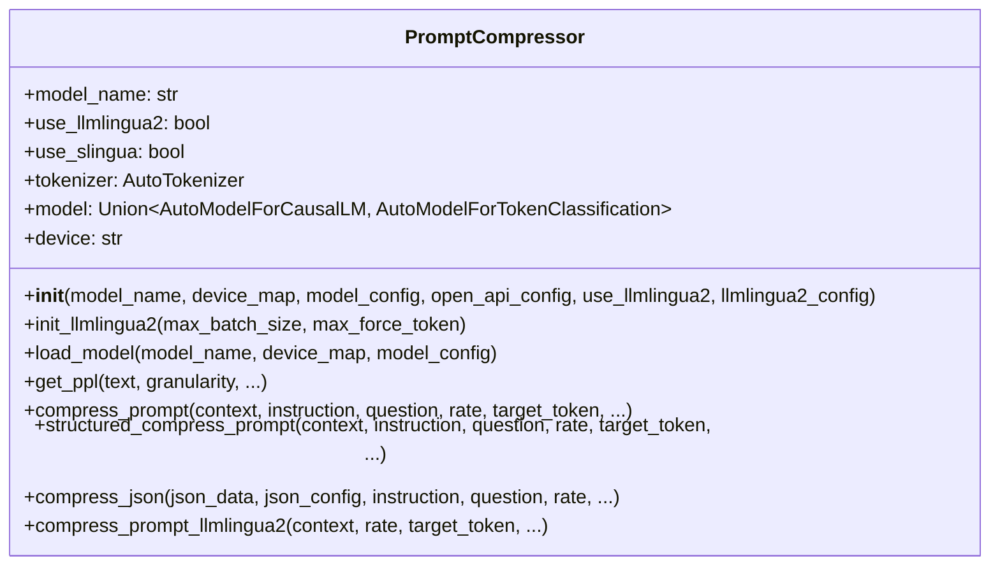
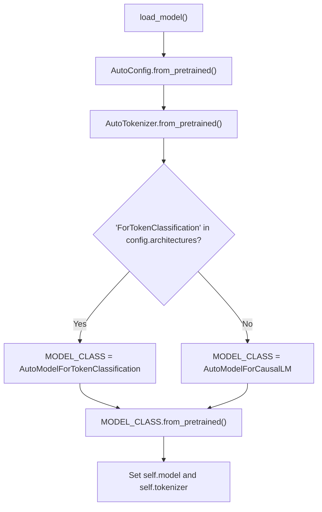
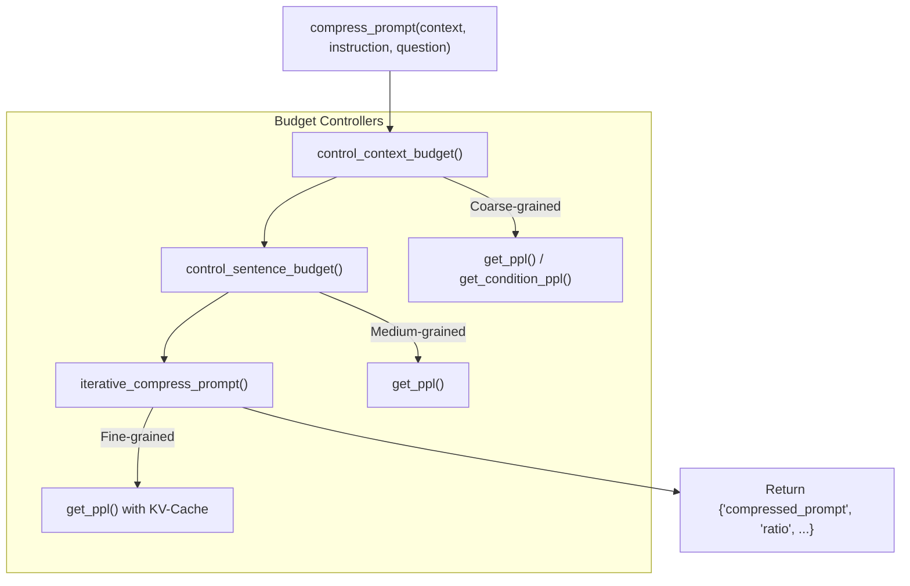

<!-- source: DeepWiki mcp.deepwiki.com · repo microsoft/LLMLingua · page 2.1 PromptCompressor Class · fetched 2026-10-26 -->

# PromptCompressor Class

<details>
<summary>Relevant source files</summary>

The following files were used as context for generating this wiki page:

- [DOCUMENT.md](DOCUMENT.md)
- [Transparency_FAQ.md](Transparency_FAQ.md)
- [llmlingua/prompt_compressor.py](llmlingua/prompt_compressor.py)
- [tests/test_llmlingua2.py](tests/test_llmlingua2.py)

</details>


## Purpose and Overview

The `PromptCompressor` class is the central component of the LLMLingua library, responsible for implementing prompt compression techniques to reduce token usage when interacting with large language models (LLMs). This class handles various compression methods including token-level, sentence-level, and context-level filtering to achieve significant compression rates while preserving the semantic meaning of the original text. It serves as the primary interface for the LLMLingua, LongLLMLingua, and LLMLingua-2 subsystems [llmlingua/prompt_compressor.py:36-69]().

## Class Architecture

The `PromptCompressor` implements a versatile compression engine that supports multiple versions of LLMLingua. It uses language models to perform perplexity analysis (for LLMLingua/LongLLMLingua) or token importance classification (for LLMLingua-2) [llmlingua/prompt_compressor.py:36-69]().

### Code Entity Space Mapping
The following diagram maps the high-level compression logic to the specific internal methods and class attributes.


Sources: [llmlingua/prompt_compressor.py:36-162](), [llmlingua/prompt_compressor.py:424-723](), [llmlingua/prompt_compressor.py:725-971]()

## Initialization and Configuration

### Constructor Parameters

The `PromptCompressor` takes several parameters to configure its behavior and load the underlying small language model (SLM) [llmlingua/prompt_compressor.py:71-91]():

| Parameter | Type | Default | Description |
|-----------|------|---------|-------------|
| `model_name` | str | "NousResearch/Llama-2-7b-hf" | Model to use for compression importance scoring. |
| `device_map` | str | "cuda" | Device to load the model onto (e.g., "cuda", "cpu", "mps"). |
| `model_config` | dict | {} | Configuration for the Hugging Face model loading. |
| `open_api_config` | dict | {} | Configuration for OpenAI APIs if used for logprobs. |
| `use_llmlingua2` | bool | False | Whether to use the LLMLingua-2 token classification approach. |
| `use_slingua` | bool | False | Enables SecurityLingua (uses LLMLingua-2 backend). |
| `llmlingua2_config` | dict | {} | Configuration for LLMLingua-2 (batch size, force tokens). |

Sources: [llmlingua/prompt_compressor.py:71-80](), [llmlingua/prompt_compressor.py:92-93]()

### Model Loading Pipeline

The `load_model` method dynamically determines whether to load a `AutoModelForTokenClassification` (for LLMLingua-2) or an `AutoModelForCausalLM` (for original LLMLingua) based on the model's architecture metadata [llmlingua/prompt_compressor.py:118-161]().


Sources: [llmlingua/prompt_compressor.py:118-162]()

### LLMLingua-2 Specific Setup

When `use_llmlingua2` or `use_slingua` is True, `init_llmlingua2` is called. It initializes the `TokenClfDataset`, adds `[NEWi]` special tokens to the tokenizer to handle `max_force_token`, and resizes the model's token embeddings [llmlingua/prompt_compressor.py:95-117]().

## Core Compression Methods

The class provides three specialized entry points for different data formats, all of which eventually flow into the internal compression budget controllers.

### 1. compress_prompt
The primary method for general text. It orchestrates the compression pipeline based on the provided `instruction`, `context`, and `question` [llmlingua/prompt_compressor.py:424-445]().

*   **Logic Flow**: If `use_llmlingua2` is active, it redirects to `compress_prompt_llmlingua2` [llmlingua/prompt_compressor.py:515-523](). Otherwise, it proceeds with the three-stage LLMLingua/LongLLMLingua pipeline: context-level, sentence-level, and token-level filtering [llmlingua/prompt_compressor.py:545-723]().

### 2. structured_compress_prompt
Handles prompts containing XML-like `<llmlingua>` tags. It uses `segment_structured_context` to parse the tags and applies specific `rate` or `compress` settings to each segment [llmlingua/prompt_compressor.py:272-300]().

### 3. compress_json
Specialized for structured data. It accepts a `json_config` that defines per-field compression rules (e.g., `value_type`, `pair_remove`). It utilizes the `process_structured_json_data` utility to flatten and reconstruct the JSON [llmlingua/prompt_compressor.py:212-230]().

## Internal Pipeline Flow

The following diagram illustrates how data flows through the `PromptCompressor` during a standard `compress_prompt` call using the original LLMLingua algorithm.


Sources: [llmlingua/prompt_compressor.py:424-723](), [llmlingua/prompt_compressor.py:1169-1240](), [llmlingua/prompt_compressor.py:1242-1307]()

## Auxiliary Methods

### Perplexity and Importance Scoring
*   **`get_ppl`**: Calculates perplexity scores for text at different granularities (`sentence`, `token`, `word`). It supports `past_key_values` for efficient iterative calculation [llmlingua/prompt_compressor.py:165-175]().
*   **`get_condition_ppl`**: Used in LongLLMLingua to calculate question-aware perplexity. It supports different `condition_in_question` modes like `after_condition` or `before_condition` [llmlingua/prompt_compressor.py:997-1010]().

### Token Management
*   **`get_token_length`**: Calculates length using either the loaded model's `tokenizer` or the `tiktoken` (OpenAI) tokenizer [llmlingua/prompt_compressor.py:973-984]().
*   **`recover`**: A utility to attempt to reconstruct the original text from a compressed prompt using a high-capacity LLM (requires `open_api_config`) [llmlingua/prompt_compressor.py:1134-1145]().

## Usage Examples

### LLMLingua-2 Compression
```python
compressor = PromptCompressor(
    model_name="microsoft/llmlingua-2-xlm-roberta-large-meetingbank", 
    use_llmlingua2=True
)
result = compressor.compress_prompt(
    context="Long transcript...", 
    rate=0.33, 
    force_tokens=['\n', '?']
)
```
Sources: [DOCUMENT.md:57-63](), [tests/test_llmlingua2.py:41-60]()

### LongLLMLingua (Question-Aware)
```python
compressor = PromptCompressor()
result = compressor.compress_prompt(
    context_list,
    question="What is the summary?",
    condition_in_question="after_condition",
    rank_method="longllmlingua"
)
```
Sources: [DOCUMENT.md:37-52]()

Sources: [llmlingua/prompt_compressor.py:36-1145](), [DOCUMENT.md:1-112](), [tests/test_llmlingua2.py:1-23]()

---

