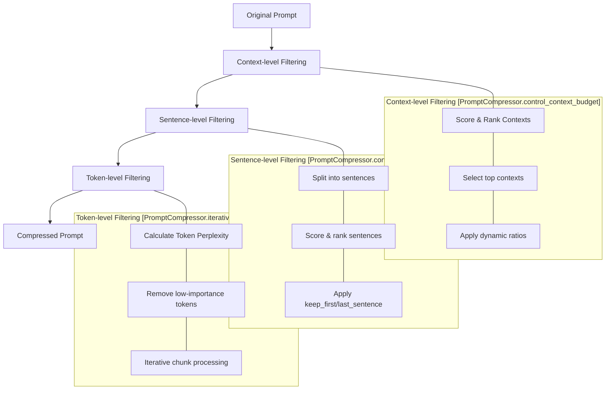
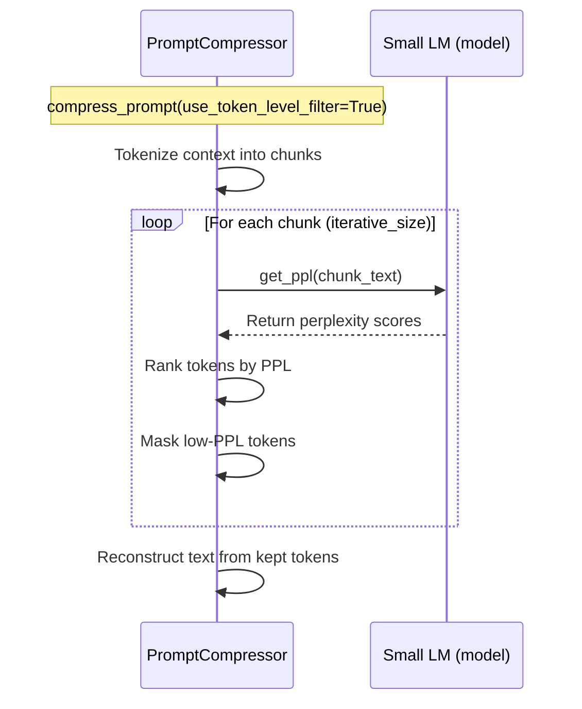
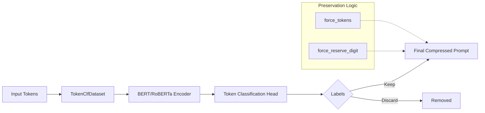

<!-- source: DeepWiki mcp.deepwiki.com · repo microsoft/LLMLingua · page 2.2 Compression Techniques · fetched 2026-10-26 -->

# Compression Techniques

Relevant source files

The following files were used as context for generating this wiki page:

- [DOCUMENT.md](DOCUMENT.md)
- [llmlingua/prompt_compressor.py](llmlingua/prompt_compressor.py)
- [llmlingua/utils.py](llmlingua/utils.py)
- [tests/test_llmlingua2.py](tests/test_llmlingua2.py)

LLMLingua provides multiple prompt compression techniques that reduce token count while preserving essential information for large language models (LLMs). This page details the technical implementation of these compression methods in the LLMLingua codebase. For information about how these techniques are integrated into the `PromptCompressor` class, see [PromptCompressor Class]().

## Compression Hierarchy Overview

LLMLingua implements a hierarchical compression approach with three primary filtering levels that can be used independently or in combination. The core logic resides in `PromptCompressor.compress_prompt`, which orchestrates these levels based on user-defined flags.

Sources: [llmlingua/prompt_compressor.py:595-629](), [llmlingua/prompt_compressor.py:631-678](), [llmlingua/prompt_compressor.py:680-723]()

## Token-level Filtering (LLMLingua)

Token-level filtering is the most granular compression technique, operating on individual tokens within the text. It uses a small language model (SLM) to calculate the information density of each token.

### Technical Implementation

The token-level filtering process is implemented through the `iterative_compress_prompt` method and involves:

1.  **Perplexity Calculation**: The `get_ppl()` method calculates perplexity scores for each token using a cross-entropy loss from the local SLM. [llmlingua/prompt_compressor.py:165-208]()
2.  **Iterative Removal**: To maintain context during compression, LLMLingua processes text in chunks (defined by `iterative_size`). [llmlingua/prompt_compressor.py:680-692]()
3.  **Importance Ranking**: Tokens with lower perplexity (predictable tokens) are removed first, as they are considered to contain less unique information.

Sources: [llmlingua/prompt_compressor.py:165-208](), [llmlingua/prompt_compressor.py:680-723]()

## Sentence-level Filtering

Sentence-level filtering works at the sentence granularity, selecting the most relevant sentences while maintaining their internal structure. This is controlled by the `use_sentence_level_filter` flag.

### Technical Implementation

The sentence-level filtering process is implemented through the `control_sentence_budget` method:

1.  **Splitting**: Context is split into sentences using NLTK or segment-based logic.
2.  **Scoring**: Each sentence is scored based on its relevance to the question using the specified `rank_method`. [llmlingua/prompt_compressor.py:631-642]()
3.  **Priority Bonuses**: Parameters like `keep_first_sentence` and `keep_last_sentence` allow preserving critical structural sentences regardless of score. [llmlingua/prompt_compressor.py:448-450]()
4.  **Budgeting**: Sentences are selected until the token budget is reached.

Sources: [llmlingua/prompt_compressor.py:631-678]()

## Context-level Filtering (LongLLMLingua)

Context-level filtering operates at the document level, selecting the most relevant contexts from a collection. This is particularly used in RAG scenarios and LongLLMLingua.

### Technical Implementation

The context-level filtering process is implemented through the `control_context_budget` method:

1.  **Ranking**: Uses `rank_method` (e.g., `longllmlingua`, `bm25`, `openai`) to score documents. [llmlingua/prompt_compressor.py:599-616]()
2.  **Forced Inclusion**: Uses `force_context_ids` to ensure specific documents are never filtered. [llmlingua/prompt_compressor.py:461]()
3.  **Reordering**: Optionally reorders documents (e.g., `reorder_context="sort"`) to place more relevant information at the beginning or end of the prompt to mitigate the "lost-in-the-middle" phenomenon. [llmlingua/prompt_compressor.py:443]()

Sources: [llmlingua/prompt_compressor.py:595-629]()

## Token Classification (LLMLingua-2)

LLMLingua-2 shifts from perplexity-based filtering to a token classification approach using a BERT-level encoder (e.g., XLM-RoBERTa).

### Technical Implementation

The LLMLingua-2 compression process is implemented through the `compress_prompt_llmlingua2` method:

1.  **Classification**: A specialized model (e.g., `microsoft/llmlingua-2-xlm-roberta-large-meetingbank`) predicts a "keep" or "discard" label for every token. [llmlingua/prompt_compressor.py:725-740]()
2.  **Force Tokens**: Users can specify `force_tokens` (e.g., `\n`, `.`) that must always be preserved. [llmlingua/prompt_compressor.py:734]()
3.  **Digit Preservation**: The `force_reserve_digit` flag ensures numeric data is not lost during compression. [llmlingua/prompt_compressor.py:735]()
4.  **Batching**: Unlike iterative PPL, LLMLingua-2 can process text in large batches, significantly increasing speed. [llmlingua/prompt_compressor.py:97]()

Sources: [llmlingua/prompt_compressor.py:725-785](), [llmlingua/utils.py:13-69](), [llmlingua/utils.py:81-101]()

## Structured and JSON Compression

LLMLingua supports compressing prompts with explicit structural requirements.

### Structured Prompt Compression
The `structured_compress_prompt` method parses XML-like tags (`<llmlingua>`) to apply different compression rates to different segments. [llmlingua/prompt_compressor.py:272-422]()

### JSON Compression
The `compress_json` method uses `process_structured_json_data` to transform JSON into a format that can be compressed while maintaining key-value relationships. [llmlingua/prompt_compressor.py:213-270]()

**Key Utility Functions:**
- `process_structured_json_data`: Maps JSON keys to specific compression rates. [llmlingua/utils.py:123-151]()
- `remove_consecutive_commas`: Cleans up compressed JSON strings to maintain validity. [llmlingua/prompt_compressor.py:269]()

Sources: [llmlingua/prompt_compressor.py:213-422](), [llmlingua/utils.py:123-240]()

## Comparison of Techniques

| Technique | Level | Scoring Mechanism | Key Parameters |
| :--- | :--- | :--- | :--- |
| **LLMLingua** | Token | Perplexity (PPL) | `iterative_size`, `use_token_level_filter` |
| **LLMLingua-2** | Token | Token Classification | `force_tokens`, `force_reserve_digit` |
| **LongLLMLingua** | Context | Question-Aware Ranking | `rank_method`, `reorder_context` |
| **Structured** | Segment | Tag-based Rates | `rate`, `compress` (within tags) |

Sources: [llmlingua/prompt_compressor.py:36-79](), [DOCUMENT.md:3-9]()

---

