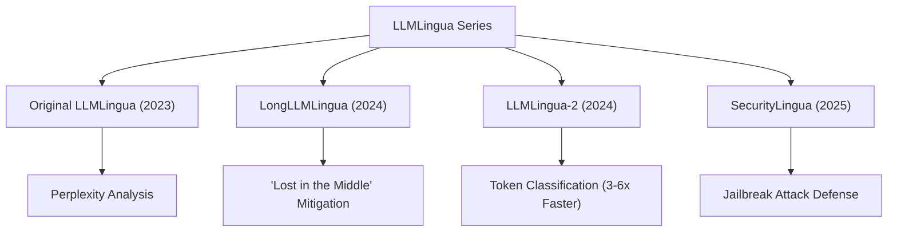
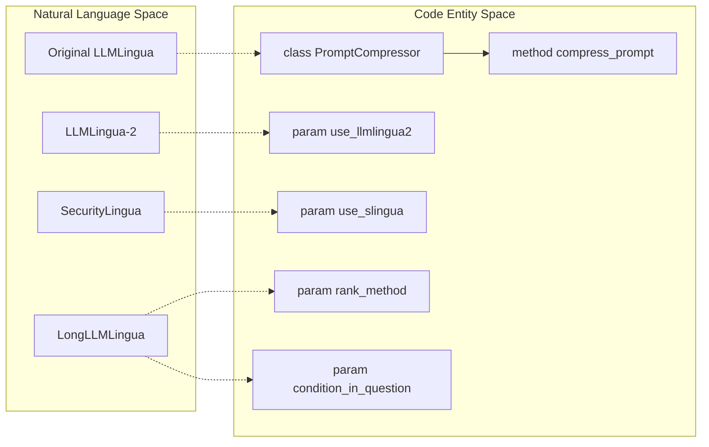

<!-- source: DeepWiki mcp.deepwiki.com · repo microsoft/LLMLingua · page 3 LLMLingua Versions · fetched 2026-10-26 -->

# LLMLingua Versions

Relevant source files

The following files were used as context for generating this wiki page:

- [DOCUMENT.md](DOCUMENT.md)
- [README.md](README.md)
- [Transparency_FAQ.md](Transparency_FAQ.md)

This document provides a comprehensive overview of the different versions of LLMLingua, a prompt compression framework designed to optimize large language model (LLM) interactions. We cover the evolution from the original LLMLingua to LongLLMLingua, LLMLingua-2, and SecurityLingua, highlighting their key features and technical approaches.

## Overview of LLMLingua Series

The LLMLingua series utilizes compact language models (e.g., GPT2-small, LLaMA-7B, or BERT-level encoders) to identify and remove non-essential tokens. This enables efficient inference with minimal performance loss and significant cost savings [README.md:34-36]().

Sources: [README.md:34-54]()

## Implementation Architecture

All versions are unified through the `PromptCompressor` class, which manages model loading and the compression pipeline [llmlingua/prompt_compressor.py:15-18]().

### Code Entity to System Mapping
The following diagram bridges the high-level versions to the specific code components and parameters used in the `PromptCompressor` class [llmlingua/prompt_compressor.py:15-132]().

Sources: [llmlingua/prompt_compressor.py:15-132](), [DOCUMENT.md:34-70]()

---

## [Original LLMLingua](#3.1)

The original LLMLingua uses a small language model to calculate token-level perplexity. It employs a budget controller and an iterative token-level compression algorithm to ensure the most informative tokens are preserved [README.md:34-39]().

**Key Components:**
*   **Perplexity-based Importance**: Tokens with higher perplexity are considered more essential to the prompt's meaning.
*   **Budget Controller**: Manages the allocation of tokens across different prompt segments (instruction, context, question).

For details, see [Original LLMLingua](#3.1).
Sources: [README.md:34-39](), [Transparency_FAQ.md:35-41]()

---

## [LongLLMLingua](#3.2)

LongLLMLingua addresses the "lost in the middle" phenomenon where LLMs struggle to utilize information in the center of long contexts. It improves RAG performance by up to 21.4% using only 1/4 of the tokens [README.md:41-44]().

**Key Features:**
*   **Question-Aware Compression**: Uses the `condition_in_question` parameter to prioritize information relevant to the user's query [DOCUMENT.md:45]().
*   **Document Reordering**: Reorders retrieved documents based on relevance to ensure key information is at the beginning or end of the prompt [DOCUMENT.md:46]().
*   **Dynamic Ratios**: Adjusts compression density via `dynamic_context_compression_ratio` [DOCUMENT.md:47]().

For details, see [LongLLMLingua](#3.2).
Sources: [README.md:41-44](), [DOCUMENT.md:34-52]()

---

## [LLMLingua-2](#3.3)

LLMLingua-2 shifts from perplexity calculation to a token classification approach using BERT-level encoders (e.g., XLM-RoBERTa). It is 3x-6x faster than the original version and provides better task-agnostic compression [README.md:46-49]().

**Key Features:**
*   **Data Distillation**: Trained on labels generated by GPT-4 to identify which tokens are safe to remove [README.md:46-47]().
*   **Force Tokens**: Supports a `force_tokens` parameter to ensure specific characters (like newlines or punctuation) are never compressed [DOCUMENT.md:63]().
*   **Encoder-Based**: Uses `use_llmlingua2=True` to trigger the classification pipeline [DOCUMENT.md:61]().

For details, see [LLMLingua-2](#3.3).
Sources: [README.md:46-49](), [DOCUMENT.md:54-70]()

---

## [SecurityLingua](#3.4)

SecurityLingua is a specialized safety guardrail model that uses security-aware prompt compression to reveal malicious intentions behind jailbreak attacks [README.md:51-54]().

**Key Features:**
*   **Attack Detection**: Enables LLMs to detect jailbreak attempts by stripping away obfuscation layers.
*   **Low Overhead**: Provides defense with 100x less token cost compared to state-of-the-art LLM guardrails.
*   **Integration**: Triggered via the `use_slingua` flag in the `PromptCompressor` configuration.

For details, see [SecurityLingua](#3.4).
Sources: [README.md:51-54]()

---

## Version Comparison Matrix

| Feature | LLMLingua | LongLLMLingua | LLMLingua-2 | SecurityLingua |
| :--- | :--- | :--- | :--- | :--- |
| **Primary Goal** | General Compression | Long Context/RAG | Speed & Generalization | Safety & Defense |
| **Model Type** | Causal LM (GPT2/LLaMA) | Causal LM (GPT2/LLaMA) | Encoder (BERT/RoBERTa) | Security-Aware LM |
| **Logic** | Perplexity Scoring | Question-Aware Ranking | Token Classification | Malicious Intent Detection |
| **Key Param** | `target_token` | `rank_method="longllmlingua"` | `use_llmlingua2=True` | `use_slingua=True` |

Sources: [README.md:34-54](), [DOCUMENT.md:34-70]()

---

