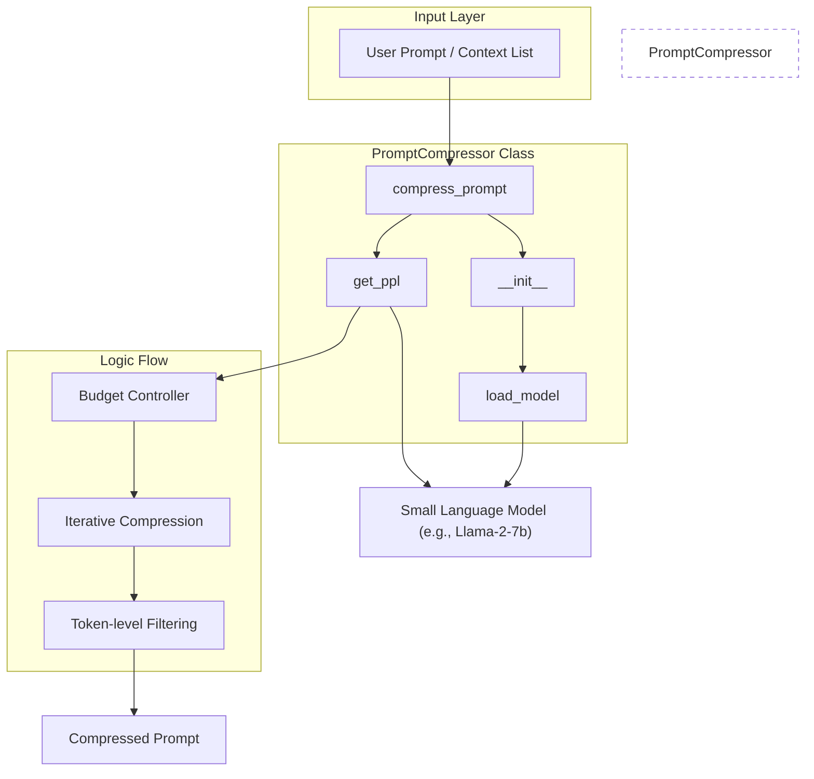
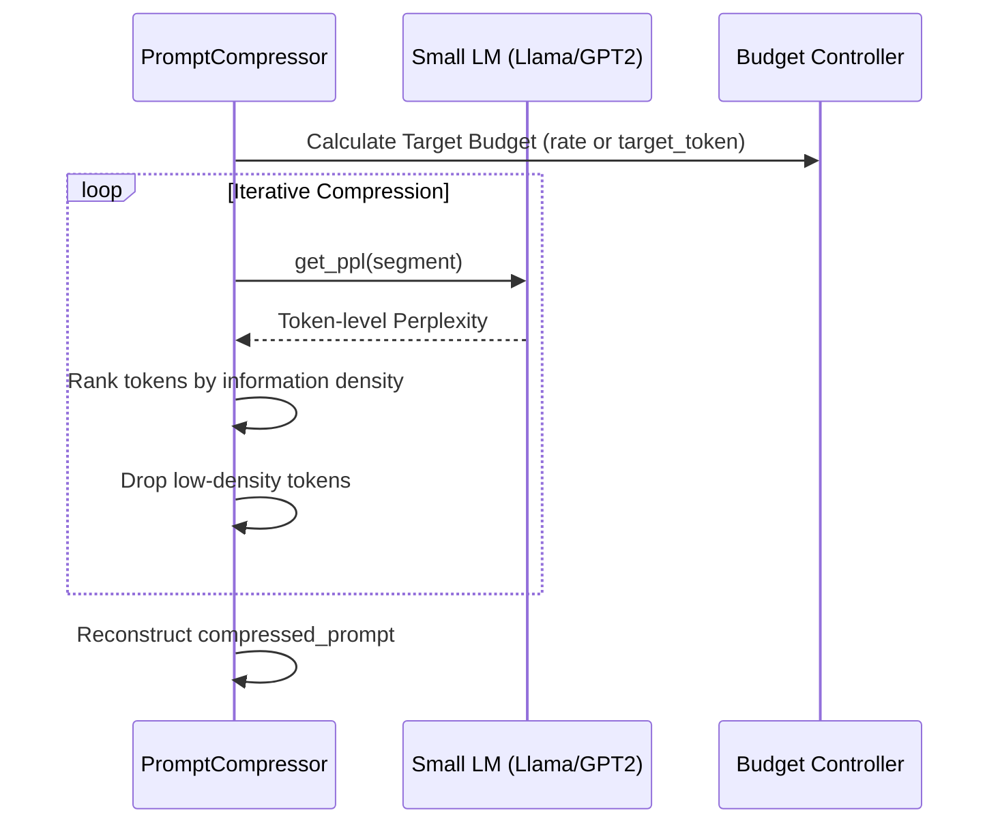

<!-- source: DeepWiki mcp.deepwiki.com · repo microsoft/LLMLingua · page 3.1 Original LLMLingua · fetched 2026-10-26 -->

# Original LLMLingua

<details>
<summary>Relevant source files</summary>

The following files were used as context for generating this wiki page:

- [README.md](README.md)
- [Transparency_FAQ.md](Transparency_FAQ.md)
- [llmlingua/prompt_compressor.py](llmlingua/prompt_compressor.py)
- [tests/test_llmlingua2.py](tests/test_llmlingua2.py)

</details>


This document covers the first version of the LLMLingua prompt compression system, which forms the foundation of the LLMLingua series. The original LLMLingua utilizes small language models to identify and remove non-essential tokens in prompts, enabling efficient inference with large language models.

## 1. Overview

The original LLMLingua is designed to compress prompts for large language models (LLMs) to reduce token usage and inference costs. It uses a compact, well-trained language model (such as GPT2-small or Llama-2-7b) to identify and remove non-essential tokens from input prompts. This approach can achieve up to 20x compression while maintaining the essential meaning and preserving the performance of the original uncompressed prompt.

Key benefits of the original LLMLingua include:
- **Cost Savings**: Reduces both prompt and generation lengths with minimal overhead [README.md:72]().
- **Knowledge Retention**: Maintains original prompt information like ICL and reasoning [README.md:75]().
- **KV-Cache Compression**: Accelerates the inference process [README.md:76]().
- **No Training Required**: Works as a robust method without needing to fine-tune the target LLM [README.md:74]().

Sources: [README.md:34-36](), [README.md:65-72](), [llmlingua/prompt_compressor.py:37-44]()

## 2. Core Architecture

The original LLMLingua follows a hierarchical approach to identify information density. It assumes that natural language is redundant and that a small language model (SLM) can estimate the importance of tokens by calculating their perplexity.

### 2.1. System Components and Code Entities

The following diagram maps the conceptual compression pipeline to the specific classes and methods implemented in the codebase.



Sources: [llmlingua/prompt_compressor.py:36-91](), [llmlingua/prompt_compressor.py:165-174](), [llmlingua/prompt_compressor.py:350-360]()

### 2.2. Prompt Segmentation

LLMLingua divides prompts into three distinct modules to manage sensitivity to compression:
1. **Instruction**: Directives like task descriptions. High sensitivity [Transparency_FAQ.md:41]().
2. **Context**: Supplementary info like documents or demonstrations. Lower sensitivity [Transparency_FAQ.md:40]().
3. **Question**: The user's specific request. High sensitivity [Transparency_FAQ.md:39]().

Sources: [Transparency_FAQ.md:35-41]()

## 3. Technical Implementation

### 3.1. Perplexity-based Importance Scoring

The core mechanism relies on the `get_ppl` method. It uses the `AutoModelForCausalLM` to calculate the perplexity of segments. Tokens with lower perplexity are considered more "predictable" and thus less essential for the target LLM to understand the core intent.

Key methods:
- `get_ppl`: Calculates perplexity for given text using the loaded SLM [llmlingua/prompt_compressor.py:165-174]().
- `load_model`: Initializes `AutoTokenizer` and `AutoModelForCausalLM` (or `AutoModelForTokenClassification` for LLMLingua-2) [llmlingua/prompt_compressor.py:118-161]().

Sources: [llmlingua/prompt_compressor.py:118-174]()

### 3.2. Iterative Token-level Compression

Unlike simple thresholding, the original LLMLingua uses an iterative approach to maintain context.



The `compress_prompt` method coordinates this logic, accepting parameters like `rate`, `target_token`, and `iteration_step` [llmlingua/prompt_compressor.py:350-400]().

Sources: [llmlingua/prompt_compressor.py:350-400](), [README.md:79]()

### 3.3. Structured Compression

For complex prompts, LLMLingua supports XML-like tags to control compression behavior per section.

- `structured_compress_prompt`: Parses tags like `<llmlingua, rate=0.5>` to apply different rates to different segments [llmlingua/prompt_compressor.py:871-880]().
- `segment_structured_context`: Internal utility to split the prompt based on these tags [llmlingua/prompt_compressor.py:814-820]().

Sources: [llmlingua/prompt_compressor.py:814-880]()

## 4. Usage Examples

### 4.1. Basic Compression
The `PromptCompressor` is initialized with a small model (defaulting to `NousResearch/Llama-2-7b-hf`).

```python
from llmlingua import PromptCompressor

# Initialize the compressor
compressor = PromptCompressor(model_name="NousResearch/Llama-2-7b-hf", device_map="cuda")

# Compress a prompt to 200 tokens
result = compressor.compress_prompt(
    context="Your long context here...",
    instruction="Summarize the following:",
    question="What is the main point?",
    target_token=200
)
print(result["compressed_prompt"])
```

Sources: [llmlingua/prompt_compressor.py:36-73](), [llmlingua/prompt_compressor.py:350-370]()

### 4.2. Response Structure
The `compress_prompt` method returns a dictionary containing:
- `compressed_prompt`: The final string to send to the target LLM.
- `origin_tokens`: Count of tokens in the original prompt.
- `compressed_tokens`: Count of tokens in the compressed version.
- `ratio`: The achieved compression ratio.

Sources: [llmlingua/prompt_compressor.py:770-785]()

## 5. Performance and Limitations

### 5.1. Compression Benchmarks
The original LLMLingua can achieve different compression levels:
- **Light**: 1.2x-2x reduction for critical instructions.
- **Moderate**: 2x-5x reduction for mixed content.
- **Aggressive**: Up to 20x reduction for verbose contexts.

Sources: [README.md:36](), [Transparency_FAQ.md:5]()

### 5.2. Limitations
1. **Lost in the Middle**: Standard LLMLingua can struggle with extremely long contexts where the middle part becomes less salient to the SLM (addressed by LongLLMLingua) [README.md:41]().
2. **Computational Overhead**: While smaller than the target LLM, running a 7B model for compression still requires GPU resources [llmlingua/prompt_compressor.py:48-49]().
3. **Short Prompts**: LLMLingua may struggle to perform well when the original prompts are already quite short [Transparency_FAQ.md:29]().

Sources: [README.md:41](), [Transparency_FAQ.md:29]()

---

