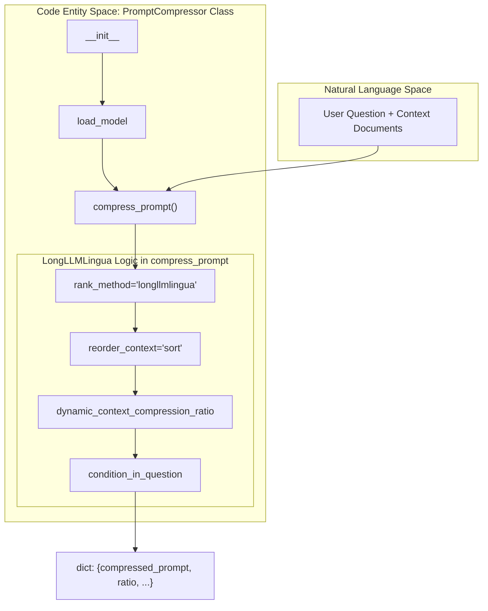
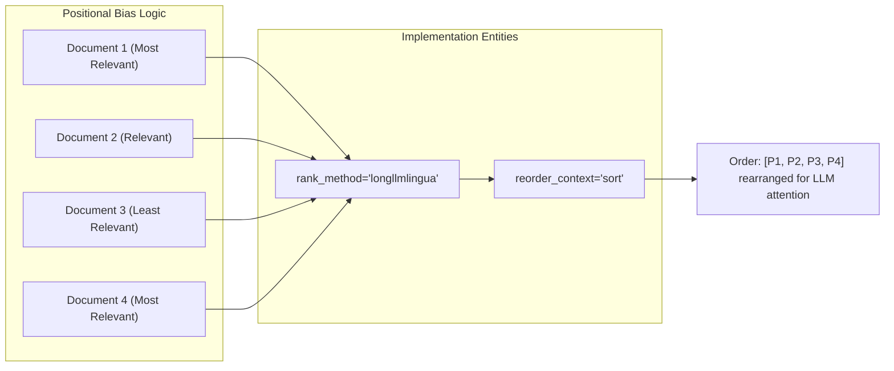

<!-- source: DeepWiki mcp.deepwiki.com · repo microsoft/LLMLingua · page 3.2 LongLLMLingua · fetched 2026-10-26 -->

# LongLLMLingua

<details>
<summary>Relevant source files</summary>

The following files were used as context for generating this wiki page:

- [DOCUMENT.md](DOCUMENT.md)
- [README.md](README.md)
- [llmlingua/prompt_compressor.py](llmlingua/prompt_compressor.py)
- [tests/test_llmlingua.py](tests/test_llmlingua.py)
- [tests/test_llmlingua2.py](tests/test_llmlingua2.py)
- [tests/test_longllmlingua.py](tests/test_longllmlingua.py)

</details>


## Purpose and Scope

LongLLMLingua is an enhanced version of the LLMLingua prompt compression system specifically designed to address the "lost in the middle" issue in long-context scenarios. It improves information delivery in large language models (LLMs) by employing document reordering techniques, dynamic context compression, and question-aware processing. This approach improves RAG performance by up to 21.4% using only 1/4 of the original tokens.

This page details the architectural components, implementation, and usage of LongLLMLingua.

Sources: [README.md:41-44](), [llmlingua/prompt_compressor.py:41-44]()

## The "Lost in the Middle" Problem

LLMs often struggle with information processing in the middle sections of long contexts. The problem manifests in two key ways:
1. **Cost and Latency**: Increased token usage leads to higher API costs and generation latency.
2. **Performance Degradation**: Decreased information density in middle sections causes LLMs to ignore relevant information, leading to incorrect or incomplete responses.

LongLLMLingua addresses these by strategically reallocating the token budget and reordering information to leverage the "primacy" and "recency" biases of LLMs.

Sources: [README.md:41-44](), [README.md:72-77]()

## Architecture and Data Flow

LongLLMLingua introduces a coarse-to-fine compression pipeline that integrates question-aware relevance scoring and document reordering.

### Natural Language to Code Entity Mapping

The following diagram bridges the conceptual "LongLLMLingua" features to the specific implementation within the `PromptCompressor` class.



Sources: [llmlingua/prompt_compressor.py:36-160](), [llmlingua/prompt_compressor.py:181-220]()

### Document Ranking and Reordering

LongLLMLingua strategically reorders documents to place the most critical passages at the beginning and end of the context, where LLMs naturally give more attention.



Sources: [DOCUMENT.md:45-51](), [llmlingua/prompt_compressor.py:181-220]()

## Key Features and Implementation

### Question-Aware Compression
LongLLMLingua uses the user's question to calculate the relevance of context segments. This is enabled by passing the `question` argument to `compress_prompt`. The parameter `condition_in_question` (e.g., `"after_condition"`) determines how the question influences the perplexity calculation.

Sources: [llmlingua/prompt_compressor.py:181-190](), [DOCUMENT.md:45]()

### Dynamic Compression Ratios
Unlike standard LLMLingua which applies a uniform target, LongLLMLingua can use `dynamic_context_compression_ratio`. This allows the system to allocate more tokens to highly relevant segments while aggressively compressing less relevant ones.

Sources: [llmlingua/prompt_compressor.py:200-210](), [DOCUMENT.md:47]()

### Configuration Parameters

| Parameter | Type | Description | File Reference |
| :--- | :--- | :--- | :--- |
| `condition_in_question` | `str` | Position of the question condition: `"before"`, `"after"`, or `"after_condition"`. | [llmlingua/prompt_compressor.py:189]() |
| `reorder_context` | `str` | Set to `"sort"` to enable document reordering based on relevance. | [llmlingua/prompt_compressor.py:202]() |
| `dynamic_context_compression_ratio` | `float` | Threshold for coarse-grained filtering (e.g., `0.3`). | [llmlingua/prompt_compressor.py:204]() |
| `condition_compare` | `bool` | Whether to compare context segments directly against the question. | [llmlingua/prompt_compressor.py:205]() |
| `context_budget` | `str` | Adjusts token allocation for context (e.g., `"+100"`). | [llmlingua/prompt_compressor.py:206]() |
| `rank_method` | `str` | Must be set to `"longllmlingua"` to activate the specialized ranking. | [llmlingua/prompt_compressor.py:207]() |

## Usage Examples

### Basic LongLLMLingua Setup
To use LongLLMLingua, initialize the `PromptCompressor` and pass the specific parameters to the `compress_prompt` method.

```python
from llmlingua import PromptCompressor

llm_lingua = PromptCompressor()
compressed_prompt = llm_lingua.compress_prompt(
    prompt_list, # List of context documents
    question="What is the profit made by Josh?",
    ratio=0.55,
    condition_in_question="after_condition",
    reorder_context="sort",
    dynamic_context_compression_ratio=0.3,
    condition_compare=True,
    context_budget="+100",
    rank_method="longllmlingua",
)
```
Sources: [DOCUMENT.md:37-52](), [tests/test_longllmlingua.py:72-83]()

### Integration with LlamaIndex
LongLLMLingua is commonly used as a post-processor in LlamaIndex RAG pipelines via the `LongLLMLinguaPostprocessor`.

```python
from llama_index.indices.postprocessor import LongLLMLinguaPostprocessor

node_postprocessor = LongLLMLinguaPostprocessor(
    instruction_str="Given the context, please answer the final question",
    target_token=300,
    rank_method="longllmlingua",
    additional_compress_kwargs={
        "condition_compare": True,
        "condition_in_question": "after",
        "context_budget": "+100",
        "reorder_context": "sort",
        "dynamic_context_compression_ratio": 0.3,
    },
)
```
Sources: [README.md:27](), [DOCUMENT.md:34-35]()

## Performance and Evaluation
LongLLMLingua is evaluated using datasets like GSM8K and MeetingBank to ensure it preserves reasoning capabilities while reducing token counts. In tests, it has demonstrated the ability to maintain accuracy even when compressing long prompts by significant margins (e.g., 2365 tokens down to 211 tokens).

Sources: [tests/test_longllmlingua.py:14-23](), [DOCUMENT.md:18-24]()

---

