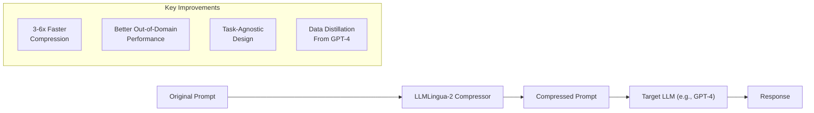
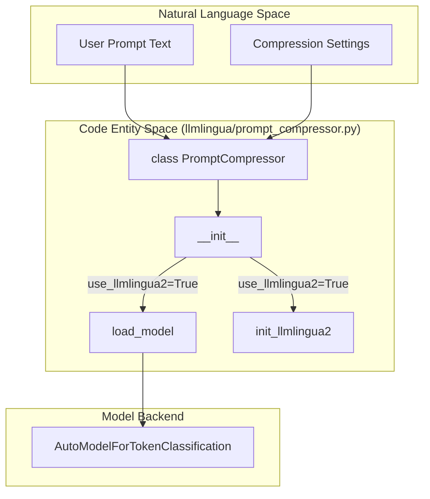
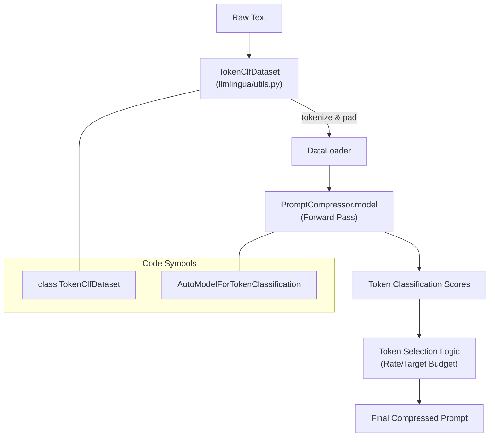

<!-- source: DeepWiki mcp.deepwiki.com · repo microsoft/LLMLingua · page 3.3 LLMLingua-2 · fetched 2026-10-26 -->

# LLMLingua-2

<details>
<summary>Relevant source files</summary>

The following files were used as context for generating this wiki page:

- [README.md](README.md)
- [examples/LLMLingua2.ipynb](examples/LLMLingua2.ipynb)
- [experiments/llmlingua2/data_collection/GPT4_compressor.py](experiments/llmlingua2/data_collection/GPT4_compressor.py)
- [experiments/llmlingua2/data_collection/compress.py](experiments/llmlingua2/data_collection/compress.py)
- [llmlingua/prompt_compressor.py](llmlingua/prompt_compressor.py)
- [llmlingua/utils.py](llmlingua/utils.py)
- [tests/test_llmlingua2.py](tests/test_llmlingua2.py)

</details>


LLMLingua-2 is a small yet powerful prompt compression solution that uses data distillation from GPT-4 for token classification. It surpasses the original LLMLingua in efficiency (3-6x faster) and effectiveness, particularly for out-of-domain tasks, while maintaining the same level of task performance with compressed prompts. This page covers the architecture, usage, and technical details of LLMLingua-2.

## 1. Overview and Key Features

LLMLingua-2 represents a significant advancement in prompt compression technology with these key improvements:

- **Data Distillation Approach**: Uses knowledge distillation from GPT-4 to train a token classification model [README.md:46-49]().
- **Performance Speed**: 3-6x faster than the original LLMLingua [README.md:26-26]().
- **Task-Agnostic Design**: Generalizes well across multiple tasks and domains [examples/LLMLingua2.ipynb:23-25]().
- **Out-of-Domain Handling**: Superior performance on data types not seen during training [examples/LLMLingua2.ipynb:23-25]().
- **Small Model Size**: Utilizes BERT-level encoders rather than full Causal LMs for the compression task [README.md:46-49]().


Sources: [README.md:26-49](), [examples/LLMLingua2.ipynb:23-25]()

## 2. Architecture

LLMLingua-2 employs a token classification approach rather than using perplexity-based filtering. This architectural shift is fundamental to its improved performance.

### 2.1 Code Entity Mapping: PromptCompressor Initialization
The following diagram maps the logical components of the LLMLingua-2 system to the specific code entities in `llmlingua/prompt_compressor.py`.


Sources: [llmlingua/prompt_compressor.py:36-117](), [llmlingua/prompt_compressor.py:131-135]()

### 2.2 Token Classification Model
Unlike the original LLMLingua which uses perplexity scores, LLMLingua-2 takes a supervised learning approach:
- **Model Backbone**: Uses either BERT-base or XLM-RoBERTa-large as the encoder [llmlingua/utils.py:19-41]().
- **Classification**: Each token is classified as important (keep) or unimportant (remove) via `AutoModelForTokenClassification` [llmlingua/prompt_compressor.py:131-135]().
- **Distillation**: Models are trained on data labeled by GPT-4 [experiments/llmlingua2/data_collection/GPT4_compressor.py:12-74]().

### 2.3 Force Token Handling
LLMLingua-2 allows specification of tokens that should always be preserved. The `init_llmlingua2` method handles the setup for these special tokens:
- **Reserved Digits**: Can preserve numeric values using `force_reserve_digit` [examples/LLMLingua2.ipynb:950-953]().
- **Special Formatting**: Punctuation and newlines can be explicitly kept via the `force_tokens` parameter in `compress_prompt` [llmlingua/prompt_compressor.py:98-115]().

Sources: [llmlingua/prompt_compressor.py:95-117](), [llmlingua/utils.py:81-101]()

## 3. Data Flow and Implementation

The data flow from raw text to compressed prompt involves the `TokenClfDataset` and the `PromptCompressor` pipeline.

### 3.1 Data Processing Flow

Sources: [llmlingua/utils.py:13-65](), [llmlingua/prompt_compressor.py:131-161]()

### 3.2 Key Functions and Classes
- **`TokenClfDataset`**: Handles tokenization, padding to `max_len` (default 512), and mask generation for the encoder [llmlingua/utils.py:13-65]().
- **`is_begin_of_new_word`**: A utility function used during reconstruction to identify word boundaries for different model types (BERT vs XLM-RoBERTa) [llmlingua/utils.py:81-101]().
- **`get_pure_token`**: Removes model-specific prefixes like `##` or `▁` from tokens [llmlingua/utils.py:110-120]().

## 4. Usage Guide

### 4.1 Basic Usage
To use LLMLingua-2, initialize the `PromptCompressor` with `use_llmlingua2=True`.

```python
from llmlingua import PromptCompressor

# Initialize with the XLM-RoBERTa model
llm_lingua = PromptCompressor(
    model_name="microsoft/llmlingua-2-xlm-roberta-large-meetingbank",
    use_llmlingua2=True
)

# Compress a prompt
compressed_prompt = llm_lingua.compress_prompt(
    context, 
    rate=0.33, 
    force_tokens=["!", ".", "?", "\n"],
    drop_consecutive=True
)
```
Sources: [llmlingua/prompt_compressor.py:61-63](), [examples/LLMLingua2.ipynb:36-39](), [examples/LLMLingua2.ipynb:183-188]()

### 4.2 Configuration Parameters
The `PromptCompressor` accepts an `llmlingua2_config` dictionary:
- `max_batch_size`: Defaults to 50 [llmlingua/prompt_compressor.py:57-59]().
- `max_force_token`: Max number of tokens to be forcibly preserved (default 100) [llmlingua/prompt_compressor.py:58-59]().

## 5. Training and Distillation (Technical Detail)

LLMLingua-2 is unique because of its data distillation pipeline.

### 5.1 Distillation Pipeline
The process involves three main scripts in the `experiments/llmlingua2/data_collection/` directory:
1. **`GPT4_compressor.py`**: Queries GPT-4 with a specific instruction to compress text while retaining information [experiments/llmlingua2/data_collection/GPT4_compressor.py:12-74]().
2. **`compress.py`**: A wrapper script that manages the batch compression of datasets using the GPT-4 compressor [experiments/llmlingua2/data_collection/compress.py:106-176]().
3. **Labeling**: Tokens are labeled based on whether they appear in the GPT-4 compressed output, creating a binary classification task for the smaller encoder.

Sources: [experiments/llmlingua2/data_collection/GPT4_compressor.py:12-74](), [experiments/llmlingua2/data_collection/compress.py:106-176]()

### 5.2 Model Variants
| Model Name | Backbone | Characteristics |
| :--- | :--- | :--- |
| `microsoft/llmlingua-2-xlm-roberta-large-meetingbank` | XLM-RoBERTa-Large | High accuracy, multi-lingual support [llmlingua/utils.py:32-39]() |
| `microsoft/llmlingua-2-bert-base-multilingual-cased-meetingbank` | BERT-Base-Multilingual | Faster, smaller footprint [llmlingua/utils.py:26-31]() |

Sources: [llmlingua/utils.py:26-41](), [examples/LLMLingua2.ipynb:36-39]()

---

