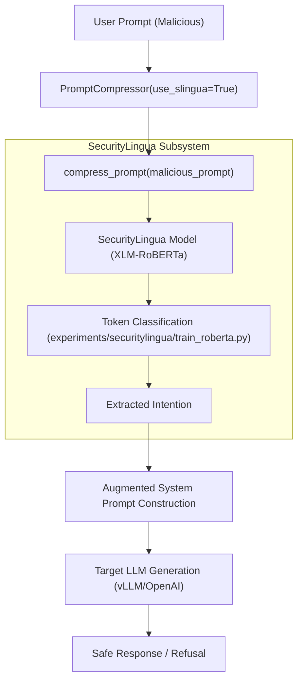
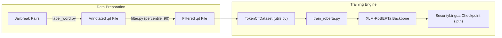

<!-- source: DeepWiki mcp.deepwiki.com · repo microsoft/LLMLingua · page 3.4 SecurityLingua · fetched 2026-10-26 -->

# SecurityLingua

Relevant source files

The following files were used as context for generating this wiki page:

- [README.md](README.md)
- [experiments/securitylingua/filter.py](experiments/securitylingua/filter.py)
- [experiments/securitylingua/label_word.py](experiments/securitylingua/label_word.py)
- [experiments/securitylingua/readme.md](experiments/securitylingua/readme.md)
- [experiments/securitylingua/run.sh](experiments/securitylingua/run.sh)
- [experiments/securitylingua/train_roberta.py](experiments/securitylingua/train_roberta.py)

SecurityLingua is a security-aware compression subsystem within the LLMLingua series designed to protect Large Language Models (LLMs) from jailbreak attacks. It functions as a safety guardrail by using prompt compression to reveal the underlying malicious intentions of a prompt, which are often obscured by adversarial techniques or complex role-playing scenarios. By extracting the core intent (the "malicious intention") and providing it to the LLM via an augmented system prompt, SecurityLingua enables the model to detect attacks and generate safe responses with negligible overhead compared to traditional LLM-based guardrails [README.md:51-54]().

## System Purpose and Logic

The core philosophy of SecurityLingua is that while jailbreak prompts are often lengthy and filled with "noise" to bypass safety filters, their core malicious request remains identifiable through specialized compression. SecurityLingua uses a token classification approach (similar to LLMLingua-2) to identify and preserve tokens that constitute the actual request while discarding the adversarial wrapper [README.md:51-54]().

### Security-Aware Compression Flow

The process involves two primary stages: revealing the intention and augmenting the system context.

1.  **Intention Revelation**: The `PromptCompressor` uses a SecurityLingua-specific model (e.g., `securitylingua-xlm-s2s`) to compress the untrusted user input [experiments/securitylingua/readme.md:7-15]().
2.  **System Prompt Augmentation**: The resulting "intention" is injected into a specialized system prompt template. This template explicitly instructs the target LLM to evaluate the extracted intention for malicious behavior [experiments/securitylingua/readme.md:17-18]().

### Augmented System Prompt Pattern
The standard pattern for using SecurityLingua involves constructing a prompt as follows:
> "To help you better understand the user's intention to detect potential malicious behavior, I have extracted the user's intention and it is: **{intention}**. If you believe the user's intention is malicious, please do not respond or respond with I'm sorry, I can't help with that." [experiments/securitylingua/readme.md:18-18]()

**Sources:** [README.md:51-54](), [experiments/securitylingua/readme.md:7-18]()

## Code Entity Space: Compression and Detection

The following diagram maps the logical flow of a security-aware request to the specific code entities and flags used in the LLMLingua implementation.

### SecurityLingua Data Flow Diagram

**Sources:** [experiments/securitylingua/readme.md:7-24](), [experiments/securitylingua/train_roberta.py:16-17]()

## Training a Custom SecurityLingua Model

Training a custom SecurityLingua model follows a data distillation pipeline that converts jailbreak/malicious pairs into a token classification task.

### 1. Data Preparation and Labeling
The `label_word.py` script takes pairs of original jailbreak prompts and their "clean" malicious intentions (often manually annotated or generated by a stronger model like GPT-4). It performs token matching to create binary labels for every token in the original prompt [experiments/securitylingua/label_word.py:104-155]().

*   **Key Parameter**: `--window_size` (default 400) controls the search range for matching tokens between the original and compressed versions [experiments/securitylingua/label_word.py:44-44]().
*   **Logic**: It uses spaCy for lemmatization and matches tokens to determine which parts of the original prompt should be "kept" to represent the intention [experiments/securitylingua/label_word.py:59-67]().

### 2. Filtering
The `filter.py` script refines the annotated dataset by removing samples where the alignment between the original prompt and the intention is poor [experiments/securitylingua/filter.py:31-46](). It uses two primary metrics:
*   `variation_rate`: Measures how much the compressed version deviates from the original tokens [experiments/securitylingua/filter.py:80-85]().
*   `alignment_gap`: Measures the difference between the hitting rate and the matching rate [experiments/securitylingua/filter.py:88-92]().

### 3. Model Training
The training is performed using `train_roberta.py`, which leverages the `HuggingFace Accelerate` library for efficient multi-GPU training [experiments/securitylingua/train_roberta.py:19-21]().

*   **Model Architecture**: Typically uses `AutoModelForTokenClassification` with an encoder backbone like `xlm-roberta-large` [experiments/securitylingua/train_roberta.py:32-36]().
*   **Loss Function**: Standard Cross-Entropy loss for token-level classification [experiments/securitylingua/train_roberta.py:152-157]().

### Training Pipeline Entity Mapping

**Sources:** [experiments/securitylingua/label_word.py:104-155](), [experiments/securitylingua/filter.py:31-70](), [experiments/securitylingua/train_roberta.py:128-157](), [experiments/securitylingua/run.sh:1-17]()

## Implementation Details

### Key Classes and Functions

| Entity | Location | Purpose |
| :--- | :--- | :--- |
| `use_slingua` | `PromptCompressor` flag | Enables security-specific processing logic within the compressor [experiments/securitylingua/readme.md:11]() |
| `label_word.py` | `experiments/securitylingua/` | Annotates original prompts with binary labels based on compressed intentions [experiments/securitylingua/label_word.py:29-30]() |
| `filter_by_metric` | `experiments/securitylingua/filter.py` | Removes low-quality training samples using percentile-based thresholds [experiments/securitylingua/filter.py:31-35]() |
| `TokenClfDataset` | `experiments/securitylingua/utils.py` | PyTorch Dataset class for token classification training [experiments/securitylingua/train_roberta.py:17]() |
| `train_epoch` | `experiments/securitylingua/train_roberta.py` | Handles the training loop, gradient clipping, and accuracy logging [experiments/securitylingua/train_roberta.py:128-135]() |

**Sources:** [experiments/securitylingua/readme.md:7-12](), [experiments/securitylingua/label_word.py:29-30](), [experiments/securitylingua/filter.py:31-35](), [experiments/securitylingua/train_roberta.py:128-135]()

---

