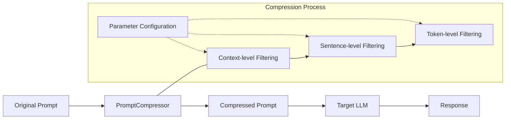
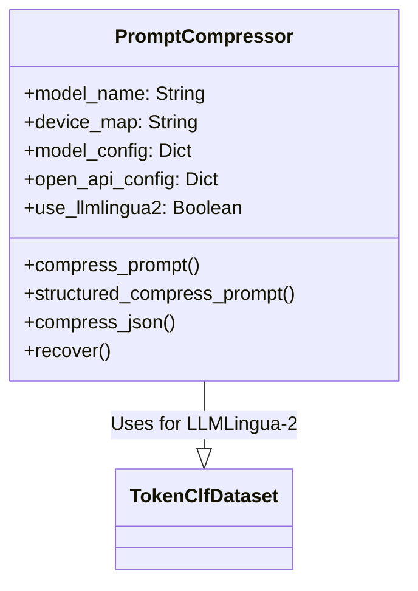
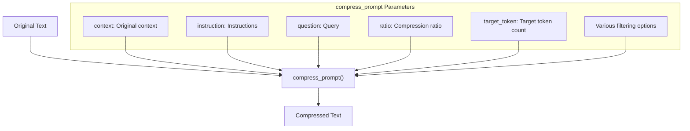
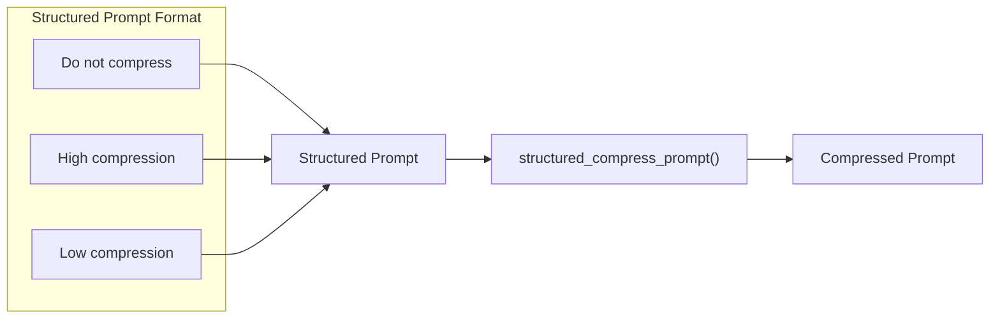
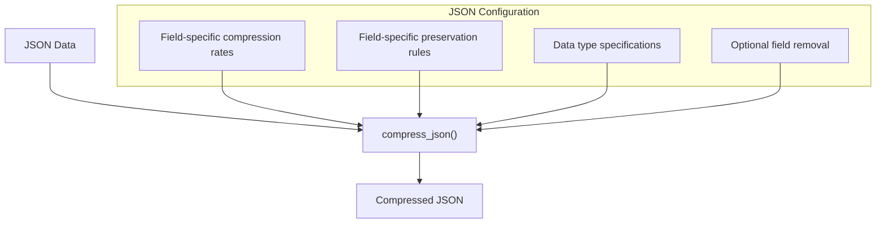

<!-- source: DeepWiki mcp.deepwiki.com · repo microsoft/LLMLingua · page 4 Usage Guide · fetched 2026-10-26 -->

# Usage Guide

<details>
<summary>Relevant source files</summary>

The following files were used as context for generating this wiki page:

- [DOCUMENT.md](DOCUMENT.md)
- [README.md](README.md)
- [setup.py](setup.py)

</details>


This guide provides comprehensive instructions for using the LLMLingua library to compress prompts for large language models (LLMs). The LLMLingua series offers efficient prompt compression techniques to reduce token usage while preserving essential information. For installation details, see [Installation](#4.1), for specific compression approaches see [Basic Usage](#4.2), [Structured Prompt Compression](#4.3), and [JSON Compression](#4.4).

## Workflow Overview

The following diagram illustrates the typical workflow when using LLMLingua:



Sources: [README.md:34-66](), [DOCUMENT.md:3-9]()

## Initializing the PromptCompressor

The main entry point for using LLMLingua is the `PromptCompressor` class. You can initialize it with different configurations depending on your needs:



Sources: [README.md:138-145](), [DOCUMENT.md:260-284](), [llmlingua/prompt_compressor.py:16-118]()

### Basic Initialization

```python
from llmlingua import PromptCompressor

# Default initialization with Llama-2-7b
llm_lingua = PromptCompressor()

# With Phi-2 (smaller model)
llm_lingua = PromptCompressor("microsoft/phi-2")

# With quantized model (requires less GPU memory)
# (Requires: pip install optimum auto-gptq)
llm_lingua = PromptCompressor("TheBloke/Llama-2-7b-Chat-GPTQ", 
                             model_config={"revision": "main"})
```

Sources: [README.md:138-168](), [DOCUMENT.md:10-32]()

### Initializing LLMLingua-2

```python
# LLMLingua-2 (larger model)
llm_lingua = PromptCompressor(
    model_name="microsoft/llmlingua-2-xlm-roberta-large-meetingbank",
    use_llmlingua2=True
)

# LLMLingua-2 (smaller model)
llm_lingua = PromptCompressor(
    model_name="microsoft/llmlingua-2-bert-base-multilingual-cased-meetingbank",
    use_llmlingua2=True
)
```

Sources: [README.md:190-206](), [DOCUMENT.md:54-70]()

## Basic Prompt Compression

The core functionality of LLMLingua is provided through the `compress_prompt()` method:



Sources: [README.md:146-168](), [DOCUMENT.md:10-32](), [llmlingua/prompt_compressor.py:148-180]()

### Simple Compression Example

```python
# Compression with target token count
compressed_prompt = llm_lingua.compress_prompt(
    prompt,            # Text to compress
    instruction="",    # Optional instruction section
    question="",       # Optional question section
    target_token=200   # Target token count after compression
)

# Compression with ratio
compressed_prompt = llm_lingua.compress_prompt(
    prompt,
    ratio=0.5         # Compress to approximately 50% of original size
)
```

The result is a dictionary containing:
- `compressed_prompt`: The compressed text
- `origin_tokens`: Number of tokens in original prompt
- `compressed_tokens`: Number of tokens in compressed prompt
- `ratio`: Compression ratio achieved (e.g., "11.2x")
- `saving`: Estimated cost savings

Sources: [README.md:146-161](), [DOCUMENT.md:10-32](), [llmlingua/prompt_compressor.py:381-413]()

## Using LongLLMLingua

LongLLMLingua enhances the base functionality with features designed for long context scenarios:

```python
# LongLLMLingua with enhanced parameters
compressed_prompt = llm_lingua.compress_prompt(
    prompt_list,                           # List of contexts/documents
    question=question,                     # Query question
    ratio=0.55,                             # Compression rate
    # LongLLMLingua-specific parameters
    condition_in_question="after_condition",  # Question-aware processing
    reorder_context="sort",                # Document reordering
    dynamic_context_compression_ratio=0.3, # Dynamic compression
    condition_compare=True,                # Question-aware fine-tuning
    context_budget="+100",                 # Context token budget
    rank_method="longllmlingua",           # Ranking method
)
```

Sources: [README.md:170-188](), [DOCUMENT.md:34-52]()

## Using LLMLingua-2

LLMLingua-2 provides faster compression through distilled models:

```python
# Initialize with LLMLingua-2
llm_lingua = PromptCompressor(
    model_name="microsoft/llmlingua-2-xlm-roberta-large-meetingbank",
    use_llmlingua2=True,
)

# Compress with force tokens (preserves specific tokens)
compressed_prompt = llm_lingua.compress_prompt(
    prompt, 
    rate=0.33, 
    force_tokens=['\n', '?']  # Always keep newlines and question marks
)
```

Sources: [README.md:190-206](), [DOCUMENT.md:54-70]()

## Structured Prompt Compression

For more granular control over compression rates across different sections of text, you can use structured prompt compression with XML-like tags:



Sources: [README.md:208-222](), [DOCUMENT.md:104-118]()

### Structured Compression Example

```python
structured_prompt = """<llmlingua, compress=False>Speaker 4:</llmlingua>
<llmlingua, rate=0.4>Thank you. And can we do the functions for content?
Items I believe are 11, three, 14, 16 and 28, I believe.</llmlingua>
<llmlingua, compress=False>Speaker 0:</llmlingua>
<llmlingua, rate=0.6>Item 11 is a communication from Council...</llmlingua>"""

compressed_prompt = llm_lingua.structured_compress_prompt(
    structured_prompt, 
    instruction="", 
    question="", 
    rate=0.5  # Default rate for sections without explicit rate
)
```

Sources: [README.md:208-222](), [DOCUMENT.md:104-118](), [llmlingua/prompt_compressor.py:415-468]()

## JSON Compression

LLMLingua provides specialized capabilities for compressing JSON data while preserving structure:



Sources: [DOCUMENT.md:120-160](), [llmlingua/prompt_compressor.py:470-517]()

### JSON Compression Example

```python
json_data = {
    "id": 987654,
    "name": "John Doe",
    "skills": ["Java", "Python", "Machine Learning"],
    "biography": "John Doe, born in New York in 1985, is a renowned software engineer..."
}

json_config = {
    "id": {
        "rate": 1,         # No compression
        "compress": False,
        "value_type": "int",
        "pair_remove": True  # Can remove this field if needed
    },
    "name": {
        "rate": 0.7,       # Light compression
        "compress": False,
        "value_type": "str",
        "pair_remove": False  # Never remove this field
    },
    # Configuration for other fields...
}

compressed_json = llm_lingua.compress_json(
    json_data, 
    json_config,
    use_keyvalue_level_filter=True
)
```

Sources: [DOCUMENT.md:122-160](), [llmlingua/prompt_compressor.py:470-517]()

## Framework Integrations

### LangChain Integration

```python
from langchain.retrievers import ContextualCompressionRetriever
from langchain_community.retrievers.document_compressors import LLMLinguaCompressor
from langchain_openai import ChatOpenAI

compressor = LLMLinguaCompressor(
    model_name="openai-community/gpt2", 
    device_map="cpu"
)

compression_retriever = ContextualCompressionRetriever(
    base_compressor=compressor,
    base_retriever=retriever
)

compressed_docs = compression_retriever.get_relevant_documents(
    "What did the president say about Ketanji Jackson Brown"
)
```

Sources: [README.md:27](), [DOCUMENT.md:162-184]()

### LlamaIndex Integration

```python
from llama_index.query_engine import RetrieverQueryEngine
from llama_index.response_synthesizers import CompactAndRefine
from llama_index.indices.postprocessor import LongLLMLinguaPostprocessor

node_postprocessor = LongLLMLinguaPostprocessor(
    instruction_str="Given the context, please answer the final question",
    target_token=300,
    rank_method="longllmlingua",
    additional_compress_kwargs={
        "condition_compare": True,
        "condition_in_question": "after",
        "context_budget": "+100",
        "reorder_context": "sort",
        "dynamic_context_compression_ratio": 0.4,
    },
)
```

Sources: [README.md:27](), [DOCUMENT.md:186-209]()

## Advanced Configuration

LLMLingua offers numerous parameters to fine-tune compression behavior:

| Parameter | Description | Default | Notes |
|-----------|-------------|---------|-------|
| `use_context_level_filter` | Enable context-level filtering | `True` | Best for multi-document scenarios |
| `use_sentence_level_filter` | Enable sentence-level filtering | `False` | More granular than context-level |
| `use_token_level_filter` | Enable token-level filtering | `True` | Most granular compression |
| `force_tokens` | Tokens to always preserve | `[]` | For preserving key characters |
| `force_reserve_digit` | Preserve all digit tokens | `False` | Useful for numeric precision |
| `keep_first_sentence` | Keep first N sentences of each context | `0` | For preserving introductory content |
| `keep_last_sentence` | Keep last N sentences of each context | `0` | For preserving concluding content |
| `reorder_context` | Document reordering method | `"original"` | Options: `"original"`, `"sort"`, `"two_stage"` |

Sources: [DOCUMENT.md:260-385](), [llmlingua/prompt_compressor.py:148-180]()

### Using Force Tokens

```python
# Preserve specific tokens
compressed_prompt = llm_lingua.compress_prompt(
    prompt,
    force_tokens=['\n', '?', '.', '!'],  # Always keep these tokens
    force_reserve_digit=True             # Always keep digits
)
```

Sources: [DOCUMENT.md:322-327](), [llmlingua/prompt_compressor.py:175-180]()

## Post-Processing

LLMLingua provides a recovery mechanism to help reconstruct responses:

```python
recovered_response = llm_lingua.recover(
    original_prompt=original_prompt,
    compressed_prompt=compressed_prompt,
    response=llm_response
)
```

Sources: [DOCUMENT.md:399-420](), [llmlingua/prompt_compressor.py:519-548]()

## Best Practices

1. **Separate prompt components** - Divide your prompt into instruction, context, and question parts for more effective compression. [DOCUMENT.md:3-9]()

2. **Use appropriate compression levels** - Different text sections have varying sensitivity to compression:
   - Instructions and questions: Less aggressive compression (low `rate`)
   - Background context: More aggressive compression (high `rate`) [DOCUMENT.md:3-9]()

3. **Preserve essential characters** - Use `force_tokens` to ensure critical punctuation, formatting, or symbols are preserved. [DOCUMENT.md:7-9]()

4. **Experiment with parameters** - Optimal compression settings vary by task and domain. [DOCUMENT.md:8-9]()

5. **Choose the right variant**:
   - For basic compression: LLMLingua
   - For long documents: LongLLMLingua
   - For faster processing: LLMLingua-2 [README.md:34-55]()

Sources: [DOCUMENT.md:1-9](), [README.md:34-73]()

---

