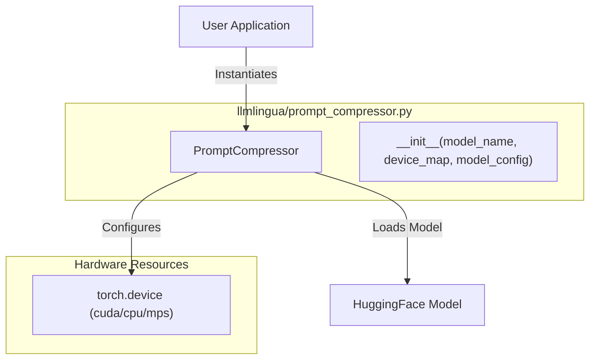
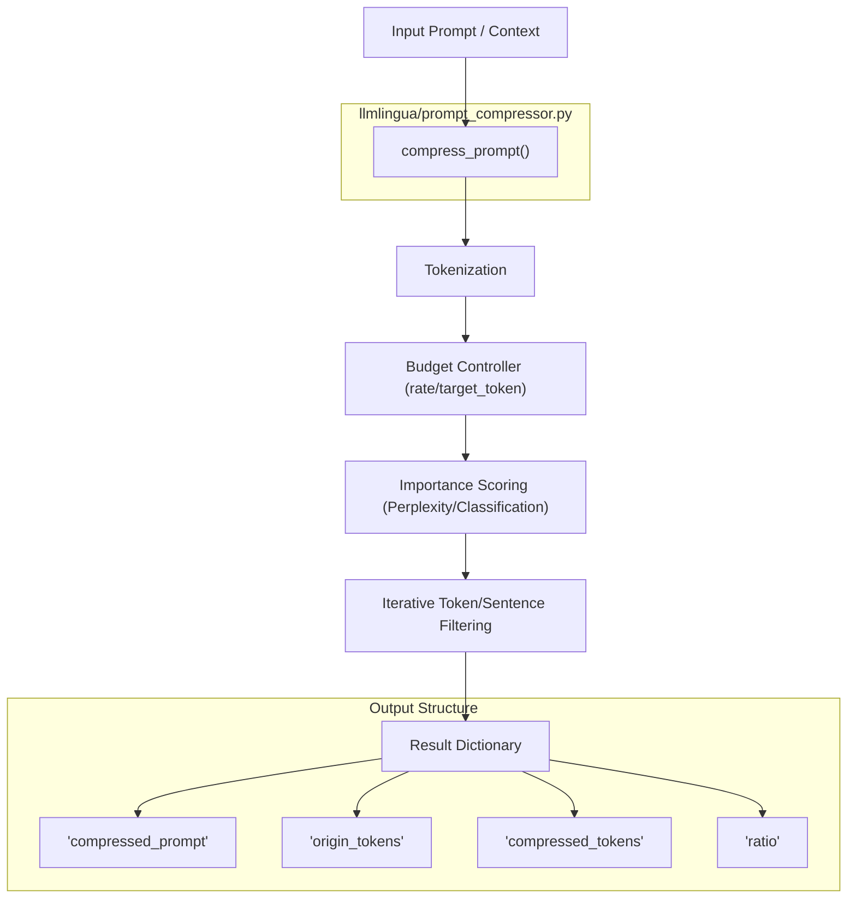

<!-- source: DeepWiki mcp.deepwiki.com · repo microsoft/LLMLingua · page 4.2 Basic Usage · fetched 2026-10-26 -->

# Basic Usage

<details>
<summary>Relevant source files</summary>

The following files were used as context for generating this wiki page:

- [DOCUMENT.md](DOCUMENT.md)
- [README.md](README.md)
- [tests/test_llmlingua.py](tests/test_llmlingua.py)
- [tests/test_longllmlingua.py](tests/test_longllmlingua.py)

</details>


This page provides a comprehensive guide on getting started with LLMLingua's prompt compression capabilities. It covers the essential operations for compressing prompts using the `PromptCompressor` class, which is the primary interface for interacting with LLMLingua.

## Initializing the PromptCompressor

The first step to using LLMLingua is creating an instance of the `PromptCompressor` class. This class serves as the entry point for all compression operations and handles model loading and device configuration.

### System to Code Entity Mapping: Initialization

Sources: [llmlingua/prompt_compressor.py:16-100](), [DOCUMENT.md:11-32]()

### Basic initialization examples:

```python
from llmlingua import PromptCompressor

# Default initialization (typically Llama-2 or similar depending on version)
llm_lingua = PromptCompressor()

# Using a specific small model for faster compression
llm_lingua = PromptCompressor("microsoft/phi-2")

# Using a quantized model to save VRAM (<8GB GPU memory)
# Requires: pip install optimum auto-gptq
llm_lingua = PromptCompressor(
    "TheBloke/Llama-2-7b-Chat-GPTQ", 
    model_config={"revision": "main"}
)

# Initializing for LLMLingua-2 (Token Classification approach)
llm_lingua = PromptCompressor(
    model_name="microsoft/llmlingua-2-xlm-roberta-large-meetingbank",
    use_llmlingua2=True
)
```
Sources: [DOCUMENT.md:27-32](), [DOCUMENT.md:59-70](), [DOCUMENT.md:98-102]()

## Standard Prompt Compression

The core functionality is accessed through the `compress_prompt()` method. This method accepts a prompt and returns a dictionary containing the compressed text and metadata.

### Data Flow: compress_prompt()

Sources: [llmlingua/prompt_compressor.py:145-200](), [DOCUMENT.md:12-24]()

### Simple usage example:

```python
# Compression using target_token (exact budget)
compressed_result = llm_lingua.compress_prompt(
    prompt, 
    instruction="", 
    question="", 
    target_token=200
)

# Compression using rate (percentage-based budget)
# rate=0.33 means keep roughly 33% of the tokens
compressed_result = llm_lingua.compress_prompt(prompt, rate=0.33)
```

### Interpreting the Output Dictionary
The `compress_prompt` method returns a dictionary with the following keys:

| Key | Type | Description |
|-----|------|-------------|
| `compressed_prompt` | `str` | The final compressed text to be sent to the target LLM. |
| `origin_tokens` | `int` | The token count of the original input prompt. |
| `compressed_tokens` | `int` | The token count of the compressed prompt. |
| `ratio` | `str` | The compression ratio achieved (e.g., "11.2x"). |
| `rate` | `float` | The actual compression rate achieved. |
| `saving` | `str` | Estimated cost savings (e.g., in GPT-4). |

Sources: [DOCUMENT.md:20-24](), [tests/test_llmlingua.py:48-52]()

## Prompt Component Separation

For optimal results, LLMLingua recommends separating the prompt into components. Instructions and questions are typically more sensitive to compression than the context (documents).

```python
compressed_result = llm_lingua.compress_prompt(
    context="The detailed document text...",
    instruction="Summarize the following document.",
    question="What are the key findings?",
    ratio=0.5
)
```
This separation allows the internal algorithms to prioritize preserving the semantic meaning of instructions and questions while more aggressively compressing the context.

Sources: [DOCUMENT.md:5-9](), [README.md:152-154]()

## Variant-Specific Usage

### LongLLMLingua (RAG Scenarios)
Designed for long-context scenarios to mitigate the "lost in the middle" issue.

```python
compressed_prompt = llm_lingua.compress_prompt(
    prompt_list, # List of documents
    question=question,
    ratio=0.55,
    condition_in_question="after_condition",
    reorder_context="sort",
    dynamic_context_compression_ratio=0.3,
    rank_method="longllmlingua"
)
```
Sources: [DOCUMENT.md:40-52]()

### LLMLingua-2 (Speed & Task-Agnostic)
Uses a BERT-level encoder for rapid token classification.

```python
# LLMLingua-2 supports force_tokens to ensure critical symbols are never removed
compressed_prompt = llm_lingua.compress_prompt(
    prompt, 
    rate=0.33, 
    force_tokens=['\n', '?']
)
```
Sources: [DOCUMENT.md:63-64](), [README.md:46-49]()

## Key Parameters for `compress_prompt`

| Parameter | Description |
|-----------|-------------|
| `rate` | The percentage of tokens to keep (0.0 to 1.0). |
| `target_token` | The specific number of tokens to aim for in the output. |
| `force_tokens` | (LLMLingua-2) List of specific tokens that must be preserved. |
| `condition_in_question` | (LongLLMLingua) How to incorporate the question into the compression process. |
| `reorder_context` | (LongLLMLingua) Strategy for reordering documents (e.g., "sort"). |

Sources: [DOCUMENT.md:40-51](), [DOCUMENT.md:63-64]()

---

