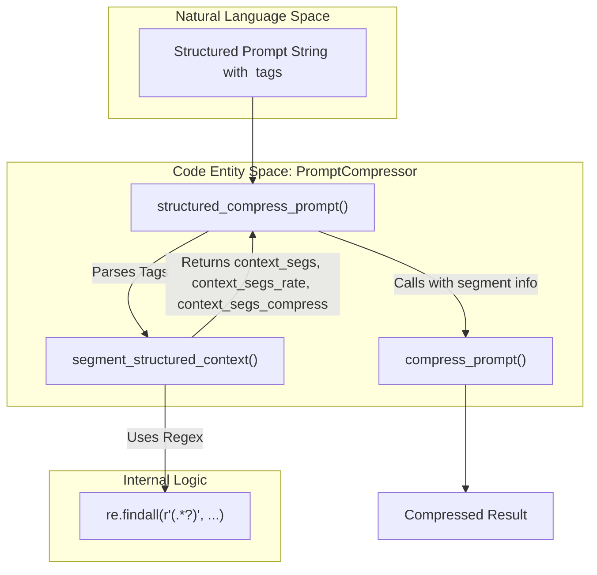
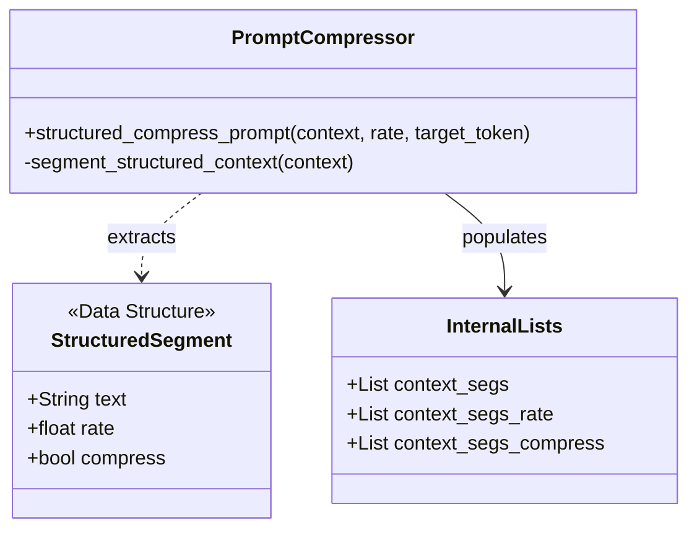

<!-- source: DeepWiki mcp.deepwiki.com · repo microsoft/LLMLingua · page 4.3 Structured Prompt Compression · fetched 2026-10-26 -->

# Structured Prompt Compression

<details>
<summary>Relevant source files</summary>

The following files were used as context for generating this wiki page:

- [DOCUMENT.md](DOCUMENT.md)
- [llmlingua/prompt_compressor.py](llmlingua/prompt_compressor.py)
- [llmlingua/utils.py](llmlingua/utils.py)
- [tests/test_llmlingua.py](tests/test_llmlingua.py)
- [tests/test_llmlingua2.py](tests/test_llmlingua2.py)
- [tests/test_longllmlingua.py](tests/test_longllmlingua.py)

</details>


Structured Prompt Compression is a feature in LLMLingua that provides fine-grained control over the compression process by allowing different segments of a prompt to be compressed at different rates. This approach enables users to preserve critical information in certain parts of the prompt (like speaker names or instructions) while aggressively compressing less important sections.

## Core Concepts

Structured Prompt Compression works by dividing the input text into segments using special XML-like tags. Each segment can have its own compression settings, such as whether to compress the segment at all and what compression rate to apply.

### System Flow: Natural Language to Code Entity Space

The following diagram illustrates how the natural language structured prompt is processed by the internal methods of the `PromptCompressor` class.


Sources: [llmlingua/prompt_compressor.py:272-422](), [DOCUMENT.md:104-118]()

## Tag Syntax and Structure

The syntax for structured prompt compression uses `<llmlingua></llmlingua>` tags to mark text segments and specify compression parameters.

### Tag Attributes

The `<llmlingua>` tag supports the following attributes:

*   **`compress`**: Boolean value (`True`/`False`) that determines whether the segment should be compressed.
*   **`rate`**: Float value between 0 and 1 that specifies the compression rate for the segment.

When `compress=False` is specified, the segment is preserved completely regardless of the `rate` value. When no attributes are specified, the segment inherits the global compression settings.

### Class Association Diagram

This diagram associates the conceptual tag attributes with the internal data structures used in the `PromptCompressor` implementation.


Sources: [llmlingua/prompt_compressor.py:300-307](), [DOCUMENT.md:104-112]()

## Implementation Details

The feature is primarily implemented in `structured_compress_prompt` [llmlingua/prompt_compressor.py:272-422]().

### Data Flow and Token Calculation

1.  **Normalization**: The method accepts either a single string or a list of strings.
2.  **Tag Parsing**: It uses a regex to identify `<llmlingua>` blocks and their parameters.
3.  **Token Budgeting**: It calculates the original token count using the tokenizer (e.g., `self.tokenizer` [llmlingua/prompt_compressor.py:160]()).
4.  **Target Calculation**: If `target_token` is provided, it overrides the global `rate`.
5.  **Execution**: It passes the segmented context and per-segment rates into the standard `compress_prompt` logic.

### Method Parameters

| Parameter | Type | Description |
| :--- | :--- | :--- |
| `context` | `Union[str, List[str]]` | Input containing `<llmlingua>` tags. |
| `rate` | `float` | Default compression rate (0.0 to 1.0). |
| `target_token` | `int` | Target token count (overrides rate). |
| `use_llmlingua2` | `bool` | Whether to use the LLMLingua-2 backend [llmlingua/prompt_compressor.py:82](). |

Sources: [llmlingua/prompt_compressor.py:300-360]()

## Usage Guide

### Basic Example
Wrapping sections to protect them from compression:

```python
from llmlingua import PromptCompressor

llm_lingua = PromptCompressor()

structured_prompt = """<llmlingua, compress=False>Speaker 4:</llmlingua><llmlingua, rate=0.4> Thank you. And can we do the functions for content? Items I believe are 11, three, 14, 16 and 28, I believe.</llmlingua>"""

compressed_result = llm_lingua.structured_compress_prompt(
    structured_prompt, 
    rate=0.5
)
```
Sources: [DOCUMENT.md:104-112]()

### Integration with LLMLingua-2
Structured compression can leverage the `LLMLingua-2` backend by setting the appropriate flag in the `PromptCompressor` constructor [llmlingua/prompt_compressor.py:77-83](). This is particularly useful for preserving "Essential Characters" while maintaining high compression speed [DOCUMENT.md:7]().

## Best Practices

1.  **Speaker Protection**: In transcripts, always wrap speaker labels in `<llmlingua, compress=False>` to maintain dialogue structure [DOCUMENT.md:109-111]().
2.  **Budget Control**: Use `target_token` instead of `rate` if you have a hard limit on the context window of your target LLM [llmlingua/prompt_compressor.py:304]().
3.  **JSON Pre-processing**: For JSON data, use `compress_json` which internally utilizes the structured compression logic by wrapping keys and values in these tags [llmlingua/utils.py:134-151]().

Sources: [DOCUMENT.md:3-9](), [llmlingua/utils.py:123-151]()

---

