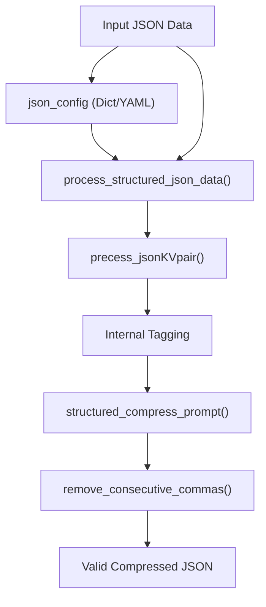
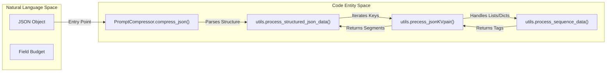

<!-- source: DeepWiki mcp.deepwiki.com · repo microsoft/LLMLingua · page 4.4 JSON Compression · fetched 2026-10-26 -->

# JSON Compression

<details>
<summary>Relevant source files</summary>

The following files were used as context for generating this wiki page:

- [DOCUMENT.md](DOCUMENT.md)
- [llmlingua/prompt_compressor.py](llmlingua/prompt_compressor.py)
- [llmlingua/utils.py](llmlingua/utils.py)
- [tests/test_llmlingua2.py](tests/test_llmlingua2.py)

</details>


## Purpose and Scope

This page documents the JSON compression feature in the LLMLingua library, which enables users to compress structured JSON data while preserving its semantic and syntactic structure. Unlike generic text compression, JSON compression applies different compression rates to specific fields within a JSON object based on a user-defined schema. This allows fine-grained control over information density—preserving critical identifiers while aggressively compressing descriptive text.

Sources: [llmlingua/prompt_compressor.py:213-270](), [llmlingua/utils.py:123-151]()

## Overview

The JSON compression pipeline transforms a standard JSON object into a tagged intermediate format that the `PromptCompressor` can process. It ensures that JSON syntax (brackets, colons, commas) is protected while the values associated with keys are compressed according to specific budgets.

### Compression Pipeline Flow



Sources: [llmlingua/prompt_compressor.py:213-270](), [llmlingua/utils.py:123-151](), [llmlingua/utils.py:237-240]()

## Configuration Schema (`json_config`)

The `json_config` defines how each key in the JSON object should be treated. It can be passed as a dictionary or a path to a YAML file [llmlingua/utils.py:124-126]().

| Parameter | Type | Description |
|-----------|------|-------------|
| `rate` | float | Target compression ratio for the value (e.g., 0.5 for 50%). |
| `compress` | bool | If `False`, the value is preserved exactly as is. |
| `value_type` | str | The data type (`str`, `int`, `float`, `bool`, `list`, `dict`). |
| `pair_remove` | bool | If `True`, the entire key-value pair can be dropped if the budget is tight. |

Sources: [llmlingua/utils.py:137-143](), [DOCUMENT.md:122-123]()

## Core Entities and Implementation

The implementation bridges high-level JSON structures with the underlying token-filtering engine by wrapping values in XML-like tags that specify local compression constraints.

### System Entity Mapping



Sources: [llmlingua/prompt_compressor.py:213-270](), [llmlingua/utils.py:123-234]()

### Data Flow Details

1.  **Validation**: `process_structured_json_data` ensures that the keys in the input data match the keys in the provided configuration [llmlingua/utils.py:131-133]().
2.  **Structural Protection**: The function initializes the context with protected JSON brackets: `<llmlingua, compress=False>{</llmlingua>` [llmlingua/utils.py:134]().
3.  **Type-Aware Tagging**: `precess_jsonKVpair` handles type conversion. For example, if `value_type` is "int", it ensures the value is cast to an integer before wrapping it in tags [llmlingua/utils.py:173-181]().
4.  **Sequence Handling**: Lists and nested dictionaries are handled by `process_sequence_data`, which recursively manages brackets and separators [llmlingua/utils.py:217-234]().
5.  **Post-Processing**: After the token-level compressor removes content, `remove_consecutive_commas` is called to fix artifacts like `{"key": , "key2": "val"}` which would break JSON validity [llmlingua/utils.py:237-240]().

## Usage Example

```python
from llmlingua import PromptCompressor

llm_lingua = PromptCompressor()

json_data = {
    "status": "success",
    "description": "The system encountered a minor error during the background sync process but recovered successfully."
}

json_config = {
    "status": {
        "rate": 1,
        "compress": False,
        "value_type": "str",
        "pair_remove": False
    },
    "description": {
        "rate": 0.3,
        "compress": True,
        "value_type": "str",
        "pair_remove": True
    }
}

# compress_json internally calls structured_compress_prompt
result = llm_lingua.compress_json(
    json_data=json_data,
    json_config=json_config,
    use_keyvalue_level_filter=True
)
print(result["compressed_prompt"])
```

Sources: [llmlingua/prompt_compressor.py:213-270](), [DOCUMENT.md:125-159]()

## Supported Value Types

The `precess_jsonKVpair` function implements specific logic for the following types:

| Type | Handling Logic |
| :--- | :--- |
| **String** | Wrapped in tags; supports partial token removal [llmlingua/utils.py:161-172](). |
| **Numeric** | Cast to `int` or `float`; wrapped in tags [llmlingua/utils.py:173-181](). |
| **Boolean** | Normalized to lowercase `true`/`false` strings for JSON compatibility [llmlingua/utils.py:182-198](). |
| **List/Dict** | Processed via `process_sequence_data` to maintain structural markers [llmlingua/utils.py:199-208](). |

Sources: [llmlingua/utils.py:154-214]()

## Best Practices for JSON Compression

1.  **Protect Identifiers**: Always set `compress: False` for unique IDs, primary keys, or status codes to prevent the model from hallucinating structural links [DOCUMENT.md:5-9]().
2.  **Filter Level**: Use `use_keyvalue_level_filter=True` in `compress_json` to allow the budget controller to drop entire non-essential fields (`pair_remove: True`) if the token limit is exceeded [llmlingua/prompt_compressor.py:224-233]().
3.  **Validation**: Since compression is token-based, always validate the output of `compressed_prompt` with `json.loads()` if you intend to use it programmatically. LLMLingua attempts to maintain validity via `remove_consecutive_commas`, but aggressive compression can still impact structure [llmlingua/utils.py:237-240]().

Sources: [DOCUMENT.md:120-160](), [llmlingua/prompt_compressor.py:213-270]()

---

